# Where Words Begin and End

Husein Zolkepli Scicom (MSC) Berhad, Malaysia husein.zolkepli@scicom.com.my

## Abstract

Forced aligners locate each word of a known transcript in the audio, and many speech pipelines depend on them. In our own data, a widely used CTC aligner inserts a pause at nearly every word boundary, and we found almost no aligner evaluated on telephone audio. We compare nine aligner configurations against human word boundaries on read, conversational and telephone English. The Montreal Forced Aligner (MFA) is the most precise, while CTC aligners consistently start words late, because most frames inside a word go to the blank token. We then fine-tune Whisper with LoRA to predict each word’s start and end as timestamp tokens, training only on boundaries placed by people: 47 hours in 87 languages. The resulting aligner is more precise than MFA on every English test condition, and than MFA’s own Korean and Dutch models. With FA-Bench’s protocol and code on TIMIT, its word-boundary error is 11.6 ms, against 18.2 ms for the best published system. Two choices matter most on telephone conversations: placing the timestamp slots after the word they time, and training on noisy transcripts, which also makes the aligner nearly insensitive to errors in the transcript. The released model reaches 16.0 ms on real landline calls, against 36.5 ms for MFA. The models are available at https://huggingface.co/collections/Scicom-intl/forcealignment.

## 1 Introduction

A forced aligner takes a recording and its transcript and returns where each word starts and ends. Textto-speech corpora are cut at these boundaries, end-of-turn detectors learn from the pauses between them, and subtitles, pronunciation scoring, data filtering and interleaved speech-text pretraining take them as given. In our own stack one aligner supplies all of them: MMS-300M [Pratap et al., 2024] with CTC decoding, run through the defaults of the ctc-forced-aligner package. It sits behind our transcription service’s word timestamps, the Malaysian speech corpora built with it, our end-of-turn labels and the quality gate of our speech synthesis data.

Those defaults are wrong in a way that propagates. Across 32.3 million words of the published Malaysian corpora aligned with them, between 99.95% and 99.99% of word boundaries carry a gap, and 44% to 54% carry one of at least 0.1 s, a pause by any end-of-turn labeller’s standard. Read speech aligned with the Montreal Forced Aligner (MFA) has a gap at 12% to 23% of its boundaries. Checked against a voice activity detector, 85% to 92% of the Malaysian pauses have their midpoint inside speech. The aligner invents a pause between almost every pair of words, and its words are shorter than they sound.

We want a replacement that is precise against human boundaries rather than another aligner, covers the languages of a Malaysian call centre (Malay, English, Mandarin, Tamil, Cantonese, Indonesian) and the switching between them without a pronunciation dictionary per language, and holds up on telephone speech: 8 kHz, codecs, line noise. This report asks what exists, how precise it is and why, and then trains a replacement on boundaries that people placed.

It makes five contributions. First, a way to measure alignment precision on telephone speech that keeps the reference time base: real codec binaries, with each codec’s delay measured and removed (Section 5). MP3 at 8 kHz alone arrives 138.125 ms late, more than the mean error of any pilot aligner on clean read speech (at most 77.5 ms). Second, a pilot benchmark of nine aligner configurations at their defaults against human word boundaries: TIMIT and Buckeye in clean and simulated telephone conditions, and Switchboard conversations recorded over real landlines (Section 6). Third, a measurement of why CTC aligners misplace boundaries, taken on the forced path itself (Section 2.3). Fourth, a survey of aligners and of evaluation data with human boundaries, which locates the gaps (Sections 3 and 4). Fifth, aligners trained only on human word boundaries in 87 languages (Sections 7 and 8). Whisper-Scicom predicting word timestamps beats MFA on every set where MFA has a model, and most of that skill transfers from English alone. The timestamp slots must come after the word they time, telephone augmentation carries over to codecs never seen in training, and neither the adapter configuration nor a finer timestamp vocabulary matters (Section 9 sums up what moved the error). The models trained on the public Whisper checkpoints, large-v3 and large-v3-turbo, are released with a standalone aligner script1.

## 2 Background

## 2.1 How aligners place words

Hidden Markov models. The classic aligner trains Gaussian-mixture HMMs over a pronunciation dictionary and Viterbi-decodes the known word sequence: P2FA, Prosodylab-Aligner, EasyAlign and MAUS on HTK, Gentle and MFA on Kaldi [Yuan and Liberman, 2008, Gorman et al., 2011, Goldman, 2011, Kisler et al., 2017, Ochshorn and Hawkins, 2017, McAuliffe et al., 2017]. Every frame belongs to some phone, so a boundary is a change of state on a 10 ms grid, and a three-state phone lasts at least 30 ms [Rousso et al., 2024]. Independent comparisons keep putting MFA ahead of the neural aligners built on speech recognisers at tight tolerances [Rousso et al., 2024, McAuliffe et al., 2026, Chu et al., 2026, Zeyer et al., 2026]. The price is a dictionary and an acoustic model per language: the MFA model listing has none for Malay or Indonesian [Montreal Corpus Tools, 2024], and run per language over FLEURS it fails on about a fifth of the utterances [Akavarapu et al., 2026]. Gentle is the one widely used open aligner whose acoustic model is natively 8 kHz [Ochshorn and Hawkins, 2017].

CTC. CTC-segmentation aligns text to frame-wise CTC posteriors [Kürzinger et al., 2020]. MMS used the same idea to segment Bible recordings in 1,130 languages, with text romanised by uroman and a <star> token, scored with probability one, to absorb audio the text does not cover (chapter introductions, digits) [Pratap et al., 2024]. Its alignments were judged only through downstream error rates, never against boundaries. torchaudio ships the model and a GPU Viterbi [Hwang et al., 2023]; ctc-forced-aligner wraps the same checkpoint and inserts the star before every word by default [Ashraf, 2024]. The NeMo Forced Aligner runs Viterbi on CTC log-probabilities of NeMo models [Rastorgueva et al., 2023], and WhisperX aligns Whisper’s transcript with a wav2vec2 character CTC model [Bain et al., 2023].

Attention. Whisper’s word timestamps come from dynamic time warping over the cross-attention of a few alignment heads, on its 20 ms encoder grid [Radford et al., 2023]; stable-ts and whispertimestamped wrap the same mechanism [Jian, 2022, Louradour, 2023]. Evaluations of these timestamps have mostly used collars of 200 ms or more [Yeh et al., 2025, Zusag et al., 2024].

Learned boundaries. A third line trains on boundaries directly. Charsiu classifies 10 ms frames into phones trained on MFA alignments, because wav2vec2’s 20 ms frames are too coarse for precise timing [Zhu et al., 2022]; NeuFA, Wav2TextGrid, MAPS and FALCON learn from human boundaries [Li et al., 2022, Kadambi et al., 2025, Kelley et al., 2024, Rousso et al., 2026]; FuseAlign refines word edges on a 1 ms grid, trained on 78k hours of Gentle labels with low-pass augmentation [Vaidya et al., 2026]. The newest are speech LLMs that fill timestamp slots: Qwen3-ForcedAligner-0.6B predicts indices on an 80 ms grid, trained on MFA labels, in 11 languages [Shi et al., 2026, Mu et al., 2026], and Granite-Speech predicts 10 ms frame indices as digit tokens [Kons et al., 2026]. The common recipe in 2025 and 2026 is to distil an HMM teacher into a neural student [Shi et al., 2026, Kons et al., 2026, Wagner et al., 2026, Vaidya et al., 2026].

## 2.2 How precision is measured

Papers disagree on what they score: starts, ends or both, tolerance accuracy at 10 to 100 ms, mean absolute error under three definitions of accumulated average shift, or precision and recall inside a collar [Shi et al., 2023, Rousso et al., 2024, Chu et al., 2026]. We report starts and ends separately and both pooled. What counts as precise is set by people. Four Buckeye transcribers agreed exactly on 43% of word boundaries and placed them 26 ms apart on average; on phones, 79% of their boundaries fell within 20 ms of each other [Raymond et al., 2002]. Three labellers of spontaneous German agreed on 93% of phone boundaries within 20 ms [Kipp et al., 1997]. On in-the-wild English, pairs of annotators placed only 64% of word boundaries within 25 ms of each other [Vaidya et al., 2026]. On telephone speech the only figure we found is from the OGI corpus: labellers agreed within 10 ms on 78% of the boundaries both put in the same broad class [Cole et al., 1994]. An aligner at 80 to 90% of boundaries within 20 to 25 ms on clean speech is at human agreement; beyond that a benchmark measures its annotators.

Telephone speech is unmeasured. We found no aligner, of any family, evaluated against human boundaries on 8 kHz or codec-processed speech. FA-Bench, the broadest benchmark so far, adds noise, music, babble and reverberation [Chu et al., 2026]; WhisperX scores Switchboard, but on its own transcripts with a 200 ms collar [Bain et al., 2023]; the one telephone voice in a 1997 study of synthesis-based alignment kept 48.6% of boundaries within 20 ms [Malfrère and Dutoit, 1997].

## 2.3 Why CTC aligners misplace boundaries

A CTC model emits one of its units or a blank at every frame, and training asks only that the units come out in the right order, not where the sound is. The models learn to fire each character on one frame or two and to give every other frame to the blank [Graves et al., 2006, Zeyer et al., 2021]. A forced aligner then decodes the known character sequence through those emissions, and a word’s start and end are read off its first and last character frame.

Figure 1 shows the result on one clean TIMIT sentence with MMS-300M. The blank posterior sits near one almost everywhere, inside words too, and the character frames on the forced path are thin spikes whose span is shorter than the word a human marked, with gaps where the speech is continuous.

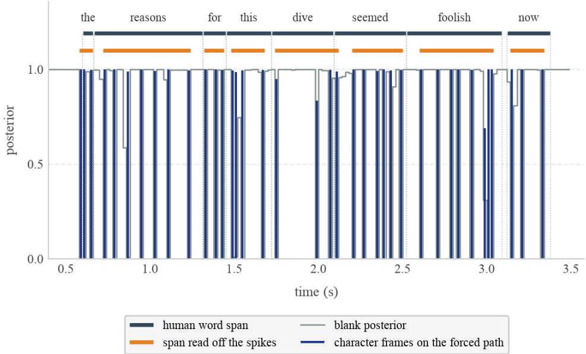  
Figure 1: MMS-300M emissions over one clean TIMIT test sentence (DR1\_AKS0\_SI2203). Dark bars: the human word spans from TIMIT’s phone labels. Orange bars: each word’s span as a decoder reads it off the forced path, from the first character frame to the end of the last. Grey: the blank posterior. Blue: the frames the forced path gives to a character.

Over all 11,025 words of the clean test set, a median 67% of the frames inside a human word are blank on the forced path. The first character frame falls a median 33 ms after the human start (interquartile range 10 to 53 ms), and the last character frame ends a median 26 ms before the human end (Figure 2). Any decoder that reads edges off the spikes inherits these offsets, and decoding tricks move them around without removing them: the model never learned where the word was. Nor do they depend on the channel. Under G.711 the first frame still falls a median 33 ms after the human start, and under GSM 32 ms.

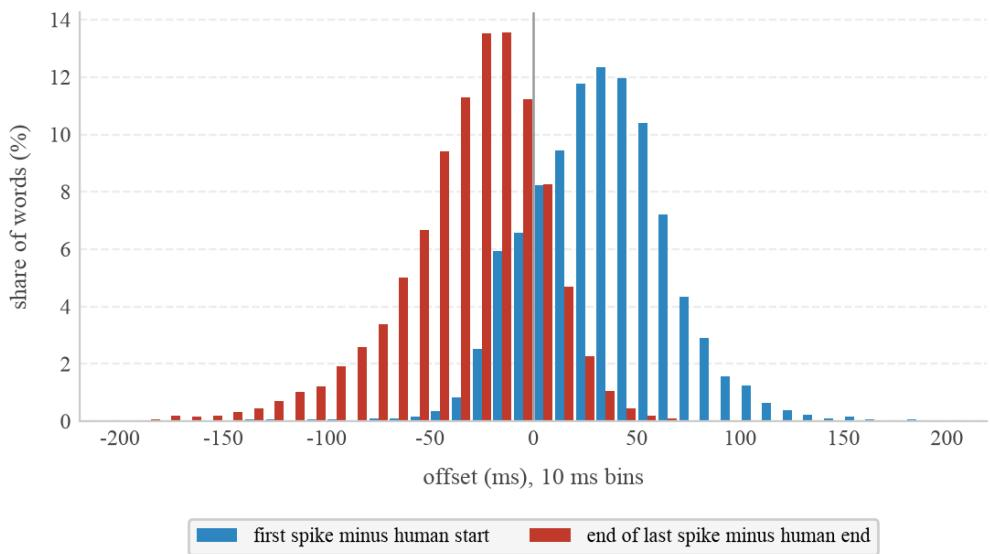  
Figure 2: Where a word’s first and last character frame fall relative to its human start and end, MMS-300M forced paths on clean TIMIT test, 10 ms bins.

The two settings of ctc-forced-aligner that our corpora used make this worse in opposite directions. A <star> wildcard before every word, scored with probability one on every frame, takes every frame it can, so each word keeps only the frames between its first and last spike. The package then pads each word with half of the neighbouring blank and the last word with all of it. Our transcription service ports a different decoder, the torchaudio tutorial’s trellis, with the same star column; both are in the pilot (Section 6).

## 2.4 What a boundary is

A boundary error is only as meaningful as the boundary. TIMIT’s word boundaries come from its hand-labelled phone boundaries, and TIMIT counts the closure of a stop, the silent interval before the burst, as part of the stop. A word that starts with a stop therefore starts at the onset of silence, where nothing in the signal marks it. If late starts concentrated on those words, part of an aligner’s error would be the convention, but they do not. With MMS-300M, words that start with a vowel start a median 33 ms late and words that start with a fricative 41 ms late; words that start with a closure start 54 ms late, and words that start on a burst, a sharp event in the signal, only 6 ms late. The convention adds to the error at closures; the spike timing makes most of it. MFA, whose stop models include the closure, starts the same closure-initial words a median 4 ms late.

## 3 Available aligners

We surveyed 72 systems, open and commercial; Table 1 lists the open aligners that matter here. Breadth is not what is missing: the MMS models cover every target language through romanisation, and so do the tools built on Whisper. Precision in those languages is: no system we found, open or commercial, publishes the timing accuracy of its word boundaries in Malay, Indonesian or Tamil. The aligners that are precise in English either need a dictionary and an acoustic model per language, and MFA has neither for Malay or Indonesian, or stop at a fixed set of languages, eleven for Qwen3- ForcedAligner, none of them Malay, Indonesian or Tamil.

Table 1: Open aligners that matter for this work, from our survey (72 systems reviewed). Grid is the resolution of the output timestamps. The language columns mark whether the system returns timestamps for Malay, Indonesian, English, Mandarin, Cantonese and Tamil (• yes, · no, ? not documented). Lexicon marks systems that need a pronunciation dictionary. None reports an evaluation against human boundaries on telephone speech.
<table><tr><td>aligner</td><td>family</td><td>grid, ms</td><td>lang.</td><td>ms</td><td>id</td><td>en</td><td>zh</td><td>yue</td><td>ta</td><td>lexicon</td></tr><tr><td>Qwen3-ForcedAligner-0.6B</td><td>NAR LLM</td><td>80</td><td>11</td><td></td><td></td><td></td><td></td><td></td><td></td><td>no</td></tr><tr><td>FunASR fa-zh</td><td>NAR LLM</td><td></td><td>1</td><td></td><td></td><td></td><td></td><td></td><td></td><td>no</td></tr><tr><td>torchaudio MMS_FA</td><td>CTC</td><td>20</td><td>1,130</td><td></td><td></td><td></td><td></td><td></td><td></td><td>no</td></tr><tr><td>ctc-forced-aligner</td><td>CTC</td><td>20</td><td>1,130</td><td></td><td></td><td></td><td></td><td></td><td></td><td>no</td></tr><tr><td>MMS-1B-all</td><td>CTC</td><td>20</td><td>1,162</td><td></td><td></td><td></td><td></td><td></td><td></td><td>no</td></tr><tr><td>Omnilingual ASR CTC</td><td>CTC</td><td>20</td><td>1,600</td><td></td><td></td><td></td><td></td><td></td><td></td><td>no</td></tr><tr><td>NeMo Forced Aligner</td><td>CTC</td><td></td><td>一</td><td>?</td><td>?</td><td></td><td>?</td><td>?</td><td>?</td><td>no</td></tr><tr><td>WhisperX</td><td>CTC</td><td>20</td><td>40</td><td></td><td></td><td></td><td></td><td></td><td></td><td>no</td></tr><tr><td>stable-ts</td><td>attention</td><td>20</td><td>99</td><td></td><td></td><td></td><td></td><td></td><td></td><td>no</td></tr><tr><td>MFA 3.x</td><td>HMM</td><td>10</td><td>42</td><td></td><td></td><td></td><td></td><td></td><td></td><td>yes</td></tr><tr><td>Charsiu</td><td>frames</td><td>10</td><td>2</td><td></td><td></td><td></td><td></td><td></td><td></td><td>no</td></tr><tr><td>Malaya-Speech aligners</td><td>CTC</td><td>20</td><td>2</td><td></td><td>?</td><td></td><td></td><td></td><td></td><td>no</td></tr></table>

Figure 3 puts the aligners we ran on one plane: how many languages each returns timestamps for, against how far its word boundaries fall from TIMIT’s human ones. The corner we want, the breadth of the CTC models at the precision of the best HMM aligner, is empty.

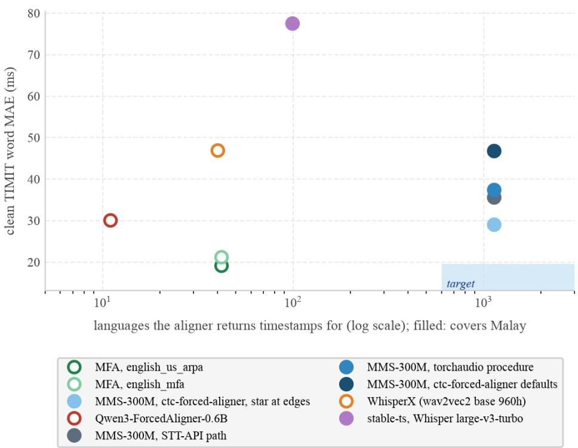  
Figure 3: Precision against breadth. Vertical: mean absolute word-boundary error on clean TIMIT test from our pilot (Section 6). Horizontal: languages for which the aligner returns timestamps, from our survey. Filled markers cover Malay. The MMS decoders share one model and so one horizontal position.

## 4 Evaluation data

Precision can only be claimed against human boundaries, and those are scarce (Table 2). English has TIMIT and Buckeye; AlignBench, a hand-labelled in-the-wild set, has been described but not released [Vaidya et al., 2026]. Mandarin and Tamil have small or read sets behind licence agreements: 300 hand-labelled utterances of Mandarin broadcast news in MCPST, read words and sentences in SSNCE. Cantonese has 126 isolated words in VoxAngeles. Malay and Indonesian have nothing we could find. The test sets behind Qwen3-ForcedAligner’s multilingual numbers are labelled by MFA, apart from one internal Chinese set, and are not released.

Table 2: Evaluation data with human or human-corrected time boundaries, from our survey (38 sets reviewed). Corrected: automatic boundaries corrected by hand; TIMIT’s: the telephone versions of TIMIT carry TIMIT’s own labels; manual, 3x: three annotators. We found no set for Malay or Indonesian.
<table><tr><td>set</td><td>languages</td><td>speech</td><td>channel</td><td>boundaries</td><td>size</td><td>access</td></tr><tr><td>TIMIT</td><td>en</td><td>read</td><td>wideband</td><td>corrected</td><td>5.4 h</td><td>LDC93S1</td></tr><tr><td>Buckeye</td><td>en</td><td>conversation</td><td>wideband</td><td>corrected</td><td>38.1 h</td><td>registration</td></tr><tr><td>AlignBench</td><td>en</td><td>in the wild</td><td>wideband</td><td>manual, 3x</td><td>0.83 h</td><td>not released</td></tr><tr><td>NTIMIT</td><td>en</td><td>read</td><td>landline</td><td>TIMIT&#x27;s</td><td>5 h</td><td>LDC93S2</td></tr><tr><td>STC-TIMIT</td><td>en</td><td>read</td><td>phone line</td><td>TIMIT&#x27;s</td><td>6,300 utt.</td><td>LDC2008S03</td></tr><tr><td>CTIMIT</td><td>en</td><td>read</td><td>cellular</td><td>TIMIT&#x27;s</td><td>3,367 utt.</td><td>LDC96S30</td></tr><tr><td>WTIMIT</td><td>en</td><td>read</td><td>mobile</td><td>TIMIT&#x27;s</td><td>6,300 utt.</td><td>LDC2010S02</td></tr><tr><td>Switchboard ICSI</td><td>en</td><td>conversation</td><td>landline</td><td>manual</td><td>3.75 h</td><td>ISIP mirror</td></tr><tr><td>OGI-MLTS</td><td>11 (zh, ta)</td><td>monologue</td><td>landline</td><td>corrected</td><td>38.5 h</td><td>LDC94S17</td></tr><tr><td>MCPST</td><td>zh</td><td>broadcast</td><td>wideband</td><td>manual (300)</td><td>7,849 utt.</td><td>LDC2015S05</td></tr><tr><td>Global TIMIT</td><td>zh</td><td>read</td><td>wideband</td><td>forced</td><td>5h</td><td>LDC2021S03</td></tr><tr><td>SSNCE</td><td>ta</td><td>read</td><td>wideband</td><td>corrected</td><td>8 h</td><td>LDC2021S04</td></tr><tr><td>VoxAngeles</td><td>95 (yue)</td><td>words</td><td>field</td><td>corrected</td><td>1.5 h</td><td>CC BY-NC</td></tr><tr><td>DoReCo 2.0</td><td>53</td><td>narratives</td><td>field</td><td>corrected</td><td>100 h</td><td>per dataset</td></tr></table>

Telephone speech with human boundaries exists in English: TIMIT replayed through landline, cellular and mobile networks, which keep TIMIT’s labels and need their own registration checked before any tolerance below 20 ms is trusted, and the Switchboard Transcription Project, in which transcribers time-marked the phones, syllables and words of real landline conversations. Of these only the last can be downloaded without a licence agreement, from a public mirror, and we use its first phase in the pilot. OGI-MLTS adds real telephone speech in eleven languages, Mandarin and Tamil among them, but its corrected boundaries are mostly broad phonetic classes.

The Singapore National Speech Corpus has telephone recordings in our region, but its time marks stop at the utterance [Koh et al., 2019]. Training material is not the constraint: transcribed speech in every target language runs to thousands of hours, but its word times come from aligners, and a student trained on them can at best match its teacher.

## 5 Telephone channel

A codec that delays the signal by 20 ms moves every reference boundary by 20 ms, and the aligner takes the blame. We therefore build every telephone condition from the clean recording in five steps: a zero-phase 300 to 3,400 Hz band-pass (no group delay), a linear-phase resample to 8 kHz, a round trip through a real codec binary, a cross-correlation against the band-limited reference that measures the codec’s delay and removes it, and a resample back to 16 kHz, the rate every aligner takes (Table 3).

Table 3: The telephone conditions. Every one starts from the same zero-phase 300 to 3,400 Hz band-pass and an 8 kHz resample, then round-trips the codec binary named. Delay is the codec’s lag measured against the band-limited reference by cross-correlation, the same on all 1,344 utterances; residual is the largest lag left after compensation.
<table><tr><td>condition</td><td>kbit/s</td><td>tool</td><td>delay, ms</td><td>residual, ms</td></tr><tr><td>band-limited only</td><td>128</td><td></td><td>0.000</td><td>0.0</td></tr><tr><td>G.711 µ-law</td><td>64</td><td>ffmpeg</td><td>0.000</td><td>0.0</td></tr><tr><td>G.726 ADPCM</td><td>32</td><td>ffmpeg</td><td>0.000</td><td>0.0</td></tr><tr><td>GSM 06.10 full rate</td><td>13</td><td>SOX</td><td>0.000</td><td>0.0</td></tr><tr><td>Opus (SILK, VoIP mode)</td><td>12</td><td>ffmpeg</td><td>0.125</td><td>0.0</td></tr><tr><td>MP3 (LAME)</td><td>16</td><td>ffmpeg</td><td>138.125</td><td>0.0</td></tr></table>

Most codecs add no delay that survives decoding. MP3 does: at 8 kHz the LAME encoder’s 576 samples and the decoder’s 529 arrive as one constant lag of 138.125 ms on every utterance, which ffmpeg does not trim for this sample rate. Call recordings are commonly archived as low-rate MP3, so the same shift sits in any label derived from such an archive unless someone removes it. After compensation the residual lag is zero on every utterance.

## 6 Pilot benchmark

## 6.1 Setup

Data. TIMIT test without the SA sentences: 1,344 read utterances, 11,025 words with human boundaries, 1.15 hours, from the Hugging Face mirror nh0znoisung/timit. Buckeye [Pitt et al., 2005], conversational interviews: the alexwengg/buckeye benchmark carries the corpus’s handcorrected word times, but its segments run up to 25 s and keep untranscribed interviewer turns between words, so we cut them again at every pause of at least 0.3 s and draw 50 sub-segments per speaker: 1,000 utterances, 11,374 words, 0.85 hours. Switchboard, real landline conversations: the first phase of the ICSI transcription project, in which transcribers time-marked every phone, keeping only utterances whose every segment is one plain word (no merged words, fragments or noises): 932 utterances, 6,828 words, 0.61 hours of native 8 kHz audio. TIMIT runs clean and in the six conditions of Table 3, Buckeye clean and in G.711, GSM and Opus, Switchboard as recorded.

Aligners. Each runs at the defaults its documentation shows, because defaults are what people run, on a shared GPU server (MFA on its CPUs). MFA 3.4.2 [McAuliffe et al., 2017] with its english\_us\_arpa and english\_mfa models. Qwen3-ForcedAligner-0.6B [Shi et al., 2026]. WhisperX [Bain et al., 2023] with its default English model. stable-ts on Whisper large-v3-turbo [Radford et al., 2023], which aligns by dynamic time warping over cross-attention. And four decoders of the same MMS-300M forced-alignment model: the torchaudio procedure (no star token), ctc-forced-aligner at its defaults (a star before every word), the same with a star only at the edges, and the decoder our transcription service runs, ported line for line.

Scoring. Every word contributes its start and its end. We report the mean absolute error over all boundaries (MAE, the quantity Qwen3-ASR calls accumulated average shift), the share of boundaries within 20, 50 and 100 ms, and the median signed error of starts and of ends. Each condition is scored on the utterances every aligner aligned.

## 6.2 Clean speech

Table 4 ranks the aligners on clean TIMIT. MFA with its english\_us\_arpa model is the most precise: 68.2% of word boundaries within 20 ms and a mean error of 19.1 ms, in line with what its authors and FA-Bench report on the same corpus [McAuliffe et al., 2026, Chu et al., 2026]. The best multilingual aligners sit near 30 ms: Qwen3-ForcedAligner at 30.1 ms and the MMS model decoded with the star only at the edges at 29.2 ms. Qwen3-ForcedAligner places only 41.0% of boundaries within 20 ms against MFA’s 68.2%; on an 80 ms grid, closer is out of reach. Whisper’s attention, through stable-ts, is the least precise of all at 77.5 ms, with 20.6% of boundaries within 20 ms.

Table 4: Existing aligners on clean TIMIT test (SI and SX sentences, human word boundaries), each at its defaults. Scored on the 1,344 utterances every aligner aligned. MAE is the mean absolute error over word starts and ends; the tolerance columns give the share of boundaries within 20, 50 and 100 ms; bias is the median signed error of starts and of ends (positive is late). Fail counts utterances the aligner returned no usable alignment for; RTF is compute time over audio time on one shared GPU (MFA: CPU, 16 jobs). MFA, arpa and MFA, mfa: MFA 3.4 with english\_us\_arpa and english\_mfa; MMS: the MMS-300M forced-alignment model decoded by the torchaudio procedure, by ctc-forced-aligner (CFA) at its defaults or with the star only at the edges, or by our transcription service (STT-API); Qwen3-FA: Qwen3-ForcedAligner-0.6B; stable-ts on Whisper large-v3-turbo.
<table><tr><td rowspan="2"></td><td colspan="4">within, %</td><td colspan="2">bias, ms</td><td rowspan="2"></td><td rowspan="2">RTF</td></tr><tr><td>MAE, ms</td><td>20 ms</td><td>50 ms</td><td>100 ms</td><td>start</td><td>end fail</td></tr><tr><td>aligner MFA, arpa</td><td>19.1</td><td>68.2</td><td>91.9</td><td>98.3</td><td>-3</td><td>+2</td><td>0</td><td>0.021</td></tr><tr><td>MFA, mfa</td><td>21.3</td><td>64.5</td><td>90.2</td><td>97.9</td><td>-3</td><td>+2</td><td>0</td><td>0.011</td></tr><tr><td>MMS, CFA edges</td><td>29.2</td><td>45.5</td><td>85.9</td><td>97.1</td><td>+10</td><td>+10</td><td>0</td><td>0.007</td></tr><tr><td>Qwen3-FA</td><td>30.1</td><td>41.0</td><td>84.6</td><td>97.5</td><td>-4</td><td>-2</td><td>0</td><td>0.028</td></tr><tr><td>MMS, STT-API</td><td>35.6</td><td>35.4</td><td>76.4</td><td>96.2</td><td>+30</td><td>-18</td><td>0</td><td>0.044</td></tr><tr><td>MMS, torchaudio</td><td>37.5</td><td>35.0</td><td>71.4</td><td>96.1</td><td>+40</td><td>-18</td><td>0</td><td>0.007</td></tr><tr><td>MMS, CFA default</td><td>46.8</td><td>31.0</td><td>68.5</td><td>91.5</td><td>+34</td><td>-22</td><td>0</td><td>0.007</td></tr><tr><td>WhisperX</td><td>46.9</td><td>29.5</td><td>60.7</td><td>91.1</td><td>+60</td><td>+1</td><td>0</td><td>0.033</td></tr><tr><td>stable-ts</td><td>77.5</td><td>20.6</td><td>47.3</td><td>74.0</td><td>-22</td><td>-51</td><td>0</td><td>0.041</td></tr></table>

The four MMS rows read the same emissions of the same model, yet their errors run from 29.2 to 46.8 ms: the decoder decides as much as the model. The package default, a star before every word, is the worst of the four, and our transcription service’s decoder scores 35.6 ms. The difference sits at the edges of the utterance. With a star before every word, the last word ends a median 135 ms after the human end, against a mean error of 38 ms inside the utterance: the package pads the last word with the whole trailing blank, the failure that ran Malaysian words to the end of the recording. With the star only at the edges, the same package is the most precise MMS decoder inside the utterance, 27 ms against Qwen3-ForcedAligner’s 29, but its errors still gather at the edges: on Switchboard, where clips are short and carry silence at both ends, its last word ends a median 78 ms late. Figure 4 shows the whole error distribution.

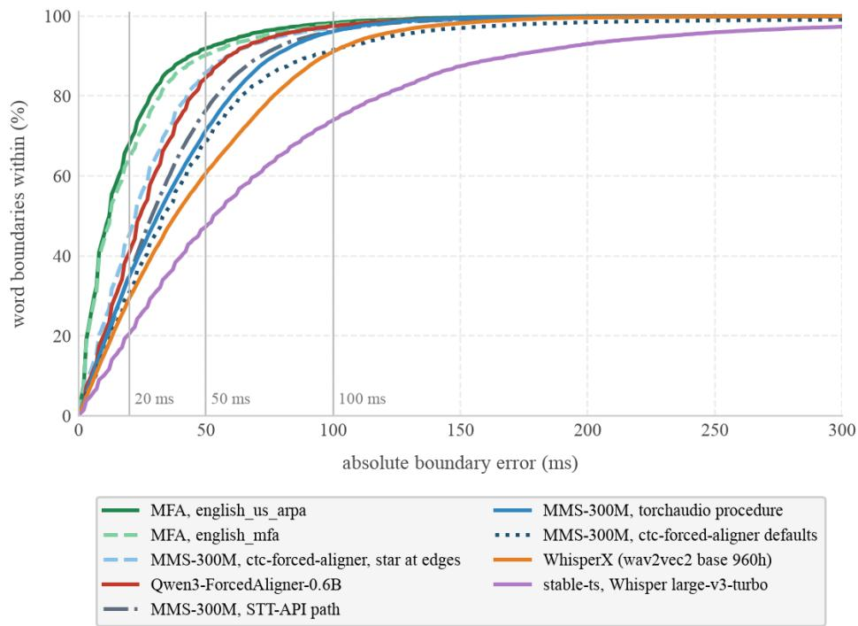  
Figure 4: Share of TIMIT word boundaries within a given error, clean test set, every aligner at its defaults.

The CTC decoders are not just noisy, they are biased (Figure 5). With the torchaudio procedure, words start a median 40 ms late and end 18 ms early, the spike offsets of Section 2.3; WhisperX starts words 60 ms late. stable-ts errs the other way, ending words 51 ms early. MFA and Qwen3-ForcedAligner are within a few milliseconds of zero at both ends. A bias is the one error a later stage can remove, and another reason not to read boundaries off a CTC path unchanged.

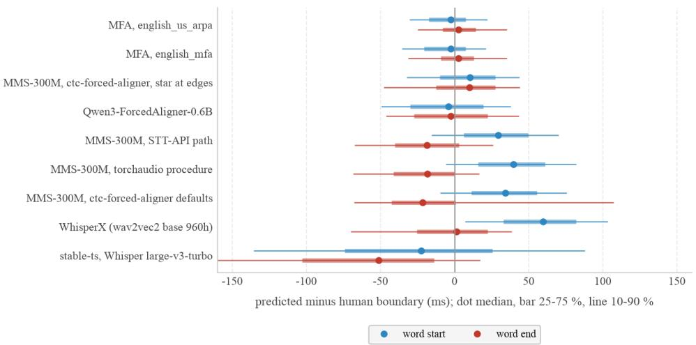  
Figure 5: Signed start and end errors on clean TIMIT: median (dot), interquartile range (thick bar) and 10 to 90% range (thin line). Positive is later than the human boundary.

## 6.3 Telephone speech

Figure 6 follows each aligner through the telephone conditions, and two groups appear. The precise aligners lose to bandwidth alone: band-limiting to 8 kHz costs MFA 5.4 points of boundaries within 50 ms and Qwen3-ForcedAligner 20.6, whose mean error at 8 kHz, 52.7 ms, is worse than all four MMS decoders. The codecs on top cost little more, with two exceptions: MP3 takes Qwen3-ForcedAligner to 64.8 ms, and G.726 takes MFA’s english\_mfa model to 37.2 ms. The CTC aligners barely move: MMS with the torchaudio procedure changes by 0.4 ms of MAE under G.711. Table 5 gives the errors.

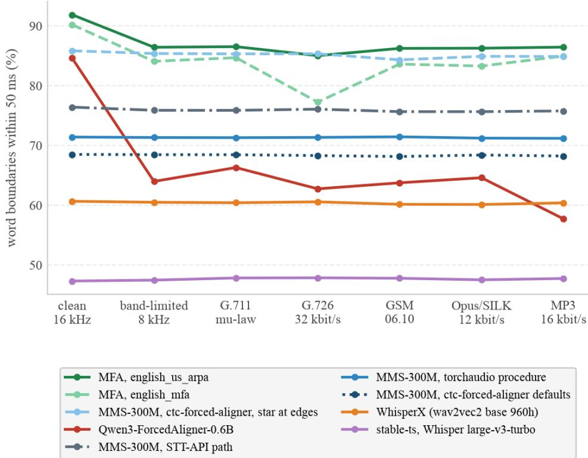  
Figure 6: Share of TIMIT word boundaries within 50 ms in each telephone condition of Table 3.

Table 5: Mean absolute boundary error (ms) on TIMIT test in each telephone condition, scored on the utterances every aligner aligned in that condition. The best aligner per condition is in bold.
<table><tr><td>aligner</td><td>clean</td><td>8kHz</td><td>G.711</td><td>G.726</td><td>GSM</td><td>Opus</td><td>MP3</td></tr><tr><td>MFA, arpa</td><td>19.1</td><td>25.3</td><td>25.3</td><td>26.8</td><td>25.8</td><td>25.5</td><td>25.4</td></tr><tr><td>MFA, mfa</td><td>21.3</td><td>28.1</td><td>27.9</td><td>37.2</td><td>29.5</td><td>29.2</td><td>27.3</td></tr><tr><td>MMS, CFA edges</td><td>29.2</td><td>29.8</td><td>29.8</td><td>29.8</td><td>30.9</td><td>30.2</td><td>30.4</td></tr><tr><td>Qwen3-FA</td><td>30.1</td><td>52.7</td><td>50.1</td><td>54.4</td><td>52.6</td><td>52.3</td><td>64.8</td></tr><tr><td>MMS, STT-API</td><td>35.6</td><td>36.5</td><td>36.4</td><td>36.6</td><td>37.2</td><td>37.1</td><td>36.9</td></tr><tr><td>MMS, torchaudio</td><td>37.5</td><td>37.9</td><td>37.9</td><td>37.9</td><td>38.2</td><td>38.1</td><td>38.1</td></tr><tr><td>MMS, CFA default</td><td>46.8</td><td>47.1</td><td>47.2</td><td>47.3</td><td>48.0</td><td>47.6</td><td>47.6</td></tr><tr><td>WhisperX</td><td>46.9</td><td>47.3</td><td>47.3</td><td>47.3</td><td>47.5</td><td>47.6</td><td>47.3</td></tr><tr><td>stable-ts</td><td>77.5</td><td>78.8</td><td>78.3</td><td>78.1</td><td>77.8</td><td>78.7</td><td>78.2</td></tr></table>

## 6.4 Conversation and real telephone lines

Table 6 adds conversational speech and real telephone lines. On Buckeye the ranking mostly holds (Qwen3-ForcedAligner moves ahead of the MMS decoders), and the package default stops being merely imprecise: on clean Buckeye its own span check rejected 2 utterances, and on another its native aligner crashed the process, though not on every run of the clip. The torchaudio procedure, on the same emissions, never failed. On Switchboard, conversations recorded over real landlines, MFA still places 64.2% of boundaries within 20 ms, but its mean error grows to 36.5 ms: most boundaries stay precise and a few go badly wrong. Figure 7 shows the tail.

Table 6: Mean absolute word-boundary error (ms) on the three human-labelled sets: TIMIT read speech, Buckeye conversation, and Switchboard conversation recorded over real landlines (ICSI transcription project). G.711 columns are the simulated channel of Section 5. The last column is the share of Switchboard boundaries within 20 ms. Best per column in bold.
<table><tr><td>aligner</td><td>TIMIT</td><td>+G.711</td><td>Buckeye</td><td>+G.711</td><td>SWB</td><td>SWB, 20 ms</td></tr><tr><td>MFA, arpa</td><td>19.1</td><td>25.3</td><td>21.0</td><td>26.6</td><td>36.5</td><td>64.2</td></tr><tr><td>MFA, mfa</td><td>21.3</td><td>27.9</td><td>24.4</td><td>29.4</td><td>40.5</td><td>60.6</td></tr><tr><td>MMS, CFA edges</td><td>29.2</td><td>29.8</td><td>37.0</td><td>44.0</td><td>56.4</td><td>39.7</td></tr><tr><td>Qwen3-FA</td><td>30.1</td><td>50.1</td><td>30.9</td><td>42.2</td><td>42.3</td><td>36.9</td></tr><tr><td>MMS, STT-API</td><td>35.6</td><td>36.4</td><td>40.3</td><td>42.4</td><td>46.9</td><td>35.9</td></tr><tr><td>MMS, torchaudio</td><td>37.5</td><td>37.9</td><td>41.4</td><td>43.9</td><td>47.8</td><td>33.8</td></tr><tr><td>MMS, CFA default</td><td>46.8</td><td>47.2</td><td>43.3</td><td>47.1</td><td>71.6</td><td>29.7</td></tr><tr><td>WhisperX</td><td>46.9</td><td>47.3</td><td>50.2</td><td>50.6</td><td>53.7</td><td>28.2</td></tr><tr><td>stable-ts</td><td>77.5</td><td>78.3</td><td>61.3</td><td>61.9</td><td>67.2</td><td>27.6</td></tr></table>

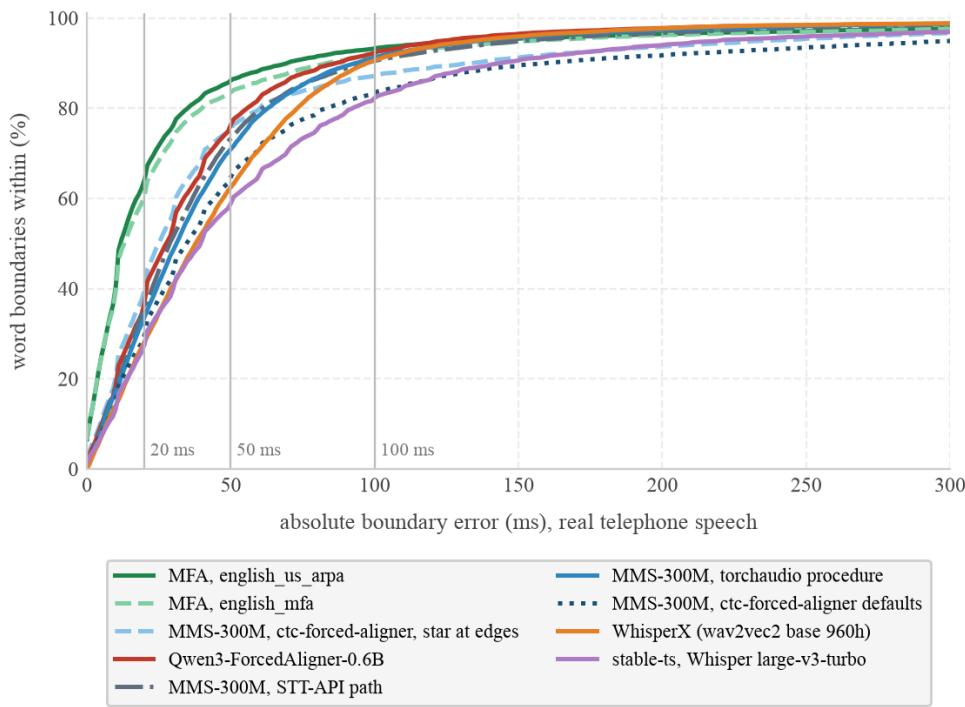  
Figure 7: Share of word boundaries within a given error on Switchboard conversations recorded over real landlines (932 utterances, 6,828 words, hand-marked by the ICSI transcription project).

## 6.5 Speed

Every aligner runs at least 23 times faster than real time on one shared GPU (real-time factors 0.007 to 0.044 in Table 4). Speed will not decide the design; precision will.

## 7 Study design

The bar. MFA with its English ARPA model is the aligner to beat. On clean TIMIT its word boundaries miss by 19.1 ms on average and 12.0 ms at the median, with 68.2% within 20 ms. On the Buckeye speakers held out of training the mean is 21.5 ms, and on Switchboard’s phone lines 36.5 ms (Table 4). A trained aligner counts as a result only if it beats MFA on both the mean error and the share within 20 ms on every English set, clean and through every codec, and beats MFA’s own Korean and Dutch models on held-out speakers of the Seoul Corpus and the IFA corpus.

Three things put MFA ahead, and each becomes an axis. It segments at 10 ms, where Whisper and the CTC models answer on a 20 ms grid. It assigns every frame to a unit, silence included, so a word ends where its sound ends; a CTC aligner ends it where its decoder chose to emit (Section 2.3). And its word edges are the edges of phones. Its weaknesses are as plain: trained on clean wideband speech, it loses 6.2 ms through G.711 where the best CTC aligner loses 0.7, and every language needs its own dictionary and acoustic model.

Two families on one encoder. The study compares two ways of reading boundaries off the same encoder. In the CTC family the encoder emits character posteriors and Viterbi forced alignment reads the path; the head is also trained on a frame target from the human word edges, inside a word or not, so that its edges stop following the spikes. The language-model family starts from Whisper-Scicom, our Whisper large-v3 fine-tuned on our private dataset of human-annotated Malaysian call-centre speech. Its decoder reads the transcript in Whisper’s own timestamp format, at the level of words. Whisper brackets a segment’s text with a timestamp token on each side; here every word gets such a pair, and the pair is two slots the decoder fills:

$$
\begin{array} { r } { \mathbf { \zeta } < | \arctan | > \mathbf { \zeta } | \arctan | > \mathbf { \zeta } < | \arctan | > \mathbf { \zeta } < | \tan | > \mathbf { \zeta } | \mathbf { t r a n s c r i b e } | > \mathbf { \zeta } } \\ { < | \mathbf { s t a r t o f 1 m } | > \mathbf { \zeta } \mathrm { h i s ~ < | \mathbf { s t a r t o f p r e v } | > \mathbf { \zeta } < | \mathbf { s t a r t o r t o f 1 m } | > \mathbf { \zeta } \ c a p t a i n ~ < | \mathbf { s t a r t o f p r e v } | > \mathbf { \zeta } \cdot \mathbf { \sigma } . . . \mathbf { \sigma } } } \\ { < | \mathbf { e n d o f t e x t } | > \mathbf { \zeta } ~ } \end{array}
$$

The slots are two special tokens Whisper already has, <|startoflm|> for a start and <|startofprev|> for an end. They enter as token ids, so the byte-level tokenizer never splits them, and only the words are encoded as text. The decoder runs once over the whole sequence, and its hidden state at each slot is scored against the embeddings of Whisper’s 1,501 timestamp tokens, <|0.00|> to <|30.00|> in 20 ms steps, to which its output layer is tied. That gives every boundary a distribution over time in one pass. Training splits each human boundary between its two neighbouring tokens (1.234 s puts 0.30 on <|1.22|> and 0.70 on <|1.24|>), and decoding takes the expectation within two tokens of the most likely one, so the output is not tied to the grid. No timestamp enters the input and none is fed back, so all words are timed at once and the text cannot change. The times are made monotonic afterwards: a start never precedes the one before it, and an end never its own start. Because the decoder is causal, a word’s start slot is read before the word itself. Two variants test these choices (Section 8.8): the slots after the word instead of around it, and Whisper’s format as Whisper is trained,

## <|startoftranscript|> <|en|> <|transcribe|> <|0.56|> his <|0.76|> <|0.76|> captain <|1.26|> ... <|endoftext|>

with real timestamp tokens rounded to 20 ms, next-token cross-entropy over the whole vocabulary, and the slots filled in order at inference, each the most likely timestamp no earlier than the one before. Both families start from Whisper-Scicom’s encoder and differ in the head alone. A third arm fine-tunes MMS-300M, the model our own stack aligns with today, with a CTC head. Each arm is trained once with LoRA and once in full, at one default each.

Human labels only. Every boundary the models train on was placed or corrected by people (Table 7): TIMIT’s training speakers, Buckeye’s speakers s05 to s20, the second phase of the Switchboard transcription project, the Seoul Corpus of Korean, the IFA corpus of Dutch, and VoxAngeles’ isolated words in 95 languages. That is 47 hours and 420,433 words in 87 languages; DoReCo’s 43 languages with audio join when its audio host answers again. We check a corpus’s claim of correction instead of taking it on trust. A forced aligner puts boundaries on a 10 ms grid and a person rarely does, and the L2-ARCTIC subset documented as hand-aligned keeps 89% of its word boundaries there, so it stays out. No machine alignment enters training, Whisper-Scicom’s included. The pilot’s test sets stay out, and so do held-out speakers of every training corpus and 10 whole languages of VoxAngeles, which measure transfer to a language the model never trained on. Stretches between pauses are short, so consecutive windows of one speaker are also joined into examples of up to 30 s (33 hours): the calls the aligner serves come in 30 s windows.

Table 7: The training data: every word boundary placed or corrected by people. Hours of audio in the windows the models see (at most 30 s); test: held-out speakers or recordings; unseen: whole languages held out; grid: share of word boundaries exactly on a 10 ms grid, where a forced aligner puts them and a person rarely does; NC: non-commercial. The pilot’s English test sets are not in it.
<table><tr><td>corpus</td><td>speech</td><td>channel</td><td>edges</td><td>grid</td><td>lang.</td><td>train h</td><td>words</td><td>test h</td><td>unseen h</td><td>licence</td></tr><tr><td>TIMIT, train</td><td>read</td><td>clean</td><td>corrected</td><td>4%</td><td>1</td><td>2.8</td><td>28,578</td><td>1</td><td></td><td>LDC</td></tr><tr><td>Buckeye, s05–s20</td><td>conversation</td><td>clean</td><td>corrected</td><td>6%</td><td>1</td><td>8.7</td><td>119,438</td><td>1.4</td><td></td><td>NC</td></tr><tr><td>Switchboard, WS97</td><td>conversation</td><td>phone</td><td>manual</td><td>18%</td><td>1</td><td>2.1</td><td>26,231</td><td>一</td><td></td><td>LDC</td></tr><tr><td>Seoul Corpus</td><td>interviews</td><td>clean</td><td>corrected</td><td>0%</td><td>1</td><td>27.1</td><td>197,712</td><td>3.1</td><td></td><td>CC BY-NC</td></tr><tr><td>IFA</td><td>read, stories</td><td>clean</td><td>corrected</td><td>0%</td><td>1</td><td>5.2</td><td>44,616</td><td>0.5</td><td></td><td>GPL-3.0</td></tr><tr><td>VoxAngeles</td><td>single words</td><td>field</td><td>corrected</td><td>24%</td><td>95</td><td>0.9</td><td>3,858</td><td>0.1</td><td>0.1</td><td>CC BY-NC</td></tr><tr><td>L2-ARCTIC, suitcase</td><td>spont., L2</td><td>clean</td><td>reviewed MFA</td><td>89%</td><td>1</td><td>excluded: left on the aligner&#x27;s grid</td><td></td><td></td><td></td><td>CC BY-NC</td></tr><tr><td>total</td><td></td><td></td><td></td><td></td><td>97</td><td>46.7</td><td>420,433</td><td>5.0</td><td>0.1</td><td></td></tr></table>

Adapters. The winning family is swept on the grid of our hallucination study, one factor at a time around a default: LoRA of rank 32 with $\alpha = 2 r$ on the attention and MLP projections of encoder and decoder, at a learning rate of $2 \times 1 0 ^ { - 4 }$ . The variants take rank 8 to 128, the attention projections alone, learning rates of $\overline { { 1 } } 0 ^ { - 4 }$ and $5 \times 1 0 ^ { - 4 }$ , the hallucination study’s $\alpha / r = 0 . 2$ , and two or three times the training. Alignment adds a factor that transcription did not need: adapters on the decoder alone, with the encoder frozen, against adapters on both. Two more seeds of the default measure the spread a factor has to clear. The other family is swept too only if it comes within two points of the winner. Output resolution, phone edges as a second target, and telephone augmentation then follow on the winner (Table 8). For augmentation, AMR-NB and G.723.1 stay out of training, so that the models are also tested on codecs they never heard.

Table 8: The axes of the training ablation, with the stage that runs each. The head is the question the study is built around; the adapter grid follows our hallucination study; resolution, phone edges and telephone augmentation target what puts MFA ahead. Stages 2 to 5, the checkpoint, long recordings, transcript noise and the English-only arm are reported in Section 8.
<table><tr><td>axis</td><td>values</td><td>question</td><td>stage</td></tr><tr><td>head</td><td>CTC over characters with Viterbi, plus a frame target from human word edges; Whisper-Scicom&#x27;s decoder predicting word start and end timestamps;</td><td>which head places boundaries best from the same encoder?</td><td>2</td></tr><tr><td>fine-tuning adapter rank</td><td>MMS-300M with CTC LoRA; full fine-tune LoRA r of 8, 16, 32, 64, 128 with</td><td>is LoRA enough? how much capacity does</td><td>23</td></tr><tr><td></td><td> $\alpha = 2 r$ </td><td>timing need?</td><td></td></tr><tr><td>adapter modules</td><td>attention projections; attention and MLP</td><td>does the MLP matter for timing?</td><td>3</td></tr><tr><td>adapter placement</td><td>decoder only; encoder and decoder</td><td>does the encoder have to move?</td><td>3</td></tr><tr><td>adapter scale</td><td>α/r of 2; 0.2</td><td>does the ratio that protects transcription help?</td><td>3</td></tr><tr><td>learning rate</td><td> $1 0 ^ { - 4 } , 2 \times 1 0 ^ { - 4 } , 5 \times 1 0 ^ { - 4 }$ </td><td>which rate converges without forgetting?</td><td>3</td></tr><tr><td>training length</td><td>1,000, 2,000, 4,000, 6,000 steps of 16 clips; five seeds of the default</td><td>is the default trained long enough, and how noisy is one run?</td><td>3</td></tr><tr><td>output resolution</td><td>the most likely 20 ms timestamp; the expectation within 1, 2 or 5 timestamps of it, or over all; finer timestamps only if the grid binds</td><td>how much of the error is the grid?</td><td>4</td></tr><tr><td>supervision</td><td>word edges; plus an encoder head trained do phone edges sharpen word on word edges, or on word and phone edges (TIMIT, IFA, Seoul, VoxAngeles)</td><td>edges?</td><td>4</td></tr><tr><td>slot order</td><td>start slot before the word (Whisper&#x27;s order); both slots after it; Whisper&#x27;s own layout with real timestamp tokens</td><td>must the decoder see the word before timing it?</td><td>4</td></tr><tr><td>telephone augmentation</td><td>probability 0, 0.25, 0.5, 0.75, 1 over the six conditions of Table 3, with noise; AMR-NB and G.723.1 kept out of</td><td>clean cost against telephone gain, and on unseen codecs</td><td>5</td></tr><tr><td>training languages</td><td>training English sets; all human-labelled sets</td><td>does multilingual human data transfer?</td><td>2,6</td></tr><tr><td>checkpoint</td><td>Whisper-Scicom; Whisper large-v3; large-v3-turbo (4 decoder layers)</td><td>does the call-centre fine-tune matter, and what does a small decoder cost?</td><td>7</td></tr><tr><td>long recordings</td><td>a coarse MMS-300M pass, then chunks of at most 25 s for the 30 s model</td><td>is precision kept on minutes of audio?</td><td>7</td></tr><tr><td>transcript noise</td><td>0 to 20% inserted, deleted or substituted words</td><td>robustness to imperfect transcripts</td><td>7</td></tr></table>

Selection. Among the configurations that clear the bar, the share of boundaries within 20 ms decides, pooled over the human-labelled test sets with clean and telephone conditions weighted equally; the mean error breaks ties. No candidate may lose more than two points between its clean and telephone conditions.

## 8 Trained aligners

We trained both families on the human-labelled set and scored every model through the pilot’s harness, on the pilot’s English sets and on held-out speakers and recordings of the Seoul, IFA and VoxAngeles corpora.

## 8.1 Training

Every run trains 2,000 steps of 16 clips, 0.65 of an epoch over the 49,170 training examples (single windows and joined ones). Each step draws 60% joined examples of up to 30 s. Half of the clips go through one of the six telephone conditions of Table 3, picked at random, with white noise at 10 to 40 dB SNR on half of those; the codec’s delay is removed as in Section 5, so the labels stay valid. LoRA has rank 32 and $\alpha = 6 4$ on the attention and MLP projections of the encoder and the decoder, at a learning rate of $2 \times 1 0 ^ { - 4 }$ , and trains 58 million parameters. The full fine-tunes run at $1 0 ^ { - 5 }$ $( 5 \times 1 0 ^ { - 5 }$ for MMS-300M) on the same 16 clips per step. The CTC runs keep the encoder frozen for their first 200 steps while the new heads warm up. The timestamp model trains on the two-hot targets and decodes with the expectation of Section 7. One clip in ten trains without a language token. Under bf16, the MMS-300M runs diverged until updates with non-finite gradients were skipped.

## 8.2 Two families

Table 9 sets the six runs against the bar. Every one clears it: each beats MFA on both the mean error and the share within 20 ms in all 16 set-conditions that have a bar, every English set clean and through every codec, and Korean and Dutch against MFA’s own models.

Table 9: The two families against the bar (stage 2): mean absolute word-boundary error in ms / share of boundaries within 20 ms in %, each set scored on the utterances every aligner aligned. Codec rows average the six conditions of Table 3 (TIMIT) or G.711, GSM and Opus (Buckeye). The bar is MFA with english\_us\_arpa, and MFA’s own Korean and Dutch models on Seoul and IFA; VoxAngeles has none. CTC, Whisper-Scicom: Whisper-Scicom’s encoder with a CTC head; timestamps: Whisper-Scicom’s decoder predicting word timestamps. Every run trained 2,000 steps of 16 clips on all training languages. Bold: the best run per row on each measure. Every run beats the bar on both measures in all 16 set-conditions that have one.

<table><tr><td></td><td></td><td colspan="2">CTC, MMS-300M</td><td colspan="2">CTC, Whisper-Scicom</td><td colspan="2">timestamps</td></tr><tr><td>set</td><td>MFA bar</td><td>LoRA</td><td>full</td><td>LoRA</td><td>full</td><td>LoRA</td><td>full</td></tr><tr><td>TIMIT</td><td>19.1/68.2</td><td>17.2/74.0</td><td>16.9/74.0</td><td>16.4/76.0</td><td>16.2/76.5</td><td>10.5/89.1</td><td>10.7/88.7</td></tr><tr><td>TIMIT, six codecs</td><td>25.7/62.7</td><td>17.2/73.6</td><td>16.9/74.2</td><td>16.4/75.8</td><td>16.4/75.7</td><td>11.1/88.0</td><td>11.4/87.4</td></tr><tr><td>Buckeye s01-s04</td><td>21.5/70.7</td><td>15.7/77.9</td><td>15.4/77.6</td><td>14.0/80.6</td><td>13.9/80.5</td><td>12.1/85.8</td><td>12.4/85.5</td></tr><tr><td>Buckeye, three codecs</td><td>26.6/64.5</td><td>16.2/76.0</td><td>15.9/77.1</td><td>14.7/78.9</td><td>14.6/79.5</td><td>13.0/84.6</td><td>13.3/84.5</td></tr><tr><td>Switchboard (telephone)</td><td>36.5/64.2</td><td>22.6/74.7</td><td>21.8/75.2</td><td>22.3/78.0</td><td>22.4/78.0</td><td>23.0/80.7</td><td>22.7/80.5</td></tr><tr><td>TIMIT, 20–28 s windows</td><td>19.5/68.1</td><td>17.4/73.7</td><td>16.9/74.2</td><td>15.6/78.1</td><td>15.7/78.3</td><td>10.3/89.5</td><td>10.5/88.9</td></tr><tr><td>Seoul (ko)</td><td>21.3/70.2</td><td>16.2/81.0</td><td>15.6/81.7</td><td>13.5/86.0</td><td>14.0/85.7</td><td>11.3/90.0</td><td>11.4/89.9</td></tr><tr><td>IFA (nl)</td><td>335.4/38.1</td><td>18.6/73.1</td><td>17.8/73.5</td><td>18.1/74.9</td><td>17.4/75.5</td><td>15.3/78.4</td><td>15.1/78.2</td></tr><tr><td>VoxAngeles</td><td></td><td>20.3/67.4</td><td>20.7/66.9</td><td>18.8/73.1</td><td>18.5/73.5</td><td>15.9/80.2</td><td>15.5/80.5</td></tr></table>

The timestamp model is the most precise. It places the most boundaries within 20 ms on every set, 2.7 to 12.6 points ahead of the best CTC run, and it has the lowest mean error everywhere except Switchboard. There the CTC runs lead (MMS-300M fine-tuned in full: 21.8 ms against 23.0), while the timestamp model still places the most boundaries within 20 ms (80.7% against at most 78.0%). On clean TIMIT it nearly halves MFA’s error: 10.5 ms with 89.1% of boundaries within 20 ms, against 19.1 ms and 68.2%. Through the six codecs its mean error rises to 11.1 ms on average, and MFA’s to 25.7.

The head matters more than the encoder. With the same CTC head and recipe, Whisper-Scicom’s encoder places 1.5 to 6.6 points more boundaries within 20 ms than MMS-300M’s, on every set. With the same Whisper-Scicom encoder, predicting timestamps instead of reading a CTC path gains 2.7 to 13.2 points. Full fine-tuning buys nothing: against LoRA it moves no set’s mean error by more than 0.8 ms in either direction, so the sweep that follows is over LoRA alone.

These tests flatter every trained model in one respect: the English, Korean and Dutch test speakers come from corpora the models trained on, so the models know those corpora’s labelling conventions, and MFA does not.

## 8.3 Against published aligners

Whisper’s own word timestamps, read off its cross-attention with dynamic time warping, sit far from human boundaries (Table 10): 41.2 ms on TIMIT for Whisper-Scicom even when its alignment heads are the three of 640 that best fit human boundaries outside every test set, with their constant lag removed, and 96.8 ms through stable-ts under FA-Bench’s protocol [Chu et al., 2026]. Trained on human word boundaries to read time off its timestamp tokens, the same model reaches 10.5 ms in our harness, where MFA scores 19.1 ms.

Table 10: Word boundaries on TIMIT against published aligners. Our harness: all 1,344 SI and SX utterances of TIMIT test, every word’s start and end; mean absolute error in ms / share within 20 ms in %. FA-Bench: TIMIT’s 192-utterance core test, each word junction once, its utterance edges included; mean absolute error in ms / F1 at 20 ms [Chu et al., 2026]. Published rows are quoted from FA-Bench’s Table 1; whisper’s own timestamps there are stable-ts, which aligns the reference text through Whisper’s cross-attention (Whisper large-v3 decoding its own words scores 148.0 ms / 0.10). Ours under FA-Bench are scored with FA-Bench’s own code, as means over the seeds listed, the same runs in both columns.
<table><tr><td>aligner</td><td>word times from</td><td>seeds</td><td>our harness</td><td>FA-Bench</td></tr><tr><td rowspan="3">Whisper&#x27;s own word timestamps MFA 3.4</td><td>cross-attention + DTW</td><td></td><td>41.2 / 41.5</td><td>96.8 / 0.18</td></tr><tr><td>HMM-GMM, English ARPA</td><td></td><td>19.1 / 68.2</td><td>21.8 / 0.64</td></tr><tr><td>frame classifier</td><td></td><td></td><td>25.5 / 0.71</td></tr><tr><td>MAPS Olign (commercial API)</td><td>not published</td><td></td><td>1</td><td>18.2 / 0.78</td></tr><tr><td>ours, CTC on MMS-300M</td><td>LoRA, CTC forced path</td><td></td><td>17.2 / 74.0</td><td>19.2 / 0.76</td></tr><tr><td>ours, CTC on Whisper-Scicom</td><td>the same</td><td></td><td>16.4 / 76.0</td><td>18.2 / 0.79</td></tr><tr><td>ours, timestamp tokens</td><td>LoRA, timestamp tokens</td><td>5</td><td>10.5 / 89.1</td><td>11.6 / 0.89</td></tr><tr><td>slots after the word</td><td>the same</td><td>5</td><td>10.5 / 89.0</td><td>11.6 / 0.90</td></tr><tr><td>the same on large-v3-turbo</td><td>the same</td><td>2</td><td>10.4 / 89.0</td><td>11.5 / 0.90</td></tr></table>

The two protocols differ in their test utterances and in how they count boundaries, so we also ran our models through FA-Bench’s own code on its TIMIT splits (Table 10, right). There the timestamp model scores 11.6 ms at an F1 of 0.89 within 20 ms (the mean of 5 seeds, which range from 11.4 to 11.8 ms). That is 36% under the best published error, the commercial Olign API’s 18.2 ms at an F1 of 0.78, and MFA 3.4 scores 21.8 ms [Chu et al., 2026]. Our CTC model on Whisper-Scicom’s encoder already matches Olign, at 18.2 ms and 0.79. On FA-Bench’s development split the timestamp model scores 11.0 ms. FA-Bench’s Buckeye splits are cut at the original corpus’s silence and noise markers, which our segmented mirror lacks. Like MAPS, our models trained on TIMIT’s training speakers, so they know its labelling conventions; MFA’s English model did not, and FA-Bench states only that Olign did not train on its test splits.

## 8.4 Transfer from English

How much of this needs the other languages? We trained the same timestamp recipe on the English rows alone (TIMIT, Buckeye and Switchboard: 25,696 of the 49,170 examples) and scored it everywhere (Table 11). On Korean, Dutch and VoxAngeles it meets languages, and labelling conventions, it never saw. Whisper-Scicom’s own word timestamps, the cross-attention aligner of Table 10 before any alignment training, mark where that training starts.

Table 11: How far timestamp training on English alone transfers: the stage-2 timestamp LoRA recipe trained on the English rows only, against the same recipe on all training languages, and untrained Whisper-Scicom (its word timestamps read off the cross-attention of three alignment heads chosen on human boundaries outside every test set). Mean absolute error in ms / share within 20 ms in %, on each set’s common utterances. The bar is MFA (english\_us\_arpa; its own Korean and Dutch models on Seoul and IFA). Seoul has 4 test speakers, IFA 1, and VoxAngeles one per language. †: the untrained aligner needs a Whisper language token and aligned only the 439 of 1,055 VoxAngeles clips whose language has one. Bold: the best per row on each measure.
<table><tr><td>set</td><td>MFA bar</td><td>untrained</td><td>English only</td><td>multilingual</td></tr><tr><td>TIMIT</td><td>19.1/68.2</td><td>41.2/41.5</td><td>10.8/89.0</td><td>10.5/89.1</td></tr><tr><td>TIMIT, G.711</td><td>25.3/63.1</td><td>41.6/40.9</td><td>11.1/88.3</td><td>10.8/88.4</td></tr><tr><td>Buckeye s01–s04</td><td>21.5/70.7</td><td>36.8/40.1</td><td>12.1/85.2</td><td>12.1/85.8</td></tr><tr><td>Switchboard (telephone)</td><td>36.5/64.2</td><td>54.6/39.4</td><td>27.1/78.5</td><td>23.0/80.7</td></tr><tr><td>TIMIT, 20–28 s windows</td><td>19.5/68.1</td><td>50.4/39.2</td><td>10.4/89.2</td><td>10.3/89.5</td></tr><tr><td>Seoul (ko)</td><td>21.3/70.2</td><td>87.2/37.8</td><td>24.2/79.1</td><td>11.3/90.0</td></tr><tr><td>IFA (nl)</td><td>335.4/38.1</td><td>167.3/27.7</td><td>22.2/71.7</td><td>15.3/78.4</td></tr><tr><td>VoxAngeles, 90 languages</td><td></td><td>72.3/18.7†</td><td>28.3/61.7</td><td>15.9/80.2</td></tr><tr><td>80 in the multilingual training</td><td></td><td>75.6/19.1†</td><td>25.7/63.1</td><td>14.3/82.0</td></tr><tr><td>10 held out of all training</td><td></td><td>69.9/18.4†</td><td>30.3/60.6</td><td>17.2/78.9</td></tr></table>

In English the other languages cost nothing. The English-only and the multilingual model are within 0.3 ms of each other on TIMIT and Buckeye. On Switchboard the multilingual model is 4.1 ms and 2.2 points better, and fewer of its boundaries are off by more than half a second (0.6% against 0.8%).

Most of the skill transfers. On the utterances all three aligned, English-only training closes 83% (Korean), 96% (Dutch) and 86% (VoxAngeles, languages with a Whisper token) of the gap in mean error between the untrained aligner and the multilingual model, and 79%, 87% and 75% of the gap within 20 ms. On Korean it beats MFA’s own Korean model at the median (8.2 against 10.9 ms) and within 20 ms (79.1% against 70.2%), but not on the mean (24.2 against 21.3 ms): 0.70% of its boundaries are off by more than half a second, against MFA’s 0.21%. It misses the bar there and nowhere else: it beats MFA in 15 of the 16 set-conditions.

Training on many languages still cuts the error on them by 31 to 53%. Korean goes from 24.2 to 11.3 ms, Dutch from 22.2 to 15.3, VoxAngeles from 28.3 to 15.9. The multilingual model is the better of the two on 81 of the 90 VoxAngeles languages by mean error (Figure 8).

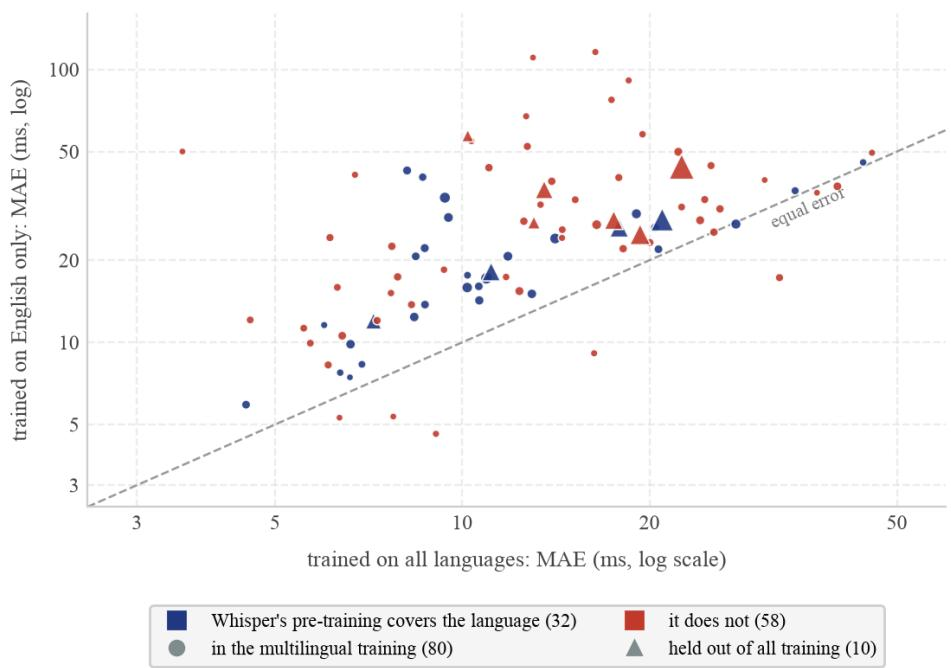  
Figure 8: Each VoxAngeles language’s mean boundary error with timestamp training on English alone against training on all languages; points above the diagonal are languages where the multilingual model is better. Colour: whether Whisper’s own pre-training covers the language (a language token, or a variety of one). Triangles: the languages held out of all training. Marker area grows with the language’s number of boundaries (one speaker each).

The transfer is better where Whisper’s pre-training heard the language. On the 32 VoxAngeles languages that Whisper’s pre-training covers, the English-only model trails the multilingual one by 8.1 ms (22.4 against 14.3); on the 58 it does not cover, by 16.1 ms (33.4 against 17.3). The lag doubles: the difference, 8.1 ms, has a 95% bootstrap interval over languages of 2.9 to 12.9 ms. Within 20 ms the English-only model falls 5.2 points further behind, an interval of −0.9 to +10.2 that includes zero. Covered and uncovered languages may differ in other ways too; the multilingual model, as each group’s control, absorbs only what affects both models alike.

Training on the language itself adds nothing measurable once many languages are in. The multilingual model leads the English-only one by 11.4 ms on the 80 VoxAngeles languages it trained on and by 13.1 ms on the 10 it never saw. If training on a language helped, the first lead would be the larger; the difference is −1.7 ms (−8.1 to +4.1). With 10 held-out languages the interval is wide: it bounds the effect rather than ruling it out.

The language token does not matter. Dropping it moves either model by at most 0.6 ms, with one exception. The English-only model, which never trained with <|nl|>, does worse on Dutch without it: its mean error goes from 22.2 to 26.1 ms, and its share of boundaries off by more than half a second from 0.38% to 0.72%.

Language by language. Figure 9 puts every language side by side, before and after the other languages join training, and Table 24 in the appendix lists them all. Training on all languages raises the share of boundaries within 20 ms on 72 of the 90 VoxAngeles languages, by a median of 17 points, leaves 18 unchanged and lowers none. Korean goes from 79% to 90%, and Dutch from 72% to 78%. Most VoxAngeles rows rest on a handful of boundaries: half the languages have 11 or fewer, and a language with a single clip has only two, so its share can only be 0, 50 or 100%, which is why some rows jump from one end to the other. The 10 languages with at least 40 boundaries gain a median of 19 points, and none loses.

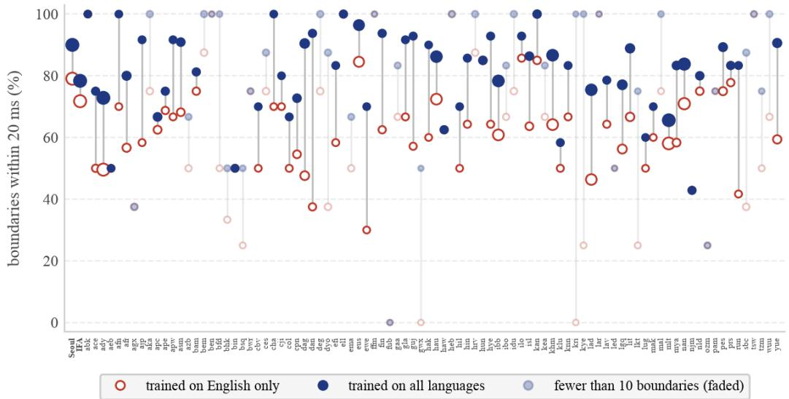  
Figure 9: Every language of the transfer test: the share of boundaries within 20 ms for the recipe trained on English alone (hollow) and on all training languages (filled). Seoul and IFA, the Korean and Dutch held-out speakers, come first; the VoxAngeles languages follow in alphabetical order of their ISO 639-3 codes, listed in Table 24. Marker area grows with the number of boundaries behind a language, and the 34 languages with fewer than 10 are faded: their share moves in steps of ten points or more.

Caveats. VoxAngeles transcripts are IPA and each clip is one word, neither of which the English-only model ever saw, so its VoxAngeles gap mixes language with transcript convention. Korean and Dutch, in their own spelling and in running speech, are the cleaner test of language transfer. On Seoul and IFA the multilingual model trained on other speakers of the same corpus, so part of its lead is their labelling convention. Korean is 4 speakers and Dutch 1.

## 8.5 Adapter sweep

Stage 3 sweeps the timestamp model alone: it led the CTC family by at least 2.7 points within 20 ms on every set, more than the two points under which both are swept. Every run is the whole encoder-decoder model with the default recipe and one factor changed (Table 12). A factor counts when it moves the mean error over the seven test sets by more than two standard deviations of 5 seeds of the default.

Table 12: The adapter sweep on the timestamp model (stage 3). Each run is the default (LoRA rank $3 2 , \alpha = 2 r$ , on attention and MLP of encoder and decoder, l $\textrm { c 2 } \times 1 0 ^ { - 4 }$ , 2,000 steps of 16 clips) with one factor changed. Set columns: mean absolute error in ms on each set’s common utterances (codecs: the mean of TIMIT’s six). Mean: MAE and share within 20 ms averaged over the seven sets in their own condition (codecs excluded). z: the mean MAE’s distance from the seeds’ mean in seed standard deviations (5 seeds: 14.00 ms, SD 0.12); positive is worse, bold beyond 2. Trainable: LoRA parameters, millions. Bold set cells: the lowest error in the column.
<table><tr><td></td><td colspan="10">MAE, ms</td><td colspan="2">mean</td><td>z</td></tr><tr><td>run</td><td>trainable</td><td>TIMIT</td><td>codecs</td><td>Buckeye</td><td>SWB</td><td>20–28 s</td><td>Seoul</td><td>IFA</td><td>VoxAng.</td><td>MAE</td><td>20 ms</td><td></td></tr><tr><td>default (seed 0)</td><td>58</td><td>10.5</td><td>11.1</td><td>12.1</td><td>23.0</td><td>10.3</td><td>11.3</td><td>15.3</td><td>15.9</td><td>14.06</td><td>84.82</td><td></td></tr><tr><td>seed 1</td><td>58</td><td>10.5</td><td>11.2</td><td>12.1</td><td>23.6</td><td>10.5</td><td>11.5</td><td>15.3</td><td>15.5</td><td>14.15</td><td>84.91</td><td></td></tr><tr><td>seed 2</td><td>58</td><td>10.5</td><td>11.2</td><td>12.2</td><td>23.2</td><td>10.2</td><td>11.5</td><td>14.9</td><td>15.3</td><td>13.97</td><td>85.07</td><td></td></tr><tr><td>seed 3</td><td>58</td><td>10.4</td><td>11.1</td><td>11.9</td><td>23.1</td><td>10.2</td><td>11.4</td><td>14.9</td><td>14.8</td><td>13.82</td><td>84.97</td><td></td></tr><tr><td>seed 4</td><td>58</td><td>10.6</td><td>11.3</td><td>12.0</td><td>23.1</td><td>10.2</td><td>11.5</td><td>15.5</td><td>15.1</td><td>14.00</td><td>84.80</td><td></td></tr><tr><td>rank 8</td><td>14</td><td>11.0</td><td>11.8</td><td>12.3</td><td>22.6</td><td>10.8</td><td>11.4</td><td>14.7</td><td>16.6</td><td>14.19</td><td>84.44</td><td>+1.6</td></tr><tr><td>rank 16</td><td>29</td><td>10.8</td><td>11.4</td><td>12.1</td><td>23.1</td><td>10.5</td><td>11.3</td><td>14.8</td><td>16.0</td><td>14.08</td><td>84.73</td><td>+0.7</td></tr><tr><td>rank 64</td><td>115</td><td>10.3</td><td>10.9</td><td>12.3</td><td>24.8</td><td>10.1</td><td>11.1</td><td>15.0</td><td>15.3</td><td>14.13</td><td>84.75</td><td>+1.1</td></tr><tr><td>rank 128</td><td>231</td><td>10.2</td><td>10.8</td><td>12.2</td><td>23.9</td><td>10.1</td><td>11.4</td><td>15.0</td><td>15.1</td><td>13.97</td><td>84.87</td><td>-0.3</td></tr><tr><td>attention only</td><td>31</td><td>11.0</td><td>11.5</td><td>12.0</td><td>23.1</td><td>10.7</td><td>11.3</td><td>14.9</td><td>16.2</td><td>14.17</td><td>84.52</td><td>+1.4</td></tr><tr><td>decoder only</td><td>34</td><td>12.3</td><td>12.9</td><td>13.3</td><td>24.2</td><td>12.0</td><td>12.7</td><td>16.6</td><td>17.6</td><td>15.53</td><td>81.49</td><td>+12.8</td></tr><tr><td>lr 10 -4</td><td>58</td><td>10.9</td><td>11.7</td><td>12.2</td><td>22.9</td><td>10.8</td><td>11.4</td><td>14.8</td><td>16.0</td><td>14.14</td><td>84.51</td><td>+1.2</td></tr><tr><td>lr 5 × 10−4</td><td>58</td><td>10.1</td><td>10.7</td><td>12.1</td><td>24.0</td><td>10.0</td><td>11.6</td><td>14.9</td><td>15.7</td><td>14.04</td><td>85.00</td><td>+0.3</td></tr><tr><td>α/r = 0.2</td><td>58</td><td>11.5</td><td>12.3</td><td>12.4</td><td>22.2</td><td>11.2</td><td>11.6</td><td>15.3</td><td>16.9</td><td>14.44</td><td>84.00</td><td>+3.7</td></tr><tr><td>1,000 steps</td><td>58</td><td>11.0</td><td>12.0</td><td>12.2</td><td>22.7</td><td>10.9</td><td>11.4</td><td>14.7</td><td>15.9</td><td>14.11</td><td>84.49</td><td>+0.9</td></tr><tr><td>4,000 steps</td><td>58</td><td>10.4</td><td>10.8</td><td>12.2</td><td>24.5</td><td>10.3</td><td>11.8</td><td>15.1</td><td>15.6</td><td>14.28</td><td>84.36</td><td>+2.4</td></tr><tr><td>6,000 steps</td><td>58</td><td>10.3</td><td>10.9</td><td>12.3</td><td>24.7</td><td>10.4</td><td>12.0</td><td>15.7</td><td>15.6</td><td>14.43</td><td>83.87</td><td>+3.6</td></tr></table>

Nothing beats the default. Its 5 seeds average 14.00 ms (SD 0.12) and 84.91% within 20 ms (SD 0.11). The best changed run, rank 128, scores 13.97 ms, 0.3 SD better than the seeds’ mean and inside their range (13.82 to 14.15 ms). By the share within 20 ms, which the selection rule puts first, no run rises more than two SDs above the seeds either (the best is +0.8 SD), and besides the three settings below, rank 8, attention-only adapters and the lower learning rate fall more than two SDs below them. There are no winners to combine, and the default stays.

The encoder has to be adapted. With adapters on the decoder alone and the encoder frozen, every set is worse, by 1.2 to 1.9 ms of mean error and 1.7 to 4.9 points within 20 ms. Where words begin and end has to be learnt in the encoder, not only read out by the decoder.

Weaker updates cost a little. At $\alpha / r = 0 . 2 $ , the ratio that kept our hallucination study’s models from forgetting the end of text, the adapters’ output is a tenth of the default’s. It acts like a much lower learning rate: 14.44 ms and 84.00%, 3.7 SD worse than the seeds. Here the decoder only fills in timestamps between words it is given, so there is no end of text to forget.

Training longer hurts, and steadily. 4,000 steps (1.30 epochs) is 0.3 ms and 0.6 points worse than the seeds’ mean (2.4 SD); 6,000 steps (1.95 epochs) is 0.4 ms and 1.0 points worse (3.6 SD). TIMIT keeps improving a little (10.4 and 10.3 ms) while Switchboard (24.5 and 24.7 ms), Korean and Dutch get worse. Half the training is no better: 1,000 steps (0.33 of an epoch) scores 14.11 ms and 84.49% within 20 ms, worse on TIMIT (11.0 ms) and better on Switchboard (22.7 ms), the trade that weaker adaptation makes below.

How strongly to adapt trades TIMIT against Switchboard (Figure 10). More adaptation (rank 64 or 128, a learning rate of $5 \times 1 0 ^ { - 4 }$ , 4,000 steps) lowers TIMIT’s error to 10.1 to 10.4 ms, against 10.4 to 10.6 for the seeds, and raises Switchboard’s to 23.9 to 24.8 ms, against 23.0 to 23.6 for the seeds. Less adaptation (rank 8, 10−4, $\alpha / r = 0 . 2 ,$ 1,000 steps) does the reverse: TIMIT 10.9 to 11.5 ms, Switchboard 22.2 to 22.9. The two sets move in opposite directions, so the mean barely moves. Switchboard, the one test on real telephone lines, is 2.1 of the 46.7 training hours.

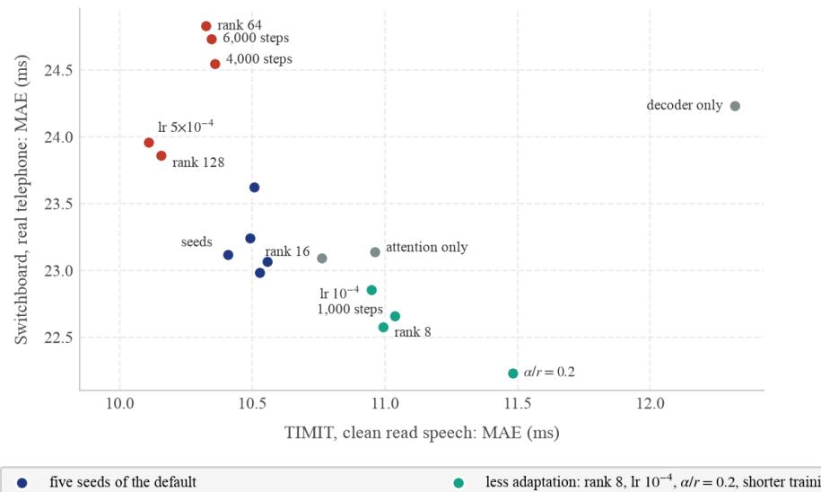  
Figure 10: Each run of the adapter sweep by its mean boundary error on clean TIMIT and on Switchboard’s real telephone calls. Lower left is better on both. More adaptation moves a run up and to the left, less moves it down and to the right; adapting the decoder alone is worse on both.

Capacity hardly matters. From rank 8 to rank 128, 14 to 231 million trainable parameters, the mean error stays between 13.97 and 14.19 ms. Attention-only adapters (31 million) score close to rank 16 on attention and MLP (29 million): 14.17 against 14.08 ms.

Seed noise differs by set. TIMIT varies by 0.2 ms between seeds, so its moves of a few tenths of a millisecond are real; Switchboard varies by 0.6 ms, VoxAngeles by 1.1 and IFA by 0.7, so one run’s differences of that size there are noise. Every run, decoder-only included, still beats MFA in all 16 set-conditions.

## 8.6 Output resolution

The timestamp model reads time off Whisper’s 20 ms timestamp tokens, with two-hot targets and expectation decoding (Section 7). To see what the grid costs, we decoded the same model’s outputs four more ways (Table 13).

Table 13: Output resolution: the default timestamp model’s logits decoded five ways. The model trains on two-hot targets over 20 ms timestamp tokens. Mean over the seven test sets of the mean absolute error, the median absolute error (both ms) and the shares within 10 and 20 ms (%); TIMIT and Switchboard alone as MAE / within 20 ms.
<table><tr><td>decoding</td><td>MAE</td><td>median</td><td>10 ms</td><td>20 ms</td><td>TIMIT</td><td>Switchboard</td></tr><tr><td>arg-max bin (the 20 ms grid)</td><td>15.5</td><td>8.4</td><td>58.4</td><td>82.5</td><td>12.2/87.4</td><td>24.1/77.9</td></tr><tr><td>expectation within 1 bin</td><td>14.1</td><td>6.3</td><td>66.7</td><td>84.7</td><td>10.6/89.0</td><td>23.0/80.6</td></tr><tr><td>expectation within 2 bins (default)</td><td>14.1</td><td>6.5</td><td>66.1</td><td>84.8</td><td>10.5/89.1</td><td>23.0/80.7</td></tr><tr><td>expectation within 5 bins</td><td>14.1</td><td>6.8</td><td>64.2</td><td>83.7</td><td>10.6/88.0</td><td>23.2/79.1</td></tr><tr><td>expectation over all bins</td><td>17.0</td><td>9.5</td><td>52.6</td><td>76.1</td><td>15.8/74.7</td><td>25.6/72.7</td></tr></table>

Snapping to the most likely token, the grid itself, costs 1.5 ms of mean error, 1.9 ms of median error and 7.7 points within 10 ms. The expectation within one or two tokens recovers all of it: the position inside a frame is in the distribution. A wider window loses a little, and the expectation over all tokens loses a lot (17.0 ms), because a second, distant mode drags it. The grid is not what limits the model’s decoding.

## 8.7 Finer timestamp tokens

Does a finer timestamp vocabulary make the aligner more precise? The question follows from how well the encoder-decoder design works. Predicting each boundary as one of Whisper’s timestamp tokens, the timestamp model places the most boundaries within 20 ms on every test set (Section 8.2), and on FA-Bench’s TIMIT test it cuts the best published error by 36% (Section 8.3). Yet those tokens are 20 ms apart, a wide step next to the slot-after recipe’s median error of 6.56 ms over the seven test sets. If the vocabulary holds the model back, finer tokens should help.

We test this by adding tokens. Whisper has one timestamp token every 20 ms, 1,501 in all. We add 1,500 new ones, each halfway between two of them, so that there is a token every 10 ms. Each new token’s embedding starts as the mean of its two neighbours and trains beside the LoRA adapters. In our format the timestamps never enter the decoder’s input. The slots are special tokens, and only the classifier their states are scored against holds the timestamp embeddings, so the new tokens need no other change to the model. We train the slot-after recipe with two-hot targets at 10 ms and decode over the same window of ±40 ms (Table 14).

Table 14: Timestamp resolution, with the slots after the word. Whisper’s own timestamp tokens are 20 ms apart; 10 ms adds one new token halfway between every two of them, 5 ms three. Means over the seven test sets in their own condition, then over seeds: mean and median absolute error in ms, share of boundaries within 10 and 20 ms in %. The first block is the baseline: the best recipe of Section 8.15, the slots after the word with 10% transcript noise in training, which has the lowest seven-set error of any arm, beside the same recipe on 10 ms tokens. The second compares the token spacings on the slot-after recipe without noise, with five seeds each at 20 and 10 ms. The third changes one thing in that 10 ms recipe. The last puts the 10 ms tokens on other checkpoints, each beside its 20 ms runs.
<table><tr><td>tokens</td><td>setting</td><td>seeds</td><td>mean</td><td>median</td><td>≤10 ms</td><td>≤20 ms</td></tr><tr><td>20 ms</td><td>best recipe (baseline)</td><td>2</td><td>12.68</td><td>6.51</td><td>65.9</td><td>85.2</td></tr><tr><td>10 ms</td><td>best recipe, 1,500 new tokens</td><td>1</td><td>12.74</td><td>6.41</td><td>66.1</td><td>84.6</td></tr><tr><td>20 ms</td><td>Whisper&#x27;s tokens</td><td>5</td><td>13.02</td><td>6.56</td><td>65.8</td><td>85.0</td></tr><tr><td>10 ms</td><td>1,500 new tokens</td><td>5</td><td>12.99</td><td>6.47</td><td>66.0</td><td>84.8</td></tr><tr><td>5 ms</td><td>4,500 new tokens</td><td>1</td><td>13.14</td><td>6.47</td><td>65.6</td><td>84.4</td></tr><tr><td>10 ms</td><td>new tokens initialised at random</td><td>1</td><td>13.03</td><td>6.33</td><td>66.5</td><td>84.9</td></tr><tr><td>10 ms</td><td>new tokens at lr 5×10−3</td><td>1</td><td>12.87</td><td>6.50</td><td>66.0</td><td>84.8</td></tr><tr><td>10 ms</td><td>new tokens at lr  $2 \times 1 0 ^ { - 4 }$ </td><td>1</td><td>12.94</td><td>6.36</td><td>66.3</td><td>84.8</td></tr><tr><td>10 ms</td><td>one-hot targets</td><td>1</td><td>13.08</td><td>6.57</td><td>65.2</td><td>84.4</td></tr><tr><td>10 ms</td><td>4,000 steps</td><td>1</td><td>13.04</td><td>6.50</td><td>66.1</td><td>84.8</td></tr><tr><td>10 ms</td><td>LoRA rank 64</td><td>1</td><td>12.86</td><td>6.33</td><td>66.4</td><td>85.0</td></tr><tr><td>20 ms</td><td>vanilla large-v3</td><td>2</td><td>12.88</td><td>6.48</td><td>66.2</td><td>85.2</td></tr><tr><td>10 ms</td><td>vanilla large-v3</td><td>1</td><td>12.71</td><td>6.36</td><td>66.5</td><td>85.2</td></tr><tr><td>20 ms</td><td>large-v3-turbo</td><td>2</td><td>12.99</td><td>6.54</td><td>65.9</td><td>84.9</td></tr><tr><td>10 ms</td><td>large-v3-turbo</td><td>1</td><td>12.93</td><td>6.54</td><td>65.9</td><td>84.6</td></tr></table>

The finer tokens do not lower the error. Over the seven test sets, 5 seeds with the new tokens score 12.99 ms and 5 seeds with Whisper’s own score 13.02 ms, a difference of −0.04 ms with a standard error of 0.07. The best recipe, with transcript noise in training, gives the same answer: 12.74 ms with the new tokens against 12.68 without them (1 seed against 2). Some boundaries do move closer. The median error goes from 6.56 to 6.47 ms, and the share within 10 ms from 65.8 to 66.0%. But the share within 20 ms falls from 85.0 to 84.8%, and the 20 to 28 s TIMIT windows lose 0.17 ms (standard error 0.05). No test set gains by more than its seed spread; the largest gain is on Switchboard (−0.44 ms, standard error 0.38). The decoding experiment of Section 8.6 explains why: the expectation already places a boundary inside its 20 ms step, so a finer grid has little left to recover. The mean error is twice the median, and the larger misses that set it are not a matter of resolution.

No setting of the new tokens changes the answer. We then varied the 10 ms recipe one thing at a time, with one seed each (Table 14). Starting the new embeddings at random instead of between their neighbours scores 13.03 ms. Their own learning rate, $5 { \times } 1 0 ^ { - 3 } ~ \mathrm { o r ~ } 2 { \times } 1 0 ^ { - 4 }$ instead of $1 0 ^ { - 3 }$ scores 12.87 or 12.94 ms. Twice the training scores 13.04 ms, and adapters of rank 64 score 12.86 ms.

One-hot targets on the nearest token score 13.08 ms, with the fewest boundaries within 10 ms (65.2%), and 5 ms tokens, three new ones between every two of Whisper’s, score 13.14 ms. Every one of these runs falls inside the range of the five seeds on Whisper’s own tokens, 12.86 to 13.22 ms. On the other checkpoints the 10 ms tokens score 12.71 ms against 12.88 on vanilla large-v3, and 12.93 against 12.99 on large-v3-turbo (one run against two seeds each), differences no larger than the spread between seeds. Whisper’s 20 ms tokens, read as an expectation, are fine enough.

Is the encoder’s frame the limit? Whisper’s encoder emits one frame every 20 ms, and the decoder sees nothing finer, so a 20 ms floor is a natural suspicion. We tested it by shifting each TIMIT test clip by part of a frame, prepending 5, 10 or 15 ms of silence, and measuring how far each predicted boundary moved. A model that knew only which frame a boundary falls in would move each one by 0 or 20 ms. The 20 ms model moves them by the shift itself (Figure 11). Shifted by half a frame, 72.0% of its boundaries move by 7.5 to 12.5 ms and 1.3% by about 0 or 20 ms, and its error stays where it was (10.57 against 10.51 ms). So the frames carry the position inside them, and the model reads it. The 10 ms tokens read the same information (67.6% and 2.2%), a little less steadily: shifted by one whole frame, 70.3% of their boundaries move by 17.5 to 22.5 ms, against 87.2% for the 20 ms model.

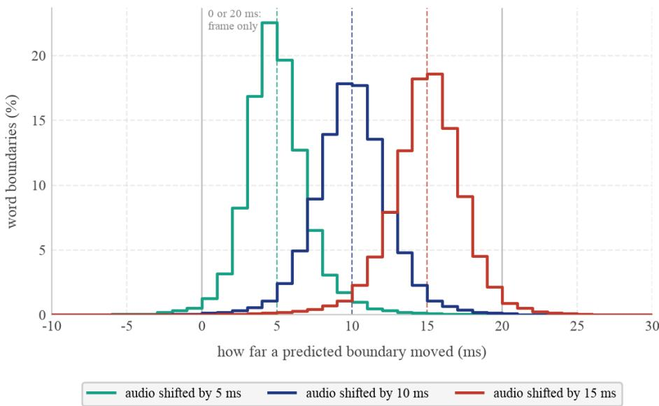  
Figure 11: How far each predicted boundary moves when a TIMIT test clip is shifted by part of Whisper’s 20 ms encoder frame, for the slot-after model on Whisper’s 20 ms tokens (22,050 boundaries). A model that knew only which frame a boundary falls in would move each boundary by 0 or 20 ms (grey lines). This one moves it by the shift (dashed lines).

## 8.8 Slot order

The decoder reads the transcript with two timestamp slots per word (Section 7). The slots can sit in two places. Around the word, the start slot comes before the word and the end slot after it:

$$
< | \mathbf { s t a r t o f 1 m } | > \mathbf { \ h i s \ < } | \mathbf { s t a r t o f p r e v } | >
$$

This is Whisper’s own segment order, and our default. After the word, both slots follow it:

$$
\mathrm { h i s ~ < | s t a r t o f 1 m | > ~ < | s t a r t o f p r e v | > ~ }
$$

Whisper’s decoder is causal. Each position sees the audio and the tokens before it, and nothing after. Around the word, the start slot has seen the words before it, but not the word it is timing. After the word, it has seen that word too. Table 15 compares the two.

Table 15: Where the timestamp slots sit, and Whisper’s own format. Mean absolute error in ms of word boundaries; mean: the seven test sets in their own condition, with the share within 20 ms; per set: word starts / word ends. Arms are means over their seeds; the four layouts differ in nothing else.
<table><tr><td>decoder input</td><td>seeds</td><td>mean</td><td>TIMIT</td><td>Buckeye</td><td>SWB</td><td>Seoul</td><td>IFA</td><td>VoxAng.</td></tr><tr><td>slots around the word (Whisper&#x27;s order)</td><td>5</td><td>14.00/84.9</td><td>10.7/10.3</td><td>13.1/11.0</td><td>29.5/16.9</td><td>12.6/10.3</td><td>14.1/16.3</td><td>9.3/21.4</td></tr><tr><td>slots after the word</td><td>5</td><td>13.02/85.0</td><td>10.8/10.3</td><td>11.5/11.1</td><td>20.3/16.5</td><td>10.8/10.0</td><td>13.7/16.0</td><td>9.4/21.3</td></tr><tr><td>around the word, rounded targets</td><td>2</td><td>14.26/84.5</td><td>11.2/10.6</td><td>13.1/11.2</td><td>29.7/17.4</td><td>12.8/10.6</td><td>14.4/16.3</td><td>9.4/21.5</td></tr><tr><td>Whisper&#x27;s own layout</td><td>2</td><td>19.12/83.2</td><td>12.9/10.7</td><td>27.4/24.0</td><td>36.8/26.0</td><td>24.3/21.2</td><td>14.6/16.7</td><td>9.5/20.7</td></tr></table>

Slots after the word cut the error by 0.97 ms, from 14.00 to 13.02 ms over the seven test sets, with 5 and 5 seeds (standard error of the difference 0.08 ms). That is 8.1 standard deviations of the default’s seeds, more than any adapter setting moved it. The gain is all in the word starts, and all in conversation (Figure 12). On Switchboard’s telephone conversations word starts go from 29.5 to 20.3 ms, 31% less, and the set’s error from 23.2 to 18.4 ms, 21% less, while its word ends stay at 16.5 ms. Buckeye’s and Seoul’s starts improve as well (13.1 to 11.5 and 12.6 to 10.8 ms); TIMIT’s read sentences do not move (10.7 and 10.8 ms). In conversation the next word is hard to guess; in read speech an onset is easy to find whatever the word.

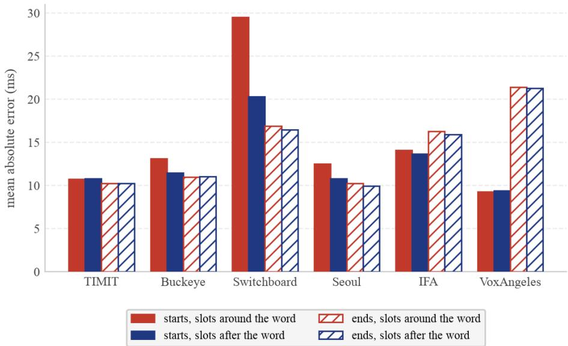  
Figure 12: Word-start and word-end error on each test set with the timestamp slots around the word (Whisper’s order, the start slot before the word) and both after it. Means over each layout’s seeds.

Whisper’s own layout is worse. Trained and decoded the way Whisper handles timestamps, with real timestamp tokens rounded to 20 ms in the input, next-token cross-entropy over the whole vocabulary, and the slots filled in order, each with the most likely timestamp no earlier than the one before, the model scores 19.12 ms, +5.12 ms against the default. A slot that jumps ahead drags every word after it, which hits long conversational windows hardest (Buckeye 25.7 ms, Seoul 22.8), and filling the slots one at a time is several times slower than reading them in one pass. Rounding the targets alone, in the default layout, costs +0.26 ms: the two-hot targets are worth keeping.

## 8.9 Phone edges

Most of the training corpora mark phones as well as words. To see whether phone edges sharpen word edges, a linear head on the encoder output learns, during training only, to mark word edges per 20 ms frame, or word and phone edges where the corpus has phones (TIMIT, Seoul, IFA and VoxAngeles), with two seeds each. The head is dropped at inference, so the aligner itself is unchanged (Table 16).

Table 16: Boundary supervision: the default timestamp model, and the same model trained with a linear head on the encoder output that marks word edges, or word and phone edges, per 20 ms frame (dropped at inference). Mean absolute error in ms / share within 20 ms in %, arm means over seeds; mean over the seven test sets in their own condition.
<table><tr><td>extra targets</td><td>seeds</td><td>TIMIT</td><td>Buckeye</td><td>SWB</td><td>Seoul</td><td>IFA</td><td>VoxAng.</td><td>mean</td></tr><tr><td>none (default)</td><td>5</td><td>10.5/89.1</td><td>12.0/86.1</td><td>23.2/80.8</td><td>11.4/89.9</td><td>15.2/78.5</td><td>15.4/80.5</td><td>14.00/84.91</td></tr><tr><td>word edges</td><td>2</td><td>10.5/89.2</td><td>12.2/86.2</td><td>24.2/80.4</td><td>11.3/90.1</td><td>14.8/78.6</td><td>15.7/79.6</td><td>14.15/84.79</td></tr><tr><td>word and phone edges</td><td>2</td><td>10.5/89.4</td><td>12.1/86.0</td><td>23.4/80.6</td><td>11.3/90.2</td><td>15.0/78.6</td><td>15.5/80.2</td><td>14.01/84.96</td></tr></table>

Neither target moves word boundaries. Word edges change the mean error over the seven sets by +0.15 ms (standard error 0.10), word and phone edges by +0.01 ms (0.06). The timestamp model already learns where words begin and end from its own targets, and a frame-level loss on the encoder adds nothing to it.

## 8.10 Telephone augmentation

Every run so far sent half of its training clips through a telephone condition. Stage 5 varies that share, p, from none to all, with three seeds at none and at a quarter and 5 at the default half (Table 17). Two codecs never enter training: AMR-NB, which mobile networks use, and G.723.1, a VoIP codec. Their delays, 5.000 and 7.500 ms, are measured and removed like the others’.

Table 17: Telephone augmentation (stage 5): p is the share of training clips sent through one of the six conditions of Table 3, with white noise on half of them. AMR-NB (12.2 kbit/s) and G.723.1 (6.3 kbit/s) never enter training. Mean absolute error in ms / share within 20 ms in %; clean averages the six test sets in their clean condition, each codec column its codecs. Arms with several seeds show their mean. Bold: the lowest error per column (ties at the shown precision all bold).
<table><tr><td>p</td><td>runs</td><td>clean</td><td>TIMIT, six codecs</td><td>TIMIT, unseen</td><td>Buckeye, three codecs</td><td>Buckeye, unseen</td><td>Switchboard</td></tr><tr><td>0</td><td>3</td><td>12.5/85.4</td><td>17.1/74.6</td><td>17.6/73.8</td><td>15.4/81.3</td><td>15.8/80.4</td><td>24.5/80.0</td></tr><tr><td>0.25</td><td>3</td><td>12.4/85.6</td><td>11.2/87.8</td><td>12.3/86.3</td><td>13.0/84.8</td><td>13.3/84.1</td><td>23.3/80.5</td></tr><tr><td>0.5 (default)</td><td>5</td><td>12.5/85.6</td><td>11.2/88.0</td><td>12.2/86.4</td><td>12.9/84.9</td><td>13.2/84.3</td><td>23.2/80.8</td></tr><tr><td>0.75</td><td>1</td><td>12.6/85.1</td><td>11.0/88.1</td><td>12.1/86.8</td><td>13.1/84.3</td><td>13.3/83.9</td><td>23.0/80.7</td></tr><tr><td>1</td><td>1</td><td>13.0/84.8</td><td>11.1/88.2</td><td>12.1/86.9</td><td>13.1/84.6</td><td>13.4/83.9</td><td>23.0/80.5</td></tr><tr><td>MFA (bar)</td><td></td><td></td><td>25.7/62.7</td><td>25.4/63.1</td><td>26.6/64.5</td><td>26.0/64.9</td><td>36.5/64.2</td></tr></table>

Without augmentation the channel costs 65%. Trained on clean audio alone, the model scores 10.4 ms on clean TIMIT and 16.5 to 17.8 ms through the six codecs. Most of that is the narrow band, not the compression: band-limiting alone costs it 6.1 ms. With the default augmentation the six codecs cost 0.4 to 0.9 ms. Over the codecs the augmentation uses, the default is 4.6 ms better than no augmentation (standard error 0.29) and places 9.8 points more boundaries within 20 ms.

The gain carries over to codecs it never used. On AMR-NB and G.723.1 the default is 4.0 ms better (standard error 0.21) and 8.3 points higher within 20 ms, nearly the gain on the codecs it trained with. AMR-NB keeps the largest residual cost: 12.9 ms on TIMIT against 10.5 clean. Adding AMR-NB to the augmentation hardly moves it (12.6 ms over two seeds, against 12.7 to 13.2 for the default’s), so what remains is the codec’s own loss of information, not unfamiliarity.

Real telephone lines gain less, and clean speech pays nothing. Switchboard improves by 1.3 ms (standard error 0.42). On clean speech the default and no augmentation differ by −0.1 ms (standard error 0.07), and up to p = 0.75 nothing changes. Only degrading every clip costs clean speech: 11.0 ms on clean TIMIT against 10.5, with no further telephone gain. A quarter of the clips already earns the full gain, and the default stays at a half.

## 8.11 Call-centre augmentation

The six conditions are generic: a band-pass from 300 to 3,400 Hz, a codec, and line noise on half the clips. For the release we also used the telephone degradation pipeline we built for CallEnhancer, our open-source call-centre speech restoration model2, and degraded every training clip once, offline. We compare its output with 116 legs of 58 real call-centre recordings, two-channel 8 kHz calls of which only aggregate statistics leave the company.

The degrader does not keep time. A median clip comes back 0 ms late, but 8.3% come back more than 5 ms late and the latest 136.5 ms. So every degraded clip is cross-correlated with its clean input between 300 and 3,000 $\mathrm { H z , }$ shifted back and cut to its length; afterwards all but 7 of the 47,287 clips line up to the sample. Where the correlation peak stays below 0.3, the degradation has swamped the speech and its lag cannot be trusted: those 3.8% of clips train clean.

We measured 1,000 of our training windows with the same statistics as the real legs (Table 18), clean, through the six conditions and through the call-centre degrader. Between 300 and 3,400 Hz every input has the legs’ spectral shape, a mean 2.1 to 2.3 dB from their median; the edges are what differ (Figure 13). The degrader’s long-term spectrum stays inside the legs’ 10th to 90th percentile band from 250 to 3,844 Hz, and its tilt, −10.4 dB per octave, matches theirs, −10.7. The six conditions leave the band below 312 Hz, because their band-pass removes everything under 300 Hz: their low edge is 250 Hz, against the legs’ 94 and the degrader’s 156. The degrader’s high edge is a little low, 3,000 against 3,281 Hz.

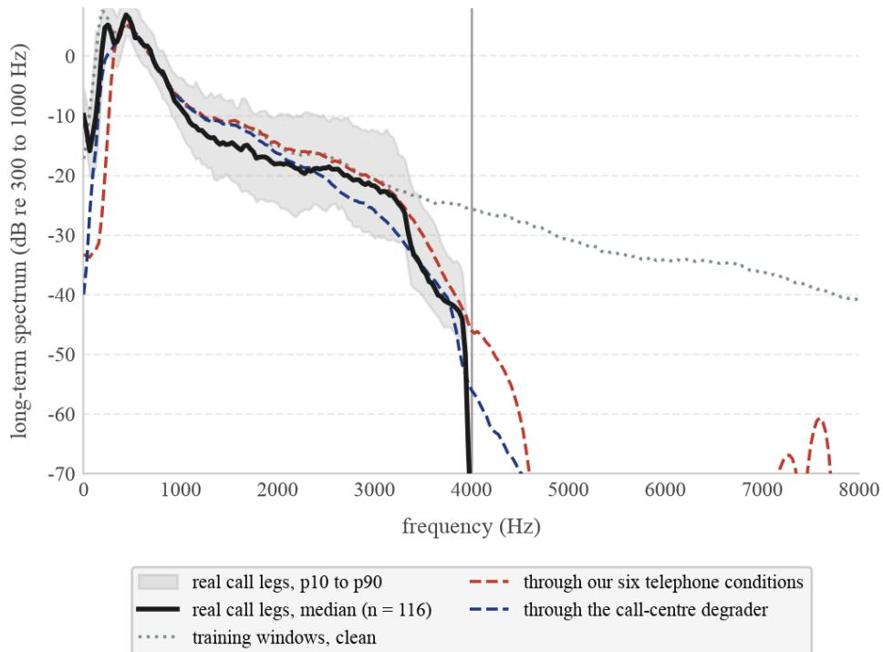  
Figure 13: Long-term spectrum of real call legs (median and 10th to 90th percentile band over 116 legs) and of our training windows, clean, through our six telephone conditions and through the call-centre degrader (medians over windows), each normalised to its own 300 to 1000 Hz level. The vertical line marks 4 kHz, the Nyquist limit of the real 8 kHz recordings.

Table 18: Our training windows against real call legs, medians: 1,000 training windows clean, through our six telephone conditions as training draws them, and through the call-centre degrader (959 of them: the rest failed the lag check), against 116 legs of 58 real two-channel 8 kHz call-centre recordings. Speech: share of 20 ms frames within 25 dB of the 90th-percentile frame; SNR: 90th over 10th percentile of frame energy; floor: the 10th percentile; level: mean energy of the speech frames; edges: lowest and highest frequency of the long-term spectrum within 15 and 25 dB of its 300 to 1000 Hz level; tilt: its slope over 0.5 to 2.5 kHz; above 4 kHz: share of windows whose high edge lies there.
<table><tr><td>input</td><td>length speech (s)</td><td>share</td><td>SNR (dB)</td><td>floor (dBFS)</td><td>level (dBFS)</td><td>low edge high edge (Hz)</td><td>(Hz)</td><td>tilt (dB/oct)</td><td>above 4kHz</td></tr><tr><td>real call legs</td><td>29.9</td><td>38%</td><td>50.9</td><td>-81</td><td>-26</td><td>94</td><td>3,281</td><td>-10.7</td><td>0%</td></tr><tr><td>our windows, clean</td><td>2.5</td><td>82%</td><td>30.5</td><td>-58</td><td>-30</td><td>62</td><td>4,578</td><td>-9.1</td><td>64%</td></tr><tr><td>six conditions</td><td>2.5</td><td>77%</td><td>31.5</td><td>-63</td><td>-33</td><td>250</td><td>3,312</td><td>-9.1</td><td>3%</td></tr><tr><td>call-centre degrader</td><td>2.5</td><td>78%</td><td>33.2</td><td>-50</td><td>-19</td><td>156</td><td>3,000</td><td>-10.4</td><td>8%</td></tr></table>

The noise statistics cannot match, and the clean windows show why (Figure 14). A real leg lasts 29.9 s at the median, and only 38% of it is that party’s speech. The rest is the other party’s turn at the line’s floor, so the 10th percentile of its frame energy reads the line, at −81 dBFS, and its envelope SNR is 50.9 dB. Our windows last 2.5 s and are 82% speech, so the same percentile falls on speech, and the clean windows themselves read 30.5 dB. On that scale neither augmentation drowns the speech: the six conditions read 31.5 dB and the call-centre degrader 33.2 dB.

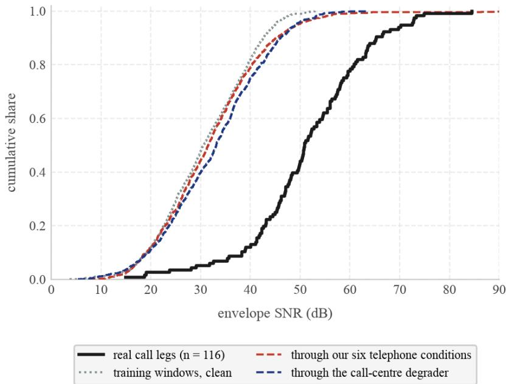  
Figure 14: Envelope SNR (90th over 10th percentile of 20 ms frame energy), cumulative over real legs and over our training windows.

The floor tells the same story from the other end (Figure 15): the degrader raises the windows’ floor by 7 dB and their speech level by 11 dB, so it adds the channel of a real call, not its silences.

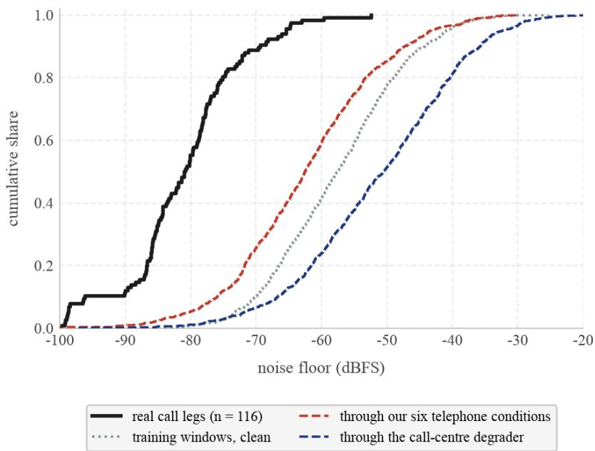  
Figure 15: Noise floor (10th percentile of 20 ms frame energy), cumulative over real legs and over our training windows.

Test sets through the degrader. The codec conditions of Section 5 carry only a band limit and a codec. To see what a fuller call costs, we put TIMIT test and Buckeye’s held-out speakers through the same degrader, one draw per clip, with its delay removed the same way (Table 19). It is the released models’ own training augmentation, so this test favours them, as the codec conditions favour the models trained on those codecs. The released large-v3 model goes from 10.6 ms on clean TIMIT to 13.4 ms through the degrader, and keeps 83% of its boundaries within 20 ms. Trained on the six conditions instead, the default model goes from 10.5 to 16.6 ms. Without telephone augmentation the error reaches 20.9 ms. MFA’s more than doubles, from 19.1 to 43.1 ms, and it fails on 37 utterances. Buckeye’s conversations keep the same order.

Table 19: Test sets through the call-centre degrader, the release recipe’s own training augmentation (one draw per clip, delay removed), against the clean audio and the codec conditions (the mean over TIMIT’s six and Buckeye’s three). Mean absolute error in ms / share within 20 ms in %, on each condition’s common utterances; Buckeye is its held-out speakers s01 to s04. The degraded condition favours the released models as the codec conditions favour the models trained on those codecs. Means over each recipe’s seeds.
<table><tr><td></td><td colspan="3">TIMIT test</td><td colspan="3">Buckeye</td></tr><tr><td>aligner</td><td>clean</td><td>codecs</td><td>degrader</td><td>clean</td><td>codecs</td><td>degrader</td></tr><tr><td>released, large-v3</td><td>10.6 / 89</td><td>11.8 / 86</td><td>13.4 / 83</td><td>11.2 / 86</td><td>12.5 / 85</td><td>13.5 / 82</td></tr><tr><td>released, large-v3-turbo</td><td>10.9 / 88</td><td>11.8 / 86</td><td>14.1 / 82</td><td>11.3 / 86</td><td>12.7 / 84</td><td>14.5 / 81</td></tr><tr><td>slots after + transcript noise</td><td>10.7 / 89</td><td>11.3 / 87</td><td>16.4 / 78</td><td>11.1 / 86</td><td>11.7 / 86</td><td>15.9 / 80</td></tr><tr><td>slots after the word, six conditions</td><td>10.5 / 89</td><td>11.2 / 88</td><td>16.3 / 78</td><td>11.3 / 86</td><td>12.0 / 86</td><td>15.9 / 80</td></tr><tr><td>default, six conditions</td><td>10.5 / 89</td><td>11.2 / 88</td><td>16.6 / 79</td><td>12.0 / 86</td><td>12.9 / 85</td><td>17.0 / 79</td></tr><tr><td>no telephone augmentation</td><td>10.4 / 89</td><td>17.1/ 75</td><td>20.9 / 70</td><td>12.3 / 86</td><td>15.4 / 81</td><td>18.6 /76</td></tr><tr><td>CTC, Whisper-Scicom encoder</td><td>16.4 / 76</td><td>16.4 / 76</td><td>19.9 / 70</td><td>14.0 / 81</td><td>14.7 / 79</td><td>17.4/75</td></tr><tr><td>MFA, English ARPA</td><td>19.1 / 68</td><td>25.7 / 63</td><td>43.1 / 53</td><td>21.5 / 71</td><td>26.6 / 65</td><td>46.1 / 55</td></tr></table>

The release recipe trains with this degrader in place of the six conditions, together with the slots after the word and transcript noise. Two seeds of each step toward it, on a newer release of Whisper-Scicom fine-tuned on the same private data and on the public Whisper checkpoints, are compared in Section 8.15.

## 8.12 Whisper checkpoint

Every model so far was trained on Whisper-Scicom, our Whisper large-v3 fine-tuned on our private call-centre dataset. To see whether that adaptation matters, and whether the 32-layer decoder does, we trained the default recipe on vanilla Whisper large-v3 and on large-v3-turbo, which keeps the encoder and has 4 decoder layers, with 3 and 3 seeds (Table 20).

Table 20: The checkpoint the adapters train on, with the default recipe: Whisper-Scicom (fine-tuned on Malaysian call-centre speech), vanilla Whisper large-v3, and large-v3-turbo (the same encoder, 4 decoder layers instead of 32). Mean absolute error in ms / share within 20 ms in %, arm means over seeds; mean over the seven test sets in their own condition. RTF: GPU seconds per second of audio on clean TIMIT, batch 16, on shared GPUs.
<table><tr><td>checkpoint</td><td>seeds</td><td>TIMIT</td><td>codecs</td><td>Buckeye</td><td>SWB</td><td>Seoul</td><td>IFA</td><td>VoxAng.</td><td>mean</td><td>RTF</td></tr><tr><td>Whisper-Scicom</td><td>5</td><td>10.5/89.1</td><td>11.2/88.0</td><td>12.0/86.1</td><td>23.2/80.8</td><td>11.4/89.9</td><td>15.2/78.5</td><td>15.4/80.5</td><td>14.00/84.91</td><td>0.0090</td></tr><tr><td>Whisper large-v3</td><td>3</td><td>10.4/89.3</td><td>11.1/88.2</td><td>12.0/86.2</td><td>24.2/80.4</td><td>11.4/89.9</td><td>15.4/78.7</td><td>15.5/80.4</td><td>14.16/84.93</td><td>0.0094</td></tr><tr><td>Whisper large-v3-turbo</td><td>3</td><td>10.4/89.4</td><td>11.1/88.1</td><td>12.2/85.7</td><td>23.1/80.5</td><td>11.5/89.8</td><td>14.7/79.3</td><td>15.7/80.4</td><td>14.01/84.94</td><td>0.0079</td></tr></table>

The call-centre fine-tune barely matters for alignment. Vanilla large-v3 scores 14.16 ms against Whisper-Scicom’s 14.00 (a difference of +0.16 ms, standard error 0.10), and through TIMIT’s simulated codecs the two are level (11.1 against 11.2 ms). On Switchboard’s real calls vanilla largev3 is behind, 24.2 against 23.2 ms (+1.0, standard error 0.43), which would credit the call-centre fine-tune; but turbo, which has no call-centre fine-tune either, is not behind there (23.1 ms), so the evidence is weak.

Turbo loses nothing on the test sets. With an eighth of the decoder it scores 14.01 ms, +0.01 ms against Whisper-Scicom (standard error 0.10, 3 seeds), and aligns 12% faster: the encoder, which both share, does most of the work. One sign points the other way: on the development set turbo’s mean error is 14.3 to 14.7 ms against 13.2 to 13.6 for Whisper-Scicom, while its median matches (6.1 to 6.3 ms against 6.0 to 6.3): a few large errors that no test set repeats.

## 8.13 Long recordings

Calls last minutes, and the timestamp model reads one 30 s window, so a wrapper aligns any length in three steps. MMS-300M, which reads a recording of any length, places every word roughly. The words are cut into runs of at most 25 s at the widest pauses it finds. Each run is aligned on its own crop of the audio, from the middle of the pause before it to the middle of the pause after it, and its times are shifted back. A recording of 25 s or less goes to the aligner whole, so no other number in this paper changes.

Only Seoul has held-out stretches long enough and fully labelled: 61 stretches of 40 to 105 s from its test speakers, 6,450 words in 0.93 h, with no unlabelled speech inside. Buckeye’s test recordings are segments of at most 25 s, and IFA’s are short files.

Table 21: Long recordings: the 61 continuously labelled stretches of 40 to 105 s of the held-out Seoul speakers (0.93 h), against the same speakers’ windows of at most 30 s. Mean absolute error in ms / median in ms / share within 20 ms in % / share beyond 500 ms in %. The wrapper places words with MMS-300M, cuts them into runs of at most 25 s at pauses and aligns each run on its own crop. RTF: GPU seconds per second of audio on a shared GPU, coarse pass included.
<table><tr><td>aligner</td><td>long stretches</td><td>30 s windows</td><td>RTF</td></tr><tr><td>timestamps, LoRA, through the wrapper</td><td>12.2 / 5.4 / 90.0 / 0.19</td><td>11.3 / 5.3 / 90.0 / 0.09</td><td>0.008</td></tr><tr><td>seed 1</td><td>11.6 / 5.4 / 90.0 / 0.15</td><td>11.5 / 5.3 / 89.9 / 0.10</td><td>0.007</td></tr><tr><td>seed 2</td><td>11.8 / 5.3 / 89.9 / 0.16</td><td>11.5 / 5.3 / 89.9 / 0.10</td><td>0.008</td></tr><tr><td>CTC, Whisper-Scicom encoder, through the wrapper</td><td>13.9 / 7.0 / 86.3 / 0.18</td><td>13.5 / 7.3 / 86.0 / 0.06</td><td>0.006</td></tr><tr><td>CTC, MMS-300M fine-tuned, whole recording</td><td>15.6 / 7.9 / 82.9 / 0.19</td><td>16.2 / 8.3 / 81.0 / 0.13</td><td>0.003</td></tr><tr><td>MFA, korean_mfa</td><td>19.0 / 10.7 / 71.2 / 0.11</td><td>21.3 / 10.9 / 70.2 / 0.21</td><td>0.013</td></tr><tr><td>MMS-300M alone (the coarse pass)</td><td>51.6 / 26.6 / 38.0 / 0.64</td><td></td><td>0.005</td></tr></table>

Long recordings cost the timestamp model almost nothing (Table 21). Through the wrapper its three seeds score 11.6 to 12.2 ms, with 89.9 to 90.0% of boundaries within 20 ms, as on the same speakers’ 30 s windows (11.3 ms, 90.0%). Gross errors rise a little: boundaries off by more than half a second go from 0.09% to 0.19%. The refinement does the work, since the coarse pass alone is off by 51.6 ms on average. Every aligner keeps its place from the windowed test, and MFA, which reads whole recordings, is no worse on them (19.0 against 21.3 ms). The pipeline runs at a real-time factor of 0.008 on one shared GPU, coarse pass included. One corpus, one language and four speakers make this a first check, not a verdict.

## 8.14 Transcript noise

Outside a labelled corpus the transcript usually comes from a recogniser, not an annotator. We perturbed the transcripts of TIMIT test and the Seoul held-out set: each word, with probability 10%, is substituted by another word of the set, deleted, or followed by an inserted word that is not spoken, and the three kinds are mixed at 20%. Every aligner sees the same draw, and we score the words the noise left unchanged, which shows how far an error disturbs its neighbours (Table 22).

Table 22: Transcript noise: each word of the transcript substituted by another word of the set, deleted, or followed by an inserted word that is not spoken, with probability 10% (20% mixed: the three kinds equally), the same draw for every aligner. Scored on the words the noise left unchanged: mean absolute error in ms / share within 20 ms in % / share beyond 500 ms in %, on the utterances every aligner aligned in every copy. none: the clean transcript, on the words the 10% mixed copy leaves unchanged. Released: the released large-v3 model (slots after the word, the call-centre degrader, 10% noise in training). MFA: english\_us\_arpa on TIMIT, korean\_mfa on Seoul.
<table><tr><td>set</td><td>noise</td><td>timestamps</td><td>+10% in training</td><td>released, large-v3</td><td>CTC</td><td>MFA</td></tr><tr><td>TIMIT</td><td>none</td><td>10.4/89.2/0.01</td><td>10.6/88.9/0.00</td><td>10.6/89.0/0.00</td><td>16.3/76.1/0.00</td><td>19.1/68.2/0.00</td></tr><tr><td></td><td>10% substituted</td><td>19.8/86.4/0.60</td><td>17.9/86.8/0.41</td><td>10.8/89.0/0.01</td><td>18.7/73.9/0.02</td><td>32.2/63.4/0.72</td></tr><tr><td></td><td>10% deleted</td><td>28.2/84.8/1.21</td><td>24.8/85.0/0.86</td><td>10.7/88.9/0.01</td><td>32.3/72.7/1.04</td><td>64.7/59.8/3.36</td></tr><tr><td></td><td>10% inserted</td><td>18.9/86.1/0.33</td><td>14.3/87.8/0.18</td><td>10.7/89.0/0.01</td><td>25.2/69.2/0.07</td><td>35.0/60.9/0.57</td></tr><tr><td></td><td>20% mixed</td><td>34.9/82.1/1.42</td><td>28.5/84.1/1.15</td><td>10.9/88.9/0.02</td><td>36.1/67.6/0.86</td><td>73.0/54.1/3.83</td></tr><tr><td>Seoul</td><td>none</td><td>11.6/89.8/0.10</td><td>11.9/89.7/0.11</td><td>10.7/90.0/0.03</td><td>13.7/85.8/0.06</td><td>21.7/69.9/0.24</td></tr><tr><td></td><td>10% substituted</td><td>34.9/86.2/1.68</td><td>26.6/87.2/1.06</td><td>11.0/89.8/0.04</td><td>16.2/84.1/0.17</td><td>29.7/67.6/0.64</td></tr><tr><td></td><td>10% deleted</td><td>44.3/85.0/2.31</td><td>38.3/85.4/1.92</td><td>12.3/89.6/0.12</td><td>41.8/81.9/2.14</td><td>65.1/65.5/3.23</td></tr><tr><td></td><td>10% inserted</td><td>33.6/85.7/1.63</td><td>22.3/87.9/0.83</td><td>11.4/89.8/0.07</td><td>26.9/78.7/0.49</td><td>47.9/63.4/1.54</td></tr><tr><td></td><td>20% mixed</td><td>67.6/80.8/4.02</td><td>45.6/83.9/2.46</td><td>12.5/89.6/0.15</td><td>45.2/77.2/2.09</td><td>66.9/61.6/2.76</td></tr></table>

The timestamp model keeps the most boundaries within 20 ms under every kind of noise. At 20% mixed noise on TIMIT it places 82.1% of them there, against 67.6% for the better CTC model and 54.1% for MFA, and its median error stays at 5.9 ms. Figure 16 shows the whole distribution of the errors.

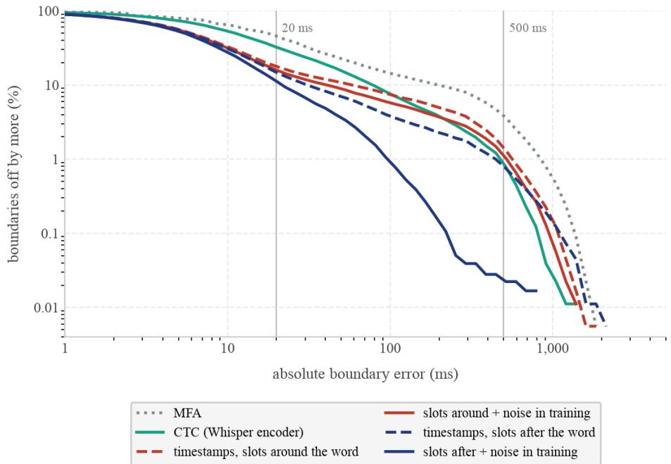  
Figure 16: Errors on the unchanged words of TIMIT at 20% mixed transcript noise: the share of boundaries off by more than each error, on log axes. Left of 20 ms, the timestamp models keep the most boundaries close. Right of 500 ms, the model with the slots around the word has more gross errors than the CTC model. With the slots after the word and noise in training, the gross errors are gone. The released large-v3 model’s curve lies on that one.

But its errors grow a heavy tail. A substituted or inserted word sometimes throws neighbouring boundaries more than half a second off: 0.60% of the unchanged boundaries on TIMIT with 10% substitutions, against 0.02% for the CTC model, and 1.68% against 0.17% on Seoul (Figure 17). There the timestamp model’s mean error rises from 11.4 to 34.9 ms, while the CTC model’s moves from 13.6 to 16.2. A CTC path smears a wrong word over its own span; the timestamp decoder reads the text and can lose its place. Deleted words hurt every aligner most, since the neighbours stretch over the missing word, and MFA fails on whole utterances when words are inserted (39 on TIMIT, 140 on Seoul).

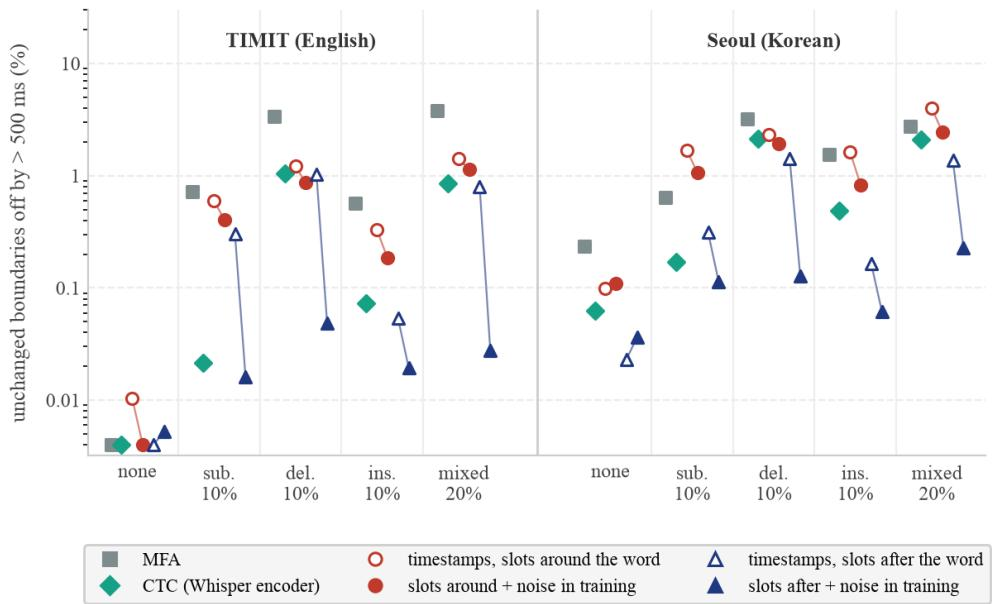  
Figure 17: Unchanged boundaries off by more than 500 ms, for each kind of transcript noise. None is the clean transcript, on the words the 10% mixed copy leaves unchanged. Hollow markers are runs trained on clean transcripts and filled ones runs trained with 10% noise; a thin line joins the two runs of each slot layout. A point on the bottom edge has no boundary that far off.

Training on noisy transcripts shrinks the tail. We perturbed the training transcripts the same way: a substituted word keeps the original word’s times, a deleted word drops out, and an inserted word gets a zero-length target in the middle of the gap after the word before it. With 10% of words perturbed, unchanged boundaries off by more than half a second on Seoul with substitutions fall from 1.68% to 1.06%, and at 20% mixed noise the mean error falls from 67.6 to 45.6 ms, level with the CTC model’s 45.2, with 83.9% of boundaries within 20 ms against its 77.2%. On clean transcripts it costs nothing: the seven-set mean moves by less than the seed spread. With the slots around the word, the tail shrinks by a third to a half but does not vanish: with substitutions on Seoul the CTC mode still has fewer gross errors (0.17%).

With the slots after the word, noise training also helps on clean transcripts. Trained with 10% noise in that layout, the model scores 12.68 ms over the seven test sets, against 13.02 without it (2 and 5 seeds; a difference of −0.34 ms, standard error 0.07). Most of the gain is on Switchboard’s conversations: 16.4 against 18.4 ms. It costs a little on the codecs no augmentation uses (0.4 ms).

And it removes the tail. With the slots after the word and noise in training, the error on a noisy transcript hardly moves from the clean one. At 20% mixed noise the released large-v3 model scores 10.9 ms on TIMIT’s unchanged words, against 10.6 with the clean transcript, and 12.5 against 10.8 ms on Seoul (Table 22). Only 0.02% of its TIMIT boundaries are off by more than half a second, against 0.86% for the CTC model and 3.83% for MFA. The slot order does part of this on its own: without noise training, the slots after the word already bring the default model’s error at that noise level from 34.9 to 22.9 ms.

## 8.15 Release recipe

The released models put three changes together: the slots after the word, the call-centre degrader in place of the six conditions, and 10% transcript noise in training. We trained the steps toward this recipe on four checkpoints: the release of Whisper-Scicom every earlier section used, a newer release fine-tuned on the same private data, and the public large-v3 and large-v3-turbo (Table 23).

Table 23: The release recipe, every arm with the slots after the word. Augmentation: our six telephone conditions, or the call-centre degrader, and with 10% transcript noise in training. Mean absolute error in ms, means over seeds; mean: the seven test sets in their own condition, with the share within 20 ms; codecs: TIMIT through the six codecs the conditions use; unseen: TIMIT through AMR-NB and G.723.1, which no augmentation uses.
<table><tr><td>checkpoint</td><td>augmentation</td><td>seeds</td><td>mean</td><td>TIMIT</td><td>codecs</td><td>unseen</td><td>Buckeye</td><td>SWB</td><td>Seoul</td><td>IFA</td><td>VoxAng.</td></tr><tr><td>Whisper-Scicom, earlier</td><td>six conditions</td><td></td><td>5 13.02 / 85.0</td><td>10.5</td><td>11.2</td><td>12.2</td><td>11.3</td><td>18.4</td><td></td><td>10.4 14.8</td><td>15.3</td></tr><tr><td>Whisper-Scicom, newer</td><td>six conditions</td><td>2</td><td>13.05 / 85.0</td><td>10.6</td><td>11.2</td><td>12.2</td><td>11.4</td><td>18.6</td><td></td><td>10.4 14.6</td><td>15.3</td></tr><tr><td>large-v3</td><td>six conditions</td><td>2</td><td>12.88 / 85.2</td><td>10.4</td><td>11.0</td><td>12.1</td><td>11.3</td><td>18.3</td><td></td><td>10.4 14.6</td><td>15.0</td></tr><tr><td>large-v3-turbo</td><td>six conditions</td><td>2</td><td>12.99 / 84.9</td><td>10.4</td><td>11.0</td><td>12.0</td><td>11.5</td><td>17.7</td><td></td><td>10.5 14.8</td><td>15.5</td></tr><tr><td>Whisper-Scicom, earlier six conditions + noise</td><td></td><td></td><td>212.68 / 85.2</td><td>10.7</td><td>11.3</td><td>12.6</td><td>11.1</td><td>16.4</td><td></td><td>10.4 14.6</td><td>15.2</td></tr><tr><td>Whisper-Scicom, newer</td><td>call-centre degrader</td><td></td><td>213.02 / 84.8</td><td>10.8</td><td>11.8</td><td>12.8</td><td>11.3</td><td>17.7</td><td></td><td>10.4 14.6</td><td>15.6</td></tr><tr><td>Whisper-Scicom, earlier</td><td>call-centre degrader</td><td>2</td><td>12.93 / 84.9</td><td>10.6</td><td>11.7</td><td>12.6</td><td>11.3</td><td>17.8</td><td></td><td>10.4 14.7</td><td>15.2</td></tr><tr><td>Whisper-Scicom, newer</td><td>degrader + noise</td><td></td><td>2 12.88 / 85.0</td><td>10.8</td><td>12.0</td><td>13.0</td><td>11.2</td><td>16.2</td><td></td><td>10.5 14.5</td><td>16.4</td></tr><tr><td>large-v3</td><td>degrader + noise</td><td>2</td><td>12.75 / 85.2</td><td>10.6</td><td>11.8</td><td>12.8</td><td>11.2</td><td>15.9</td><td></td><td>10.4 14.5</td><td>16.1</td></tr><tr><td>large-v3-turbo</td><td>degrader + noise</td><td></td><td>2 13.02 / 84.6</td><td>10.9</td><td>11.8</td><td>12.8</td><td>11.3</td><td>16.3</td><td>10.7 14.6</td><td></td><td>16.5</td></tr></table>

The checkpoint still barely matters. With the slots after the word and the six conditions, the newer Whisper-Scicom scores 13.05 ms over the seven test sets, large-v3 12.88 and turbo 12.99, against 13.02 for the earlier release. None of the differences reaches two standard errors.

The degrader buys robustness to degraded audio, not a measurable gain on Switchboard. On the newer Whisper-Scicom, the call-centre degrader in place of the six conditions moves Switchboard from 18.6 to 17.7 ms over two seeds, a difference of −0.9 ms with a standard error of 1.6; on the earlier release the difference is −0.6 ms (standard error 1.0). It costs on TIMIT’s simulated codecs, from 11.2 to 11.8 ms through the six and from 12.2 to 12.8 ms through the two neither augmentation uses, although the six conditions there are the very codecs the other models trained on. What it buys shows through the degrader itself (Table 19).

Transcript noise is what helps on real calls. Added to the degrader, noise training moves Switchboard by −1.5 ms (standard error 1.6); with the six conditions it moved it by −2.0 ms (standard error 0.3, Section 8.14). The full recipe ends at 15.9 ms on large-v3, 16.3 on turbo and 16.2 on the newer Whisper-Scicom, two seeds each, against 18.3, 17.7 and 18.6 with the slots after the word alone.

Released models. We release the first seed of the recipe on large-v3 and on large-v3-turbo, fixed before any test score was seen; the variant on Whisper-Scicom stays private with its base. On FA-Bench’s TIMIT core test they score 11.7 and 12.0 ms, at an F1 of 0.89 and 0.88 within 20 ms. On Switchboard’s real calls they score 16.0 and 16.7 ms, and through the call-centre degrader 13.4 and 14.1 ms on TIMIT (Section 8.11).

## 9 Conclusion

We set out to replace the aligner in our own stack with one that is precise against human boundaries, works across languages and holds up on telephone speech. Five changes moved the error, each measured against the one before (Figure 18).

1. Word timestamps from an encoder-decoder instead of a CTC path. Trained on human boundaries, Whisper predicting each word’s start and end as timestamp tokens scores 10.4 ms on clean TIMIT, where the MMS-300M CTC aligner our stack runs scores 46.8 ms. The head is what matters: a CTC head on the same encoder, trained the same way, scores 17.0 ms over the seven test sets against the timestamp model’s 14.0.

2. Telephone augmentation. Passing half the training clips through six simulated telephone channels brings TIMIT through those codecs from 17.1 to 11.2 ms and costs nothing on clean speech.

3. Timestamp slots after the word. The decoder reads a word before it times it. Switchboard’s telephone conversations go from 23.2 to 18.4 ms, and the seven-set mean from 14.0 to 13.0.

4. Transcript noise in training. With 10% of the training words substituted, deleted or inserted, Switchboard falls to 16.4 ms and the seven-set mean to 12.7, and a wrong word in the transcript no longer throws its neighbours half a second off (Section 8.14).

5. The call-centre degrader. Trained on audio degraded like real calls in place of the six channels, the released large-v3 model scores 13.4 ms on TIMIT through that degrader, against 16.4, and 15.9 ms on Switchboard.

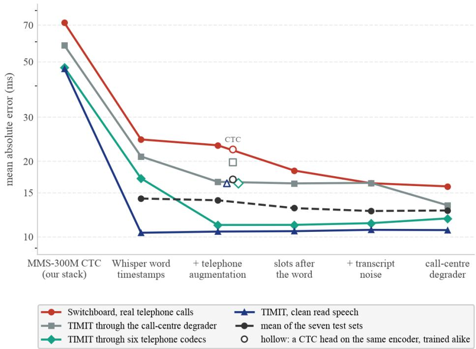  
Figure 18: How each change moved the error, on a log scale. Each step adds one change to the one before: our stack’s MMS-300M CTC aligner as it runs; Whisper predicting word timestamps, trained on human boundaries; telephone augmentation; the slots after the word; transcript noise in training; the call-centre degrader in place of the six channels. The last point is the released large-v3 model and the others are Whisper-Scicom, a difference that changes nothing measurable (Section 8.12). Hollow markers: a CTC head on the same encoder, trained like the third step. Means over each arm’s seeds (3, 5, 5, 2 and 2).

Two choices hold up every step: training only on boundaries people placed, and training on many languages, which cuts the error on the held-out languages by 31 to 53% against English alone (Section 8.4). Much else did not move the error: the adapters’ rank, learning rate and training length, full fine-tuning, a boundary head on the encoder, the Whisper checkpoint (Section 8.12) and finer timestamp tokens (Section 8.7).

## 10 Limitations

English ground truth in the pilot. All three human-labelled sets in the pilot are English, so whatever the pilot says about other languages is inference.

No external test. The trained models are tested on held-out speakers and recordings of the corpora they trained on, in English, Korean, Dutch and the VoxAngeles languages, so they know each test set’s labelling convention and MFA does not. Korean has 4 test speakers, Dutch 1, and VoxAngeles one per language, with one word per clip.

Mostly simulated telephone channels. Apart from Switchboard, the codecs are real and the line is not. Real networks add packet loss, transcoding chains, echo cancellation and automatic gain control, which the six simulated conditions do not model.

Defaults only in the pilot. Every existing aligner ran at its documented defaults. Several can be tuned, MFA most of all, and a tuned configuration may rank differently.

Few seeds. The adapter sweep reads each factor against 5 seeds of the default, and runs every other configuration once. Telephone augmentation cannot be repeated exactly: its random draws are not seeded.

Mirrors and licences. TIMIT (LDC93S1) and Buckeye are read from third-party Hugging Face copies, and the Switchboard excerpts from a public mirror of LDC-licensed audio. Results are for internal study until the licence position is confirmed.

## 11 Acknowledgement

This work was carried out at Scicom (MSC) Berhad. The author thanks Scicom for the compute and for the call-centre work that made the problem concrete.

## References

V. S. D. S. Mahesh Akavarapu, Michael Daniel, and Gerhard Jäger. Phoneme- and word-level metrics using self-supervised speech representations for forced alignment evaluation, 2026.

Mahmoud Ashraf. ctc-forced-aligner: Text to speech alignment using CTC forced alignment. https://github.com/MahmoudAshraf97/ctc-forced-aligner, 2024.

Max Bain, Jaesung Huh, Tengda Han, and Andrew Zisserman. WhisperX: Time-accurate speech transcription of long-form audio. In Proc. Interspeech 2023, pages 4489–4493, 2023. doi: 10.21437/Interspeech.2023-78.

Wei Chu, Yuanzhe Dong, Ke Tan, Dong Han, Yichao Zhou, Ruchao Fan, Bingshen Mu, Jingbei Li, Vishwas Shetty, Sarthak Bisht, Ziyue Qiu, Massa Baali, Rita Singh, and Bhiksha Raj. FA-Bench: A benchmark for word-level and phone-level forced-alignment and ASR timestamps under clean and noisy conditions, 2026.

Ronald Cole, Beatrice T. Oshika, Mike Noel, Terri Lander, and Mark Fanty. Labeler agreement in phonetic labeling of continuous speech. In Proc. 3rd International Conference on Spoken Language Processing (ICSLP 1994), pages 2131–2134, 1994. doi: 10.21437/ICSLP.1994-535.

Jean-Philippe Goldman. EasyAlign: An automatic phonetic alignment tool under Praat. In Proc. Interspeech 2011, pages 3233–3236, 2011. doi: 10.21437/Interspeech.2011-815.

Kyle Gorman, Jonathan Howell, and Michael Wagner. Prosodylab-aligner: A tool for forced alignment of laboratory speech. Canadian Acoustics, 39(3):192–193, 2011.

Alex Graves, Santiago Fernández, Faustino Gomez, and Jürgen Schmidhuber. Connectionist temporal classification: Labelling unsegmented sequence data with recurrent neural networks. In Proceedings of the 23rd International Conference on Machine Learning (ICML), pages 369–376, 2006. doi: 10.1145/1143844.1143891.

Jeff Hwang, Moto Hira, Caroline Chen, Xiaohui Zhang, Zhaoheng Ni, Guangzhi Sun, Pingchuan Ma, Ruizhe Huang, Vineel Pratap, Yuekai Zhang, Anurag Kumar, Chin-Yun Yu, Chuang Zhu, Chunxi Liu, Jacob Kahn, Mirco Ravanelli, Peng Sun, Shinji Watanabe, Yangyang Shi, Yumeng Tao, Robin Scheibler, Samuele Cornell, Sean Kim, and Stavros Petridis. TorchAudio 2.1: Advancing speech recognition, self-supervised learning, and audio processing components for PyTorch. In 2023 IEEE Automatic Speech Recognition and Understanding Workshop (ASRU), pages 1–9, 2023. doi: 10.1109/ASRU57964.2023.10389648.

Jian. stable-ts: Stabilizing timestamps for Whisper. https://github.com/jianfch/stable-ts, 2022.

Prad Kadambi, Tristan J. Mahr, Katherine C. Hustad, and Visar Berisha. A tunable forced alignment system based on deep learning: Applications to child speech. Journal ofSpeech, Language, and Hearing Research, 68(7S):3583–3601, 2025. doi: 10.1044/2024\_JSLHR-24-00347.

Matthew C. Kelley, Scott James Perry, and Benjamin V. Tucker. The Mason-Alberta phonetic segmenter: A forced alignment system based on deep neural networks and interpolation. Phonetica, 81(5):451–508, 2024. doi: 10.1515/phon-2024-0015.

Andreas Kipp, Maria-Barbara Wesenick, and Florian Schiel. Pronunciation modeling applied to automatic segmentation of spontaneous speech. In Proc. Eurospeech 1997, pages 1023–1026, 1997. doi: 10.21437/Eurospeech.1997-358.

Thomas Kisler, Uwe Reichel, and Florian Schiel. Multilingual processing of speech via web services. Computer Speech and Language, 45:326–347, 2017. doi: 10.1016/j.csl.2017.01.005.

Jia Xin Koh, Aqilah Mislan, Kevin Khoo, Brian Ang, Wilson Ang, Charmaine Ng, and Ying-Ying Tan. Building the Singapore English National Speech Corpus. In Proc. Interspeech, pages 321–325, 2019.

Zvi Kons, Avihu Dekel, Hagai Aronowitz, Vishal Sunder, and Ron Hoory. Word timestamps and speaker attribution with a non-autoregressive LLM, 2026.

Ludwig Kürzinger, Dominik Winkelbauer, Lujun Li, Tobias Watzel, and Gerhard Rigoll. CTCsegmentation of large corpora for German end-to-end speech recognition. In Speech and Computer (SPECOM 2020), Lecture Notes in Computer Science, pages 267–278. Springer, 2020. doi: 10.1007/978-3-030-60276-5\_27.

Jingbei Li, Yi Meng, Zhiyong Wu, Helen Meng, Qiao Tian, Yuping Wang, and Yuxuan Wang. NeuFA: Neural network based end-to-end forced alignment with bidirectional attention mechanism. In Proc. IEEE ICASSP 2022, pages 8007–8011, 2022. doi: 10.1109/ICASSP43922.2022.9747085.

Jérôme Louradour. whisper-timestamped. https://github.com/linto-ai/whispertimestamped, 2023.

Fabrice Malfrère and Thierry Dutoit. High-quality speech synthesis for phonetic speech segmentation. In Proc. Eurospeech 1997, pages 2631–2634, 1997. doi: 10.21437/Eurospeech.1997-664.

Michael McAuliffe, Michaela Socolof, Sarah Mihuc, Michael Wagner, and Morgan Sonderegger. Montreal forced aligner: Trainable text-speech alignment using Kaldi. In Proc. Interspeech 2017, pages 498–502, 2017. doi: 10.21437/Interspeech.2017-1386.

Michael McAuliffe, Kaylynn Gunter, Michael Wagner, and Morgan Sonderegger. Montreal forced aligner and the state of speech-to-text alignment in 2026, 2026.

Montreal Corpus Tools. MFA models documentation (mfa model 3.1.2): English alignment benchmarks and acoustic model listing. https://mfa-models.readthedocs.io/en/latest/, 2024.

Bingshen Mu, Xian Shi, Xiong Wang, Hexin Liu, Jin Xu, and Lei Xie. LLM-ForcedAligner: A non-autoregressive and accurate LLM-based forced aligner for multilingual and long-form speech, 2026.

Robert M. Ochshorn and Max Hawkins. Gentle forced aligner. https://github.com/ lowerquality/gentle, 2017.

Mark A. Pitt, Keith Johnson, Elizabeth Hume, Scott Kiesling, and William Raymond. The Buckeye corpus of conversational speech: Labeling conventions and a test of transcriber reliability. Speech Communication, 45:89–95, 2005.

Vineel Pratap, Andros Tjandra, Bowen Shi, Paden Tomasello, Arun Babu, Sayani Kundu, Ali Elkahky, Zhaoheng Ni, Apoorv Vyas, Maryam Fazel-Zarandi, Alexei Baevski, Yossi Adi, Xiaohui Zhang, Wei-Ning Hsu, Alexis Conneau, and Michael Auli. Scaling speech technology to 1,000+ languages. Journal ofMachine Learning Research, 25(97):1–52, 2024. URL http://jmlr.org/papers/ v25/23-1318.html.

Alec Radford, Jong Wook Kim, Tao Xu, Greg Brockman, Christine McLeavey, and Ilya Sutskever. Robust speech recognition via large-scale weak supervision. In International Conference on Machine Learning (ICML), volume 202 of Proceedings of Machine Learning Research, pages 28492–28518, 2023.

Elena Rastorgueva, Vitaly Lavrukhin, and Boris Ginsburg. NeMo forced aligner and its application to word alignment for subtitle generation. In Proc. Interspeech 2023, pages 5257–5258, 2023.

William D. Raymond, Mark Pitt, Keith Johnson, Elizabeth Hume, Matthew Makashay, Robin Dautricourt, and Craig Hilts. An analysis of transcription consistency in spontaneous speech from the Buckeye corpus. In Proc. ICSLP 2002, pages 1125–1128, 2002. doi: 10.21437/ICSLP.2002- 371.

Rotem Rousso, Eyal Cohen, Joseph Keshet, and Eleanor Chodroff. Tradition or innovation: A comparison of modern ASR methods for forced alignment. In Proc. Interspeech 2024, pages 1525–1529, 2024. doi: 10.21437/Interspeech.2024-429.

Rotem Rousso, Eyal Cohen, and Joseph Keshet. Fully differentiable neural forced alignment via soft dynamic programming, 2026.

Xian Shi, Yanni Chen, Shiliang Zhang, and Zhijie Yan. Achieving timestamp prediction while recognizing with non-autoregressive end-to-end ASR model. In Man-Machine Speech Communication (NCMMSC 2022), Communications in Computer and Information Science, pages 89–100. Springer Nature Singapore, 2023. doi: 10.1007/978-981-99-2401-1\_8.

Xian Shi, Xiong Wang, Zhifang Guo, Yongqi Wang, Pei Zhang, Xinyu Zhang, Zishan Guo, Hongkun Hao, Yu Xi, Baosong Yang, Jin Xu, Jingren Zhou, and Junyang Lin. Qwen3-ASR technical report, 2026.

Mithilesh Vaidya, Stephen Bailey, Sumukh Badam, Matthew Bendel, and Xingzhe He. FuseAlign: Forced alignment in the wild, 2026.

Laurin Wagner, Mario Zusag, and Bernhard Thallinger. Transcription policy as a latent variable: Activating controllable verbatim ASR with word-level timing, 2026.

Sung-Lin Yeh, Yen Meng, and Hao Tang. Whisper has an internal word aligner. In 2025 IEEE Automatic Speech Recognition and Understanding Workshop (ASRU), 2025. doi: 10.1109/ASRU65441. 2025.11434635.

Jiahong Yuan and Mark Liberman. Speaker identification on the SCOTUS corpus. In Proceedings of Acoustics ’08, Paris, 2008.

Albert Zeyer, Ralf Schlüter, and Hermann Ney. Why does CTC result in peaky behavior?, 2021.

Albert Zeyer, Ralf Schlüter, and Hermann Ney. Gradient-based speech-to-text alignment for any ASR model: From CTC to speech LLMs, 2026.

Jian Zhu, Cong Zhang, and David Jurgens. Phone-to-audio alignment without text: A semi-supervised approach. In Proc. IEEE ICASSP 2022, pages 8167–8171, 2022. doi: 10.1109/ICASSP43922. 2022.9746112.

Mario Zusag, Laurin Wagner, and Bernhard Thallinger. CrisperWhisper: Accurate timestamps on verbatim speech transcriptions. In Proc. Interspeech 2024, pages 1265–1269, 2024. doi: 10.21437/Interspeech.2024-731.

## A Transfer from English, every language

Table 24: Transfer from English, every language: the timestamp recipe trained on the English rows only (English) and on all training languages (all), on the same utterances. ∆: the change in the share of boundaries within 20 ms. Korean and Dutch are held-out speakers of the Seoul Corpus and IFA; the other rows are VoxAngeles, one speaker per language and one word per clip, so a row rests on a handful of boundaries (bound.: two per clip, so a language with one clip can only score 0, 50 or 100%). Trained: the language is in the multilingual training (other speakers); Whisper: Whisper’s pre-training covers it.
<table><tr><td colspan="9">within 20 ms (%)</td><td rowspan="2">MAE (ms)</td><td colspan="2"></td></tr><tr><td>language</td><td>code</td><td>clips</td><td>bound.</td><td>trained</td><td>Whisper</td><td>English</td><td>all</td><td>Δ</td><td>English</td><td>all</td></tr><tr><td rowspan="2">Korean (Seoul Corpus) Dutch (IFA)</td><td>kor</td><td>1,294</td><td>44,540</td><td>yes</td><td>yes</td><td>79</td><td>90</td><td>+11</td><td></td><td>24.2</td><td>11.3</td></tr><tr><td>nld</td><td>333</td><td>5,028</td><td>yes</td><td>yes</td><td></td><td>72 78</td><td>+7</td><td></td><td>22.1</td><td>15.5</td></tr><tr><td>Abkhazian</td><td>abk</td><td>5</td><td>10</td><td>yes</td><td>no</td><td></td><td>100 100</td><td></td><td>0</td><td>8.3</td><td>6.1</td></tr><tr><td>Achinese</td><td>ace</td><td>8</td><td>16</td><td>yes</td><td>no</td><td></td><td>50</td><td>75</td><td>+25</td><td>49.9</td><td>22.3</td></tr><tr><td>Adamawa Fulfulde</td><td>fub</td><td>1</td><td>2</td><td>yes</td><td>no</td><td></td><td>0</td><td>0</td><td>0</td><td>35.4</td><td>37.2</td></tr><tr><td>Adyghe</td><td>ady</td><td>116</td><td>232</td><td>no</td><td>no</td><td></td><td>50</td><td>73</td><td>+23</td><td>44.1</td><td>22.5</td></tr><tr><td>Afrikaans</td><td>afr</td><td>15</td><td>30</td><td>yes</td><td>yes</td><td></td><td>57</td><td>80</td><td>+23</td><td>24.0</td><td>14.1</td></tr><tr><td>Aghul</td><td>agx</td><td>4</td><td>8</td><td>yes</td><td>no</td><td></td><td>38</td><td>38</td><td>0</td><td>31.3</td><td>22.5</td></tr><tr><td>Akan</td><td>aka</td><td>4</td><td>8</td><td>yes</td><td>no</td><td></td><td>75</td><td>100</td><td>+25</td><td>15.9</td><td>6.3</td></tr><tr><td>Albay Bikol</td><td>bhk</td><td>3</td><td>6</td><td>yes</td><td>no</td><td></td><td>33</td><td>50</td><td>+17</td><td>57.9</td><td>19.5</td></tr><tr><td>Angami Naga</td><td>njm</td><td>7</td><td>14</td><td>yes</td><td>no</td><td></td><td>43</td><td>43</td><td>0</td><td>37.3</td><td>40.1</td></tr><tr><td>Armenian</td><td>hye</td><td>7</td><td>14</td><td>yes</td><td>yes</td><td></td><td>64</td><td>93</td><td>+29</td><td>20.7</td><td>8.4</td></tr><tr><td>Assamese</td><td>asm</td><td>11</td><td>22</td><td>yes</td><td>yes</td><td></td><td>68</td><td>91</td><td>+23</td><td>20.7</td><td>11.8</td></tr><tr><td>Bafut</td><td>bfd</td><td>2</td><td>4</td><td>yes</td><td>no</td><td></td><td>50 100</td><td></td><td>+50</td><td>54.6</td><td>10.4</td></tr><tr><td>Bambara</td><td>bam</td><td>8</td><td>16</td><td>yes</td><td>no</td><td></td><td>75</td><td>81</td><td>+6</td><td>15.4</td><td>12.4</td></tr><tr><td>Basque</td><td>eus</td><td>42</td><td>84</td><td>no</td><td>yes</td><td></td><td>85</td><td>96</td><td>+12</td><td>12.0</td><td>7.2</td></tr><tr><td>Bassa</td><td>bsq</td><td>2</td><td>4</td><td>yes</td><td>no</td><td></td><td>25</td><td>50</td><td>+25</td><td>91.1</td><td>18.5</td></tr><tr><td>Bemba (Zambia)</td><td>bem</td><td>4</td><td>8</td><td>yes</td><td>no</td><td></td><td>88</td><td>100</td><td>+12</td><td>9.9</td><td>5.7</td></tr></table>

<table><tr><td>language</td><td>code clips</td><td>bound.</td><td>trained</td><td>Whisper</td><td>English</td><td>all</td><td>within 20 ms (%)</td><td></td><td>MAE (ms) English</td></tr><tr><td></td><td></td><td></td><td>2</td><td></td><td></td><td></td><td>Δ</td><td></td><td>all</td></tr><tr><td>Bengali</td><td>ben 1</td><td>12</td><td>yes</td><td>yes</td><td>100 50</td><td>100 50</td><td>0</td><td>7.5 30.8</td><td>6.6 26.0</td></tr><tr><td>Bini</td><td>bin 6 8</td><td>16</td><td>yes</td><td>no no</td><td>69</td><td>75</td><td>0</td><td>28.0</td><td>24.1</td></tr><tr><td>Bukiyip</td><td>ape</td><td></td><td>yes</td><td></td><td></td><td></td><td>+6</td><td>24.1</td><td>14.5 19.1</td></tr><tr><td>Bura-Pabir</td><td>bwr</td><td>2 4</td><td>yes</td><td>no</td><td>75</td><td>75</td><td>0</td><td></td><td>17.9 16.4</td></tr><tr><td>Burmese</td><td>mya 12</td><td>24</td><td>yes</td><td>yes</td><td>58</td><td>83</td><td>+25</td><td>29.6</td><td>32.4</td></tr><tr><td>Cacua</td><td>cbv 5</td><td>10</td><td>yes</td><td>no</td><td>50</td><td>70</td><td>+20</td><td>40.2</td><td></td></tr><tr><td>Central Atlas Tamazight</td><td>tzm</td><td>2 4</td><td>yes</td><td>no</td><td>50</td><td>75</td><td>+25</td><td>115.9</td><td>16.5</td></tr><tr><td>Chamalal</td><td>cji</td><td>5 10</td><td>yes</td><td>no</td><td>70</td><td>80</td><td>+10</td><td>17.3</td><td></td></tr><tr><td>Chamorro</td><td>cha</td><td>5 10</td><td>yes</td><td>no</td><td>70</td><td>100</td><td>+30</td><td>24.2</td><td>6.1</td></tr><tr><td>Cherepon</td><td>cpn</td><td>11 22</td><td>yes</td><td>no</td><td>55</td><td>73</td><td>+18</td><td>27.0</td><td></td></tr><tr><td>Columbia-Wenatchi</td><td>col</td><td>6 12</td><td>yes</td><td>no</td><td>50</td><td>67</td><td>+17</td><td>25.4</td><td>25.4</td></tr><tr><td>Croatian</td><td>hrv</td><td>4 8</td><td>yes</td><td>yes</td><td>88</td><td>100</td><td>+12</td><td>8.3</td><td>6.9</td></tr><tr><td>Czech</td><td>ces</td><td>4 8</td><td>yes</td><td>yes</td><td>75</td><td>88</td><td>+12</td><td>17.6</td><td>10.2 8.2</td></tr><tr><td>Dagbani</td><td>dag 21</td><td>42</td><td>no</td><td>no</td><td>48</td><td>90</td><td>+43</td><td>57.2</td><td>10.2 10.7</td></tr><tr><td>Danish</td><td>dan</td><td>8 16</td><td>yes</td><td>yes</td><td>38</td><td>94</td><td>+56</td><td>42.6</td><td></td></tr><tr><td>Dari</td><td>prs</td><td>9 18</td><td>yes</td><td>yes</td><td>78</td><td>83</td><td>+6</td><td>14.3</td><td></td></tr><tr><td>Defaka</td><td>afn</td><td>5 10</td><td>yes</td><td>no</td><td>70</td><td>100</td><td>+30</td><td>12.0</td><td>7.3</td></tr><tr><td>Degema</td><td>deg</td><td>4 8</td><td>yes</td><td>no</td><td>75</td><td>100</td><td>+25</td><td>11.3</td><td>5.6</td></tr><tr><td>Dutch</td><td>nld</td><td>10 20</td><td>yes</td><td>yes</td><td>75</td><td>80</td><td>+5</td><td>15.1</td><td>12.9</td></tr><tr><td>Efik</td><td>efi</td><td>6 12</td><td>yes</td><td>no</td><td>58</td><td>83 +25 +17</td><td></td><td>38.9 77.4</td><td>13.9 17.4 12.7</td></tr><tr><td>Emai-Iuleha-Ora</td><td>ema</td><td>3 6</td><td>yes</td><td>no</td><td>50 30</td><td>67</td><td></td><td>52.2</td><td>8.7</td></tr><tr><td>Ewe</td><td>ewe</td><td>5 10</td><td>yes</td><td>no</td><td>62</td><td>70</td><td>+40</td><td>22.2</td><td>13.4</td></tr><tr><td>Finnish</td><td>fin</td><td>8 16</td><td>yes</td><td>yes</td><td></td><td>94 +31</td><td></td><td></td><td></td></tr><tr><td>Ga</td><td>gaa</td><td>3 6</td><td>yes</td><td>no</td><td>67</td><td>83 +17</td><td></td><td>32.0 23.2</td><td></td></tr><tr><td>Ganda</td><td>lug</td><td>5 10</td><td>yes</td><td>no</td><td>50 0</td><td>60 +10 +50</td><td></td><td>110.6</td><td>20.0</td></tr><tr><td>Gua</td><td>gwx</td><td>1 2</td><td>yes</td><td>no</td><td>57</td><td>50 93 +36</td><td></td><td>13.8</td><td>13.0 8.7 8.3</td></tr><tr><td>Gujarati</td><td>guj</td><td>7 14</td><td>yes yes</td><td>yes no</td><td>60</td><td>90 +30</td><td></td><td>13.8</td><td>11.1 20.4</td></tr><tr><td>Hakka Chinese</td><td>hak</td><td>5 10</td><td>no</td><td></td><td>72</td><td>86 +14</td><td></td><td>18.2</td><td></td></tr><tr><td>Hausa</td><td>hau</td><td>58 116</td><td></td><td>yes</td><td>62</td><td>62</td><td></td><td>26.3</td><td></td></tr><tr><td>Hawaiian</td><td>haw</td><td>8 16</td><td>yes 6</td><td>yes</td><td>100</td><td>100</td><td>0</td><td>7.7</td><td></td></tr><tr><td>Hebrew</td><td>heb</td><td>3</td><td>yes yes</td><td>yes</td><td>50</td><td>70 +20</td><td>0</td><td>33.4</td><td>6.4</td></tr><tr><td>Hiligaynon</td><td>hil</td><td>5 10</td><td></td><td>no</td><td>64</td><td>86 +21</td><td></td><td>16.1</td><td>24.6 10.6 8.4 17.5</td></tr><tr><td>Hindi</td><td>hin</td><td>7 14</td><td>yes</td><td>yes</td><td>85</td><td>85</td><td></td><td>12.4</td><td>9.5</td></tr><tr><td>Hungarian</td><td>hun</td><td>10 20</td><td>yes no</td><td>yes</td><td>61</td><td>78 +18</td><td>0</td><td>28.1</td><td></td></tr><tr><td>Ibibio</td><td>ibb</td><td>60 120</td><td>yes</td><td>no</td><td>64</td><td>86 +23</td><td></td><td>28.7</td><td></td></tr><tr><td>Icelandic</td><td>isl</td><td>11 22</td><td>8 yes</td><td>yes no</td><td>75</td><td>100 +25</td><td></td><td>12.1</td><td>4.6</td></tr><tr><td>Idoma</td><td>idu</td><td>4</td><td>6 yes</td><td>no</td><td>67</td><td>83 +17</td><td></td><td>17.4</td><td>11.8</td></tr><tr><td>Igbo</td><td>ibo</td><td>37</td><td>14 yes</td><td>no</td><td>86</td><td>93 +7</td><td></td><td>10.6</td><td>6.4 10.2 15.2</td></tr><tr><td>Iloko</td><td>ilo</td><td>14 28</td><td>yes</td><td>yes</td><td>75</td><td>89 +14</td><td></td><td>15.9 33.3</td><td>9.4 6.6</td></tr><tr><td>Iranian Persian Jola-Fonyi</td><td>pes dyo</td><td>4</td><td>8 yes 6</td><td>no</td><td>38</td><td>88 +50 +17</td></table>