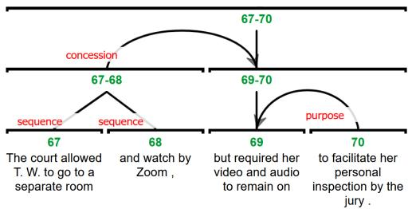
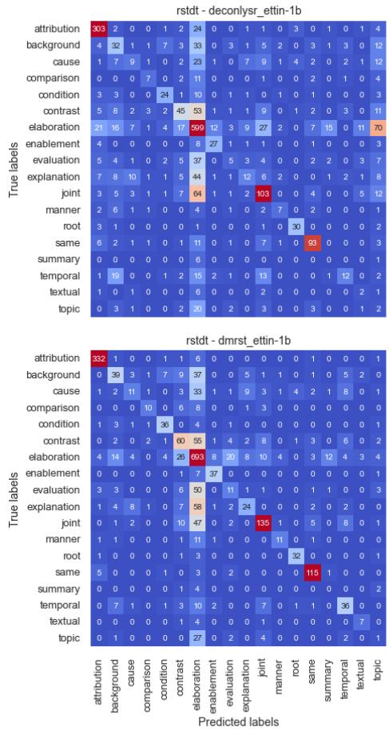
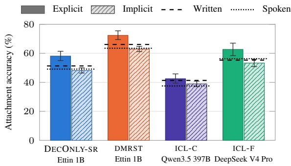
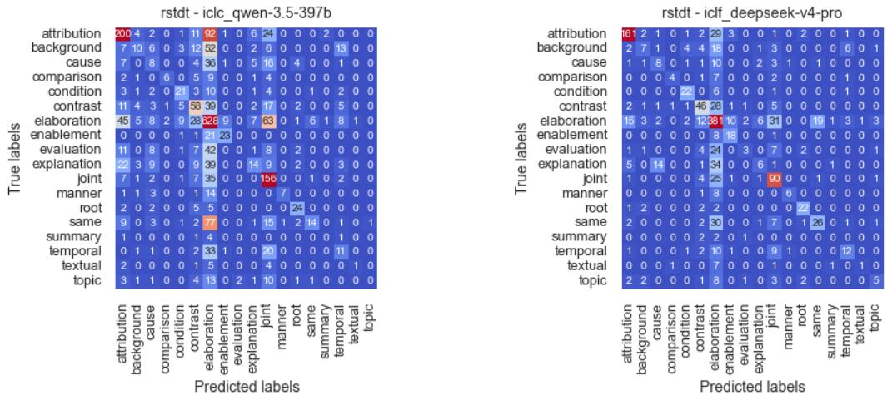

# Worth Their Weights? Evaluating Generative Models for Discourse Parsing

Luke Gessler Indiana University Bloomington Department of Linguistics lgessler@iu.edu

Amir Zeldes Georgetown University Department of Linguistics amir.zeldes@georgetown.edu

## Abstract

Rhetorical Structure Theory (RST) parsing has historically been dominated by discriminative models based on pretrained encoder-only language models. The recent availability of highquality generative language models has made it unclear whether RST parsing is better approached as a generative task. In this work, we investigate whether generative language models are better at parsing RST than traditional discriminative ones. We find that at matched parameter counts, discriminative parsers perform much better than generative ones, though much larger generative models sometimes outperform them. Generative models hold a particular advantage in elementary discourse unit (EDU) segmentation, and we report new stateof-the-art results on the RST-DT benchmark in end-to-end parsing as well as segmentation.

## 1 Introduction

Natural language texts and conversations are not just homogeneous sequences of sentences: they can be split into meaningful subparts, which play specific roles and may be more or less prominent than one another (Stede, 2012, 1–5). The task of hierarchical discourse parsing consists of segmenting an arbitrary input document into minimal Elementary Discourse Units (EDUs, roughly corresponding to clauses), grouping them into such subparts hierarchically, and labeling their roles using a fixed inventory (Marcu, 2000), most commonly in the framework of Rhetorical Structure Theory (RST, Mann and Thompson 1988, see Figure 1).

Discourse parsing has been used for relation extraction, for example in computational social science (Zaczynska and Stede, 2024) (e.g. to identify all CONCESSION relations that a politician has conceded in past speeches), as an LLM pretraining/instruction fine-tuning task (Iter et al., 2020; Liu and Demberg, 2024) or architectural component (Bhatia et al., 2015; Liu et al., 2026; Tran et al.,

  
Figure 1: RST tree fragment from the GUM corpus: The most central EDU [69] has a less central PURPOSE satellite, forming unit [69-70] which has a CONCESSION satellite, itself a temporal SEQUENCE of two EDUs.

2026; Chen et al., 2026), and for theoretical (Sun et al., 2021; Peng, 2023; Tsipidi et al., 2024; Souza et al., 2025), applied (Kong et al., 2018) or literary (Alexandropoulos, 2015) linguistic research.

RST parsing has historically been dominated by task-specific architectures, which, in the earlier neural age, harnessed pretrained encoders, and usually operated on gold EDU inputs. However, in recent years, the model landscape has shifted dramatically. It is no longer obvious whether the best RST parser is (a) a discriminative parser using a bidirectional encoder, (b) a generative parser obtained by finetuning an open-weight LM to emit a linearized tree, or (c) a large LM prompted in context with no training at all. Further, prior comparisons are confounded by differing data preparation, tree binarization, and evaluation conventions (Morey et al., 2017), and most experimental results are difficult to reproduce for researchers, and hard to use for applications due to engineering issues.

In this paper we investigate 5 research questions:

RQ1. Under matched data and evaluation conditions, which family of parser produces the highest-quality parses in end-to-end and gold EDU settings?

RQ2. How does performance trade off against the scale of the pretrained language model (PLM) and interact with family?

RQ3. Within the generative family, how do PLM architecture (encoder-decoder vs. decoderonly) and tree serialization scheme (bottomup shift-reduce vs. top-down S-expression) each affect parsing quality?

RQ4. What differences in error patterns emerge between families and how much error is attributable to segmentation rather than tree structure and labeling?

RQ5. Are the answers to these questions stable across languages and datasets?

To answer these questions, we carry out a comprehensive evaluation controlling for LM and parser architecture, and release a suite of easily usable models for practical RST parsing at stateof-the-art (SotA) or near SotA performance. Our primary contributions are the following:

1. We report rigorous apples-to-apples comparisons of several variants of three model families, showing that encoders outperform alternatives at matched parameter counts and rival much larger decoder models.

2. We set new SotA results on RST-DT for EDU segmentation (98.2 F<sub>1</sub>) and end-to-end parsing (55.1 Full).

3. We document a previously unnoticed advantage of large generative parsers in EDU segmentation.

4. We report numbers for five languages using current architectures.

5. We release code and select off-the-shelf runnable parsers for five languages at https: //github.com/larc-iu/dipo.

## 2 Related Work

Previous work on neural RST parsing focused on either recursive top-down or bottom up (e.g. shiftreduce) transition parsing over BERT-style encoders (Guz and Carenini, 2020; Nguyen et al., 2021; Kobayashi et al., 2022), usually evaluating on gold-standard EDU input. In the top-down framework, Nguyen et al. (2021) model parsing as a sequence of splitting decisions at token boundaries, so that EDU segmentation falls out of parsing rather than preceding it, and the DMRST parser (Liu et al., 2021) trains segmentation and top-down parsing jointly. Older work has also suffered from inconsistent evaluation paradigms, laid out in detail by Morey et al. (2017), whose evaluation recommendations we adopt.

More recent work using the generative family of models is represented by Hu and Wan (2023), who propose direct text to tree generation for sentenceand document-level parsing with constrained decoding, and Maekawa et al. (2024), who fine-tune Llama 2 with QLoRA at up to 70B parameters to predict one parsing action per prompt from the current stack and queue, find bottom-up parsing 1–2 points better than top-down and zero-shot prompting far worse, and report current SotA results on English datasets including the RST Discourse Treebank (RST-DT, Carlson et al. 2001) and an older version of the Georgetown University Multilayer Corpus (GUM, Zeldes 2017). Li et al. (2024) similarly compare plain and transition-based target serializations for LLM-based dialogue discourse parsing. Multilingual evaluation remains rarer (Braud et al., 2017; Liu et al., 2021; Chistova, 2025), and we are aware of no decoder-based work.

## 3 Data

As in most previous work, we use two English corpora, RST-DT (LDC2002T07, Wall Street Journal newswire, Carlson et al., 2001) with the standard 18-relation coarse inventory, under the DISRPT 2025 partition (Braud et al., 2025) of 309 train, 38 dev, and 38 test documents, and GUM v12.1 (multi-genre written and spoken text, Zeldes, 2017) with its 32-relation fine-grained inventory, under its official partition (211/32/32, two dev and two test documents from each of sixteen genres). We evaluate on the full 38-document RST-DT test set. Following common practice in prior work, trees are binarized right-branching.

To address RQ5 we add one dataset in each of four further languages, using DISRPT 2025 partitions. For Basque we use the RST Basque TreeBank (Iruskieta et al., 2013), 116/23/24 documents from domains including medical, terminological and scientific. For German we use the Potsdam Commentary Corpus (PCC, Stede and Neumann, 2014), v2.2 (Bourgonje and Stede, 2020), 141/17/17 newspaper commentaries. For Persian we use the Persian RST Corpus (Shahmohammadi et al., 2021), 120/15/15 journalistic texts annotated with RST-DT relation classes. For Chinese we use GCDT (Peng et al., 2022), 40/5/5 documents drawn from 5 genres using the same relation inventory as GUM. These four languages span three scripts and three language families, one of them an isolate. DISRPT releases segmentation and relation-pair data but not constituent trees, so we take partitions from DISRPT and the trees from each corpus’s own release (see Appendix A for preprocessing details).

## 4 Methods

## 4.1 Parsers

We compare three broad families of parsers: discriminative parsers, fine-tuned generative parsers, and LLMs used as parsers via in-context learning. All parsers in this work are original implementations, which we release at https://github.com/ larc-iu/dipo.

## 4.1.1 Discriminative parsers

The first family follows the dominant pre-LLM strategy: a pretrained bidirectional encoder yields a contextualized representation of the document’s tokens, and task-specific discriminative heads make all structural and labeling decisions. We compare three variants, all of which use greedy decoding.

TOPDOWN Following Kobayashi et al. (2022), we represent each span by the average of its two boundary token representations. Parsing recursively splits the current span: a deep biaffine scorer over the candidate left and right sub-spans selects the split point, and a second biaffine over the same pair predicts the resulting node’s label, which unlike Kobayashi et al. we model as a joint nuclearityand-relation class.

SHIFTREDUCE The second parser, also based on Kobayashi et al. (2022), is transition-based, with the same span representation. Instead of recursively splitting top-down, a shift-reduce parser is used to successively combine units bottom-up. The parser is trained with teacher forcing on the gold oracle’s action sequence. Note that TOPDOWN and SHIFTREDUCE both assume gold EDUs and therefore cannot be applied to raw text.

DMRST DMRST (Liu et al., 2021) is our only discriminative parser capable of “end-to-end” parsing, i.e. without EDU boundaries as inputs. Following Chistova (2024), we augment its segmentation module with a linear chain conditional random field. The parser obtains a mean-pooled representation for each EDU and applies a gated recurrent unit (GRU) encoder to them. A separate GRU decoder then builds the tree over the EDU representations top-down, as in TOPDOWN, selecting each split by pointer attention (Vinyals et al., 2015) over the EDUs inside the current span and labeling it with a biaffine classifier. Segmentation and parsing train jointly, with the three losses (segmentation, split, label) combined by dynamic weighting.

RST tree: EDUs: e =The cat sat., e =It was tired., e =So   
it slept.   
Structure: (e<sub>1</sub> e<sub>2</sub>)<sub>SN:elaboration</sub> e<sub>3</sub> <sub>:background</sub>.   
Fine-tuned generative parsers   
Shift-reduce (SR):   
The cat sat . <shift> It was tired . <shift>   
<reduce\_sn\_elaboration> So it slept . <shift>   
<reduce\_ns\_background>   
S-expression (SEXP):   
{ { { The cat sat . } { It was tired . } SN   
elaboration <label\_end> } { So it slept . } NS   
background <label\_end> }   
In-context learning   
Segmentation output:   
The cat sat . || It was tired . || So it slept .   
Parsing output:   
The cat sat . <shift> It was tired . <shift> SN   
elaboration <label\_end> So it slept . <shift>   
NS background <label\_end>  
Figure 2: A three-EDU tree and its serializations. For the fine-tuned generative parsers, every element in < > is a single special token added to the PLM’s tokenizer. ICL takes two calls: the model marks EDU boundaries in the raw text, then parses its own segmented output. For ICL, < > encloses ordinary strings.

PLMs Pretrained representation quality is essential for parser performance (Kobayashi et al., 2022). We use a recent English model, Ettin (Weller et al., 2026), at 150M, 400M, and 1B parameters. We choose Ettin for its high quality and because it also comes with decoder-only variants of each model trained identically, which allows us to cleanly control for architecture (cf. Table 3). We train only DMRST, the strongest discriminative parser, on all 3 model sizes, and train TOPDOWN and SHIFTRE-DUCE on only Ettin-400M in order to keep experiment count manageable. For the four non-English languages we use XLM-R base (270M parameters, Conneau et al., 2020), since Ettin is English-only. We discuss our model choices and give full settings in Appendix B.

## 4.1.2 Generative parsers

RST parsing can also be cast as sequence generation: the model reads a document’s raw text and generates a serialization of its tree. Hu and Wan (2023) do this with an S-expression serialization, but their decoding constraints still admit unbalanced brackets, which have to be repaired in postprocessing. We devise two novel serialization schemes, shown in Figure 2 and detailed in Appendix C, which overcome this limitation.

SEXP nests EDUs in curly braces, with each node’s nuclearity and relation spelled out as a postfix in normal tokens after its children. SR encodes the tree as the actions of a shift-reduce parser, with each reduce and its nuclearity–relation label fused into a single new token. In both, the source text is reproduced by a special copy action that emits the next source token, rather than by constraining the vocabulary as Hu and Wan do. Constrained decoding guarantees that every output is well formed, and also lets us evaluate generative parsers with gold EDUs by forcing an EDU boundary exactly at each gold boundary. All generative parsers are trained with a curriculum that grows from small subtrees to full documents.

PLMs We use T5Gemma 2 1B-1B (Zhang et al., 2025), Gemma 3 1B (Gemma Team, 2025), Gemma 4 31B (Gemma Team, 2026), and Qwen 3.6 27B (Qwen Team, 2026b), training each model on both serialization schemes.

## 4.1.3 In-context learning

The third family frames RST parsing as an incontext learning (ICL) task, where the model is given k gold-annotated input–output pairs from the training split of the given corpus and a full label inventory before it makes its predictions.

We exclusively use a variant of the shift-reduce serialization scheme, as shown in Figure 2. Preliminary experiments showed that models tend to struggle with performing segmentation and parsing simultaneously, and we therefore use a two-step approach where the model first segments and then is prompted again with its own output to perform parsing with the predicted EDUs. We formulate two variants of this approach below.

ICL-F (Frontier) A large near-frontier LLM is used through a hosted API, with no constraint on decoding. No commercial provider offers grammarconstrained decoding expressive enough for our serialization schema, so the model must adhere to it unassisted. Any malformed output sequence is recorded as a failure and is treated as a wholly incorrect prediction. We use DeepSeek V4 Pro (1.6T parameters, DeepSeek-AI, 2026), served in fp8 through a hosted API accessed via OpenRouter. We prefer an open-weight model over an API-only model such as those provided by OpenAI and Anthropic in the interest of reproducibility.

ICL-C (Constrained) A self-hosted open-weight LLM is used via llama.cpp (Gerganov and llama.cpp contributors, 2023). The models we selfhost are relatively small, but llama.cpp offers a sophisticated grammar-constrained decoding feature, which allows us to enforce our serialization schema so that malformed outputs are impossible. We use Qwen3.5-397B-A17B and Qwen3.5-122B-A10B (Qwen Team, 2026a). Due to hardware constraints, we use quantized versions of both: UD-Q4\_K\_XL and Q8\_0, respectively. See Appendix D for details.

## 4.2 Training and inference

Every discriminative and generative parser is adapted with LoRA (Hu et al., 2022) (rank 16, α = 32), which a preliminary comparison on RST-DT finds comparable to full fine-tuning. The discriminative parsers are optimized with AdamW (Loshchilov and Hutter, 2019) and the generative ones with Adafactor (Shazeer and Stern, 2018). Every parser decodes greedily, as is standard in RST parsing—beam search helps only configurations already well below the best (Appendix C.3). Hyperparameters follow prevailing practice, with tuning confined to RST-DT development data and a single PLM per family. Due to the large number of experiments in this work, each configuration is trained and evaluated only once. See Appendices B and C for full details.

## 4.3 Evaluation

We report micro-averaged Parseval F-scores (S, N, R, F) over the n − 1 internal constituents of each binarized n-EDU tree: span, nuclearity, relation, and the Parseval full F-score, which we refer to below simply as Full. Following Morey et al. (2017), we exclude trivial single-EDU leaf spans from the counts and key each constituent on its parent span rather than scoring one entry per child, as in RST-Parseval. For end-to-end systems we additionally report segmentation quality (Seg) as per-token BeginSeg F<sub>1</sub>, computed with the official scorer of the DISRPT 2025 shared task (Braud et al., 2025). A predicted segmentation that does not reproduce the document text exactly is projected onto the gold token stream, and a document with no prediction scores zero while staying in the denominator.

## 5 Results

For English, Table 1 reports end-to-end results, and Table 2 reports gold EDU results. All ICL-

<table><tr><td></td><td></td><td colspan="5">RST-DT (coarse)</td><td colspan="5">GUM (fine)</td></tr><tr><td>System</td><td>PLM</td><td>Seg</td><td>S</td><td>N</td><td>R</td><td>F</td><td>Seg</td><td>S</td><td>N</td><td>R</td><td>F</td></tr><tr><td colspan="10">Discriminative (LoRA fine-tuned encoder)</td></tr><tr><td>DMRST</td><td>Ettin-150M</td><td>96.0</td><td>72.5</td><td>60.9</td><td>49.9</td><td>48.6</td><td>93.7</td><td>66.6</td><td>52.8</td><td>40.5</td><td>40.3</td></tr><tr><td>DMRST</td><td>Ettin-400M</td><td>96.7</td><td>75.2</td><td>64.6</td><td>54.3</td><td>52.5</td><td>94.7</td><td>72.3</td><td>58.4</td><td>46.7</td><td>46.5</td></tr><tr><td>DMRST</td><td>Ettin-1B</td><td>96.5</td><td>75.7</td><td>64.5</td><td>53.5</td><td>52.0</td><td>94.8</td><td>71.1</td><td>58.0</td><td>46.5</td><td>46.3</td></tr><tr><td colspan="10">Generative (LoRA fine-tuned LM)</td></tr><tr><td>ENCDEC-SR</td><td>T5Gemma 2 1B-1B</td><td>97.8</td><td>72.2</td><td>62.4</td><td>52.6</td><td>51.4</td><td>95.4</td><td>65.1</td><td>50.5</td><td>39.4</td><td>39.2</td></tr><tr><td>ENCDEC-SEXP</td><td>T5Gemma 2 1B-1B</td><td>95.1</td><td>66.0</td><td>56.6</td><td>47.2</td><td>46.0</td><td>90.5</td><td>53.6</td><td>43.3</td><td>33.9</td><td>33.7</td></tr><tr><td>DECONLY-SR</td><td>Gemma 3 1B</td><td>96.7</td><td>65.9</td><td>55.7</td><td>46.6</td><td>45.7</td><td>93.9</td><td>55.9</td><td>40.9</td><td>31.3</td><td>31.1</td></tr><tr><td>DECONLY-SEXP</td><td>Gemma 3 1B</td><td>92.5</td><td>50.4</td><td>42.0</td><td>35.6</td><td>34.4</td><td>76.1</td><td>30.6</td><td>23.3</td><td>18.1</td><td>17.9</td></tr><tr><td>DECONLY-SR</td><td>Gemma 4 31B</td><td>98.2</td><td>76.7</td><td>66.4</td><td>56.4</td><td>55.1</td><td>95.7</td><td>68.2</td><td>54.3</td><td>44.0</td><td>43.9</td></tr><tr><td>DECONLY-SR</td><td>Qwen 3.6 27B</td><td>98.2</td><td>76.3</td><td>65.9</td><td>56.3</td><td>54.9</td><td>95.9</td><td>71.2</td><td>57.7</td><td>46.7</td><td>46.4</td></tr><tr><td>DECONLY-SEXP</td><td>Gemma 4 31B</td><td>94.9</td><td>66.5</td><td>57.4</td><td>48.8</td><td>47.5</td><td>90.6</td><td>55.6</td><td>45.1</td><td>36.7</td><td>36.6</td></tr><tr><td>DECONLY-SEXP</td><td>Qwen 3.6 27B</td><td>95.8</td><td>65.4</td><td>57.5</td><td>49.1</td><td>47.5</td><td>92.0</td><td>59.4</td><td>48.6</td><td>38.8</td><td>38.6</td></tr><tr><td colspan="10">In-context (no training)</td></tr><tr><td>ICL-F (unconstrained)</td><td>DeepSeek V4 Pro</td><td>66.3</td><td>46.3</td><td>36.2</td><td>30.3</td><td>28.2</td><td>60.2</td><td>40.4</td><td>28.4</td><td>19.8</td><td>19.4</td></tr><tr><td>ICL-C (grammar)</td><td>Qwen 3.5 397B</td><td>89.4</td><td>54.4</td><td>33.5</td><td>30.2</td><td>24.0</td><td>84.7</td><td>48.4</td><td>27.1</td><td>17.5</td><td>15.3</td></tr><tr><td>ICL-C (grammar)</td><td>Qwen 3.5 122B</td><td>86.5</td><td>40.7</td><td>24.7</td><td>20.2</td><td>17.5</td><td>83.1</td><td>36.8</td><td>19.7</td><td>11.1</td><td>10.0</td></tr></table>

Table 1: End-to-end parsing results on RST-DT and GUM.

<table><tr><td></td><td></td><td colspan="4">RST-DT (coarse)</td><td colspan="4">GUM (fine)</td></tr><tr><td>System</td><td>PLM</td><td>S</td><td>N</td><td>R</td><td>F</td><td>S</td><td>N</td><td>R</td><td>F</td></tr><tr><td colspan="10">Discriminative (LoRA fine-tuned encoder)</td></tr><tr><td>TOPDOWN</td><td>Ettin-400M</td><td>78.3</td><td>67.4</td><td>56.2</td><td>54.8</td><td>76.9</td><td>63.1</td><td>50.3</td><td>50.0</td></tr><tr><td>SHIFTREDUCE</td><td>Ettin-400M</td><td>77.0</td><td>66.5</td><td>54.7</td><td>53.5</td><td>76.0</td><td>62.7</td><td>50.7</td><td>50.3</td></tr><tr><td>DMRST</td><td>Ettin-150M</td><td>76.3</td><td>65.2</td><td>54.2</td><td>52.6</td><td>72.5</td><td>59.5</td><td>47.1</td><td>46.8</td></tr><tr><td>DMRST</td><td>Ettin-400M</td><td>78.0</td><td>68.1</td><td>57.3</td><td>55.5</td><td>76.4</td><td>63.7</td><td>51.5</td><td>51.3</td></tr><tr><td>DMRST</td><td>Ettin-1B</td><td>79.5</td><td>69.1</td><td>58.1</td><td>56.5</td><td>75.7</td><td>63.6</td><td>51.6</td><td>51.4</td></tr><tr><td colspan="10">Generative (LoRA fine-tuned LM)</td></tr><tr><td>ENCDEC-SR</td><td>T5Gemma 2 1B-1B</td><td>74.7</td><td>64.8</td><td>55.1</td><td>53.9</td><td>68.8</td><td>54.5</td><td>42.4</td><td>42.3</td></tr><tr><td>ENCDEC-SEXP</td><td>T5Gemma 2 1B-1B</td><td>64.8</td><td>55.5</td><td>46.7</td><td>45.5</td><td>55.0</td><td>45.6</td><td>36.1</td><td>36.0</td></tr><tr><td>DECONLY-SR</td><td>Gemma 3 1B</td><td>69.5</td><td>59.1</td><td>49.7</td><td>48.7</td><td>60.9</td><td>46.3</td><td>35.0</td><td>34.9</td></tr><tr><td>DECONLY-SEXP</td><td>Gemma 3 1B</td><td>49.4</td><td>42.1</td><td>35.4</td><td>34.5</td><td>36.5</td><td>29.0</td><td>22.6</td><td>22.5</td></tr><tr><td>DECONLY-SR</td><td>Gemma 4 31B</td><td>77.8</td><td>68.3</td><td>58.5</td><td>57.2</td><td>72.0</td><td>59.4</td><td>48.1</td><td>48.0</td></tr><tr><td>DECONLY-SR</td><td>Qwen 3.6 27B</td><td>78.3</td><td>68.2</td><td>58.6</td><td>57.3</td><td>74.4</td><td>61.7</td><td>50.0</td><td>49.7</td></tr><tr><td>DECONLY-SEXP</td><td>Ġemma 4 31B</td><td>66.3</td><td>57.8</td><td>49.7</td><td>48.3</td><td>54.3</td><td>45.0</td><td>36.5</td><td>36.3</td></tr><tr><td>DECONLY-SEXP</td><td>Qwen 3.6 27B</td><td>65.3</td><td>57.2</td><td>49.7</td><td>48.1</td><td>58.4</td><td>48.5</td><td>39.0</td><td>38.9</td></tr><tr><td colspan="10">In-context (no training)</td></tr><tr><td>ICL-F (unconstrained)</td><td>DeepSeek V4 Pro</td><td>41.5</td><td>33.2</td><td>27.3</td><td>25.2</td><td>35.7</td><td>26.6</td><td>18.9</td><td>18.3</td></tr><tr><td>ICL-C (grammar)</td><td>Qwen 3.5 397B</td><td>60.9</td><td>39.3</td><td>33.6</td><td>28.1</td><td>56.4</td><td>32.7</td><td>23.2</td><td>20.1</td></tr><tr><td>ICL-C (grammar)</td><td>Qwen 3.5 122B</td><td>51.3</td><td>31.5</td><td>27.1</td><td>21.7</td><td>48.8</td><td>28.2</td><td>16.0</td><td>14.6</td></tr></table>

Table 2: Gold EDU parsing results on RST-DT and GUM.

<table><tr><td></td><td colspan="6">RST-DT</td><td colspan="6">GUM</td></tr><tr><td></td><td colspan="3">DMRST (enc.)</td><td colspan="3">DECONLY-SR (dec.)</td><td colspan="3">DMRST (enc.)</td><td colspan="3">DECONLY-SR (dec.)</td></tr><tr><td>Ettin</td><td>Seg</td><td>E2E</td><td>Gold</td><td>Seg</td><td>E2E</td><td>Gold</td><td>Seg</td><td>E2E</td><td>Gold</td><td>Seg</td><td>E2E</td><td>Gold</td></tr><tr><td>150M</td><td>96.0</td><td>48.6</td><td>52.6</td><td>92.6</td><td>31.5</td><td>38.3</td><td>93.7</td><td>40.3</td><td>46.8</td><td>89.6</td><td>19.2</td><td>26.1</td></tr><tr><td>400M</td><td>96.7</td><td>52.5</td><td>55.5</td><td>94.5</td><td>35.3</td><td>41.3</td><td>94.7</td><td>46.5</td><td>51.3</td><td>91.9</td><td>22.5</td><td>27.6</td></tr><tr><td>1B</td><td>96.5</td><td>52.0</td><td>56.5</td><td>95.7</td><td>39.6</td><td>44.4</td><td>94.8</td><td>46.3</td><td>51.4</td><td>93.0</td><td>27.9</td><td>32.5</td></tr></table>

Table 3: Parsing results using matched Ettin encoders and decoders: segmentation $F _ { 1 }$ (Seg), and Full end to end (E2E) and with gold EDUs (Gold).

<table><tr><td rowspan="2">System</td><td rowspan="2">PLM</td><td colspan="5">End-to-end</td><td colspan="4">Gold EDU</td></tr><tr><td>Seg</td><td>S</td><td>N</td><td>R</td><td>F</td><td>S</td><td>N</td><td>R</td><td>F</td></tr><tr><td colspan="10">Basque (RST Basque TreeBank)</td></tr><tr><td>DMRST</td><td>XLM-R base</td><td>88.1</td><td>62.5</td><td>42.3</td><td>28.2</td><td>27.4</td><td>71.1</td><td>50.1</td><td>33.4</td><td>33.1</td></tr><tr><td>ENCDEC-SR</td><td>T5Gemma 2 1B-1B</td><td>89.4</td><td>52.5</td><td>32.8</td><td>22.2</td><td>21.9</td><td>58.1</td><td>34.6</td><td>24.3</td><td>24.0</td></tr><tr><td>DECONLY-SR</td><td>Qwen 3.6 27B</td><td>92.7</td><td>58.8</td><td>31.8</td><td>19.2</td><td>18.6</td><td>61.3</td><td>33.4</td><td>19.4</td><td>19.1</td></tr><tr><td colspan="10">German (PCC)</td></tr><tr><td>DMRST</td><td>XLM-R base</td><td>91.1</td><td>55.9</td><td>30.2</td><td>19.0</td><td>18.2</td><td>64.2</td><td>36.5</td><td>23.8</td><td>23.1</td></tr><tr><td>ENCDEC-SR</td><td>T5Gemma 2 1B-1B</td><td>95.8</td><td>57.5</td><td>29.9</td><td>15.5</td><td>15.1</td><td>62.3</td><td>35.0</td><td>18.8</td><td>18.5</td></tr><tr><td>DECONLY-SR</td><td>Qwen 3.6 27B</td><td>95.9</td><td>66.8</td><td>27.7</td><td>16.6</td><td>16.6</td><td>71.9</td><td>29.2</td><td>18.5</td><td>18.1</td></tr><tr><td colspan="10">Persian (Persian RST Corpus)</td></tr><tr><td>DMRST</td><td>XLM-R base</td><td>91.6</td><td>59.6</td><td>43.3</td><td>34.4</td><td>33.1</td><td>63.8</td><td>48.5</td><td>38.4</td><td>37.1</td></tr><tr><td>ENCDEC-SR</td><td>T5Gemma 2 1B-1B</td><td>94.0</td><td>56.0</td><td>38.2</td><td>32.1</td><td>29.9</td><td>59.2</td><td>43.5</td><td>35.1</td><td>33.6</td></tr><tr><td>DECONLY-SR</td><td>Qwen 3.6 27B</td><td>94.2</td><td>62.6</td><td>44.2</td><td>35.8</td><td>34.9</td><td>65.8</td><td>48.2</td><td>40.5</td><td>39.4</td></tr><tr><td colspan="10">Chinese (GCDT, fine)</td></tr><tr><td>DMRST</td><td>XLM-R base</td><td>87.2</td><td>60.6</td><td>42.7</td><td>32.0</td><td>31.8</td><td>73.2</td><td>55.6</td><td>44.9</td><td>44.9</td></tr><tr><td>ENCDEC-SR</td><td>T5Gemma 2 1B-1B</td><td>89.2</td><td>46.3</td><td>29.2</td><td>21.6</td><td>21.3</td><td>58.9</td><td>39.3</td><td>30.6</td><td>30.5</td></tr><tr><td>DECONLY-SR</td><td>Qwen 3.6 27B</td><td>91.4</td><td>49.5</td><td>31.9</td><td>22.4</td><td>22.4</td><td>57.0</td><td>39.7</td><td>30.8</td><td>30.8</td></tr></table>

Table 4: Parsing results on non-English languages.

C and ICL-F runs do poorly, despite their great size. ICL-F fails to produce a well-formed parse for 9 of 38 RST-DT documents and for 14 (end to end) and 15 (gold EDU) of 32 GUM documents, which score zero, while the grammar lets ICL-C parse every document. On RST-DT, the 27–31B DECONLY-SR parsers set new states of the art in both EDU segmentation (98.2 F ) and end-to-end parsing (55.1 Full), as detailed below.

Segmentation Our RST-DT setting corresponds to the plain track of the DISRPT segmentation task, which supplies tokenized documents without sentence boundaries. Our largest DECONLY-SR models reach 98.2, which is to the best of our knowledge a new state of the art: previously, the records without and with gold sentence boundaries available were 97.9 (Chistova, 2024) and 97.62 (Braud et al., 2023), respectively. GUM Seg values are not directly comparable with published scores, since DISRPT 2025 used an earlier GUM release.

Predicted EDUs cost DMRST 3.0–4.5 points on the Full metric (F) on RST-DT and 4.8–6.5 on GUM, but the SR parsers on T5Gemma, Gemma, and Qwen only lose 2.1–3.0 and 3.1–4.1 (RQ4), so part of the generative family’s advantage in structure in end-to-end settings comes from a reduction in error propagation from segmentation. The generative models’ edge in segmentation lies mostly at sentence-internal boundaries without preceding punctuation, where the 27–31B SR parsers recall 97.0–97.9% of RST-DT boundaries—compare with DMRST at 400M and 1B 92.8–93.4% (Table 9). See Appendix E for further analysis.

Structure With gold EDUs, the best discriminative and generative parsers are roughly tied: the 27–31B generative parsers lead DMRST by under a point on RST-DT, and DMRST leads by 1.7 on GUM, with 27 times fewer parameters. Only generative parsers benefit from scale (RQ2): DMRST gains little beyond 400M, while generative parsers improve sharply from 1B to 27–31B. Wide constituents are responsible for much of the poor performance of smaller models: all parsers correctly identify 91–94% of two-EDU constituents on RST-DT, but at 9–16 EDUs DMRST with Ettin-1B identifies 58.7%, the 27–31B parsers 50.5–53.8%, and the Gemma 3 and T5Gemma parsers 32.7–42.3% (Table 10).

Within the generative family (RQ3), SR beats SEXP in every pairing, and encoder–decoder beats decoder-only in the 1B–2B range. On RST-DT, the 27–31B DECONLY-SR parsers set a new end-toend state of the art, at 55.1 Full, surpassing the 53.5 of Chistova (2025), whose model trains jointly on 18 treebanks in 11 languages. With gold EDUs, the best published result remains the 58.1 of Maekawa et al. (2024)’s expensive prompt-per-action 70B Llama 2, which DMRST with Ettin-1B approaches within 1.6 at two orders of magnitude fewer parameters, while exceeding the best prior encoder-based parser (55.7, Chistova, 2024).

Matched recipe encoder vs. decoder Table 3 shows the results for the matched Ettin encoder/decoder PLMs trained with the best parser architecture in each family (DMRST and DECONLY-SR). At matched parameter counts and pretraining, the encoder-based parser outperforms the decoderbased one by a wide margin, in line with the finding of Weller et al. (2026) that encoders yield better representations for classification tasks (RQ1).

Non-English languages In Table 4 (cf. Appendix F for prior work), DMRST outperforms both generative parsers in three of the four languages, both end to end and with gold EDUs. The exception is Persian, where the 27B decoder leads by about two points with 100 times the parameters of XLM-R base. This is a clearer discriminative win than in English, where the families were roughly tied, which may reflect how much smaller these treebanks are than RST-DT or GUM. Segmentation again shows the opposite pattern (RQ4): both generative parsers segment better than DMRST in every language, so DMRST’s lead comes despite worse segmentation. Both English patterns therefore hold across languages: DMRST is the more parameterefficient parser, and the generative parsers segment better (RQ5).

## 6 Error Analysis

Relation labels Figure 3 shows the confusion matrix of relation labels in RST-DT for the two Ettin models (decoder and encoder), based on a dependency conversion of the data following Li et al. (2014), which looks for each EDU at whether its outgoing discourse relation is correct, regardless of hierarchical structure. This allows us to compare which discourse relation semantics get confused for which by each model in a local context. Figure 7 in the appendix shows the same information for the two best (but overall much worse) ICL approaches.

The figure shows that while both models overpredict majority classes, especially ELABORATION, the encoder is much better at avoiding false predictions of JOINT (a simple additive ‘A and B’ relationship). The decoder also has a notable hot spot of 70 false positive TOPIC predictions for true ELAB-ORATION. TOPIC includes question–answer pairs, rhetorical questions, problem-solution pairs and responses to statements. Both types of relations typically occur without explicit discourse markers (DMs) such as ‘but’ or ‘although’, which make COMPARISON relations easier. It is unclear whether decoder errors are simply due to mapping of lexical items as in example (1), where a trigger word such as ‘dealing’, which might occur in problemsolution relations, could nudge the model to choose TOPIC.

  
Figure 3: Label confusion matrices for top Ettin decoder and encoder models on RST-DT.

$$
\begin{array} { r l } { ( 1 ) \quad } & { \mathrm { ~ } W e \ a r e \ d e a l i n g \ w i t h \ r e a l \ e n t r e p r e n e u r s }  \\ & { \mathrm { ~ } \underset { \mathrm { d e c o d e r : t o p i c } } { \underbrace { \mathrm { g o l d + D M R S T : e l a b . } } } T h e r e \ a r e \ a \ l o t \ o f \ t h e m } \\ & { \mathrm { ~ } ( \mathrm { w s j } \underset { - } { \mathrm { 1 } } 1 4 6 ) } \end{array}
$$

Attachment across data types GUM marks whether each relation is signaled by a discourse marker (explicit) following the eRST framework (Zeldes et al., 2025), and covers spoken and written genres, so we compare attachment accuracy, i.e. whether each EDU’s dependency head is correct, along both dimensions (Figure 4). Explicit relations are easier for every system, significantly so for all but ICL-C, and written text is easier for all but ICL-F. In the matched Ettin pair, the encoder leads by about 15 points on explicit and implicit relations alike, and almost equally on spoken and written data, so its advantage does not come from relying on discourse markers. The ICL-F bars cover only the 17 of 32 documents it parsed without failure, which flatters it relative to the other systems.

  
Figure 4: Attachment accuracy on GUM with gold EDUs, by relation explicitness (bars, 95% CIs) and modality (lines). ICL-F covers the 17 documents it parsed.

Segmentation The segmentation errors that separate the families fall at sentence-internal boundaries (Section 5). Only GUM contains spoken data, and there speech is slightly harder to segment for most systems (e.g. 94.5 vs. 95.0 for DMRST Ettin-1B, and 95.4 vs. 96.2 for DECONLY-SR Qwen 3.6 27B). On GUM, errors made only by DMRST with Ettin-1B, and not by DECONLY-SR with Qwen 3.6 27B, are mostly recall errors (in blue), sometimes involving complex elliptical environments, as in (2), where only Qwen catches the blue segmentation point, or in (3), which also has an Ettin precision error (marked in red, where this ‘so’ actually belongs with ‘conceded so’ in the same unit).

(2) Speakers of Eegimaa use .. Gújjolaay .. || to refer to their language.., || but Eegimaa || to distinguish their Jóola variety

(3) the State, || and it can be found in the transcript .., || admitted as much and conceded || so in its closing argument

Outside of English, we note the poorest segmentation quality in Chinese, where XLM-R base struggles to decide when to separate fronted temporal adverbials, as in the false positive (4). The somewhat better Qwen model also over-predicts boundaries around non-clausal phrases, as in (5).

<sub>(4)</sub> 昨天 <sub>||</sub> 在 教育部 举行 的yesterday || at education-ministry hold REL“held at the education ministry || yesterday”

(5) 在||逝世的||第四天，捷克为他举行国葬 at || death POSS || 4th day , Czechia for him held state funeral

“Czechia held a state funeral for him 4 days after his death”

## 7 Discussion and conclusion

Our results suggest several important takeaways. First, encoders should be the architecture of choice for gold EDU RST parsing: they outperform decoders at matched parameter budgets and match much larger models, a finding mirrored by recent results on other tasks, such as the latest shared task on coreference resolution, where an encoder-based system outperformed every LLM entry (Novák et al., 2025; Straka, 2025). Their advantage is clearer still on the much smaller non-English treebanks, where DMRST wins in three of four languages, although differences in pretraining language coverage between XLM-R and the generative PLMs may also contribute.

At the same time, large generative SR parsers show an edge in EDU segmentation in end-to-end settings, which are the realistic setting for discourse parsing. On RST-DT, this edge widens the lead of models with around 30B parameters over our 1B encoder. However, our apples-to-apples comparison using only Ettin models shows that even when used for segmentation, a pure encoder model outperforms a pure decoder at matched parameters. Additionally, we observe that ICL approaches, even with near-frontier LLMs on the scale of DeepSeek V4 Pro (1.6T), cannot even beat an encoder with 150M parameters.

These findings suggest that a golden middle path for practical RST parsing at this point may be to implement a decoder-based segmenter as an input to an encoder-based parser, or to develop hybrid models with shared parameters combining the strengths of these architectures. That said, as we look at the gap between English results and lower-resourced languages, it remains likely that developing more data for supervision, especially for those languages, possibly coupled with stronger encoders beyond 1B should they become available, may bring the greatest gains.

Beyond providing these results, we release our most successful models alongside an easy-to-use software package for running them for the community, with the hope of enabling practical work using discourse parsing under realistic compute budgets, especially using the near-SotA Ettin encoder models reported in this paper.

## Limitations

We do not perform an extensive hyperparameter search, given its computational cost: settings follow prevailing practice, and tuning within each family was restricted to RST-DT, confined to development set performance, and used only a single PLM, so further tuning may in some cases yield better results. All results come from a single training run per configuration, and run-to-run variance is non-trivial, especially on small datasets: for example, runs of the German discriminative parser differ by up to 3.5 points of gold-EDU Full. Our English corpora are several times larger and should be less at risk, but we have not carefully measured their variance.

We also did not test for data contamination. GUM, including its gold RST trees, is publicly available, and RST-DT trees circulate in public parser repositories, so any of our PLMs may have seen test annotations during pretraining.

## References

George Alexandropoulos. 2015. Caesars and Misopogon: A linguistic approach of Flavius Claudius Julianus’ political satires. The Buckingham Journal ofLanguage and Linguistics, 8:107–120.

Parminder Bhatia, Yangfeng Ji, and Jacob Eisenstein. 2015. Better document-level sentiment analysis from RST discourse parsing. In Proceedings ofthe 2015 Conference on Empirical Methods in Natural Language Processing, pages 2212–2218, Lisbon, Portugal. Association for Computational Linguistics.

Nicolas Boizard, Hippolyte Gisserot-Boukhlef, Duarte M. Alves, André Martins, Ayoub Hammal, Caio Corro, Céline Hudelot, Emmanuel Malherbe, Etienne Malaboeuf, Fanny Jourdan, Gabriel Hautreux, João Alves, Kevin El Haddad, Manuel Faysse, Maxime Peyrard, Nuno M. Guerreiro, Patrick Fernandes, Ricardo Rei, and Pierre Colombo. 2025. EuroBERT: Scaling multilingual encoders for European languages. In Second Conference on Language Modeling.

Peter Bourgonje and Manfred Stede. 2020. The Potsdam commentary corpus 2.2: Extending annotations for shallow discourse parsing. In Proceedings of the Twelfth Language Resources and Evaluation Conference, pages 1061–1066, Marseille, France. European Language Resources Association.

Chloé Braud, Maximin Coavoux, and Anders Søgaard. 2017. Cross-lingual RST discourse parsing. In Proceedings of the 15th Conference of the European Chapter of the Association for Computational Linguistics: Volume 1, Long Papers, pages 292–304,

Valencia, Spain. Association for Computational Linguistics.

Chloé Braud, Yang Janet Liu, Eleni Metheniti, Philippe Muller, Laura Rivière, Attapol Rutherford, and Amir Zeldes. 2023. The DISRPT 2023 shared task on elementary discourse unit segmentation, connective detection, and relation classification. In Proceedings ofthe 3rd Shared Task on Discourse Relation Parsing and Treebanking (DISRPT 2023), pages 1–21, Toronto, Canada. The Association for Computational Linguistics.

Chloé Braud, Amir Zeldes, Chuyuan Li, Yang Janet Liu, and Philippe Muller. 2025. The DISRPT 2025 shared task on elementary discourse unit segmentation, connective detection, and relation classification. In Proceedings ofthe 4th Shared Task on Discourse Relation Parsing and Treebanking (DISRPT 2025), pages 1–20, Suzhou, China. Association for Computational Linguistics.

Lynn Carlson, Daniel Marcu, and Mary Ellen Okurovsky. 2001. Building a discourse-tagged corpus in the framework of Rhetorical Structure Theory. In Proceedings ofthe Second SIGdial Workshop on Discourse and Dialogue.

Huiyao Chen, Yi Yang, Yinghui Li, Meishan Zhang, Baotian Hu, and Min Zhang. 2026. Beyond chunking: Discourse-aware hierarchical retrieval for long document question answering. In Proceedings ofthe 64th Annual Meeting of the Association for Computational Linguistics (Volume 1: Long Papers), pages 18176–18198, San Diego, California, United States. Association for Computational Linguistics.

Elena Chistova. 2024. Bilingual rhetorical structure parsing with large parallel annotations. In Findings of the Associationfor Computational Linguistics: ACL 2024, pages 9689–9706, Bangkok, Thailand. Association for Computational Linguistics.

Elena Chistova. 2025. Bridging discourse treebanks with a unified rhetorical structure parser. In Proceedings of the 6th Workshop on Computational Approaches to Discourse, Context and Document-Level Inferences (CODI 2025), pages 197–208, Suzhou, China. Association for Computational Linguistics.

Alexis Conneau, Kartikay Khandelwal, Naman Goyal, Vishrav Chaudhary, Guillaume Wenzek, Francisco Guzmán, Edouard Grave, Myle Ott, Luke Zettlemoyer, and Veselin Stoyanov. 2020. Unsupervised cross-lingual representation learning at scale. In Proceedings of the 58th Annual Meeting of the Association for Computational Linguistics, pages 8440– 8451, Online. Association for Computational Linguistics.

DeepSeek-AI. 2026. DeepSeek-V4: Towards highly efficient million-token context intelligence. Preprint, arXiv:2606.19348.

Gemma Team. 2025. Gemma 3 technical report. Preprint, arXiv:2503.19786.

Gemma Team. 2026. Gemma 4 technical report. Preprint, arXiv:2607.02770.

Georgi Gerganov and llama.cpp contributors. 2023. llama.cpp: LLM inference in C/C++. Software, MIT license. Accessed 2026-10-06.

Naman Goyal, Jingfei Du, Myle Ott, Giri Anantharaman, and Alexis Conneau. 2021. Larger-scale transformers for multilingual masked language modeling. In Proceedings of the 6th Workshop on Representation Learning for NLP (RepL4NLP-2021), pages 29–33, Online. Association for Computational Linguistics.

Grigorii Guz and Giuseppe Carenini. 2020. Coreference for discourse parsing: A neural approach. In Proceedings of the First Workshop on Computational Approaches to Discourse, pages 160–167, Online. Association for Computational Linguistics.

Edward J. Hu, Yelong Shen, Phillip Wallis, Zeyuan Allen-Zhu, Yuanzhi Li, Shean Wang, Lu Wang, and Weizhu Chen. 2022. LoRA: Low-rank adaptation of large language models. In International Conference on Learning Representations.

Xinyu Hu and Xiaojun Wan. 2023. RST discourse parsing as text-to-text generation. IEEE/ACM Transactions on Audio, Speech, and Language Processing, 31:3278–3289.

Mikel Iruskieta, María Jesús Aranzabe, Arantza Díaz de Ilarraza, Itziar González-Dios, Mikel Lersundi, and Oier López de Lacalle. 2013. The RST Basque Tree-Bank: An online search interface to check rhetorical relations. In Proceedings of the 4th Workshop on RST and Discourse Studies, pages 40–49, Fortaleza, Brazil.

Dan Iter, Kelvin Guu, Larry Lansing, and Dan Jurafsky. 2020. Pretraining with contrastive sentence objectives improves discourse performance of language models. In Proceedings of the 58th Annual Meeting of the Association for Computational Linguistics, pages 4859–4870, Online. Association for Computational Linguistics.

Naoki Kobayashi, Tsutomu Hirao, Hidetaka Kamigaito, Manabu Okumura, and Masaaki Nagata. 2022. A simple and strong baseline for end-to-end neural RST-style discourse parsing. In Findings ofthe Associationfor Computational Linguistics: EMNLP 2022, pages 6725–6737, Abu Dhabi, United Arab Emirates. Association for Computational Linguistics.

Anthony Pak-Hin Kong, Anastasia Linnik, Sam-Po Law, and Waisa Wai-Man Shum. 2018. Measuring discourse coherence in anomic aphasia using Rhetorical Structure Theory. International Journal of Speech-Language Pathology, 20(4):406–421. Epub 2017-03- 17.

Chuyuan Li, Yuwei Yin, and Giuseppe Carenini. 2024. Dialogue discourse parsing as generation: A

sequence-to-sequence LLM-based approach. In Proceedings of the 25th Annual Meeting of the Special Interest Group on Discourse and Dialogue, pages 1–14, Kyoto, Japan. Association for Computational Linguistics.

Sujian Li, Liang Wang, Ziqiang Cao, and Wenjie Li. 2014. Text-level discourse dependency parsing. In Proceedings ofthe 52nd Annual Meeting ofthe Association for Computational Linguistics (Volume 1: Long Papers), pages 25–35, Baltimore, Maryland. Association for Computational Linguistics.

Dongqi Liu and Vera Demberg. 2024. RST-LoRA: A discourse-aware low-rank adaptation for long document abstractive summarization. In Proceedings of the 2024 Conference of the North American Chapter of the Association for Computational Linguistics: Human Language Technologies (Volume 1: Long Papers), pages 2200–2220, Mexico City, Mexico. Association for Computational Linguistics.

Dongqi Liu, Hang Ding, Qiming Feng, Xurong Xie, Zhucun Xue, Chengjie Wang, Jian Li, Jiangning Zhang, and Yabiao Wang. 2026. Disco-RAG: Discourse-aware retrieval-augmented generation. In Proceedings of the 64th Annual Meeting of the Associationfor Computational Linguistics (Volume 1: Long Papers), pages 4106–4136, San Diego, California, United States. Association for Computational Linguistics.

Zhengyuan Liu, Ke Shi, and Nancy Chen. 2021. DMRST: A joint framework for document-level multilingual RST discourse segmentation and parsing. In Proceedings of the 2nd Workshop on Computational Approaches to Discourse, pages 154–164, Punta Cana, Dominican Republic and Online. Association for Computational Linguistics.

Ilya Loshchilov and Frank Hutter. 2019. Decoupled weight decay regularization. In International Conference on Learning Representations (ICLR).

Aru Maekawa, Tsutomu Hirao, Hidetaka Kamigaito, and Manabu Okumura. 2024. Can we obtain significant success in RST discourse parsing by using large language models? In Proceedings of the 18th Conference of the European Chapter of the Association for Computational Linguistics (Volume 1: Long Papers), pages 2803–2815, St. Julian’s, Malta. Association for Computational Linguistics.

William C. Mann and Sandra A. Thompson. 1988. Rhetorical Structure Theory: Toward a functional theory of text organization. Text, 8(3):243–281.

Daniel Marcu. 2000. The Theory and Practice ofDiscourse Parsing and Summarization. MIT Press, Cambridge, MA.

Mathieu Morey, Philippe Muller, and Nicholas Asher. 2017. How much progress have we made on RST discourse parsing? A replication study of recent results on the RST-DT. In Proceedings of the 2017

Conference on Empirical Methods in Natural Language Processing, pages 1319–1324, Copenhagen, Denmark. Association for Computational Linguistics.

Thanh-Tung Nguyen, Xuan-Phi Nguyen, Shafiq Joty, and Xiaoli Li. 2021. RST parsing from scratch. In Proceedings of the 2021 Conference of the North American Chapter of the Association for Computational Linguistics: Human Language Technologies, pages 1613–1625, Online. Association for Computational Linguistics.

Michal Novák, Miloslav Konopik, Anna Nedoluzhko, Martin Popel, Ondrej Prazak, Jakub Sido, Milan Straka, Zdenek Žabokrtský, and Daniel Zeman. 2025.ˇ Findings of the fourth shared task on multilingual coreference resolution: Can LLMs dethrone traditional approaches? In Proceedings of the Eighth Workshop on Computational Models of Reference, Anaphora and Coreference, pages 95–118, Suzhou, China. Association for Computational Linguistics.

Siyao Peng. 2023. Cross-Paragraph Discourse Structure in Rhetorical Structure Theory Parsing and Treebankingfor Chinese and English. Ph.D. dissertation, Georgetown University. ProQuest Dissertations & Theses, No. 30419618.

Siyao Peng, Yang Janet Liu, and Amir Zeldes. 2022. GCDT: A Chinese RST treebank for multigenre and multilingual discourse parsing. In Proceedings ofthe 2nd Conference ofthe Asia-Pacific Chapter ofthe Associationfor Computational Linguistics and the 12th International Joint Conference on Natural Language Processing (Volume 2: Short Papers), pages 382–391, Online only. Association for Computational Linguistics.

Qwen Team. 2026a. Qwen3.5: Towards native multimodal agents. Accessed 2026-10-06.

Qwen Team. 2026b. Qwen3.6-27B: Flagship-level coding in a 27B dense model. Accessed 2026-10-06.

Sara Shahmohammadi, Hadi Veisi, and Ali Darzi. 2021. Persian rhetorical structure theory. arXiv preprint arXiv:2106.13833.

Noam Shazeer and Mitchell Stern. 2018. Adafactor: Adaptive learning rates with sublinear memory cost. In Proceedings ofthe 35th International Conference on Machine Learning, volume 80 of Proceedings of Machine Learning Research, pages 4596–4604. PMLR.

Jackson Wilke da Cruz Souza, Paula Christina Figueira Cardoso, and Roana Rodrigues. 2025. Taxonomy of discourse signals for RST relations: A study in a news corpus. Revista Brasileira de Linguística Aplicada, 25(1):e49793. Special Issue: Corpus Linguistics: Studies and Applications.

Manfred Stede. 2012. Discourse Processing, volume 4 of Synthesis Lectures on Human Language Technologies. Morgan & Claypool, San Rafael, CA.

Manfred Stede and Arne Neumann. 2014. Potsdam commentary corpus 2.0: Annotation for discourse research. In Proceedings ofthe Ninth International Conference on Language Resources and Evaluation (LREC’14), pages 925–929, Reykjavik, Iceland. European Language Resources Association (ELRA).

Milan Straka. 2025. CorPipe at CRAC 2025: Evaluating multilingual encoders for multilingual coreference resolution. In Proceedings of the Eighth Workshop on Computational Models of Reference, Anaphora and Coreference, pages 130–139, Suzhou, China. Association for Computational Linguistics.

Kun Sun, Rong Wang, and Wenxin Xiong. 2021. Investigating genre distinctions through discourse distance and discourse network. Corpus Linguistics and Linguistic Theory, 17(3):599–624. Published online 2021-02-25.

Nhi Thao Tran, Tien Le, Toan Pham, and Quoc Hoang Vu. 2026. ThinkStruct: RST-aware attention for logical reasoning in machine reading comprehension. In Proceedings ofthe 30th Conference on Computational Natural Language Learning, pages 471–480, San Diego, California, USA. Association for Computational Linguistics.

Eleftheria Tsipidi, Franz Nowak, Ryan Cotterell, Ethan Wilcox, Mario Giulianelli, and Alex Warstadt. 2024. Surprise! Uniform Information Density isn’t the whole story: Predicting surprisal contours in longform discourse. In Proceedings ofthe 2024 Conference on Empirical Methods in Natural Language Processing, pages 18820–18836, Miami, Florida, USA. Association for Computational Linguistics.

Oriol Vinyals, Meire Fortunato, and Navdeep Jaitly. 2015. Pointer networks. In Advances in Neural Information Processing Systems, volume 28. Curran Associates, Inc.

Benjamin Warner, Antoine Chaffin, Benjamin Clavié, Orion Weller, Oskar Hallström, Said Taghadouini, Alexis Gallagher, Raja Biswas, Faisal Ladhak, Tom Aarsen, Griffin Thomas Adams, Jeremy Howard, and Iacopo Poli. 2025. Smarter, better, faster, longer: A modern bidirectional encoder for fast, memory efficient, and long context finetuning and inference. In Proceedings of the 63rd Annual Meeting of the Associationfor Computational Linguistics (Volume 1: Long Papers), pages 2526–2547, Vienna, Austria. Association for Computational Linguistics.

Orion Weller, Kathryn Ricci, Marc Marone, Antoine Chaffin, Dawn Lawrie, and Benjamin Van Durme. 2026. Seq vs seq: An open suite of paired encoders and decoders. In The Fourteenth International Conference on Learning Representations.

Karolina Zaczynska and Manfred Stede. 2024. Rhetorical strategies in the UN security council: Rhetorical Structure Theory and conflicts. In Proceedings ofthe 25th Annual Meeting of the Special Interest Group on Discourse and Dialogue, pages 15–28, Kyoto, Japan. Association for Computational Linguistics.

Amir Zeldes. 2017. The GUM corpus: Creating multilayer resources in the classroom. Language Resources and Evaluation, 51(3):581–612.

Amir Zeldes, Tatsuya Aoyama, Yang Janet Liu, Siyao Peng, Debopam Das, and Luke Gessler. 2025. eRST: A signaled graph theory of discourse relations and organization. Computational Linguistics, 51(1):23– 72.

Biao Zhang, Paul Suganthan, Gaël Liu, Ilya Philippov, Sahil Dua, Ben Hora, Kat Black, Gus Martins, Omar Sanseviero, Shreya Pathak, Cassidy Hardin, Francesco Visin, Jiageng Zhang, Kathleen Kenealy, Qin Yin, Xiaodan Song, Olivier Lacombe, Armand Joulin, Tris Warkentin, and Adam Roberts. 2025. T5Gemma 2: Seeing, reading, and understanding longer. Preprint, arXiv:2512.14856.

## A Data preprocessing

In RST-DT, one test document, wsj\_1189, carries an irregularity in the released annotation. We resolve it to the reading its LDC source implies and keep the document, evaluating on the full 38- document test set.

Each of the four non-English datasets required some interventions, which were necessary and which we record in full since these alter the data a system is trained or scored on. Where possible, we oriented our decisions to ones taken in the most recent edition of the shared task on Discourse Relation Parsing and Treebanking (DISRPT 2025, Braud et al. 2025), which contains all of the datasets used in this paper, but does not provide full discourse trees. Instead, the task’s relation classification track lists pairs of pre-segmented text spans and challenges participants to predict the relations between them.

For German, every PCC document is annotated as a two-root forest in which the headline is left unattached. DISRPT resolves this by dropping the headline, and we follow. One further document is disconnected even after that, which we exclude, leaving us with 141 of the original 142 training documents to use.

For Persian, one document is likewise annotated as two adjacent top-level spans that were never joined, and because it falls in the test split, we join them under a multinuclear JOINT rather than discard it.

In Basque, one test document contains a duplicated node whose two copies are identical. We deduplicate these nodes. Further, one development document is left almost entirely unannotated—only four of its sixteen segments attach to anything at all, and DISRPT’s own release lists a single relation for it. We also drop this document, yielding 23 of the original 24 development documents.

Finally, Basque and German each contain multinuclear nodes carrying more than one satellite. We read these in the standard nested way, interposing a span node so that the multinuclear core takes its nearest satellite, the resulting span takes the next, and so on, which reduces the structure to the single-satellite case these corpora otherwise use throughout. This affects 21 multinuclear nodes and interposes 23 spans, and because no multinuclear node in either English corpus carries more than one satellite it cannot alter our English trees.

Two smaller repairs are confined to training data: five Persian documents carry a seemingly meaningless multinuclear node with a single child, which we collapse into its grandparent, and one Basque document types as a span a node whose two children are both satellites, which we read as multinuclear.

Chinese GCDT needs no structural repair, and we take its text as distributed, in word-segmented form, as is standard for this corpus. This setting is, however, somewhat unrealistic, since natural Chinese has no spaces between words, and e2e algorithms would potentially need to predict EDU boundaries at the level of individual Chinese characters. GCDT’s trees do escape square brackets in the PTB style as -LSB- and -RSB-, which we restore to the literal characters, as in DISRPT, occurring in 26 of its 50 documents.

## B Discriminative parsers

## B.1 Encoder choice

While encoders larger than 1B do exist, evidence suggests that they would not offer better representations here. XLM-R XL (3.5B) and XXL (10.7B) are multilingual instead of monolingual, and the large Ettin models score higher on MNLI and match or exceed them on SST-2, the two benchmarks shared between the two suites’ evaluations (Goyal et al., 2021; Weller et al., 2026). EuroBERT (Boizard et al., 2025) 2.1B is likewise multilingual, and on the English portions of its own evaluation, including NLI and NER, it performs only comparably to five-times-smaller ModernBERTlarge (Warner et al., 2025), the English-only model whose recipe Ettin replicates and slightly exceeds at matched size. We choose XLM-R base rather than large because large diverged in two of five

<table><tr><td></td><td>TOPDOWN</td><td>SHIFTREDUCE</td><td>DMRST</td></tr><tr><td>Optimizer</td><td></td><td>AdamW</td><td></td></tr><tr><td>Weight decay</td><td></td><td>0.01</td><td></td></tr><tr><td>LoRA rank</td><td></td><td>16</td><td></td></tr><tr><td>LoRA α</td><td></td><td>32</td><td></td></tr><tr><td>LoRA dropout</td><td></td><td>0.05</td><td></td></tr><tr><td>LoRA targets</td><td></td><td>all linear</td><td></td></tr><tr><td>Adapter LR</td><td></td><td> $3 \times 1 0 ^ { - 4 }$ </td><td></td></tr><tr><td>Head LR</td><td></td><td> $2 \times 1 0 ^ { - 4 }$ </td><td></td></tr><tr><td>Warmup steps</td><td>1000</td><td>1000</td><td>100</td></tr><tr><td>Grad. clip</td><td>1.0</td><td>1.0</td><td>20.0</td></tr><tr><td>Grad. accum.</td><td>1</td><td>1</td><td>3</td></tr><tr><td>Epochs</td><td>50</td><td>50</td><td>100</td></tr><tr><td>Patience</td><td></td><td>10</td><td></td></tr><tr><td>Dropout</td><td>0.2</td><td>0.2</td><td>0.5†</td></tr></table>

Table 5: Discriminative parser settings for the main table (LoRA) runs. No LoRA bias terms are trained and DoRA is off. <sup>†</sup>DMRST dropout: 0.5 (encoder, decoder, labeler), 0.2 (document GRU), 0.3 (segmenter).

German training runs.

## B.2 Recipe

The exact settings of the RST-DT runs are given below. Each system’s GUM run shares this recipe, differing only in the training data and the fine-grained relation inventory. The discriminative parsers train under bf16 autocast with fp32 weights and evaluate in fp32. Table 5 lists hyperparameters for main experiments. The encoder is adapted with LoRA, with validation every epoch. The learning rate schedule is linear warmup followed by linear decay to zero, identical to transformers’ get\_linear\_schedule\_with\_warmup. As is standard, documents are encoded whole, with a “batch” actually consisting of a single whole document, with gradients accumulated as shown.

Head architectures The biaffine heads of TOP-DOWN and SHIFTREDUCE have 512 hidden units. SHIFTREDUCE also chooses each action with a 512-unit feedforward network over the top two discourse units on the stack and the next EDU in the queue. DMRST pairs a single-layer GRU decoder and dot-product pointer attention with BIE/CRF segmentation and dynamic loss weighting (temperature 2, window 30).

Model selection and early stopping The checkpoint with highest Full on the development set is used for final evaluation. Training stops early if this metric does not improve for 10 epochs.

<table><tr><td>S</td><td>N</td><td>R</td><td>F</td></tr><tr><td>ToPDOWN (XLM-R large)</td><td></td><td></td><td></td></tr><tr><td>FFT</td><td>78.6 66.5</td><td>56.5</td><td>54.3</td></tr><tr><td>LoRA</td><td>77.4 66.2</td><td>56.3</td><td>54.1</td></tr><tr><td>SHIFTREDUCE (XLM-R large)</td><td></td><td></td><td></td></tr><tr><td>FFT 76.5</td><td>66.2</td><td>55.2</td><td>53.5</td></tr><tr><td>LoRA 76.9</td><td>66.6</td><td>56.4</td><td>54.2</td></tr><tr><td>DMRST (XLM-R base)</td><td></td><td></td><td></td></tr><tr><td>FFT 75.7</td><td>64.6</td><td>54.0</td><td>52.6</td></tr><tr><td>LoRA 74.7</td><td>64.6</td><td>53.9</td><td>52.6</td></tr><tr><td>DMRST (XLM-R large)</td><td></td><td></td><td></td></tr><tr><td>FFT 78.1</td><td>67.6</td><td>56.9</td><td>55.7</td></tr><tr><td>LoRA 76.6</td><td>66.9</td><td>56.4</td><td>54.9</td></tr></table>

Table 6: Discriminative parsers under full fine-tuning (FFT) and under the LoRA recipe of Table 5, on RST-DT, gold EDU.

## B.3 Full fine-tuning vs. LoRA

The main table discriminative results use LoRA so that adaptation is held fixed across the PLM sizes and matched to the generative family. This is a departure from prior work, which typically fully fine-tunes the encoder at a low (<1e-3) learning rate.

To confirm that discriminative parsers fine-tuned with LoRA remain competitive with full finetuning, we compare the two strategies for TOP-DOWN and SHIFTREDUCE with XLM-R large (550M) and for DMRST with XLM-R base (270M) and large. The full fine-tuning runs use encoder learning rates of $1 \times 1 0 ^ { - 5 }$ (TOPDOWN, SHIFTRE-DUCE) and $2 \times 1 0 ^ { - 5 }$ (DMRST), and otherwise match the recipe shown in Table 5. Overall, both LoRA and full fine-tuning lead to good results on RST-DT, with the largest difference being 0.8 absolute Full points.

## C Generative parsers

## C.1 Recipe

The exact settings of the RST-DT runs are given below, and each system’s GUM run shares this recipe, differing only in the training data and the finegrained relation inventory. The generative parsers hold their frozen base in bf16 and both train and decode at that precision. Table 7 lists the settings shared by all generative parsers. The exact PLMs are google/t5gemma-2-1b-1b (ENCDEC-SR, ENCDEC-SEXP), google/gemma-3-1b-it, google/gemma-4-31B-it, and Qwen/Qwen3.6-27B (DECONLY-SR, DECONLY-SEXP).

<table><tr><td>Setting</td><td>Value</td></tr><tr><td>Optimizer</td><td>Adafactor‡</td></tr><tr><td>Learning rate</td><td>3 × 10−4</td></tr><tr><td>LR schedule</td><td>warmup-stable-decay (see text)</td></tr><tr><td>Weight decay</td><td>0.05</td></tr><tr><td>Label smoothing</td><td>0.1</td></tr><tr><td>Gradient clip</td><td>1.0</td></tr><tr><td>Effective batch</td><td>8 docs (1×8 accum.)</td></tr><tr><td>Grad. checkpointing</td><td>yes</td></tr><tr><td>Max input length</td><td>16384</td></tr><tr><td>Max output length</td><td>16384</td></tr><tr><td>LoRA rank</td><td>16</td></tr><tr><td>LoRA α</td><td>32</td></tr><tr><td>LoRA dropout</td><td>0.1</td></tr><tr><td>LoRA targets</td><td>all linear modules†</td></tr><tr><td>Patience</td><td>5 validations (10 epochs)</td></tr></table>

Table 7: Hyperparameters shared by all generative parsers. <sup>‡</sup>Adafactor with relative\_step and scale\_parameter disabled, so the external schedule sets the rate. <sup>†</sup>On the multimodal Gemma 4 31B, the adapter regex targets the text stack only, excluding the vision and audio towers.

We use the post-trained release of each PLM and present the source as a raw text stream, ignoring its chat template. We use Adafactor rather than AdamW for its much smaller memory footprint, without which models above 10B parameters would have been prohibitively memory-intensive to train on our hardware. There is only one exception to the values shown in the table: the Qwen 3.6 27B S-expression run has a higher maximum output length of 24576, which was necessary in order to ensure untruncated sequences.

Trained parameters The LoRA adapters are the only trained PLM weights. Each model’s vocabulary is extended with additional tokens—the serialization alphabets described in Appendix C.2, plus, for decoder-only PLMs, a separator token marking the boundary between the document and the action stream. These new vocabulary embeddings are trained, and all other embeddings remain frozen.

Model selection and early stopping The checkpoint with highest Full on the development set is used for final evaluation. Validation cycles are very expensive due to the autoregressive nature of these models, and we therefore perform them only every other epoch of the last stage of the training curriculum. Training stops early if the validation metric does not improve after 5 validation cycles (i.e. 10 epochs).

Curriculum All generative models use the same curriculum, tuned in preliminary experiments. We adopt this regimen because of instabilities and divergences we observed in generative parsers when full documents were given from the beginning, especially under S-expression serialization. This curriculum consists of a five-phase schedule of 60 epochs, with EDU caps of 8, 16, 32, and 64 for 8, 4, 4, and 4 epochs, then full documents for 40. Each subtree stage trains on the maximal subtrees within its cap, subsampled uniformly to at most 2 times the document count. The learning rate schedule is customized to this curriculum: there is a linear warmup over the first 200 steps, then the learning rate holds at maximum across all stages before the last, and then in the final stage, another linear warmup of 150 steps is applied, followed by a linear decay to 10% of peak learning rate over the remaining epochs.

## C.2 Serialization and constrained decoding

We illustrate throughout with the three-EDU document of Figure 2. Both serializations reproduce the source text through a <copy> action, which copies the token at a cursor and advances the cursor by one position. For both serialization schemes, all possible decodes are syntactically valid by construction under our constrained decoding approach.

## C.2.1 Shift-reduce

The output alphabet is a small action set: <copy>, <shift>, and one fused <reduce\_\*> token per nuclearity–relation pair, scored by a replacement head over that alphabet. This head replaces the pretrained language modeling head, and each of its rows is warm-initialized from the corresponding unembedding row. No terminator or trie is needed, since a reduce with its labels is a single action token.

The decode state is the source cursor, the stack size, and the length of the currently open EDU. <copy> is legal while source remains, <shift> once the open EDU is non-empty, and <reduce> once the stack holds two subtrees. <eos> is legal only once all the source tokens have been consumed, with exactly one item on the stack.

Under the gold EDU condition, the model is forced to copy up to each gold boundary and <shift> at the boundary.

## C.2.2 S-expression

SEXP resembles the scheme of Hu and Wan (2023), but places each node’s nuclearity–relation label after its children rather than before them, and uses curly rather than square brackets. Following their hypothesis that labels spelled out in words are easier to learn given pretraining than new special tokens, we render labels as ordinary words.

The output alphabet is the LM’s own subword vocabulary together with <copy> and a <label\_end> terminator, scored by the LM’s own pretrained head. Each internal node’s label is spelled out as its nuclearity code and relation in words, followed by <label\_end>, as in SN elaboration <label\_end>. The terminator marks where a label ends, and is necessary because some relation names are prefixes of others, such as with elaboration and elaboration additional. Wherever a label is required, the decoding mask follows a trie over the relation inventory, admitting only tokens that continue some label until a complete label is recognized.

Legality Several invariants guide the constrained decoding applied for S-expression validity, which we detail here. Every open bracket becomes either a leaf, which contains copied text, or an internal node, which contains two children and a label. The first action inside a new bracket decides which: a <copy> makes it a leaf, and another open bracket makes it internal. A leaf may close once it contains at least one subword. An internal node may close once it has two children and a label. The root may close only once the entire source has been copied.

Throughout decoding, the number of leaves still required may never exceed the number of source subwords remaining, since each leaf needs at least one to close without leaving an EDU empty. This rules out opening a bracket that would require too many leaves (with one subword left, the model may open a leaf but not an internal node, which needs two) and copying a subword that a required leaf still needs. Likewise, the last required leaf cannot close while source remains, so every subword ends up in exactly one leaf.

Gold EDU forcing Under the gold EDU condition, decoding is further constrained so that every leaf is exactly one gold EDU. Copying within a leaf is forced up to the gold boundary, and each node carries a budget of gold EDUs to cover: the root covers the whole document, a split divides a node’s budget between its children, and a budget of one forces a leaf while a larger one forces an internal node.

Unlike SR, which reduces only over completed EDUs, SEXP performs segmentation and structure prediction at the same time. This can lead to issues if the model is forced into a segmentation that it did not anticipate: for example, if the model has opened brackets for a constituent of one EDU but gold forcing inserts a boundary within it, the extra EDU must be fitted into whatever brackets are still open, and the tree around it is no longer the one the model was trying to build. Forcing can therefore have more deleterious effects on SEXP models compared to SR models.

## C.3 Beam search

All systems decode greedily in main experiments in order to simply control for decoding budget across systems. In Table 8, we compare greedy and beam search (beam size 6) for our generative parsers. Overall, we find that beam search provides modest benefits at best: at most 2 absolute points on segmentation and on Full. In particular, our results show that shift-reduce systems appear to receive little benefit, and often slightly degrade under beam search, while S-expression systems always segment better, a gain which all but the weakest convert into modestly higher Full.

## D In-context learning

Both ICL systems use the two-call pipeline of Section 4.1.3: a segmentation call that reproduces the document with EDU delimiters, then a parsing call that emits a shift-reduce action sequence over the fixed EDU sequence. Greedy decoding is used for all ICL experiments. All reported rows use k = 5 exemplars, selected after preliminary experiments on RST-DT development data. Exemplars are drawn from the training split by one seeded permutation, of which the first k are taken, so exemplar sets are nested across k and a sweep measures k rather than which documents were drawn. The pool is restricted to documents of at most 60 EDUs on RST-DT and 80 on GUM so that the shared prompt prefix stays small. No system prompt is used. Figure 5 gives the exact prompts for both calls.

For ICL-F, decoding is unconstrained. We evaluate syntactically malformed outputs as completely incorrect for the given document.

Constrained decoding We devise a context-free grammar approach to constrain decoding for both stages of generative parsing (EDU segmentation and structure prediction). Specifically, we devise a grammar specific to each document. The grammar’s nonterminals are parser states $S _ { s , d } ,$ where s and d represent the number of shifts executed and the number of subtrees on the stack, respectively. The accepting state $S _ { n , 1 }$ , where n is the number of EDUs, emits the empty string, and all other states produce some combination of literal document tokens and shift and labeling actions. In general, this context-free grammar approach is unambiguous and forces exactly n shifts and n − 1 reduces for n EDUs.

<table><tr><td rowspan="2">System</td><td rowspan="2">PLM</td><td colspan="2">Seg</td><td colspan="2">F</td><td rowspan="2">∆F</td></tr><tr><td>greedy</td><td>beam</td><td>greedy</td><td>beam</td></tr><tr><td>ENCDEC-SR</td><td>T5Gemma 2 1B-1B</td><td>97.8</td><td>97.9</td><td>51.4</td><td>52.2</td><td>+0.8</td></tr><tr><td>ENCDEC-SEXP</td><td>T5Gemma 2 1B-1B</td><td>95.1</td><td>96.0</td><td>46.0</td><td>47.5</td><td>+1.5</td></tr><tr><td>DECONLY-SR</td><td>Gemma 3 1B</td><td>96.7</td><td>96.6</td><td>45.7</td><td>45.2</td><td>-0.5</td></tr><tr><td>DECONLY-SEXP</td><td>Gemma 3 1B</td><td>92.5</td><td>94.0</td><td>34.4</td><td>34.3</td><td>-0.1</td></tr><tr><td>DECONLY-SR</td><td>Gemma 4 31B</td><td>98.2</td><td>98.2</td><td>55.1</td><td>54.8</td><td>-0.4</td></tr><tr><td>DECONLY-SR</td><td>Qwen 3.6 27B</td><td>98.2</td><td>98.2</td><td>54.9</td><td>54.9</td><td>-0.1</td></tr><tr><td>DECONLY-SEXP</td><td>Gemma 4 31B</td><td>94.9</td><td>96.8</td><td>47.5</td><td>49.5</td><td>+2.0</td></tr><tr><td>DECONLY-SEXP</td><td>Qwen 3.6 27B</td><td>95.8</td><td>96.4</td><td>47.5</td><td>48.3</td><td>+0.8</td></tr></table>

Table 8: Beam search ablation within the generative family: RST-DT end-to-end, identical checkpoints decoded greedily and with legality-constrained beam search (beam size 6). Greedy is the setting used in Tables 1 and 2. Segmentation and Full are shown per decoding, with ∆F the beam-minus-greedy difference computed before rounding.

An example is shown in Figure 6. We may observe that the first two states $S _ { \mathrm { 0 , 0 } }$ and $S _ { 1 , 1 }$ force the parser to perform two shifts, and the first point at which the grammar offers a choice between actions is $S _ { 2 , 2 }$ , where the model may either reduce by emitting a LABEL or continue shifting the third EDU.

We choose to make a shift’s production include the text of the EDU it consumes under the hypothesis that this will allow the model to more effectively process the current state of decoding at any given point. In a preliminary comparison with Qwen3.5- 122B-A10B on gold EDUs, including EDU text like this instead of only decoding actions raised Full from 14.7 to 28.1 on the 29 RST-DT test documents that both variants parsed.

Context and reasoning For both ICL-C models, we allow the model to perform unconstrained reasoning for up to 49,152 tokens before reasoning is interrupted and the generation of the response under the grammar constraint is forced. We use the full 262,144-token context length for both models, except in the grammar ablation below, which ran with 65,536 tokens per request. Under this configuration, no document ever exceeds available context length during inference.

Grammar ablation In order to measure the effect of constrained decoding, we repeat our ICL-C gold EDU experiments for the larger Qwen3.5- 397B-A17B model but with the output grammar disabled. This results in failures on 13 of 38 RST-DT documents and 30 of 32 GUM documents, causing Full to fall from 28.1 to 12.4 on RST-DT and from 20.1 to 1.4 on GUM.

Relation confusions Figure 7 shows the much less impressive performance of ICL approaches on discourse relation recognition for RST-DT.

## E Segmentation and structure analysis

Table 9 splits segmentation recall by what precedes each gold boundary. Boundaries after sentencefinal punctuation are recovered almost perfectly by every system, so all differences lie at sentenceinternal boundaries. On RST-DT the large pretrained PLMs lead most where no punctuation cues the boundary, as in complement and attribution clauses. On GUM all differences are small, and the large generative parsers gain on both recall and precision.

Table 10 gives gold EDU span recall by constituent width, excluding each document’s root. All parsers are close on two-EDU constituents, and the generative parsers fall behind as width grows. With relation and nuclearity also required, the deficit on wide GUM constituents is larger still: at 17– 32 EDUs DMRST recovers 16.0–18.6% of constituents fully, the 27–31B parsers 7.4–11.2%, and the Gemma 3 and T5Gemma parsers 4.3–5.3%.

<table><tr><td rowspan="2"></td><td colspan="2">RST-DT</td><td colspan="3">GUM</td></tr><tr><td>sent.</td><td>punct. none</td><td>sent.</td><td>punct.</td><td>none</td></tr><tr><td>DMRST 400M DMRST 1B</td><td>99.9 99.8</td><td>95.9 93.4 97.7 92.8</td><td>99.8 99.9</td><td>94.2</td><td>92.6</td></tr><tr><td rowspan="3">Ettin-1B dec. Gemma 3 1B T5Gemma 2 Gemma 431B</td><td>99.7</td><td>96.8 91.0</td><td>99.9</td><td>92.7 89.6</td><td>91.4 86.5</td></tr><tr><td>99.7</td><td>97.3 93.6</td><td>99.7</td><td>91.3</td><td>89.6</td></tr><tr><td>99.8 98.8 99.9</td><td>96.7 98.8 97.9</td><td>99.9 99.9</td><td>92.8 93.7</td><td>92.6 92.7</td></tr><tr><td>n</td><td>99.9 924</td><td>98.8 97.0 560 824</td><td>100.0 1368</td><td>94.2 1028</td><td>93.1 1351</td></tr></table>

Table 9: End-to-end segmentation recall by the token preceding each gold boundary: sentence-final punctuation (sent.), other punctuation (punct.), or none. Predictions are projected onto gold tokens as in Section 4.3, the generative rows are SR parsers, the Ettin-1B decoder (dec.) is the DECONLY-SR parser of Table 3, and n is the number of gold boundaries.

## F Multilingual comparison with prior work

For the non-English treebanks, the closest point of comparison is the treebank-specific baselines of Chistova (2025), which use the same DISRPT 2025 partitions and original Parseval. With gold EDUs, their Full scores are 23.6 for German, 40.1 for Persian, and 50.7 for Chinese, against 23.1, 37.1, and 44.9 for our DMRST (Table 4). The comparison is indicative rather than matched: their models use XLM-R large rather than base and average three seeds, and their label inventories are coarser, merging infrequent German and Persian relations following Braud et al. (2017) and keeping GCDT’s coarse classes where we use its 32 fine ones. Their Basque results come from the 88-document open release of the treebank rather than the DISRPT partition and are not comparable to ours.

## G Compute, software, and artifacts

The discriminative and ≤4B generative models were each trained on a single NVIDIA A100 40GB GPU, and the 27–31B generative models on single H100 80GB or RTX PRO 6000 96GB GPUs. The ICL-C models were served with llama.cpp on two RTX PRO 6000 96GB GPUs, and ICL-F was accessed through a commercial API gateway. Including development and failed runs, the project used about 1,550 A100 GPU-hours and 570 H100 GPU-hours on the clusters, measured from their job accounting, and an estimated 600 further GPUhours on the RTX PRO 6000 GPUs, which were not metered, about 100 of them for retraining the

released models.

Software Experiments used Python 3.12 to 3.14, PyTorch 2.10 to 2.12, Hugging Face Transformers 5.9, and PEFT 0.19. Tree metrics are computed by our own implementation and segmentation by the DISRPT 2025 scorer (Section 4.3).

Licenses and intended use RST-DT is distributed by the Linguistic Data Consortium under its user agreement. GUM’s annotations are CC BY 4.0, and its texts carry the licenses of their sources, from CC BY to CC BY-NC-SA, with Reddit text available for non-commercial use only. PCC is CC BY-NC-SA 4.0, and the GCDT repository is under Apache 2.0. We found no license for the Persian corpus or for the Basque treebank. We use all corpora for research only. Ettin, XLM-R, and DeepSeek-V4 are MIT licensed, Qwen 3.5, Qwen 3.6, and Gemma 4 are Apache 2.0, and Gemma 3 and T5Gemma 2 are covered by the Gemma terms of use. llama.cpp is MIT licensed. We use all models within their licenses, for research.

Released artifacts Our code, under the MIT license, and ten trained models are released at https://github.com/larc-iu/dipo. The released models were retrained on untokenized text so that they work on real text, so they are not the exact runs reported in our tables, and their model cards give their own scores. They are intended for research and for analysis of text. They carry the terms of their base models and of their training corpora, which the model cards state, so for example the German model is bound by the NonCommercial terms of PCC.

## H AI Assistance Disclosure

We used an AI coding assistant, Claude Code, to assist our implementation of these parsers to conduct experiments. All code produced by the assistant was verified by the authors, and all experimental work conducted by the assistant was audited and verified by the authors.

<table><tr><td></td><td colspan="6">RST-DT</td><td colspan="6">GUM</td></tr><tr><td>Width (EDUs)</td><td>2</td><td>3-4</td><td>5-8</td><td>9-16</td><td>17-32</td><td>33+</td><td>2</td><td>3-4</td><td>5-8</td><td>9-16</td><td>17-32</td><td>33+</td></tr><tr><td>DMRST 400M</td><td>92.7</td><td>85.8</td><td>70.7</td><td>52.9</td><td>47.6</td><td>29.1</td><td>89.6</td><td>80.6</td><td>71.4</td><td>61.8</td><td>52.7</td><td>46.6</td></tr><tr><td>DMRST 1B</td><td>93.8</td><td>85.7</td><td>70.7</td><td>58.7</td><td>54.5</td><td>33.0</td><td>90.0</td><td>80.6</td><td>71.7</td><td>58.5</td><td>44.7</td><td>44.7</td></tr><tr><td>Ettin-1B dec.</td><td>91.9</td><td>76.7</td><td>46.7</td><td>24.0</td><td>16.1</td><td>32.0</td><td>84.0</td><td>68.5</td><td>41.1</td><td>26.7</td><td>15.4</td><td>28.1</td></tr><tr><td>Gemma 3 1B</td><td>91.3</td><td>78.8</td><td>52.8</td><td>32.7</td><td>24.5</td><td>33.0</td><td>84.4</td><td>71.4</td><td>46.2</td><td>22.8</td><td>16.0</td><td>32.8</td></tr><tr><td>T5Gemma 2</td><td>93.2</td><td>84.9</td><td>61.2</td><td>42.3</td><td>37.8</td><td>26.2</td><td>90.4</td><td>77.9</td><td>58.3</td><td>36.2</td><td>23.4</td><td>37.2</td></tr><tr><td>Gemma 4 31B</td><td>93.8</td><td>88.1</td><td>69.1</td><td>50.5</td><td>33.6</td><td>31.1</td><td>90.0</td><td>81.5</td><td>63.7</td><td>42.3</td><td>30.9</td><td>42.7</td></tr><tr><td>Qwen 3.6 27B</td><td>93.2</td><td>86.0</td><td>72.8</td><td>53.8</td><td>44.8</td><td>25.2</td><td>90.9</td><td>83.0</td><td>68.2</td><td>51.3</td><td>47.3</td><td>30.0</td></tr><tr><td>n</td><td>780</td><td>657</td><td>379</td><td>208</td><td>143</td><td>103</td><td>1215</td><td>1000</td><td>669</td><td>390</td><td>188</td><td>253</td></tr></table>

Table 10: Gold EDU span recall by constituent width in EDUs, excluding each document’s root. Rows are as in Table 9, and n is the number of gold constituents.

Task instructions, segmentation call   
You are doing Rhetorical Structure Theory (RST) discourse segmentation. Split the   
document into Elementary Discourse Units (EDUs, roughly clause-level spans).   
Reproduce the input document VERBATIM, inserting " || " at every boundary between   
adjacent EDUs. Copy every word exactly, in order. Do NOT paraphrase, drop, merge,   
or reorder any text. The ONLY characters you add are the " || " delimiters. EDUs   
are fine-grained: split at clause boundaries, including subordinate clauses,   
relative clauses, and many non-finite (to-infinitive and -ing) clauses, not just   
at sentence boundaries.   
Output ONLY the delimited text, no commentary.   
Task instructions, parsing call   
You are doing RST discourse parsing. You are GIVEN the document's EDUs in order,   
separated by " || ", and must produce ONLY the tree structure over them.   
Nuclearity patterns:   
- NS: left child is the nucleus, right child is the satellite   
- SN: left child is the satellite, right child is the nucleus   
- NN: multinuclear, both children are nuclei (symmetric relations)   
Emit a bottom-up SHIFT-REDUCE action sequence over the given EDUs, in order:   
- Emit the next EDU's words verbatim, then "<shift>", to push it (EDUs are   
consumed in the listed order, so the text you emit is fully determined).   
- A REDUCE combines the top two stack items into a parent, written as its   
nuclearity code (NS, SN, or NN), the relation spelled in words, then   
"<label\_end>". For example "NS elaboration additional <label\_end>".   
For N EDUs there are exactly N "<shift>" actions and N-1 reduces. The only legal   
reduce labels are:   
- NS attribution <label\_end> (left child nucleus, right satellite)   
- SN attribution <label\_end> (left child satellite, right nucleus)   
- NS background <label\_end> (left child nucleus, right satellite)   
[... one line per legal nuclearity-relation pair ...]   
Output ONLY the action sequence, no commentary.   
Prompt body, both calls   
Here are 5 worked examples.   
--- Example 1 ---   
INPUT: [example document]   
OUTPUT: [its gold output]   
[... examples 2-5 ...]   
--- Now do this ---   
INPUT: [the document to be processed]   
OUTPUT:   
Figure 5: The exact prompts used by both ICL systems. A call’s prompt is its task instruction block followed by the   
prompt body, whose INPUT and OUTPUT slots take the formats of Figure 2. The parsing call’s query INPUT is   
the segmentation call’s output, or the gold segmentation in the gold EDU condition. Bracketed text stands in for   
per-document material, the label inventory (42 lines for RST-DT, 57 for GUM) is elided after its first three lines,   
and one over-length instruction line is wrapped for display. Apart from the label inventory, the prompts are identica   
across corpora and both systems.

```perl
S → The cat sat . <shift> S
S<sub>1,1</sub> → It was tired . <shift> S<sub>2,2</sub>
S<sub>2,2</sub> → So it slept . <shift> S<sub>3,3</sub> | LABEL $S _ { 2 , 1 }$
S<sub>2,1</sub> → So it slept . <shift> S<sub>3,2</sub>
S<sub>3,3</sub> → LABEL S<sub>3,2</sub>
S<sub>3,2</sub> → LABEL S<sub>3,1</sub>
$S _ { 3 , 1 }  \varepsilon$
LABEL → SN elaboration <label_end> | NS
background <label_end> | · · ·
```  
Figure 6: The structure prediction grammar compiled for the three-EDU document of Figure 2. Nonterminal $S _ { s , d }$ is the parser state after s shifts with d subtrees on the stack, the start symbol is $S _ { \mathrm { 0 , 0 } }$ , and derivations terminate at $S _ { n , 1 }$ . Shift productions carry the text of the EDU they consume, and LABEL expands to one string per nuclearity–relation pair.

  
Figure 7: Label confusion matrices for top ICL models on RST-DT.