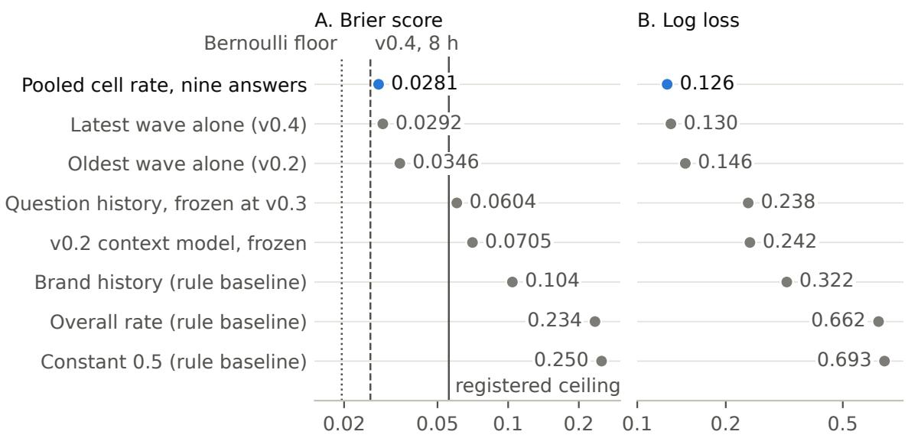
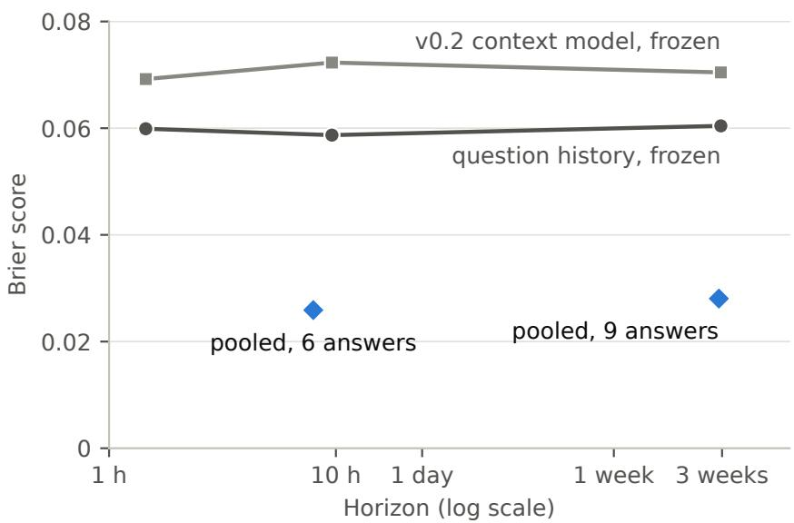
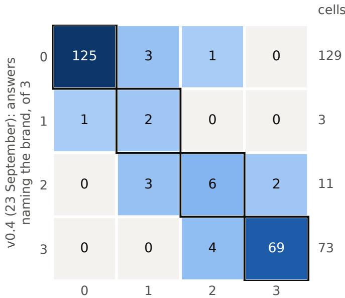

# Twenty Days Later: A Pre-Registered Test of History-Based Forecasts of Brand Mentions in Gemini Answers

Dmitrij Żatuchin

Rankfor.AI Sp. z o.o., Wrocław, Poland ORCID 0009-0002-1929-9770 · dmitrij@rankfor.ai

## Abstract

Counts of which brands a large language model names are useful only if they hold long enough to act on. We test this with a pre-registered replication. The same 162 requests (54 questions in English, Estonian and Finnish about three software categories, four of twelve candidate brands per question, three repeats) were sent to gemini-3.1-pro-preview in three waves within about ten hours on 22 and 23 September 2026, and again on 13 October 2026, 20.3 days after the third wave, with identical request bodies. The plan and its decision rule were frozen, hashed and registered on OSF before the first call. The outcome is a lexical mention label per answer and brand, 648 per wave. The primary forecast, each brand-and-question cell’s mention rate over the nine earlier answers, scored Brier 0.0281 and log loss 0.126, against Brier 0.0259 for the six-answer forecast of the 8-hour wave and a registered ceiling of 0.0559. It beat brand history (0.104), the overall rate (0.234) and a constant 0.5 (0.250) on both scores and in all nine question families (exact sign-flip p = 0.0039), so durability holds under the registered rule. A forecast frozen from the first wave alone scored 0.0599, 0.0587 and 0.0604 at horizons of 1.5 hours, 9.6 hours and 20.7 days. Of the 202 cells unanimous in the 8-hour wave, 194 were unchanged at D1 and none reversed. The latest wave alone was nearly as accurate as the pooled history (Brier 0.0292; pooled lower in 5 of 9 families, p = 0.28). Every answer reported the requested model version, and none issued a search query although search was enabled. A blind human check of 96 labels agreed with the rule on 94; both disagreements were adjudicated as rater omissions, so after adjudication the rule matched on 96 of 96. The test covers one model, one interval and twelve known brands, and estimates no decay rate.

## 1 Introduction

People ask AI assistants which products to consider, and companies, agencies and researchers measure which brands the answers name, usually by sending the same question several times and counting. Such a count is worth something only if it still describes the answers when someone acts on it, days or weeks later. Single answers vary from run to run [9, 11]; what matters for planning is whether the rate at which a question names a brand stays put.

We treat this as a forecasting problem. How well do the answers collected to a fixed question predict which brands the same question names later? If a forecast built on past answers keeps its accuracy at a long horizon, the underlying rates held; if its accuracy decays, they moved. Proper scoring rules measure this directly [2, 4], and simple baselines separate stability at the level of a question from the general popularity of a brand.

Earlier work in this line decomposed run-to-run variance in brand answers [11], measured what share of the brands and sources found by a long series of repeated queries a shorter series already recovers [12], and compared category ownership across models in two waves [13]. Outside it, studies of generative engines measured how content changes the visibility of sources in answers [1], showed that strategic text can raise a product’s visibility in model recommendations [7], and documented a preference of language models for global brands over local ones [6]. None of these tests prospectively, under a registered rule, how long a brand measurement stays valid.

In September 2026 we collected three waves of answers from gemini-3.1-pro-preview to the same 54 questions about twelve software brands. Forecasts frozen before the second and third waves passed their gates at horizons of about 1.5 and 8 hours. Horizons of hours say nothing about weeks. This note reports D1, the same 162 requests sent 20.3 days after the third wave, under a plan that was frozen, hashed and registered before the first call, with the decision rule fixed in advance [8].

Under the registered rule, durability holds. A forecast frozen from the first wave alone kept its accuracy from 1.5 hours to 20.7 days (Brier between 0.0587 and 0.0604), and the most recent wave alone forecast D1 nearly as well as the pooled history. No D1 answer searched the web, so what held is the model’s stored association of these brands with these needs, under an unchanged version string.

## 2 The Answer Forecast waves

Table 1 lists the four waves. All four sent the same 54 question texts to the same model identifier with the same generation settings: the Google Search tool included in the request, thinking level LOW, temperature 1.0, at most 8,192 output tokens, no system instruction, four requests in flight and no retries. D1 rebuilt each request body from the frozen payload function and refused to send any body whose SHA-256 difered from the manifest, so its requests equal those of v0.4 byte for byte.

Table 1. Waves of the 54 questions on gemini-3.1-pro-preview. Labels per wave: 648. Horizons run from the end of the history a forecast uses to the first call of the wave it is scored on; for D1, to the first and the last call.
<table><tr><td>Wave</td><td>Collected (UTC)</td><td>Positive labels</td><td>Forecast scored</td><td>Horizon</td><td>Freeze</td></tr><tr><td>v0.2</td><td>22 Sep 2026, 19:58 to 20:16</td><td>247</td><td>none (first history)</td><td></td><td>development wave of another experiment</td></tr><tr><td>v0.3</td><td>22 Sep, 21:41 to 21:54</td><td>246</td><td>question history (from v0.2)</td><td>1.5 h</td><td>manifest hash before collection</td></tr><tr><td>v0.4</td><td>23 Sep, 05:51 to 06:09</td><td>244</td><td>pooled rate, six answers (v0.2, v0.3)</td><td>7.9 h</td><td>manifest hash before collection</td></tr><tr><td>D1</td><td>13 Oct, 14:03 to 14:18</td><td>243</td><td>pooled rate, nine answers (v0.2 to v0.4)</td><td>487.9 to 488.2 h (20.3 days)</td><td>hash, commit and OSF registration before call 1</td></tr></table>

v0.2 was the development wave of an earlier experiment that trained on these twelve brands and tested on others. Its 162 answers to the 54 questions give each brand-and-question cell its first three observations. v0.3 tested a shrinkage estimator built from v0.2 (“question history”), which scored Brier 0.0599 and passed its gate. A post hoc look at v0.3 showed that the raw cell rate would have scored 0.0303 there; that development observation is why the raw pooled rate became a predictor. v0.4 was its first untouched test (Brier 0.0259 on six answers per cell), and D1 is its first registered one. At v0.4, 192 of the 197 cells that had been unanimous at v0.3 were unchanged. The three history waves span 10.2 hours. They have not been published; their counts and manifests go into the deposit of this note.

## 3 D1 design and pre-registration

## 3.1 Questions, brands and labels

The 54 questions cross three software categories (e-commerce platforms, project-management software, sales CRM), three buyer needs per category, three languages (English, Estonian, Finnish)

and two requested markets (Estonia, Finland). The nine category-and-need combinations are the question families; each family has six questions, one per language and market. A typical question reads: “Which sales CRM products would you consider for a small company operating in Finland that needs automated sales follow-ups and recurring emails? Name up to five products and briefly explain the fit. Answer in English. Distinguish confirmed capabilities from assumptions about local availability.” No question names a brand.

Each question has the four brands of its category as candidates: BigCommerce, MyCashflow, PrestaShop and WooCommerce for e-commerce; ClickUp, ProofHub, Smartsheet and Wrike for project management; HubSpot, Insightly, Microsoft Dynamics 365 and Zoho CRM for sales CRM. The 54 questions and 4 candidates give 216 brand-and-question cells, and three answers per question give 648 labels per wave.

A candidate is labelled 1 when its name or one of its listed aliases occurs in the answer text as a whole-token sequence after NFKC normalisation and casefolding. Negative mentions count. The answer text is the non-thought text of the first candidate response. The rule (version v02\_unicode\_product\_alias\_v1) is the one used in every earlier wave, so D1 labels compare directly with theirs. Because it matches whole tokens, it does not count inflected Estonian or Finnish forms such as a case ending attached to a brand name; Section 5 measures how much this matters.

## 3.2 Forecasts

Every forecast is a function of counts committed before D1 and was written into the manifest at the freeze.

• Pooled cell rate (primary): mentions of the brand in the cell over its nine earlier answers (three each in v0.2, v0.3 and v0.4), clipped to [0.05, 0.95].

• Rule baselines: brand history, the brand’s mentions over its 18 cells and 162 earlier observations, shrunk towards the overall rate with weight 20; the overall rate, 737 of 1,944 earlier labels (0.379); and a constant 0.5.

• Comparators reported beside the rule: the latest wave alone (v0.4 count over three, clipped to [0.05, 0.95]); the oldest wave alone (v0.2 count over three, clipped the same way); question history, the estimator frozen at v0.3 from v0.2 alone; and the v0.2 context model, also frozen.

## 3.3 Decision rule

The frozen protocol states the rule as: “Durability holds if pooled\_cell\_rate has strictly lower Brier and strictly lower log loss than brand\_history, global\_history and constant\_half over all 648 labels, and its D1 Brier is at most 0.03 above its v0.4 Brier. Any other outcome on a complete wave with an unchanged model is reported as decay.” The v0.4 reference is 0.0258873457, the 0.0259 of the v0.4 record recomputed from the committed counts, so the ceiling is 0.0558873457. A wave with any failed row is reported as incomplete and the rule is not applied. If any answer reports a model version other than gemini-3.1-pro-preview, or none, the wave becomes a modelshift test and the rule is not applied. Brier score is the mean of $( p - y ) ^ { 2 }$ over the 648 labels; log loss is the mean of $- [ y \log p + ( 1 - y ) \log ( 1 - p ) ]$

## 3.4 Inference

Labels are not independent: four candidates share an answer, three answers share a question, and the six questions of a family are translations and market variants of one another. The nine families are therefore the units of inference. For each comparison we take the mean per-family diference between the pooled cell rate and the comparator and run an exact two-sided sign-flip test over all 512 sign assignments [5]. The smallest attainable p is $2 / 5 1 2 = 0 . 0 0 3 9$ , reached when all nine diferences share a sign. For continuity with v0.4 we also report a paired bootstrap over families (2,000 replicates, seed 20261002, percentile intervals) [3]. Floors, transition tables, calibration and slices were fixed in advance as descriptive outputs.

## 3.5 Registration and execution

The protocol was frozen at 07:56 UTC on 13 October 2026. Its plan hash (SHA-256 b3893b79 8490dcb8fed2a5dba649da23dad5e5b99b8e45311e16d9a84d3a9018) covers the design, the manifest of 162 requests with their frozen forecasts, and the collection and analysis code. It was committed to the author’s research repository (commit 9d69cbb) and registered on OSF $\mathrm { ( h t t p s { : } / / o s f . i o / x 8 h 3 p / ) }$ , under an embargo that is lifted at publication. The plan allowed calls from 7 to 21 days after v0.4. Two smoke calls on factual tax questions that name no brand checked the request settings and are excluded from every analysis. The 162 calls started between 14:03 and 14:18 UTC, in an order shufled with seed 20261002, and ran through a capped local gateway.

The plan lists two steps outside the analysis. The first is a legal reading of the provider’s terms for search-grounded output; the run went ahead on the author’s decision before that reading was filed, and no D1 answer contains search-grounded content (Section 4.1). The second is a label reading by a model from a second vendor, which has not yet run; Section 5 reports a human check in its place. Collection followed the plan with no deviation: no failed row, no retry, no resample.

## 4 Results

## 4.1 Completion, model version and search

All 162 calls completed with finish reason STOP, none failed and none ran past the 120-second timeout. All 162 answers reported model version gemini-3.1-pro-preview, so the durability rule applies. The calls started between 487.9 and 488.2 hours after the end of v0.4 (median 488.0 hours, 20.3 days), inside the registered window. No answer issued a search query and none returned a grounding chunk, although the request included the search tool. The calls used 339,193 tokens in all, against 338,706 for the same 162 requests in v0.4; 144,369 of them were thinking tokens. The wave cost USD 3.94 at list price against a cap of USD 15. Of the 648 labels, 243 were positive (37.5%), against 247, 246 and 244 in the three earlier waves.

## 4.2 Verdict

Durability holds under the registered rule. The pooled cell rate scored Brier 0.0281 and log loss 0.126 (Table 2, Figure 1). Both are strictly lower than those of brand history, the overall rate and the constant, and the Brier score is 0.0022 above the v0.4 reference of 0.0259, inside the ceiling of 0.0559.

## 4.3 Question families

The pooled cell rate scored lower than brand history, the overall rate, the constant and question history in 9 of 9 families, on Brier and on log loss (exact sign-flip $p = 0 . 0 0 3 9$ for each of the eight comparisons). Against the v0.2 context model it was lower in 9 of 9 families on Brier $( p = 0 . 0 0 3 9 )$ and 8 of 9 on log loss $( p = 0 . 0 2 7 )$ . The family bootstrap puts the Brier diference to brand history at −0.0769, with interval [−0.1347, −0.0275].

Table 2. D1 scores over 648 labels. Lower is better.
<table><tr><td>Forecast</td><td>Role</td><td>Brier</td><td>Log loss</td></tr><tr><td>Pooled cell rate, nine answers</td><td>primary</td><td>0.0281</td><td>0.126</td></tr><tr><td>Latest wave alone (v0.4)</td><td>comparator</td><td>0.0292</td><td>0.130</td></tr><tr><td>Oldest wave alone (v0.2)</td><td>comparator</td><td>0.0346</td><td>0.146</td></tr><tr><td>Question history, frozen at v0.3</td><td>comparator</td><td>0.0604</td><td>0.238</td></tr><tr><td>v0.2 context model, frozen</td><td>comparator</td><td>0.0705</td><td>0.242</td></tr><tr><td>Brand history</td><td>rule baseline</td><td>0.104</td><td>0.322</td></tr><tr><td>Overall rate</td><td>rule baseline</td><td>0.234</td><td>0.662</td></tr><tr><td>Constant 0.5</td><td>rule baseline</td><td>0.250</td><td>0.693</td></tr></table>

Reference lines: pooled rate on v0.4 (six answers) 0.0259; registered ceiling 0.0559; Bernoulli floor of D1 0.0195.

  
Figure 1. D1 scores over 648 labels: the pooled cell rate (Brier 0.0281) sits well inside the registered ceiling and below every rule baseline, and the latest wave alone (0.0292) is close behind. Panel A, Brier score; panel B, log loss; both on log scales. The lines in panel A mark the Bernoulli floor of D1 (0.0195, dotted), the pooled rate on v0.4 (0.0259, dashed) and the registered ceiling (0.0559, solid).

## 4.4 Comparators beside the rule

The latest wave alone came close. With three answers per cell from v0.4, it scored Brier 0.0292 and log loss 0.130. The pooled rate was lower in 5 families, tied in 1 and higher in 3 (sign-flip p = 0.28 on Brier, 0.44 on log loss), and the bootstrap interval of the Brier diference, [−0.0029, 0.0006], includes zero. Pooling the two earlier waves into the forecast added no accuracy that this design can distinguish from zero.

The oldest wave alone did worse. With the three v0.2 answers per cell it scored 0.0346; the pooled rate was lower in 6 families, tied in 1 and higher in $ { 2 } ( p = 0 . 0 3 1 )$ , with bootstrap interval [−0.0107, −0.0025]. v0.2 and v0.4 were collected about ten hours apart, so this gap measures how much three answers vary between sessions, and says nothing about age. The frozen question-history estimator, which shrinks each cell towards its brand’s rate, scored 0.0604, worse than the plain count of the same v0.2 answers. With the data held equal, light smoothing beat heavy smoothing, as the post hoc look at v0.3 had suggested.

## 4.5 The horizon series

Two forecasts were frozen before v0.3 and never changed: question history and the v0.2 context model. Scoring the same predictions on three waves varies the horizon while the forecast stays fixed (Table 3, Figure 2). Question history scored 0.0599 at 1.5 hours, 0.0587 at 9.6 hours and 0.0604 at 20.7 days. The context model scored 0.0692, 0.0723 and 0.0705. Neither shows a trend from 1.5 hours to 20.7 days. The pooled rate cannot be read the same way, because each wave adds three answers to its history, but its Brier score rose by 0.0022 between the 7.9-hour and the 20.3-day test.

Table 3. Brier score of each forecast on the wave it was scored on. Horizons for the frozen forecasts run from the end of v0.2.
<table><tr><td>Forecast</td><td>History</td><td>v0.3 (1.5 h)</td><td>v0.4 (9.6 h)</td><td>D1 (20.7 days)</td></tr><tr><td>Question history, frozen</td><td>v0.2</td><td>0.0599</td><td>0.0587</td><td>0.0604</td></tr><tr><td>v0.2 context model, frozen</td><td>v0.2</td><td>0.0692</td><td>0.0723</td><td>0.0705</td></tr><tr><td>Pooled cell rate</td><td>all earlier waves</td><td></td><td>0.0259 (7.9 h)</td><td>0.0281 (20.3 days)</td></tr><tr><td>Brand history</td><td>all earlier waves</td><td>0.1131</td><td>0.1051</td><td>0.104</td></tr><tr><td>Overall rate</td><td>all earlier waves</td><td>0.2355</td><td>0.2348</td><td>0.234</td></tr></table>

## 4.6 Cell transitions

Table 4 compares each cell’s mention count in v0.4 with its count in D1 (Figure 3). Of the 202 cells that were unanimous in v0.4 (129 never named, 73 always named), 194 were unchanged after 20 days. Seven moved by one answer and one by two; none went from never named to always named or back. Across all twelve answers per cell, nine before D1 and three in it, 182 of 216 cells were all-or-nothing: 119 never named and 63 always named. Four of the twelve brands appeared in none of their 54 D1 labels, and two appeared in at least 52. The uncertainty sits in the 14 cells that were mixed in v0.4 and the few unanimous cells that moved. At eight hours, the comparable figure had been 192 of 197.

Table 4. Cells by number of answers naming the brand, v0.4 (rows) against D1 (columns). 216 cells.
<table><tr><td>v0.4\ D1</td><td>0 1</td><td>2</td><td>3</td><td>Cells</td></tr><tr><td>0</td><td>125 3</td><td>1</td><td>0</td><td>129</td></tr><tr><td>1</td><td>1</td><td>0</td><td>0</td><td>3</td></tr><tr><td>2</td><td>0</td><td>6</td><td>2</td><td>11</td></tr><tr><td>3</td><td>0</td><td>4</td><td>69</td><td>73</td></tr></table>

  
Figure 2. The question-history forecast, frozen before v0.3, scored between 0.0587 and 0.0604 at 1.5 hours, 9.6 hours and 20.7 days, with no trend over three weeks. The two frozen forecasts (grey, joined) score the same predictions at three horizons from the end of v0.2. The pooled cell rate (blue) is shown at 7.9 hours and 20.3 days and is not joined, because its history grows from six to nine answers per cell.

  
D1 (13 October): answers naming the brand, of 3  
Figure 3. Of 202 cells unanimous in v0.4, 194 were unchanged 20 days later and none moved from 0 of 3 to 3 of 3 or back. Each square counts brand-and-question cells; the outlined diagonal holds the unchanged cells, and the row totals are at the right.

## 4.7 Floors and calibration

If each cell’s D1 mention rate were known exactly, the Brier score of the three D1 answers would be 0.0195, the Bernoulli floor. The pooled forecast sits 0.0085 above it. Predicting each D1 answer from the other two D1 answers to the same question scored 0.0440, worse than the 20-day-old forecast: two unclipped observations are a noisier estimate than nine clipped ones. In calibration, the lowest of five bins forecast 0.053 on average against an observed rate of 0.010 over 381 labels, and the highest 0.942 against 0.978 over 225 labels. The clip at 0.05 and 0.95 makes extreme forecasts slightly conservative.

## 4.8 Slices

By category, the pooled rate scored 0.0507 on e-commerce, 0.0242 on project management and 0.0092 on sales CRM; by requested market, 0.0142 for Estonia and 0.0419 for Finland; by language, 0.0367 for English, 0.0231 for Estonian and 0.0244 for Finnish. Each slice holds 54 to 81 answers and is descriptive. E-commerce was also the hardest category at v0.4.

## 5 Label validation

The labels in Sections 3 and 4 come from a lexical rule. To measure how far that rule matches a human reading, the author labelled a sample of D1 answers by hand on 13 October 2026, blind to the automatic labels.

Sample. 24 of the 162 D1 answers, eight per language (English, Estonian, Finnish), drawn by script with the fixed seed 20261013. Within each language the draw was stratified by category: three answers from each of two categories and two from the third, with the category that gives two rotating across languages. The 24 answers were then shown in a shufled order. Each answer carries its four candidate brands, so the sample holds 96 candidate labels, 32 per language.

Blinding. The rater saw each question, its answer text exactly as the rule read it (the non-thought text of the response), and the four candidate brands of its category with their listed aliases, in the fixed order of the request. The packet showed no automatic label, no forecast, no wave and no other answer to the same question. The key that links the packet rows to the automatic labels was kept apart until all 96 human labels were recorded.

Question asked of the rater. For each candidate the rater wrote yes, no or unsure. The packet defined yes as an answer that names the brand, or one of the other names listed for it, in any form: an inflected form such as an Estonian or Finnish case ending, a diferent capitalisation, a spelling slip or a web address. A negative mention counts as yes; a diferent company with a similar name counts as no. The human definition therefore includes inflected forms, which the automatic rule misses by design. The rater marked no label unsure.

Measures. With the human label as the reference, we report for the automatic label, by language and overall: agreement (share of labels on which the two agree), precision (share of automatic positives the rater also marked positive) and recall (share of the rater’s positives the rule found), each with a 95% Wilson interval [10]. The intervals treat labels as independent; four labels share an answer, so the intervals are too narrow. Frozen labels do not change. Each disagreement is listed in the supplement with its type, such as an inflected form or an alias missing from the list.

The rule found every brand the rater marked: recall is 37 of 37, and in Estonian and Finnish, where an inflected brand name could defeat a whole-token match, no positive was missed in this sample. Both disagreements are English answers in which the rule marked a brand the rater did not. An AI assistant re-read both answer texts and flagged that in each the brand is the heading of a numbered list item and is named again in its description; the rater then confirmed both as omissions. After adjudication the automatic label matches the reading on 96 of 96 labels (95% Wilson interval 96.2% to 100%). The check has one human rater, the author, and no second independent rater; the two disputed labels were settled against the answer text. The sample covers 15% of D1 answers. Since forecasts and outcomes use the same rule, the verdict concerns the lexical target, and the check found no sign that this target departs from a human reading of whether a brand is named.

Table 5. Automatic labels against one blind human rater, before adjudication. Intervals are 95% Wilson intervals in percent.
<table><tr><td>Language</td><td>Answers</td><td>Labels</td><td>Human positives</td><td>Automatic positives</td><td>Agreement [95% CI]</td><td>Precision [95% CI]</td><td>Recall [95% CI]</td><td>Disagree- ments</td></tr><tr><td>English</td><td>8</td><td>32</td><td>11</td><td>13</td><td>30/32, 93.8%</td><td>11/13, 84.6%</td><td>11/11, 100%</td><td>2</td></tr><tr><td>Estonian</td><td>8</td><td>32</td><td>15</td><td>15</td><td>[79.9, 98.3] 32/32, 100%</td><td>[57.8, 95.7] 15/15, 100%</td><td>[74.1, 100] 15/15, 100%</td><td>0</td></tr><tr><td>Finnish</td><td>8</td><td>32</td><td>11</td><td>11</td><td>[89.3, 100] 32/32, 100%</td><td>[79.6, 100] 11/11, 100%</td><td>[79.6, 100] 11/11, 100%</td><td>0</td></tr><tr><td>All</td><td>24</td><td>96</td><td>37</td><td>39</td><td>[89.3, 100] 94/96, 97.9% [92.7, 99.4]</td><td>[74.1, 100] 37/39, 94.9% [83.1, 98.6]</td><td>[74.1, 100] 37/37, 100% [90.6, 100]</td><td>2</td></tr></table>

## 6 Discussion

For these questions and this model, the rate at which a question names a brand held for 20 days. Most cells are all-or-nothing and stay that way: across twelve answers spread over three weeks, 182 of 216 cells were named every time or never. The registered ceiling allowed the Brier score to more than double; the observed rise used 7% of that allowance, and the frozen forecasts show no trend with the horizon. The verdict sits far from the boundary of the rule.

The latest wave alone was nearly as accurate as the pooled history. Three answers per question from one session predicted the answers of 20 days later almost as well as nine answers from three sessions. For a measurement design this means that a small sample per question from one session carries most of the information, and that more sessions within a few hours add little. The three history waves lie within 10.2 hours of one another, so this study cannot say whether waves spread over weeks would add what waves spread over hours do not.

No D1 answer searched the web, and neither did the v0.4 answers. The model answered from what it stores, under a version string that did not change. D1 shows that sampling at temperature 1.0 and day-to-day serving conditions did not move the rates over three weeks; it gives no evidence about a model update, answers that do search, or other providers. A practical reading: for a fixed model version, a monthly measurement of brand mentions is still current when it is used, and a change in the reported model version is the event that calls for a new one.

The plain count beat the shrinkage estimator wherever both were scored: shrinking a cell towards its brand’s rate costs accuracy when most cells sit at 0 or 1 and stay there.

## 7 Limits

The study covers one model (gemini-3.1-pro-preview) from one provider, accessed through its programming interface. It covers 12 known brands and 54 questions in three software categories, in three languages and two requested markets, all asking for up to five products. One later wave measures one interval of 20.3 days, so the study estimates no rate of decay. The outcome is lexical mention, negative mentions included; the study says nothing about recommendation, ranking within an answer, sentiment, factual correctness, citations, new brands, new questions or other providers. The labels come from a whole-token alias rule that misses inflected forms; the human check in Section 5 covers 96 labels read by one rater, the author, and the cross-vendor label reading named in the plan is still pending. Inference rests on nine question families, which bounds the smallest attainable p-value at 0.0039 and makes every interval coarse. The pooled-rate predictor was chosen after a post hoc observation on v0.3; its tests at v0.4 and D1 are prospective. No answer used search, so the results do not transfer to search-grounded answers. Answers from consumer apps were not collected and can difer from answers through the programming interface.

## 8 Future work

The registered series continues with a wave at a longer horizon, a replication on a second provider at a matched horizon, and labels checked by human readers in each language at larger scale. Forecasts for brands with no answer history are a separate problem; an earlier development wave on unseen brands failed its gate, and a registered experiment on that question is in preparation. An exploratory pilot on fast-growing European firms, which compared questions asking for diferent numbers of companies, shaped the design of that study.

## Data and code availability

The registration on OSF (https://osf.io/x8h3p/) records the plan hash, the design and the decision rule. The frozen protocol and manifest are deposited at https://doi.org/10.5281/zenodo.23351313; the manifest holds every question text, the SHA-256 of every request body, the candidate brands and aliases and the frozen forecasts, and its plan block reproduces the registered hash. The same deposit holds the derived data: the 648 D1 labels with request identifiers; the 162 request rows with completion status, finish reason, returned model version, token counts, search and grounding counts, realised horizon and the SHA-256 of each answer text; the metrics file; the derivation receipt; the label-check summary and the list of its two disagreements; and the per-cell counts of v0.2, v0.3 and v0.4. Raw answer texts are not redistributed; their hashes allow any copy to be checked. The collection and analysis scripts are fixed by SHA-256 in the registered plan and are available from the author on request. Every number in this note is produced by a script from the deposited files; the list of numbers with sources is part of the deposit.

## Competing interests

The author founded Rankfor.AI and holds equity in it. Neither the author nor Rankfor.AI has any business connection with the twelve brands studied.

## Funding

Rankfor.AI funded the study. Provider charges for the D1 wave were USD 3.94 at list price.

## Use of AI tools

AI coding and writing assistants helped build the collection and analysis scripts and review the language of this text. All numbers come from scripts run on the deposited files, and the author checked the text against them.

## References

[1] Aggarwal, P., Murahari, V., Rajpurohit, T., Kalyan, A., Narasimhan, K., and Deshpande, A. (2024). GEO: Generative engine optimization. In Proceedings of the 30th ACM SIGKDD Confer-

ence on Knowledge Discovery and Data Mining, 5 to 16. https://doi.org/10.1145/3637528.3671900. arXiv:2311.09735.

[2] Brier, G. W. (1950). Verification of forecasts expressed in terms of probability. Monthly Weather Review, 78(1), 1 to 3. https://doi.org/10.1175/1520-0493(1950)078<0001:VOFEIT>2.0.CO;2

[3] Efron, B., and Tibshirani, R. J. (1993). An Introduction to the Bootstrap. Chapman and Hall.

[4] Gneiting, T., and Raftery, A. E. (2007). Strictly proper scoring rules, prediction, and estimation. Journal of the American Statistical Association, 102(477), 359 to 378. https://doi.org/10.1198/ 016214506000001437

[5] Good, P. I. (2005). Permutation, Parametric, and Bootstrap Tests of Hypotheses (3rd ed.). Springer Series in Statistics. Springer. https://doi.org/10.1007/b138696

[6] Kamruzzaman, M., Nguyen, H. M., and Kim, G. L. (2024). “Global is good, local is bad?”: Understanding brand bias in LLMs. In Proceedings of the 2024 Conference on Empirical Methods in Natural Language Processing, 12695 to 12702. https://doi.org/10.18653/v1/2024.emnlp-main.707

[7] Kumar, A., and Lakkaraju, H. (2024). Manipulating large language models to increase product visibility. arXiv:2404.07981.

[8] Nosek, B. A., Ebersole, C. R., DeHaven, A. C., and Mellor, D. T. (2018). The preregistration revolution. Proceedings of the National Academy of Sciences, 115(11), 2600 to 2606. https://doi.org 10.1073/pnas.1708274114

[9] Ouyang, S., Zhang, J. M., Harman, M., and Wang, M. (2025). An empirical study of the nondeterminism of ChatGPT in code generation. ACM Transactions on Software Engineering and Methodology, 34(2), 1 to 28. https://doi.org/10.1145/3697010. arXiv:2308.02828.

[10] Wilson, E. B. (1927). Probable inference, the law of succession, and statistical inference. Journal of the American Statistical Association, 22(158), 209 to 212. https://doi.org/10.1080/01621459.1927. 10502953

[11] Żatuchin, D. (2026). Where does the noise come from? A variance-components decomposition of non-determinism in LLM brand answers. arXiv:2607.13304.

[12] Żatuchin, D. (2026). Measuring brand and source discovery under repeated LLM queries: A finitesample audit. arXiv:2609.05059v2.

[13] Żatuchin, D. (2026). Who owns the AI recommendation? A multi-industry empirical map of brand category ownership across large language models. arXiv:2606.23057v2.