# Typed Decision Models on Tabular Data

Baowen Zhang1, Hangting Ye2\*, Hongyuan Zha3

1University of Wisconsin–Madison

2School of Artificial Intelligence, Jilin University

3School of Data Science, Chinese University of Hong Kong, Shenzhen bzhang599@wisc.edu, yeht22@mails.jlu.edu.cn, zhahy@cuhk.edu.cn

## Abstract

Typed decision models are language models that answer a question with a fixed set of possible answers by returning a probability for each answer instead of generating text. We study them on tabular data and compare four decision models with three large language models (LLMs) on row classification, fact verification and anomaly detection. Every request is sent in its original form and under 21 types of rewrite that keep its content, such as renaming the options or writing the table in another format. The decision models perform as well as the LLMs at a lower cost. Three of them are also far more robust to how the question is formulated. No model we test is robust to how the table is organized. For every model, at least a third of the row decisions change under some rewrite of the table or the question. The decisions to which a decision model gives low probability are the ones most likely to change. Decision models are a practical choice for tabular decisions, but their robustness remains an open problem.

## 1 Introduction

Tabular data, in which each row describes a sample and each column one of its heterogeneous features, is one of the most common forms of data in fields such as healthcare, finance and network security (Borisov et al., 2022; Fang et al., 2024). On such data, gradient-boosted trees (Chen and Guestrin, 2016; Ke et al., 2017; Prokhorenkova et al., 2018) still outperform most deep networks designed for tables (Grinsztajn et al., 2022; Borisov et al., 2022), and tabular foundation models do best on small tables (Hollmann et al., 2025; Prior Labs, 2026).

Large language models (LLMs) have opened a new route for tabular data (Fang et al., 2024). LLM-based methods first serialize a row or a table into text, for example as feature–value pairs or as a Markdown table (Hegselmann et al., 2023;

Sui et al., 2024). The serialized row is then classified by prompting an LLM with a description of the task and a few in-context examples, or by fine-tuning it (Dinh et al., 2022; Hegselmann et al., 2023). The LLM can also turn the labelled rows into features and rules for a conventional model (Han et al., 2024; Ye et al., 2025). This works well even when only a few labelled rows are available (Hegselmann et al., 2023). However, LLMs are not built for decisions. The LLM-generated output has to be mapped to one of the options, and every decision needs a full decoding process, which can be expensive when a large number of decisions need to be made. Their answers can also change with the order of the columns, the format of the rows or the wording of the question (Sui et al., 2024; Liu et al., 2024; Sclar et al., 2024).

Recently, a new class of language models has been built for such decisions: typed decision models (decision models for short). TypeSafe released the first of them, Jev (TypeSafe, 2026). Jev takes a sample or a table together with one or more questions, each with a fixed set of possible answers such as the classes of a task. Instead of generating text, it returns a probability for every answer of every question in a single request. TypeSafe trains it with Reinforcement Learning for Calibrated Decisions (RLCD) so that these probabilities match outcomes, and reports that its confidence is calibrated and that similar inputs receive similar answers (Type-Safe, 2026). Open-weight decision models such as Clef and Kev-27B followed, trained from an openweight LLM with proper scoring rules (Cloudflare, 2026; Palmer, 2026). OpenAI now also offers GPT-6 Luna Decisions, a decision model built on its LLM GPT-6 Luna, through its Decisions API (OpenAI, 2026a). Decision models thus avoid generation and decoding, since every decision comes with a probability in a single request. Whether they are also robust to how the table and the question are written is open, since a decision model also reads

<table><tr><td rowspan="2"></td><td colspan="2">Decision models</td><td rowspan="2">LLMs</td></tr><tr><td>Jev, Clef, Kev-27B</td><td>GPT-6 Luna Decisions</td></tr><tr><td>RQ1 Are decision models practical? (§3)</td><td>√As accurate as LLMs and best on two of three</td><td>√As accurate as GPT-6 Luna and cheaper on rows</td><td>√Best on row classification, but a</td></tr><tr><td>RQ2 Are they robust to the formulation of the question? (§4)</td><td>tasks, at far lower cost √Option names and order barely matter</td><td>and samples X Reversing the options changes up to 23%</td><td>decoding pass per decision X Option names and order change up to 30%</td></tr><tr><td>RQ3 Are they robust to how the table is organized? (§5)</td><td>X Format and row and column order change many decisions</td><td>X Likewise</td><td>X Likewise</td></tr><tr><td>RQ4 Does their confidence indicate which decisions are sensitive to rewrites? (§6)</td><td>√Low confidence marks the decisions a rewrite changes</td><td>Partly. As well as an LLM&#x27;s best readout</td><td>Partly. Only with ten draws or token probabilities</td></tr></table>

Table 1: Our four research questions and their answers for the decision models and the LLMs.

the table as text.

Of the 112 arXiv papers on decision models published in the three weeks after the release of Jev, none studies them as a method for tabular data (Table 11). For LLMs on tables, decisions are known to depend on the serialization (Sui et al., 2024; Hegselmann et al., 2023), on the order of rows and columns (Liu et al., 2024; Zhou et al., 2024) and on the in-context examples (Hegselmann et al., 2023). These questions have not been asked of decision models.

To study them in depth, we change how each request is written without changing the information the decision needs, for example by renaming the options or writing the table in another format. We call such a change a rewrite. We send every request in its original form and in each rewritten form to decision models and LLMs.

Our research questions are as follows:

RQ1 Are decision models practical for tabular decisions?

RQ2 Are they robust to the formulation of the question, such as the names and order of the options?

RQ3 Are they robust to how the table is organized, such as its format and the order of its rows and columns?

RQ4 Does their confidence indicate which decisions are sensitive to rewrites?

We evaluate seven models—four decision models (Jev, Clef, Kev-27B and GPT-6 Luna Decisions) and three LLMs (GPT-6 Luna, Qwen3.8-27B and Llama-3.3-70B)—across three tabular tasks covering row classification, fact verification and anomaly detection, under 21 types of rewrite. Clef and Kev-27B are trained from Qwen3.8-27B, which lets us compare the two ways of deciding on the same

backbone (Section 2).

Our main findings are as follows:

Decision models perform as well as LLMs on these tasks and are cheaper to run (Table 1). They are also far less affected by how the question is formulated. In contrast, GPT-6 Luna Decisions is as sensitive to the order of the options as the LLMs. Writing the table differently, however, changes many decisions of every model, even though accuracy stays almost the same. The decisions that a decision model gives low probability are the ones that change most often.

## 2 Experimental setup

## 2.1 Decision interfaces

We refer to a model’s output for one item as a decision: the class of a sample, the verdict on a claim about a table, or whether a sample is anomalous. A request is one call to a model and may contain several items. A decision model receives a request as a state, such as a group of samples or a table, with one question per item whose possible answers are fixed in advance. It returns a probability for every option of every question in a single request (TypeSafe, 2026). An LLM receives a prompt built from the same request and generates text, which we map to one of the options. Its confidence has to be read from that text, from its token probabilities or from repeated draws (Li and Wagle, 2026; Deußer et al., 2026).

## 2.2 Tasks and models

Tasks. We use three tasks (Table 2). Row classification assigns a class to a sample from the ten datasets of TabLLM and FeatLLM. Fact verification decides whether a table from TabFact supports a claim. Anomaly detection decides whether a sample from one of 20 ReTabAD sources is anomalous.

<table><tr><td>Task</td><td>Input</td><td>Decision</td><td>Data</td></tr><tr><td>Row classi- fication</td><td>One sample and a description of its features</td><td>Its class</td><td>10 datasets, 3,481 rows</td></tr><tr><td>Fact verification</td><td>A table and a claim about it</td><td>Supported or refuted</td><td>TabFact, 2,000 claims</td></tr><tr><td>Anomaly</td><td>One sample, a</td><td>Normal or</td><td>ReTabAD, 20</td></tr><tr><td>detection</td><td>description of the data and statistics</td><td>anomalous</td><td>sources, 5,059</td></tr></table>

Table 2: The three tasks: row classification on the ten datasets of TabLLM and FeatLLM (Hegselmann et al., 2023; Han et al., 2024), fact verification on TabFact (Chen et al., 2020) and anomaly detection on ReTabAD (Yoon et al., 2026). Metrics: Macro-F1, accuracy and AUROC, averaged over datasets or sources.
<table><tr><td colspan="2">Question, options with their descriptions original {no, yes} with descriptions</td></tr><tr><td>options reversed {yes, no} renamed A, B synonyms yes/no question paraphrased</td><td>{A, B}, descriptions kept {false, true} &quot;Is the target class yes?&quot; &quot;Determine the class . . 11</td></tr><tr><td>Row, columns Recency, Frequency, Monetary, Time array (original) columns shuffled [70.0, 21.0, 3.0, 750.0] columns reversed [70.0, 750.0, 3.0, 21.0] list</td><td>) [21.0, 3.0, 750.0, 70.0] - Recency: 21.0 . .. The Recency is 21.0. ..</td></tr></table>

Figure 1: One row-classification request (blood donation) under the rewrites of Figure 3, shortened to the part that each rewrite changes. Shuffling or reversing the columns permutes their names, descriptions and values together.

Models. The four decision models are Jev 1.13 (TypeSafe, 2026), the open-weight Clef (Cloudflare, 2026) and Kev-27B (Palmer, 2026), and GPT-6 Luna Decisions (OpenAI, 2026a). Jev is available only through TypeSafe’s API. Clef and Kev-27B are both trained from Qwen3.8-27B (Qwen Team, 2026). GPT-6 Luna Decisions is built on the LLM GPT-6 Luna and served through OpenAI’s Decisions API. It accepts requests in the same format as Jev. OpenAI does not document how the API computes its probabilities, and we use its publicbeta snapshot of 6 October 2026. The LLMs are GPT-6 Luna (OpenAI, 2026b) and the open-weight

Qwen3.8-27B and Llama-3.3-70B (Llama Team, AI @ Meta, 2024). We run GPT-6 Luna at temperature 1 and decode the open-weight LLMs greedily. Appendix A lists all versions.

In row classification, a decision-model request contains the 16 rows of a group as separate typed questions over a shared state, whereas an LLM prompt contains one row, as in TabLLM. In fact verification and anomaly detection, every model receives the same claim or the same batch of 15 samples. All decision models receive identical requests, and the LLM prompts are built from them.

## 2.3 Evaluation

We evaluate row classification by Macro-F1, fact verification by accuracy and anomaly detection by AUROC, each averaged over datasets or sources (Table 2). We also report the latency and price of each decision, and for RQ1 we vary the number of in-context examples from none to as many as fit.

Besides its original form, we send every request under rewrites, which change how it is written but keep all the information the decision needs (Figure 1). Rewrites of the question serve RQ2, rewrites of the table serve RQ3, and each task uses those of the 21 types of rewrite that apply to it (Table 12). We checked that each rewrite keeps every cell and header by recovering the original request from it. The one exception is the order of rows on TabFact, which can change the truth of claims about positions such as “first”. We leave these claims out of RQ3 and RQ4.

A decisionflips when it differs from the decision under the original request, and an invalid output counts as a flip. Even an identical request can receive a different decision. We therefore report each model’s re-send rate, the share of its decisions that flip when the identical request is sent again, and compare the flips under rewrites with it. Section 6 defines confidence, and Appendix C gives every result with intervals.

## 3 RQ1: Are decision models practical for tabular decisions?

Performance. Decision models perform as well as LLMs and better on two of three tasks. Jev verifies TabFact claims best and Kev-27B detects anomalies best, while GPT-6 Luna leads on row classification (Table 3). Clef and Kev-27B are also more accurate than Qwen3.8-27B, which shares their backbone, on every task. GPT-6 Luna Decisions comes within 1.3 points of GPT-6 Luna on row classification and TabFact and is 3.2 points above it on anomaly detection. In-context examples help the decision models as they help the LLMs. With as many rows as fit in the context, Clef and Kev-27B beat every LLM on row classification and every LLM and detector fitted to the same samples on anomaly detection (Figure 2). From about 64 rows on, TabPFN-3.5 (Prior Labs, 2026) and methods trained on the same rows match or beat every in-context model on row classification.

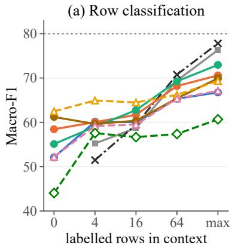

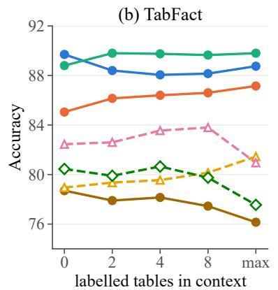

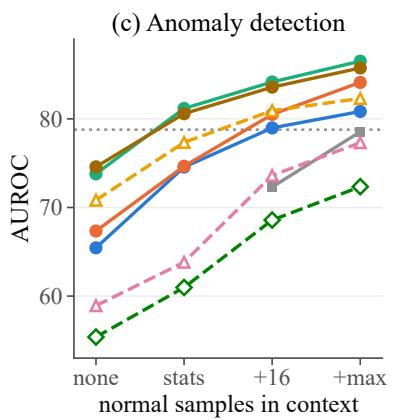  
Figure 2: In-context examples (RQ1). Grey lines show the best of eight classifiers or five anomaly detectors trained on the same rows, and dotted lines the best trained on all training rows. max stands for as many rows as fit in the context. In (c), stats is the original request of ReTabAD, which summarizes the normal training samples by statistics. none leaves these statistics out, and +16 and +max add raw normal samples.

<table><tr><td></td><td colspan="3">performance</td><td colspan="3">generated tokens</td></tr><tr><td>Model</td><td>Cl.</td><td>TF</td><td>AD</td><td>Cl.</td><td>TF</td><td>AD</td></tr><tr><td>Jev</td><td>52.1</td><td>89.7</td><td>74.6</td><td></td><td>none: one passº</td><td>b</td></tr><tr><td>Clef</td><td>58.4</td><td>85.0</td><td>74.7</td><td></td><td>none: one pass</td><td></td></tr><tr><td>Kev-27B</td><td>55.2</td><td>88.8</td><td>81.2</td><td></td><td>none: one pass</td><td></td></tr><tr><td>GPT-6 Luna Decisions</td><td>61.2</td><td>78.7</td><td>80.5</td><td></td><td>none C</td><td></td></tr><tr><td>GPT-6 Luna</td><td>62.5</td><td>79.0</td><td>77.3</td><td>5.6</td><td>11.8</td><td>87.5</td></tr><tr><td>Qwen3.8-27B</td><td>52.2</td><td>82.5</td><td>71.0</td><td>2.6</td><td>9.1</td><td>111.7</td></tr><tr><td>Llama-3.3-70B</td><td>44.0</td><td>80.5</td><td>61.0</td><td>2.5</td><td>8.0</td><td>44.4</td></tr><tr><td>trainedª</td><td>80.0</td><td>n/a</td><td>78.8</td><td></td><td>none</td><td></td></tr></table>

Table 3: RQ1: performance under the original request and the tokens each model generates per decision (an anomaly batch carries 15 decisions). Cl. = row classification (Macro-F1), TF = TabFact (accuracy), AD = anomaly detection (AUROC). aBest of eight classifiers trained on the whole training split, LightGBM (Cl.), and of five anomaly detectors, k-nearest neighbours (AD, 19 of 20 sources). We train no model for TabFact. bAs stated by its provider. Jev’s architecture is not public. cNo output tokens are billed.

Latency and price. The LLMs generate 2.5 to 112 tokens per decision, and the other models none (Table 3). Of the closed models, Jev and GPT-6 Luna Decisions take 0.08–0.11 seconds per row or sample, against 0.73–1.62 for GPT-6 Luna (Table 4). Per decision, GPT-6 Luna costs 1.6 to 8 times as much as Jev. Served through the Decisions API, the same model costs 3.4 times less on row classification and 1.8 times less on anomaly detection. On TabFact, where every request holds a single claim, the two interfaces cost the same per decision. We time only the closed models, since the open-weight models run on our own servers.

Takeaway. Decision models are practical for tabular decisions. They perform as well as LLMs or better, and are generally faster and cheaper per decision. Where 64 or more labelled rows exist, a tabular foundation model or a trained model is better.

## 4 RQ2: Are decision models robust to the formulation of the question?

Decision models are robust to the names and order of the options. Renaming or reordering the options changes 2–8% of the classifications of Jev, Clef and Kev-27B, at most 5.5 percentage points above their re-send rates (Figure 3, upper block). Their Macro-F1 changes by at most 1.3 points. The same rewrites change 14–30% of the open-weight LLMs’ classifications and cost them up to 11.5 points. Posing the question as yes/no costs these three models at most 2 points but Qwen3.8-27B 14, and Llama-3.3-70B answers it with “Yes.” so often that half of its outputs are unusable. Only paraphrasing the instructions affects both kinds of model alike. On TabFact these rewrites change under 5% of their verdicts and under 7% of the open-weight LLMs’. Clef and Kev-27B change far fewer decisions under these rewrites than Qwen3.8- 27B, which shares their backbone. For option order, part of this comes from Clef’s release code, which sorts the options.

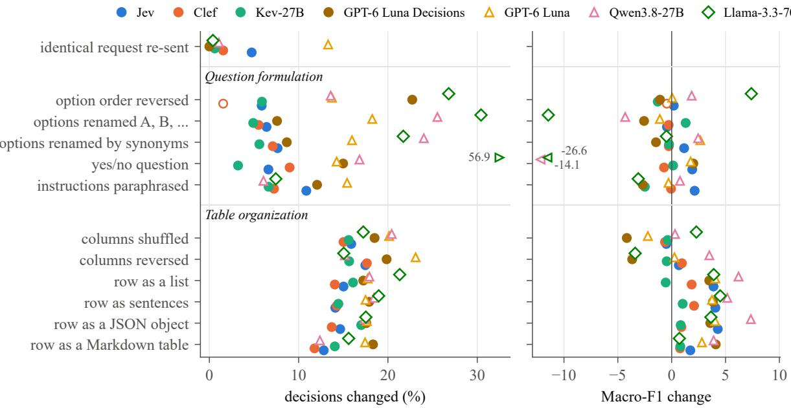  
Figure 3: Row classification, per rewrite: decisions that differ from the model’s original decision (left) and the change of Macro-F1 (right). The upper block shows RQ2 and the lower block RQ3. Filled markers are decision models and hollow markers LLMs. Clef’s point for option order is hollow because Clef sorts the options.

<table><tr><td></td><td colspan="3">seconds</td><td colspan="3">US$ / million</td></tr><tr><td>Model</td><td>Cl.</td><td>TF</td><td>AD</td><td>Cl.</td><td>TF</td><td>AD</td></tr><tr><td>Jev</td><td>0.08</td><td>1.33</td><td>0.09</td><td>10</td><td>38</td><td>16</td></tr><tr><td>GPT-6 Luna Decisions</td><td>0.10</td><td>1.60</td><td>0.11</td><td>24</td><td>61</td><td>37</td></tr><tr><td>GPT-6 Luna</td><td>1.62</td><td>1.59</td><td>0.73</td><td>81</td><td>62</td><td>68</td></tr></table>

Table 4: Latency and price per decision of the closed models: mean wall-clock seconds, and US\$ per million decisions as billed, on the original requests. A Jev or GPT-6 Luna Decisions request answers 16 rows or a batch of 15 samples, and a GPT-6 Luna request one row, one claim or one batch.

GPT-6 Luna Decisions is not robust to the order of the options. GPT-6 Luna Decisions repeats its decision whenever the identical request is re-sent. Yet reversing the options changes 23% of its classifications, 12% of its TabFact verdicts and 22% of its anomaly decisions, and renaming them changes 8–17%. Few of these flips come from ties of its rounded probabilities. Even among its classifications with a probability of at least 0.8, 14% flip, and 92–100% of all flips move to the option now listed first. Robustness to the question thus does not come with the decision interface itself.

<table><tr><td>Model</td><td></td><td>Row classif. TabFact Anomaly det.</td></tr><tr><td>Jev</td><td>33.8</td><td>19.3 21.1</td></tr><tr><td>Clef</td><td>31.7</td><td>23.0 25.8</td></tr><tr><td>Kev-27B</td><td>32.2</td><td>18.3 17.7</td></tr><tr><td>GPT-6 Luna Decisions</td><td>39.6</td><td>38.3 29.9</td></tr><tr><td>GPT-6 Luna</td><td>42.8</td><td>60.8 63.4</td></tr><tr><td>Qwen3.8-27B</td><td>31.8</td><td>27.4 23.3</td></tr><tr><td>Llama-3.3-70B</td><td>35.5</td><td>33.7 53.4</td></tr></table>

Table 5: Items (%) whose decision changes under at least one information-preserving rewrite of the table (6, 10 and 8 types of rewrite, Table 12). GPT-6 Luna is run at temperature 1, so its shares include its re-send rate.

Takeaway. Decisions of Jev, Clef and Kev-27B remain largely unchanged when the options are renamed or reordered. However, LLMs and GPT-6 Luna Decisions can change up to 30% of their decisions.

## 5 RQ3: Are decision models robust to how the table is organized?

No language model is fully robust to how the table is organized. Writing each row as a list, as sentences, as a JSON object or as a Markdown table instead of an array of values changes 12–21% of the row classifications of every model. This is about ten times the re-send rate of the open-weight models. Shuffling or reversing the columns changes

<table><tr><td>Model</td><td>Confidence</td><td>Cl.</td><td>TF</td><td>AD</td></tr><tr><td colspan="5">Trained from the same backbone</td></tr><tr><td>Clef</td><td>probability</td><td>1.4</td><td>4.1</td><td>0.7</td></tr><tr><td>Kev-27B</td><td>probability</td><td>3.1</td><td>2.5</td><td>0.1</td></tr><tr><td>Qwen3.8-27B</td><td>ten draws stated</td><td>2.6 23.4</td><td>9.7 29.2</td><td>4.8 9.2</td></tr><tr><td>The same model through two interfaces</td><td></td><td></td><td></td><td></td></tr><tr><td>GPT-6 Luna Decisions probability GPT-6 Luna</td><td>ten draws stated</td><td>1.8 20.2 22.5</td><td>15.5 48.7</td><td>4.2 47.6</td></tr><tr><td colspan="5"></td></tr><tr><td>Other models</td><td></td><td></td><td></td><td></td></tr><tr><td>Jev</td><td>probability</td><td>0.9</td><td>4.6</td><td>0.6</td></tr><tr><td>Llama-3.3-70B</td><td>ten draws</td><td>26.8</td><td>27.5</td><td>45.9</td></tr><tr><td></td><td>stated</td><td>26.8</td><td>27.7</td><td>39.6</td></tr></table>

Table 6: Of each model’s 25% most confident items, the share (%) changed by at least one rewrite of the table. Cl. = row classification, TF = TabFact, AD = anomaly detection.

15–23% (Figure 3, lower block). On TabFact, other table formats and row or column orders change 3– 13% of the decision models’ verdicts and 4–12% of the open-weight LLMs’. Here decision models and LLMs do not differ. Clef and Kev-27B change about as many decisions as Qwen3.8-27B, which shares their backbone.

Nor is any model fully robust to how the incontext examples are presented. We present the same 16 in-context examples with their classes interleaved instead of grouped, or as text lines instead of arrays. This changes 7–12% of the decision models’ classifications, 7–8% of Qwen3.8-27B’s and 15% of Llama-3.3-70B’s, far above their resend rates. Macro-F1 changes by at most 3 points. GPT-6 Luna’s 14% is close to its re-send rate. The presentation of the in-context examples is thus part of the organization of the table as well.

Individual decisions change while overall accuracy stays the same. For every model, some rewrite of the table changes the decision on about a third of the row classifications and on a fifth or more of the TabFact claims and anomaly-detection samples (Table 5). Re-sending the request changes only 2–9% of the open-weight models’ rows. Yet Macro-F1 changes by less than a point for some models and by up to 7 for others, because the flips fall on borderline items that are right about as often as wrong (Section 6). This is the arbitrariness that the multiplicity literature studies across retrained models and prompts (Marx et al., 2020; Ganesh, 2025), here caused by the table.

Takeaway. Neither decision models nor LLMs are fully robust to how the table is organized. About a third of every model’s row-classification decisions change under at least one rewrite of the table. But accuracy largely hides these changes.

## 6 RQ4: Does their confidence indicate which decisions are sensitive to rewrites?

Every model we test makes some decisions that a rewrite of the table changes (Section 5). We call such a decision fragile, meaning that at least one rewrite of the table flips it, and any other decision stable. We ask whether a model’s confidence indicates which of its decisions are fragile. Since a table can hold many rows, such a signal is most useful if it comes with each decision rather than from repeated requests.

Confidence. Let d be a model’s original decision on an item. A decision model returns a probability p(o) for every option o, and its confidence is the probability of the chosen option,

$$
c = \operatorname* { m a x } _ { o } p ( o ) .\tag{1}
$$

This is not the confidence field that some of these APIs return, which is the gap between the two highest probabilities. The closed LLM returns no probabilities, so for all three LLMs we draw ten answers $a _ { 1 } , \ldots , a _ { 1 0 }$ at temperature 1 and use the share that agrees with d,

$$
\begin{array} { r } { c = \frac { 1 } { 1 0 } \big | \{ \boldsymbol k : a _ { \boldsymbol k } = d \} \big | , } \end{array}\tag{2}
$$

where an invalid draw counts as different. We also compare two other LLM readouts, the stated confidence divided by 100 and the probability of the first token of the generated answer (Table 10).

Measure. The flip AUROC measures how well low confidence ranks the decisions that a rewrite flips. It is the AUROC of −c for a flip over all pairs of an item and a rewrite. For comparison, the error AUROC measures how well −c ranks wrong decisions. For both, 0.5 is chance.

A decision model’s confidence is a strong indicator of fragile decisions. Of the 25% of items with its highest confidence, 0.1–5% change under some rewrite of the table, against about a third of all items (Table 6). The exception is GPT-6 Luna Decisions on TabFact, with 15.5%. Pooled over the rewrites both kinds of model receive, the flip AU-ROC is 0.82–0.87 for the decision models on row classification, 0.81–0.90 on TabFact and 0.84–0.93 on anomaly detection, with GPT-6 Luna Decisions lowest on every task. It is similar for each rewrite on its own (Figure 6). Their mean confidence on a dataset also ranks the ten classification datasets by flip rate (Spearman −0.62 to −0.90, Figure 7), as does an LLM’s ten-draw agreement.

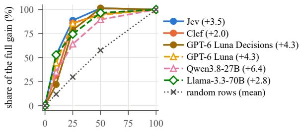  
least confident rows re-queried (%)  
Figure 4: Re-querying the least confident rows (row classification). For the x% of rows with the lowest confidence, the answer in the original format is replaced by the combination of the answers in the original and the four other formats. The y-axis gives the share of the Macro-F1 gain obtained when every row is re-queried, and the legend gives that gain in points.

An LLM’s confidence is a weaker indicator of fragile decisions. Read as the share of ten draws that repeat the original decision, it ranks the flips less well than the probability of Jev, Clef and Kev-27B on every task, and the best LLM ranks them about as well as GPT-6 Luna Decisions (Table 9). The LLMs’ most confident decisions are also less stable (Table 6). The confidence an LLM states is the least informative of all. With the best of its three readouts, the best LLM comes within 0.02 of the weakest of Jev, Clef and Kev-27B on row classification and TabFact and stays 0.05 behind on anomaly detection (Table 10), but these readouts need ten decoding passes or token probabilities.

Re-querying the least confident rows. Since low confidence marks the decisions that a rewrite is likely to change, it can also tell which rows are worth asking again. On row classification, we send a share of the rows again in the four other formats of Table 12 and combine the five answers, by the highest mean probability for a decision model and by majority vote for an LLM. Re-querying every row raises Macro-F1 by 2.0 to 6.4 points for six of the models but takes four more requests per row. Re-querying only the 25% least confident rows takes one more request per row on average and recovers 79–89% of the gain for the decision models and 64–86% for the LLMs, against 23–44% for random rows (Figure 4). Most of this gain comes from leaving the original array of values, the weakest format for six of the seven models, and the best other format alone comes within 0.2 points of the combination or exceeds it. The rows whose decisions change with the format are thus mostly the least confident ones, and re-querying them undoes most of the effect of a weak format. Kev-27B, whose weakest format is not the array, loses 0.7 points (not shown).

Confidence follows stability more than correctness. Confident decisions are more often right. Among the 25% of decisions with the highest confidence, the decision models are right 67–99% of the time, against 43–73% among the 25% with the lowest. Yet their confidence separates stable from fragile decisions far better than right from wrong ones (Table 19). On row classification and anomaly detection, stable but wrong decisions carry almost as much confidence as stable and right ones (0.67– 0.86 against 0.76–0.90) and far more than fragile ones (0.54–0.66). On TabFact the order is the same, with smaller gaps. Such stable errors make up 17–23% of the decisions in row classification and anomaly detection and 4–5% on TabFact, and no signal of instability can reveal them (cf. Ganesh et al., 2026). Llama-3.3-70B’s confidence is high in all four groups (0.85–1.00).

Why confidence predicts flips. A decision flips when a rewrite moves its margin, the gap between the log-probabilities of the chosen option and the best other option, below zero (cf. Cohen et al., 2019; Bhojanapalli et al., 2021). For the decision models, the flip rates predicted from the margin alone, assuming a small shift that is nearly independent of the item, match the observed ones decile by decile (Figure 5). Such a shift flips only borderline decisions, which would explain why the flips cancel in accuracy and why the confidence predicts them.

Takeaway. A decision model’s probability indicates which of its decisions a rewrite is likely to change. The confidence of an LLM is a weaker indicator. Re-querying only the least confident rows recovers most of the gain of re-querying every row.

## 7 Related work

LLMs on tables. LLMs can classify rows serialized as text from a few labelled examples, by prompting or fine-tuning (Dinh et al., 2022; Hegselmann et al., 2023). They can also build features and rules for a conventional model (Han et al., 2024; Ye et al., 2025). LLMs also detect anomalous samples (Tsai et al., 2025; Yoon et al., 2026; Ye et al., 2026) and verify claims about tables on TabFact (Chen et al., 2020), and Fang et al. (2024) survey the field. Each of these methods addresses one kind of task and reports accuracy. We compare LLMs with decision models on three kinds and look at single decisions.

Robustness of LLMs. LLM answers change with the order, names and format of the options and with the wording of the prompt (Zhao et al., 2021; Zheng et al., 2024; Sclar et al., 2024; Mizrahi et al., 2024). On tables, the serialization changes results (Sui et al., 2024; Fang et al., 2024), and reordering or transposing a table lowers accuracy on table question answering (Liu et al., 2024; Zhao et al., 2023; Zhou et al., 2024). For single predictions, Hamman et al. (2025) find that the probability of tabular LLMs does not reveal their inconsistency across fine-tuning seeds, and Ganesh et al. (2026) find that an LLM’s uncertainty identifies promptsensitive items but not wrong ones. We measure which individual decisions rewrites of the table change, for LLMs and for models that return a probability by design.

Decision models. Early studies measure Jev’s accuracy and calibration on text (Deußer et al., 2026), its consistency under benign and injected edits (Hu et al., 2026) and the readout stability of open-weight decision models (Li and Chen, 2026). Others apply decision models to single tabular applications (Severo et al., 2026; Jung, 2026), and an audit lists the missing tests (Tang and Zheng, 2026). We compare decision models, including one built on an LLM, with LLMs across tabular tasks.

## 8 Discussion

When to use decision models? Decision models suit tabular decisions whose answers form a fixed set, such as classifying rows, verifying claims or flagging anomalies. In tasks with few labelled rows, they perform as well as LLMs, cost less per decision, respond faster and return a useful confidence with each decision (Section 3). They are most useful when many rows need a decision, when the wording of the question may vary and when uncertain decisions need to be identified (Sections 4 and 6). They are less suited when many labelled rows are available. From around 64 labelled rows on, tabular foundation models and trained models perform better (Section 3), and decision models have shorter context windows than LLMs, which limits how many labelled rows they can read. By design they return only one of a fixed set of choices, so they do not cover tasks that need free text, such as an explanation or a computed value.

When to use LLMs? LLMs suit the task better when the answer has to be written in tokens rather than chosen from a fixed set, for example when a decision must be explained or an open question about a table answered. A strong LLM is also a reasonable starting point when almost no labelled rows exist (Section 3). When an LLM is used for decisions with a fixed set of answers, a single question prompt may not be relied on, since presenting the options in several orders and aggregating the answers can reduce its dependence (Zheng et al., 2024).

Future directions. No model we test is robust to how the table is organized, and this is the main limitation of decision models on tables. A natural next step is to train decision models on rewrites of the table. In previous work, LLMs have been trained to predict on unseen tables in few shots more accurately than XGBoost and TabPFN (Gardner et al., 2024). With RLCD, decision models can also follow this path and be trained to improve their decision accuracy and robustness on tabular tasks. LLMs and decision models can also work together: a decision model can make most of the decisions, and an LLM can explain or review the few it is least confident about. Systems that combine the two kinds of model in this way are another direction for future work.

## 9 Conclusion

We studied typed decision models as a method for decisions on tabular data. On row classification, fact verification and anomaly detection, they perform as well as LLMs at a fraction of the cost. Except for GPT-6 Luna Decisions, renaming or reordering the options barely changes their decisions. How the table is organized, however, affects decision models and LLMs alike, and about a third of the row decisions change under some rewrite of the table. The decisions to which a decision model gives low probability are the ones most likely to change. Whether decision models can be made robust to how the table is organized remains open.

## Limitations

First, each of the seven models is tested in one version. Jev and GPT-6 Luna Decisions are closed services whose internal processing is not visible to us and may change across versions, and the Decisions API is still in public beta. The two open-weight decision models reproduce the findings we rely on, but other decision models, and later versions of the ones we test, may behave differently.

Second, we cover three kinds of tabular decisions and use subsets of each benchmark, since every request is sent under every rewrite to seven models. The 21 types of rewrite cover the format of the table, the order of its rows and columns and the formulation of the question. They do not cover other changes that keep the content, such as renaming columns or converting units, so our results say little about robustness to those changes.

## References

Srinadh Bhojanapalli, Kimberly Wilber, Andreas Veit, Ankit Singh Rawat, Seungyeon Kim, Aditya Menon, and Sanjiv Kumar. 2021. On the reproducibility of neural network predictions. arXiv:2102.03349.

Vadim Borisov, Tobias Leemann, Kathrin Seßler, Johannes Haug, Martin Pawelczyk, and Gjergji Kasneci. 2022. Deep neural networks and tabular data: A survey. IEEE Transactions on Neural Networks and Learning Systems.

Tianqi Chen and Carlos Guestrin. 2016. XGBoost: A scalable tree boosting system. In Proceedings ofthe 22nd ACM SIGKDD International Conference on Knowledge Discovery and Data Mining.

Wenhu Chen, Hongmin Wang, Jianshu Chen, Yunkai Zhang, Hong Wang, Shiyang Li, Xiyou Zhou, and William Yang Wang. 2020. TabFact: A large-scale dataset for table-based fact verification. In International Conference on Learning Representations.

Cloudflare. 2026. Introducing Clef: our open-source decision models, and new RL fine-tuning platform. Blog post by M. Chen, https://blog.cloudflare. com/clef-decision-models/. Weights: https://huggingface.co/Cloudflare/clef, Apache-2.0.

Jeremy Cohen, Elan Rosenfeld, and Zico Kolter. 2019. Certified adversarial robustness via randomized smoothing. In Proceedings of the 36th International Conference on Machine Learning.

Tobias Deußer, Lorenz Sparrenberg, and Rafet Sifa. 2026. Evaluating and benchmarking the system one model Jev. Preprint, arXiv:2609.37647.

Tuan Dinh, Yuchen Zeng, Ruisu Zhang, Ziqian Lin, Michael Gira, Shashank Rajput, Jy-yong Sohn, Dimitris Papailiopoulos, and Kangwook Lee. 2022. LIFT: Language-interfaced fine-tuning for non-language machine learning tasks. In Advances in Neural Information Processing Systems.

Xi Fang, Weijie Xu, Fiona Anting Tan, Jiani Zhang, Ziqing Hu, Yanjun Qi, Scott Nickleach, Diego Socolinsky, Srinivasan Sengamedu, and Christos Faloutsos. 2024. Large language models (LLMs) on tabular data: Prediction, generation, and understanding – a survey. Transactions on Machine Learning Research.

Prakhar Ganesh. 2025. From model multiplicity to prompt multiplicity: Emerging arbitrariness concerns in the age of generative AI. In Proceedings of the AAAI/ACM Conference on AI, Ethics, and Society.

Prakhar Ganesh, Reza Shokri, and Golnoosh Farnadi. 2026. Rethinking hallucinations: Correctness, consistency, and prompt multiplicity. In Proceedings of the 19th Conference ofthe European Chapter ofthe Associationfor Computational Linguistics (EACL).

Josh Gardner, Juan C. Perdomo, and Ludwig Schmidt. 2024. Large scale transfer learning for tabular data via language modeling. In Advances in Neural Information Processing Systems.

Léo Grinsztajn, Edouard Oyallon, and Gaël Varoquaux. 2022. Why do tree-based models still outperform deep learning on typical tabular data? In Advances in Neural Information Processing Systems: Datasets and Benchmarks Track.

Faisal Hamman, Pasan Dissanayake, Saumitra Mishra, Freddy Lecue, and Sanghamitra Dutta. 2025. Quantifying prediction consistency under fine-tuning multiplicity in tabular LLMs. In Proceedings ofthe 42nd International Conference on Machine Learning.

Sungwon Han, Jinsung Yoon, Sercan Ö. Arik, and Tomas Pfister. 2024. Large language models can automatically engineer features for few-shot tabular learning. In Proceedings of the 41st International Conference on Machine Learning, volume 235 of PMLR, pages 17454–17479.

Stefan Hegselmann, Alejandro Buendia, Hunter Lang, Monica Agrawal, Xiaoyi Jiang, and David Sontag. 2023. TabLLM: Few-shot classification of tabular data with large language models. In Proceedings of The 26th International Conference on Artificial Intelligence and Statistics, volume 206 of PMLR, pages 5549–5581.

Noah Hollmann, Samuel Müller, Lennart Purucker, Arjun Krishnakumar, Max Körfer, Shi Bin Hoo, Robin Tibor Schirrmeister, and Frank Hutter. 2025. Accurate predictions on small data with a tabular foundation model. Nature, 637:319–326.

Jianyi Hu, Hangtao Zhang, Yi Liu, Yeqi Zeng, Li Zeng, Xianlong Wang, Rui Wang, and Leo Yu Zhang. 2026. JevAdvBench: A benchmark and black-box attacks

for reinforcement learning for calibrated decisions models. Preprint, arXiv:2609.31142.

Wooyoung Jung. 2026. Where can a decision model diagnose HVAC faults? reasoning demand, physical representation, and robustness under shift. Preprint, arXiv:2610.09937.

Guolin Ke et al. 2017. LightGBM: A highly efficient gradient boosting decision tree. In Advances in Neural Information Processing Systems.

Ran Li and Lei Chen. 2026. Readout stability in prefill-only decision models: Zero-label prediction and inference-time compute allocation. Preprint, arXiv:2610.07716.

Yinheng Li and Justin Wagle. 2026. LLM-as-Jev: LLMs are already Jev-style decision models – when and how to fine-tune them. Preprint, arXiv:2610.02076.

Tianyang Liu, Fei Wang, and Muhao Chen. 2024. Rethinking tabular data understanding with large language models. In Proceedings of the 2024 Conference of the North American Chapter of the Association for Computational Linguistics: Human Language Technologies (Volume 1: Long Papers), pages 450–482.

Llama Team, AI @ Meta. 2024. The Llama 3 herd of models. Preprint, arXiv:2407.21783.

Charles Marx, Flavio Calmon, and Berk Ustun. 2020. Predictive multiplicity in classification. In Proceedings ofthe 37th International Conference on Machine Learning.

Moran Mizrahi, Guy Kaplan, Dan Malkin, Rotem Dror, Dafna Shahaf, and Gabriel Stanovsky. 2024. State of what art? a call for multi-prompt LLM evaluation. Transactions of the Association for Computational Linguistics, 12:933–949.

OpenAI. 2026a. Decisions API. https: //developers.openai.com/api/docs/guides/ decisions. Public beta since 6 October 2026; model openai/gpt-6-luna-decisions, snapshot gpt-6-luna-decisions-20261006.

OpenAI. 2026b. GPT-6 Luna. https:// openrouter.ai/openai/gpt-6-luna. Snapshot gpt-6-luna-20260922.

Jared Palmer. 2026. Kev. https://github.com/ jaredpalmer/kev.

Prior Labs. 2026. TabPFN-3.5. https: //huggingface.co/Prior-Labs/tabpfn\_3\_5. Model card and weights, checkpoint tabpfnv3.5-20260909; TabPFN-3.5 Non-Commercial License.

Liudmila Prokhorenkova et al. 2018. CatBoost: Unbiased boosting with categorical features. In Advances in Neural Information Processing Systems.

Qwen Team. 2026. Qwen3.8-27B. https:// huggingface.co/Qwen/Qwen3.8-27B.

Melanie Sclar, Yejin Choi, Yulia Tsvetkov, and Alane Suhr. 2024. Quantifying language models’ sensitivity to spurious features in prompt design or: How i learned to start worrying about prompt formatting. In International Conference on Learning Representations.

Paulo Severo, Silvio E. Quincozes, and Amanda Dias. 2026. Jev-IDS: A system one model for network intrusion detection in label-scarce and zero-day scenarios. Preprint, arXiv:2610.01079.

Yuan Sui, Mengyu Zhou, Mingjie Zhou, Shi Han, and Dongmei Zhang. 2024. Table meets LLM: Can large language models understand structured table data? a benchmark and empirical study. In Proceedings of the 17th ACM International Conference on Web Search and Data Mining.

Lijuan Tang and Yuemeng Zheng. 2026. Typed decision models: An early evidence audit and evaluation checklist. Preprint, arXiv:2609.32160.

Che-Ping Tsai, Ganyu Teng, Phillip Wallis, and Wei Ding. 2025. AnoLLM: Large language models for tabular anomaly detection. In International Conference on Learning Representations.

TypeSafe. 2026. Jev. https://docs.typesafe.ai. Model typesafe/jev-1.13, revision 20260917.

Hangting Ye, Jinmeng Li, He Zhao, Dandan Guo, and Yi Chang. 2025. LLM meeting decision trees on tabular data. Preprint, arXiv:2505.17918.

Hangting Ye, Jinhan Liu, Yong Yao, Jinmeng Li, Peng Wang, Yang Cao, He Zhao, Dandan Guo, Yi Chang, and Hongyuan Zha. 2026. A comprehensive survey of tabular anomaly detection. Preprints.org, 202607.1125. https://www. preprints.org/manuscript/202607.1125.

Sanghyu Yoon, Dongmin Kim, Suhee Yoon, Ye Seul Sim, Seungdong Yoa, Hye-Seung Cho, Soonyoung Lee, Hankook Lee, and Woohyung Lim. 2026. ReTabAD: A benchmark for restoring semantic context in tabular anomaly detection. In International Conference on Learning Representations. ArXiv:2510.02060.

Yilun Zhao et al. 2023. RobuT: A systematic study of table QA robustness against human-annotated adversarial perturbations. In Proceedings of the 61st Annual Meeting of the Association for Computational Linguistics.

Zihao Zhao, Eric Wallace, Shi Feng, Dan Klein, and Sameer Singh. 2021. Calibrate before use: Improving few-shot performance of language models. In Proceedings of the 38th International Conference on Machine Learning.

Chujie Zheng, Hao Zhou, Fandong Meng, Jie Zhou, and Minlie Huang. 2024. Large language models are not robust multiple choice selectors. In International Conference on Learning Representations.

Wei Zhou, Mohsen Mesgar, Heike Adel, and Annemarie Friedrich. 2024. FREB-TQA: A fine-grained robustness evaluation benchmark for table question answering. In Proceedings of the 2024 Conference of the North American Chapter ofthe Associationfor Computational Linguistics.

## A Models

Table 7 lists the models we evaluate, the exact versions and how we run them.
<table><tr><td>Model</td><td>Access</td><td>Version</td><td>How we run it</td></tr><tr><td colspan="4">Decision models, whose confidence is the probability they return</td></tr><tr><td>Jev</td><td>Closed</td><td>typesafe/jev-1.13 revision 20260917</td><td>TypeSafe&#x27;s API through OpenRouter</td></tr><tr><td>Clef</td><td>Open-weight, trained from Qwen3.8-27B</td><td>Cloudflare/clef commit 2f3de3dd</td><td>Our implementation of its release code</td></tr><tr><td>Kev-27B</td><td>Open-weight, trained from Qwen3.8-27B</td><td>jaredpalmer/kev-27b revision 28be62e9</td><td>Official server, bf16, 4×A800</td></tr><tr><td>GPT-6 Luna Decisions</td><td>Closed, built on GPT-6 Luna</td><td>openai/gpt-6-luna-decisions snapshot gpt-6-luna-decisions-20261006</td><td>OpenAI&#x27;s Decisions API (public beta) through OpenRouter</td></tr><tr><td colspan="4">LLMs, whose confidence is the share of ten draws that repeat the original decision</td></tr><tr><td>GPT-6 Luna</td><td>Closed</td><td>openai/gpt-6-luna snapshot gpt-6-1una-20260922</td><td>OpenAI&#x27;s API through OpenRouter, temperature 1,</td></tr><tr><td>Qwen3.8-27B</td><td>Open-weight</td><td>Qwen/Qwen3.8-27B commit 1d4bf0f2</td><td>reasoning off vLLM, greedy decoding</td></tr><tr><td>Llama-3.3-70B</td><td>Open-weight</td><td>meta-1lama/Llama-3.3-70B-Instruct weights checked by sha256 against the official release</td><td>vLLM, greedy decoding</td></tr></table>

Table 7: The models we evaluate. Section 6 defines the confidence. For every LLM, the ten draws are taken at temperature 1.

## B Compute

Table 8 lists the hardware and the dates of all runs. The open-weight models run on servers with four or six NVIDIA A800 80GB PCIe GPUs and on a server with four NVIDIA RTX 6000D GPUs (84 GB each). The trained methods and TabPFN-3.5 run on CPUs.

<table><tr><td>Model</td><td>Hardware</td><td>Dates</td></tr><tr><td>Jev</td><td>API</td><td>1–5 Oct</td></tr><tr><td>Clef</td><td>A800, RTX 6000D</td><td>1-9 Oct</td></tr><tr><td>Kev-27B</td><td>A800</td><td>6-9 Oct</td></tr><tr><td>GPT-6 Luna Decisions</td><td>API</td><td>12 Oct</td></tr><tr><td>GPT-6 Luna</td><td>API</td><td>1-10 Oct</td></tr><tr><td>Qwen3.8-27B</td><td>A800, RTX 6000D</td><td>1-9 Oct</td></tr><tr><td>Llama-3.3-70B</td><td>A800</td><td>7–9 Oct</td></tr><tr><td>Trained methods</td><td>CPU</td><td>5–9 Oct</td></tr><tr><td>TabPFN-3.5</td><td>CPU</td><td>9 Oct</td></tr></table>

Table 8: Hardware and dates of the runs (2026, UTC). The closed models are called through their providers APIs.

## C Further results

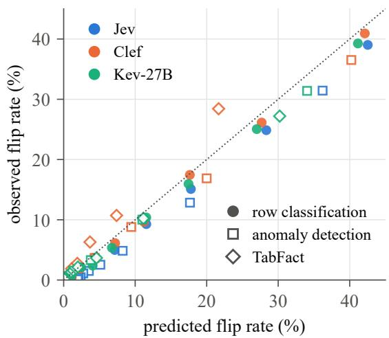  
Figure 5: Decision models: observed flip rate against the rate predicted when a rewrite adds item-independent noise to the margin, per margin decile and task.

<table><tr><td></td><td colspan="3">predicts a flip</td><td colspan="3">predicts an error</td></tr><tr><td>Model</td><td>Row classif.</td><td>Anomaly</td><td>TabFact</td><td></td><td>Row classif. Anomaly</td><td>TabFact</td></tr><tr><td>Jev</td><td>0.87 [0.86, 0.88]</td><td>0.89 [0.89, 0.90]</td><td>0.89 [0.88, 0.91]</td><td>0.59</td><td>0.65</td><td>0.82</td></tr><tr><td>Clef</td><td>0.85 [0.85, 0.86]</td><td>0.89 [0.88, 0.89]</td><td>0.87 [0.86, 0.89]</td><td>0.67</td><td>0.61</td><td>0.84</td></tr><tr><td>Kev-27B GPT-6 Luna</td><td>0.85 [0.84, 0.86]</td><td>0.92 [0.92, 0.93]</td><td>0.90 [0.88, 0.91]</td><td>0.70</td><td>0.70</td><td>0.84</td></tr><tr><td>Decisions</td><td>0.82 [0.81, 0.83]</td><td>0.83 [0.83, 0.84]</td><td>0.81 [0.80, 0.83]</td><td>0.74</td><td>0.70</td><td>0.78</td></tr><tr><td>GPT-6 Luna</td><td>0.83 [0.82, 0.84]</td><td>0.71 [0.70, 0.72]</td><td>0.73 [0.72, 0.75]</td><td>0.68</td><td>0.62</td><td>0.69</td></tr><tr><td>Qwen3.8-27B</td><td>0.77 [0.76, 0.78]</td><td>0.84 [0.83, 0.85]</td><td>0.83 [0.82, 0.85]</td><td>0.70</td><td>0.62</td><td>0.78</td></tr><tr><td>Llama-3.3-70B</td><td>0.64 [0.63, 0.65]†</td><td>0.67 [0.66, 0.68]</td><td>0.66 [0.64, 0.68]</td><td>0.55</td><td>0.51</td><td>0.57</td></tr></table>

Table 9: How well a model’s confidence in its original decision predicts (left) that an information-preserving rewrite changes the decision and (right) that the original decision is wrong (flip AUROC and error AUROC; 0.5 is chance). Left: pooled over the rewrites of Figure 3 and the table formats, with 95% cluster-bootstrap intervals. Confidence: for the decision models, the returned probability of the chosen option; for the LLMs, the share of ten draws at temperature 1 that give the original decision. †Strict parse: an answer such as “Yes.” to the yes/no question counts as invalid, hence as changed. Ignoring case and a final full stop: Llama-3.3-70B on row classif. 0.66 [0.65, 0.67].

<table><tr><td>Model</td><td></td><td>Ten draws Stated Answer prob.</td></tr><tr><td colspan="3">Row classification GPT-6 Luna 0.83 0.72</td></tr><tr><td>Qwen3.8-27B Llama-3.3-70B weakest of Jev, Clef and Kev-27B: Kev-27B, 0.85</td><td>0.77 0.60 0.64 0.50</td><td>0.71 0.65 0.73</td></tr><tr><td>GPT-6 Luna Decisions: 0.82</td><td></td><td></td></tr><tr><td>TabFact GPT-6 Luna Qwen3.8-27B 0.83</td><td>0.73 0.58 0.52</td><td>0.86 0.83</td></tr><tr><td colspan="3">Llama-3.3-70B 0.66 0.56 weakest of Jev, Clef and Kev-27B: Clef, 0.87 GPT-6 Luna Decisions: 0.81 Anomaly detection</td></tr><tr><td colspan="3">GPT-6 Luna 0.71 0.65 Qwen3.8-27B 0.84 0.72 Llama-3.3-70B 0.67 0.59 weakest of Jev, Clef and Kev-27B: Clef, 0.89</td></tr></table>

Table 10: Every readout of an LLM’s confidence, on the same rewrites: flip AUROC (rewrites shared by both kinds of model). Ten draws: share of ten draws at temperature 1 that give the original decision, the readout of the main text. Stated: the confidence the model gives when asked, 0–100 (anomaly detection: the confidence in its answer). Answer prob.: probability of the first token of the generated label, or the stated anomaly score’s distance from 0.5; for GPT-6 Luna, agreement of three draws. Bold: the best readout of each model and task. –: not available.

<table><tr><td>arXiv</td><td>Table input (application or setting)</td></tr><tr><td></td><td>2609.23136 telemetry tables (6G network intents) 2609.24395 video feature records (video quality)</td></tr><tr><td></td><td>2609.27535 survey micro-data as personas (social science) 2609.33689 KPM records (5G network control)</td></tr><tr><td></td><td>2609.36154 accelerometer features (activity recognition)</td></tr><tr><td></td><td>2609.37470 joined tables or nested records (synthetic world) 2610.00376 packet features (traffic classification)</td></tr><tr><td></td><td>2610.01079 NSL-KDD flow records (intrusion detection)</td></tr><tr><td>2610.03073 security telemetry (security tasks) 2610.08089 relational tuples (synthetic query plans)</td><td>2610.02046 database tuples (semantic queries)</td></tr></table>

Table 11: Of the 112 arXiv papers on decision models posted between 15 September and 8 October 2026, the fourteen whose main input is a table or table rows.

<table><tr><td>Task</td><td>Code</td><td>Rewrite</td><td>Source</td></tr><tr><td>Row classification</td><td>COLS</td><td>Columns shuffled: one fixed permutation per dataset; field descriptions, names and values permuted together</td><td>order</td></tr><tr><td></td><td>COLR</td><td>Columns in reverse order</td><td>order</td></tr><tr><td></td><td>LIST</td><td>One line per field, “- name: value&quot; (TabLLM list)</td><td>format</td></tr><tr><td></td><td>TEXT</td><td>One sentence per field, “The name is value.&quot; (TabLLM text)</td><td>format</td></tr><tr><td></td><td>JSONOBJ</td><td>JSON object {name: value}</td><td>format</td></tr><tr><td></td><td>MD</td><td>One-row Markdown table (header and value row)</td><td>format</td></tr><tr><td>TabFact</td><td>COLS</td><td>Columns shuffled: one fixed permutation per table; header and rows permuted together</td><td>order</td></tr><tr><td></td><td>COLR</td><td>Columns in reverse order</td><td>order</td></tr><tr><td></td><td>ROWS</td><td>Data rows shuffled; header kept firstb</td><td>order</td></tr><tr><td></td><td>ROWR</td><td>Data rows in reverse orderb</td><td>order</td></tr><tr><td></td><td>TRANS</td><td>Table transposed; the format sentence says that each line starts with a column name followed by that column&#x27;s values</td><td>order</td></tr><tr><td></td><td>MD</td><td>Markdown table</td><td>format</td></tr><tr><td></td><td>CSV</td><td>CSV with standard quoting</td><td>format</td></tr><tr><td></td><td>JSONREC</td><td>List of JSON records, one object per row keyed by the header</td><td>format</td></tr><tr><td></td><td>HTML TAPEX</td><td>HTML table TAPEX linearization, &quot;col : ... row  $1 : \dots :$ </td><td>format format</td></tr><tr><td></td><td></td><td></td><td></td></tr><tr><td>Anomaly detection</td><td>COLS</td><td>Fields shuffled within each sample</td><td>order</td></tr><tr><td></td><td>COLR</td><td>Fields in reverse order</td><td>order</td></tr><tr><td></td><td>ROWS</td><td>Samples of a batch shuffled; sample identifiers unchanged</td><td>order</td></tr><tr><td></td><td>ROWR</td><td>Samples of a batch in reverse order</td><td>order</td></tr><tr><td></td><td>JSONOBJ</td><td>Each sample as a JSON object</td><td>format</td></tr><tr><td></td><td>LIST</td><td>Each sample as “- name: value&quot; lines</td><td>format</td></tr><tr><td></td><td>TEXT</td><td>Each sample as sentences, “The name is value.&quot;</td><td>format</td></tr><tr><td></td><td>MD</td><td>The batch as one Markdown table, sample identifier in the first column</td><td>format</td></tr><tr><td></td><td>DEC3</td><td>Numeric fields rendered with three decimals instead of twoª</td><td>format</td></tr></table>

Table 12: Rewrites of the table that keep the information needed for the decision. The original format is, for row classification, field descriptions followed by one array of values; for TabFact, the official format with a header line and # between cells; for anomaly detection, the serializer of the ReTabAD authors with 15 samples per batch. Source: order of rows and columns, or format of the table. aAdds a decimal of precision, so it is left out of Tables 5 and 6. bCan change the truth of claims that refer to positions $( \hbar r s t , l a s t , . . . ) ;$ such claims are left out of Tables 5 and 6.

<table><tr><td></td><td colspan="7">decision models</td><td colspan="7">LLMs</td></tr><tr><td></td><td colspan="2"></td><td colspan="2">Clef</td><td colspan="2">Kev-27B</td><td colspan="2">GPT-6 Luna Decisions</td><td colspan="2">GPT-6 Luna</td><td colspan="2">Qwen3.8-27B</td><td colspan="2">Llama-3.3-70B</td></tr><tr><td>Condition</td><td>Jev Flip</td><td>Score</td><td>Flip</td><td>Score</td><td>Flip</td><td>Score</td><td>Flip</td><td>Score</td><td>Flip</td><td>Score</td><td>Flip</td><td>Score Flip</td><td></td><td>Score</td></tr><tr><td>Row classification (Macro-F1)</td><td></td><td></td><td></td><td></td><td></td><td></td><td></td><td></td><td></td><td></td><td></td><td></td><td></td><td></td></tr><tr><td>original request</td><td></td><td>52.1</td><td></td><td>58.4</td><td></td><td>55.2</td><td></td><td>61.2</td><td></td><td>62.5</td><td></td><td>52.2</td><td></td><td>44.0</td></tr><tr><td>identical re-send</td><td>4.7</td><td>52.4</td><td>1.6</td><td>58.0</td><td>0.6</td><td>54.5</td><td>0.0</td><td>61.2</td><td>13.3</td><td>63.0</td><td>1.1</td><td>52.9</td><td>0.4</td><td>44.1</td></tr><tr><td>options in reverse order</td><td>5.9</td><td>52.3</td><td>1.6</td><td>58.0</td><td>5.9</td><td>53.9</td><td>22.7</td><td>60.1</td><td>13.7</td><td>62.5</td><td>13.6</td><td>54.1</td><td>26.8</td><td>51.4</td></tr><tr><td>option names A, B, ...</td><td>6.4</td><td>51.7</td><td>5.5</td><td>58.2</td><td>4.9</td><td>56.5</td><td>7.6</td><td>58.6</td><td>18.2</td><td>61.4 25.5</td><td></td><td>47.9</td><td>30.4</td><td>32.6</td></tr><tr><td>option names replaced by synonyms</td><td>7.6</td><td>53.3</td><td>7.1</td><td>58.2</td><td>5.6</td><td>54.9</td><td>8.7</td><td>59.7</td><td>16.0</td><td>65.1 24.0</td><td></td><td>54.7</td><td>21.7</td><td>43.6</td></tr><tr><td>no option descriptions</td><td>5.4</td><td>52.0</td><td>6.1</td><td>57.6</td><td>6.0</td><td>54.2</td><td>9.3</td><td>63.0</td><td></td><td></td><td></td><td></td><td></td><td></td></tr><tr><td>original, binary datasets</td><td></td><td>54.9</td><td></td><td>62.6</td><td></td><td>59.4</td><td></td><td>64.7</td><td></td><td>65.5</td><td></td><td>59.2</td><td></td><td>46.2</td></tr><tr><td>yes/no question</td><td>6.6</td><td>56.8</td><td>9.0</td><td>61.9</td><td>3.2</td><td>59.5</td><td>15.0</td><td>66.7 14.3</td><td></td><td>67.3 16.8</td><td></td><td></td><td>45.2 56.9</td><td>19.6</td></tr><tr><td>paraphrased instructions</td><td>10.9</td><td>54.2</td><td>7.2</td><td>58.4</td><td>6.6</td><td>52.7</td><td>12.1</td><td>58.5</td><td>15.4</td><td>62.2</td><td>6.1</td><td>53.0</td><td>7.4</td><td>40.9</td></tr><tr><td>unverified hint appended</td><td>8.8</td><td>51.3</td><td></td><td></td><td></td><td></td><td></td><td></td><td></td><td></td><td></td><td></td><td></td><td></td></tr><tr><td>no task description</td><td>14.6</td><td>54.2</td><td>15.6 10.7</td><td>56.6 55.6</td><td>4.7 14.1</td><td></td><td>55.1 17.6 57.4 18.6</td><td>60.1 16.2 54.2</td><td>20.1</td><td>61.1 61.4</td><td>10.5 7.2</td><td></td><td>48.033.9 15.5</td><td>45.9</td></tr><tr><td></td><td></td><td></td><td></td><td></td><td></td><td></td><td></td><td></td><td></td><td></td><td></td><td>52.5</td><td></td><td>38.4</td></tr><tr><td>Fact verification on TabFact (accuracy)</td><td></td><td></td><td></td><td></td><td></td><td></td><td></td><td></td><td></td><td></td><td></td><td></td><td></td><td></td></tr><tr><td>original request identical re-send</td><td></td><td>89.7</td><td>1</td><td>85.0</td><td></td><td>88.8</td><td></td><td>78.7</td><td></td><td>79.0</td><td></td><td>82.5</td><td></td><td>80.5</td></tr><tr><td></td><td>1.9</td><td>89.5</td><td>0.4</td><td>85.2</td><td>0.1</td><td>88.8</td><td>0.0</td><td>78.7</td><td>13.5</td><td>75.6</td><td>0.7</td><td>82.6</td><td>0.7</td><td>81.0</td></tr><tr><td>options in reverse order</td><td>2.4</td><td>89.4</td><td>0.4</td><td>85.2</td><td>4.0</td><td>89.3</td><td>12.3</td><td>74.9</td><td>14.4</td><td>78.1</td><td>5.8</td><td>83.9</td><td>4.7</td><td>79.9</td></tr><tr><td>option names A, B, ...</td><td>2.2</td><td>89.3</td><td>2.1</td><td>85.2</td><td>2.1</td><td>88.9</td><td>9.6</td><td>79.5</td><td>21.3</td><td>72.0</td><td>3.2</td><td>83.1</td><td>4.2</td><td>81.2</td></tr><tr><td>option names replaced by synonyms</td><td>2.1</td><td>89.3</td><td>3.6</td><td>85.2</td><td>2.4</td><td>89.5</td><td>6.8</td><td>80.0</td><td>47.6</td><td>47.0</td><td>5.1</td><td>83.7</td><td>5.8</td><td>81.5</td></tr><tr><td>no option descriptions</td><td>2.2</td><td>89.5</td><td>3.0</td><td>85.8</td><td>4.3</td><td>88.5</td><td>7.6</td><td>77.0</td><td>13.7</td><td>77.8</td><td>5.3</td><td>82.5</td><td>4.2</td><td>80.2</td></tr><tr><td>yes/no question</td><td>4.1</td><td>89.2</td><td>4.0</td><td>86.2</td><td>4.0</td><td>89.2</td><td>12.0</td><td>79.2</td><td>13.6</td><td>80.7</td><td>6.9</td><td>81.8</td><td>5.8</td><td>80.5</td></tr><tr><td>paraphrased instructions</td><td>2.1</td><td>89.1</td><td>2.7</td><td>86.5</td><td>2.5</td><td>88.6</td><td>8.6</td><td>78.8</td><td>10.9</td><td>80.2</td><td>5.1</td><td>81.2</td><td>4.7</td><td>79.8</td></tr><tr><td>unverified hint appended</td><td>4.1</td><td>87.7</td><td>3.5</td><td>85.0</td><td>4.8</td><td>89.2</td><td>8.3</td><td>78.1 11.1</td><td></td><td>80.5</td><td>6.5</td><td>80.7</td><td>11.6</td><td>76.4</td></tr><tr><td>no task description</td><td>4.2</td><td>88.4</td><td>4.5</td><td>85.4</td><td>3.2</td><td>88.1</td><td>9.5</td><td>78.5</td><td>16.8</td><td>74.4</td><td>5.5</td><td>81.0</td><td>5.9</td><td>79.9</td></tr><tr><td>Anomaly detection on ReTabAD (AUROC)</td><td></td><td></td><td></td><td></td><td></td><td></td><td></td><td></td><td></td><td></td><td></td><td></td><td></td><td></td></tr><tr><td>original request identical re-send</td><td>2.8</td><td>74.6 74.3</td><td>1.2</td><td>74.7 74.8</td><td></td><td>81.2 81.2</td><td></td><td>80.5 80.5</td><td>13.3</td><td>77.3 76.3</td><td>2.8</td><td>71.0 71.5</td></table>

Table 13: How the question is asked, raw results. Flip: share of items whose decision differs from the model’s own decision under the original request (%; invalid outputs count as flips). Score: the task metric ×100 (row classification: Macro-F1 averaged over the 10 datasets; TabFact: accuracy; anomaly detection: AUROC averaged over the 20 sources). Identical re-send: the original request sent again, which gives the re-send rate. Conditions below the line remove or mislead information. Clef sorts the options, so reversing them cannot reach it. On row classification the LLMs receive no option descriptions, and on anomaly detection no options. Llama-3.3-70B answers the yes/no question mostly with “Yes” or “Yes.”, which the strict parse counts as invalid; with a parse that ignores case and a final full stop its flip rate there is 13.0%. Invalid outputs above 5% (%): Llama-3.3-70B on row classification, yes/no question: 54.8; GPT-6 Luna on TabFact, option names A, B, . . . : 9.8; GPT-6 Luna on TabFact, option names replaced by synonyms: 43.7; GPT-6 Luna on TabFact, no task description: 6.6; GPT-6 Luna on ReTabAD, paraphrased instructions: 7.0; Llama-3.3-70B on ReTabAD, paraphrased instructions: 9.5; GPT-6 Luna on ReTabAD, no task description: 5.2. –: does not apply.

<table><tr><td></td><td colspan="7">decision models</td><td colspan="7">LLMs</td></tr><tr><td></td><td colspan="2">Jev</td><td colspan="2">Clef</td><td colspan="2">Kev-27B</td><td colspan="2">GPT-6 Luna Decisions</td><td colspan="2">GPT-6 Luna</td><td colspan="2"></td><td colspan="2">Qwen3.8-27B Llama-3.3-70B</td></tr><tr><td>Condition</td><td>Flip Score</td><td></td><td>Flip</td><td>Score</td><td>Flip</td><td>Score</td><td>Flip</td><td>Score</td><td></td><td>Score</td><td>Flip</td><td>Score</td><td>Flip</td><td>Score</td></tr><tr><td>Row classification (Macro-F1)</td><td></td><td></td><td></td><td></td><td></td><td></td><td></td><td></td><td>Flip</td><td></td><td></td><td></td><td></td><td></td></tr><tr><td>original request</td><td></td><td>52.1</td><td></td><td>58.4</td><td></td><td>55.2</td><td></td><td></td><td></td><td>62.5</td><td></td><td>52.2</td><td></td><td>44.0</td></tr><tr><td>identical re-send</td><td>4.7</td><td>52.4</td><td>1.6</td><td>58.0</td><td>0.6</td><td>54.5</td><td>0.0</td><td>61.2 61.2</td><td>13.3</td><td>63.0</td><td>1.1</td><td>52.9</td><td>0.4</td><td>44.1</td></tr><tr><td>columns shuffled</td><td>15.9</td><td>51.6</td><td>15.0</td><td>57.8</td><td>15.6</td><td>54.8</td><td>18.5</td><td>57.0</td><td>20.1</td><td>60.3</td><td>20.4</td><td>52.5</td><td>17.2</td><td>46.3</td></tr><tr><td>columns reversed</td><td>17.5</td><td>52.8</td><td>17.6</td><td>59.4</td><td>15.7</td><td>54.7</td><td>19.9</td><td>57.5</td><td>23.1</td><td>62.7</td><td>15.2</td><td></td><td>55.7 15.1</td><td>40.7</td></tr><tr><td>questions shuffled within a request</td><td>4.8</td><td>51.9</td><td>14.9</td><td>57.5</td><td>0.4</td><td>55.3</td><td>0.0</td><td>61.2</td><td></td><td></td><td></td><td></td><td></td><td></td></tr><tr><td></td><td></td><td></td><td></td><td></td><td></td><td></td><td></td><td></td><td></td><td></td><td></td><td></td><td></td><td></td></tr><tr><td>Fact verification on TabFact (accuracy)</td><td></td><td>89.7</td><td></td><td>85.0</td><td></td><td>88.8</td><td></td><td>78.7</td><td></td><td>79.0</td><td></td><td>82.5</td><td></td><td>80.5</td></tr><tr><td>original request identical re-send</td><td>1.9</td><td>89.5</td><td>0.4</td><td>85.2</td><td>0.1</td><td>88.8</td><td>0.0</td><td></td><td>78.7 13.5</td><td>75.6</td><td>0.7 一</td><td>82.6</td><td>0.7</td><td>81.0</td></tr><tr><td>columns shuffled</td><td>6.3</td><td>88.2</td><td>8.0</td><td>84.2</td><td>6.2</td><td>87.9</td><td>12.7</td><td>78.3</td><td>19.9</td><td>75.4</td><td>8.2</td><td>81.7</td><td>11.0</td><td>79.4</td></tr><tr><td>columns reversed</td><td>7.3</td><td>87.8</td><td>9.0</td><td>85.2</td><td>6.5</td><td>87.4</td><td>13.4</td><td>77.8</td><td>20.4</td><td>74.8</td><td>9.2</td><td>80.8</td><td>12.1</td><td>78.2</td></tr><tr><td>rows shuffled</td><td>6.6</td><td>88.6</td><td>7.0</td><td>85.6</td><td>6.7</td><td>88.3</td><td>11.6</td><td>77.8</td><td>18.5</td><td>75.0</td><td>8.1</td><td>82.4</td><td>9.1</td><td>80.0</td></tr><tr><td>rows reversed</td><td>6.0</td><td>88.9</td><td>8.3</td><td>85.5</td><td>7.3</td><td>88.5</td><td>12.9</td><td>78.1</td><td>20.4</td><td>74.2</td><td>8.0</td><td>82.5</td><td>10.4</td><td>78.5</td></tr><tr><td>table transposed</td><td>8.7</td><td>86.4</td><td>9.7</td><td>83.4</td><td>8.0</td><td>86.7 17.0</td><td></td><td>73.9</td><td>25.5</td><td>70.9</td><td>12.1</td><td>77.0</td><td>16.1</td><td>74.1</td></tr><tr><td>Anomaly detection on ReTabAD (AUROC)</td><td></td><td></td><td></td><td></td><td></td><td></td><td></td><td></td><td></td><td></td><td></td><td></td><td></td><td></td></tr><tr><td>original request</td><td></td><td>74.6</td><td></td><td>74.7</td><td></td><td>81.2</td><td></td><td>80.5</td><td></td><td>77.3</td><td>一</td><td>71.0</td><td></td><td>61.0</td></tr><tr><td>identical re-send</td><td>2.8</td><td>74.3</td><td>1.2</td><td>74.8</td><td>0.1</td><td>81.2</td><td>0.0</td><td>80.5</td><td>13.3</td><td>76.3</td><td>2.8</td><td>71.5</td><td>1.6</td><td>60.2</td></tr><tr><td>columns shuffled</td><td>7.7</td><td>73.5</td><td>9.2</td><td>73.9</td><td>6.0</td><td>79.9</td><td>10.1</td><td>79.7</td><td>17.6</td><td>75.6</td><td>7.3</td><td>70.1</td><td>15.0</td><td>59.1</td></tr><tr><td>columns reversed</td><td>7.6</td><td>74.0</td><td>10.6</td><td>73.9</td><td>7.1</td><td>79.8</td><td>11.8</td><td>80.9</td><td>18.4</td><td>77.1</td><td>8.4</td><td>70.4</td><td>18.7</td><td>58.5</td></tr><tr><td>rows shuffled</td><td>7.6</td><td>74.0</td><td>10.2</td><td>73.7</td><td>7.1</td><td>81.5</td><td>10.8</td><td>80.0</td><td>20.1</td><td>73.7</td><td>8.9</td><td>71.6</td><td>24.7</td><td>58.8</td></tr><tr><td>rows reversed</td><td>8.8</td><td>74.4</td><td>10.6</td><td>72.3</td><td>7.6</td><td>81.0</td><td>10.7</td><td></td><td>80.6 20.0</td><td>79.2</td><td>11.6</td><td></td><td>72.5 27.2</td><td>58.6</td></tr></table>

Table 14: Order of rows and columns, raw results. Flip: share of items whose decision differs from the model’s own decision under the original request (%; invalid outputs count as flips). Score: the task metric ×100 (row classification: Macro-F1 averaged over the 10 datasets; TabFact: accuracy; anomaly detection: AUROC averaged over the 20 sources). Identical re-send: the original request sent again, which gives the re-send rate. Shuffling the questions of a request applies only to the decision models, which answer 16 questions per request; the LLMs receive one row per prompt. Reordering rows can change the truth of TabFact claims with position words. Invalid outputs above 5% (%): GPT-6 Luna on TabFact, columns shuffled: 6.7; GPT-6 Luna on TabFact, columns reversed: 7.2; GPT-6 Luna on TabFact, rows shuffled: 5.9; GPT-6 Luna on TabFact, rows reversed: 6.8; GPT-6 Luna on TabFact, table transposed: 8.2; GPT-6 Luna on ReTabAD, columns shuffled: 7.3; GPT-6 Luna on ReTabAD, columns reversed: 7.1; GPT-6 Luna on ReTabAD, rows shuffled: 8.8; GPT-6 Luna on ReTabAD, rows reversed: 8.0. –: does not apply.

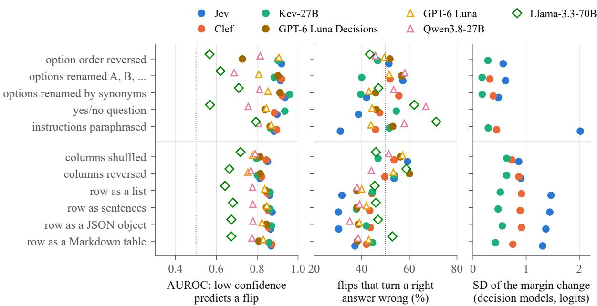  
Figure 6: Row classification, by rewrite. Left: flip AUROC. Middle: among flips that change correctness, the share that turn a right answer wrong. Right: standard deviation of the change of the decision models’ margin. Clef is omitted for option order, since it sorts the options.

<table><tr><td></td><td colspan="7">decision models</td><td colspan="7">LLMs</td></tr><tr><td></td><td colspan="2">Jev</td><td colspan="2">Clef</td><td colspan="2">Kev-27B</td><td colspan="2">GPT-6 Luna Decisions</td><td colspan="2">GPT-6 Luna</td><td colspan="2">Qwen3.8-27B</td><td colspan="2">Llama-3.3-70B</td></tr><tr><td>Condition</td><td></td><td>Flip Score</td><td>Flip</td><td>Score</td><td>Flip</td><td>Score</td><td>Flip</td><td>Score</td><td>Flip</td><td>Score</td><td>Flip</td><td>Score</td><td>Flip</td><td>Score</td></tr><tr><td>Row classification (Macro-F1)</td><td></td><td></td><td></td><td></td><td></td><td></td><td></td><td></td><td></td><td></td><td></td><td></td><td></td><td></td></tr><tr><td>original request</td><td></td><td>52.1</td><td></td><td>58.4</td><td></td><td>55.2</td><td></td><td>61.2</td><td></td><td>62.5</td><td></td><td>52.2</td><td></td><td>44.0</td></tr><tr><td>identical re-send</td><td>4.7</td><td>52.4</td><td>1.6</td><td>58.0</td><td>0.6</td><td>54.5</td><td>0.0</td><td>61.2</td><td>13.3</td><td>63.0</td><td>1.1</td><td>52.9</td><td>0.4</td><td>44.1</td></tr><tr><td>list (“- name: value&quot;)</td><td>15.0</td><td>56.0</td><td>14.0</td><td>60.3</td><td>16.1</td><td></td><td>54.6 17.2</td><td>64.7</td><td>17.7</td><td>66.5</td><td>17.9</td><td>58.4</td><td>21.3</td><td>47.9</td></tr><tr><td>text (“The name is value.&quot;)</td><td>14.1</td><td>56.2</td><td>14.3</td><td>60.5</td><td>14.4</td><td></td><td>56.2 17.9</td><td>65.0</td><td>17.5</td><td>66.2</td><td>18.4</td><td>57.4</td><td>19.0</td><td>48.5</td></tr><tr><td>JSON object</td><td>14.7</td><td>56.4 13.7</td><td></td><td>59.3 17.0</td><td></td><td></td><td>56.0 17.6</td><td>64.8 17.6</td><td></td><td>66.5</td><td>17.4</td><td>59.6</td><td>17.5</td><td>47.7</td></tr><tr><td>Markdown table</td><td>12.8</td><td>53.8 11.8</td><td></td><td>59.2</td><td>14.0</td><td></td><td>56.018.3</td><td>65.317.4</td><td></td><td>65.3</td><td>12.4</td><td>56.1</td><td>15.6</td><td>44.8</td></tr><tr><td>no field descriptions</td><td>8.5</td><td>51.7</td><td>6.4</td><td>56.3</td><td>7.2</td><td></td><td>52.7 12.3</td><td></td><td>61.2 16.0</td><td>61.6</td><td>6.8</td><td></td><td>52.8 13.6</td><td>39.6</td></tr><tr><td>values without names</td><td>40.5</td><td>46.834.3</td><td></td><td>51.3</td><td>41.4</td><td></td><td>44.7 28.8</td><td></td><td>47.632.0</td><td>49.4</td><td>22.6</td><td>39.7</td><td>25.8</td><td>36.4</td></tr><tr><td>names attached to other fields&#x27; values</td><td>33.6</td><td></td><td>45.7 21.1</td><td>53.0 29.0</td><td></td><td></td><td>49.9 24.8</td><td>44.938.5</td><td></td><td>46.2 12.2</td><td></td><td>44.1 16.7</td><td></td><td>41.7</td></tr><tr><td>Fact verification on TabFact (accuracy)</td><td></td><td></td><td></td><td></td><td></td><td></td><td></td><td></td><td></td><td></td><td></td><td></td><td></td><td></td></tr><tr><td>original request</td><td></td><td>89.7</td><td></td><td>85.0</td><td></td><td>88.8</td><td></td><td>78.7</td><td></td><td>79.0</td><td></td><td>82.5</td><td></td><td>80.5</td></tr><tr><td>identical re-send</td><td>1.9</td><td>89.5</td><td>0.4</td><td>85.2</td><td>0.1</td><td>88.8</td><td>0.0</td><td>78.713.5</td><td></td><td>75.6</td><td>0.7</td><td>82.6</td><td>0.7</td><td>81.0</td></tr><tr><td>Markdown table</td><td>3.1</td><td>89.6</td><td>5.0</td><td>86.2</td><td>3.5</td><td>89.6</td><td>9.6</td><td>80.8</td><td>15.7</td><td>78.7</td><td>5.7</td><td>81.3</td><td>5.3</td><td>81.0</td></tr><tr><td>CSV</td><td>2.7</td><td>89.7</td><td>4.3</td><td>86.0</td><td>2.9</td><td>89.2</td><td>9.2</td><td>79.8</td><td>14.8</td><td>77.1</td><td>4.3</td><td>82.2</td><td>4.3</td><td>80.5</td></tr><tr><td>JSON records</td><td>4.1</td><td>90.2</td><td>5.9</td><td>86.6</td><td>4.7</td><td>89.5</td><td>10.2</td><td>80.4</td><td>19.9</td><td>75.7</td><td>7.7</td><td>81.8</td><td>7.0</td><td>81.2</td></tr><tr><td>HTML</td><td>3.6</td><td>90.0</td><td>5.6</td><td>87.0</td><td>4.3</td><td>89.4</td><td>9.9</td><td>80.9</td><td>15.2</td><td>78.8</td><td>6.6</td><td>82.5</td><td>6.8</td><td>80.7</td></tr><tr><td>TAPEX linearization</td><td>4.1</td><td>88.7</td><td>5.2</td><td>85.4</td><td>3.6</td><td>89.7</td><td>9.8</td><td>79.5</td><td>20.1</td><td>72.9</td><td>7.8</td><td>80.2</td><td>6.9</td><td>81.1</td></tr><tr><td>Anomaly detection on ReTabAD (AUROC)</td><td></td><td></td><td></td><td></td><td></td><td></td><td></td><td></td><td></td><td></td><td></td><td></td><td></td><td></td></tr><tr><td>original request</td><td></td><td>74.6</td><td></td><td>74.7</td><td></td><td>81.2</td><td></td><td>80.5</td><td></td><td>77.3</td><td></td><td>71.0</td><td></td><td>61.0</td></tr><tr><td>identical re-send</td><td>2.8</td><td>74.3</td><td>1.2</td><td>74.8</td><td>0.1</td><td>81.2</td><td>0.0</td><td>80.5</td><td>13.3</td><td>76.3</td><td>2.8</td><td>71.5</td><td>1.6</td><td>60.2</td></tr><tr><td>JSON object</td><td>3.8</td><td>74.3</td><td>4.9</td><td>75.0</td><td>3.0</td><td>81.1</td><td>8.9</td><td>81.2</td><td>18.9</td><td>76.8</td><td>5.0</td><td>72.5</td><td>7.9</td><td>60.7</td></tr><tr><td>list (“- name: value&quot;)</td><td>4.3</td><td>74.3</td><td>5.4</td><td>74.6</td><td>3.5</td><td>81.0</td><td>9.0</td><td>80.3</td><td>17.7</td><td>75.6</td><td>4.6</td><td>71.8</td><td>11.2</td><td>59.6</td></tr><tr><td>text (“The name is value.&quot;)</td><td>4.2</td><td>74.4</td><td>6.0</td><td>75.0</td><td>3.9</td><td>81.3</td><td>9.6</td><td>80.2</td><td>17.7</td><td>74.8</td><td>5.4</td><td>71.8</td><td>10.6</td><td>60.0</td></tr><tr><td>Markdown table</td><td>7.8</td><td>73.0</td><td>8.6</td><td>76.3</td><td>6.2</td><td>81.0</td><td>11.6</td><td>79.4 16.3</td><td></td><td>76.5</td><td>7.6</td><td>71.0</td><td>17.8 5.4</td><td>59.7 61.1</td></tr><tr><td>numbers with three decimals</td><td>3.5</td><td>75.0</td><td>5.1</td><td>74.2</td><td>3.0</td><td>80.9</td><td>8.4</td><td>79.8</td><td>16.9</td><td>76.5</td><td>6.0</td><td>71.1</td></table>

Table 15: Format of the table, raw results. Flip: share of items whose decision differs from the model’s own decision under the original request (%; invalid outputs count as flips). Score: the task metric ×100 (row classification: Macro-F1 averaged over the 10 datasets; TabFact: accuracy; anomaly detection: AUROC averaged over the 20 sources). Identical re-send: the original request sent again, which gives the re-send rate. Conditions below the line remove or mislead information. Rendering numbers with three decimals adds precision. Invalid outputs above 5% (%): GPT-6 Luna on TabFact, CSV: 5.1; GPT-6 Luna on TabFact, JSON records: 7.3; GPT-6 Luna on TabFact, TAPEX linearization: 8.9; GPT-6 Luna on ReTabAD, JSON object: 9.7; GPT-6 Luna on ReTabAD, list (“- name: value”): 7.7; GPT-6 Luna on ReTabAD, text (“The name is value.”): 9.2; GPT-6 Luna on ReTabAD, Markdown table: 5.6; GPT-6 Luna on ReTabAD, numbers with three decimals: 8.2; GPT-6 Luna on ReTabAD, values without names: 10.9. –: does not apply.

<table><tr><td></td><td colspan="2">Jev</td><td colspan="2">Clef</td><td colspan="2">Kev-27B</td><td colspan="2">GPT-6 Luna Decisions</td><td colspan="4">trained on the same examples</td></tr><tr><td>Row classification (Macro-F1)</td><td>Score</td><td>∆</td><td>Score</td><td>∆</td><td>Score</td><td>∆</td><td>Score</td><td>Δ</td><td>LogReg LightGBM</td><td></td><td>Best TabPFN</td><td></td></tr><tr><td>no examples (zero-shot)</td><td>52.1</td><td></td><td>58.4</td><td></td><td>55.1</td><td></td><td>61.2</td><td></td><td></td><td></td><td></td><td></td></tr><tr><td>4 examples</td><td>60.2</td><td>+8.1</td><td>60.0</td><td>+1.6</td><td>59.0</td><td>+3.8</td><td>59.6</td><td>-1.6</td><td>51.8</td><td>45.3</td><td>55.2</td><td>51.5</td></tr><tr><td>16 examples (the original</td><td>60.0</td><td>+7.9</td><td>61.7</td><td>+3.2</td><td>62.7</td><td>+7.6</td><td>60.4</td><td>-0.8</td><td>58.6</td><td>51.8</td><td>58.7</td><td>59.5</td></tr><tr><td>ones)</td><td></td><td></td><td></td><td></td><td></td><td></td><td></td><td></td><td></td><td></td><td></td><td></td></tr><tr><td>64 examplesb</td><td>65.3+12.2</td><td></td><td>68.2</td><td>+9.0</td><td>69.3+12.2</td><td></td><td>65.4</td><td>+3.3</td><td>69.2</td><td>69.1</td><td>69.4</td><td>70.8</td></tr><tr><td>as many as fit (30–681) whole training split</td><td>66.7+14.6</td><td></td><td>70.6</td><td>+12.1</td><td>73.0+17.6</td><td></td><td>69.9</td><td>+8.7</td><td>72.2 74.7</td><td>76.0 80.0</td><td>76.3</td><td>77.8</td></tr><tr><td>16 examples, classes</td><td></td><td>一</td><td>一</td><td>一</td><td>1</td><td>一</td><td></td><td></td><td></td><td></td><td>80.0</td><td></td></tr><tr><td>interleaved</td><td>62.0</td><td>+9.9</td><td>61.9</td><td>+3.5</td><td>62.8</td><td>+7.7</td><td>63.6</td><td>+2.4</td><td></td><td></td><td></td><td></td></tr><tr><td>16 examples, written as text</td><td>57.1</td><td>+5.0</td><td>62.7</td><td>+4.3</td><td>61.1</td><td>+5.9</td><td>63.7</td><td>+2.5</td><td></td><td></td><td></td><td></td></tr><tr><td>TabFact (accuracy)</td><td>Score</td><td>∆</td><td>Score</td><td>Δ</td><td>Score</td><td>∆</td><td>Score</td><td>∆</td><td></td><td></td><td></td><td></td></tr><tr><td>no examples (zero-shot)</td><td>89.7</td><td></td><td>85.0</td><td></td><td>88.8</td><td></td><td>78.7</td><td></td><td></td><td></td><td></td><td></td></tr><tr><td>2 examples</td><td>88.4</td><td>-1.3</td><td>86.2</td><td>+1.1</td><td>89.8</td><td>+1.0</td><td>77.9</td><td>-0.8</td><td></td><td></td><td></td><td></td></tr><tr><td>4 examples</td><td>88.0</td><td>-1.7</td><td>86.4</td><td>+1.3</td><td>89.8</td><td>+0.9</td><td>78.1</td><td>-0.6</td><td></td><td></td><td></td><td></td></tr><tr><td>8 examples</td><td>88.1 88.8</td><td>-1.6 -1.0</td><td>86.6 87.2</td><td>+1.5</td><td>89.6 89.8</td><td>+0.8</td><td>77.5</td><td>-1.3 -2.6</td><td></td><td></td><td></td><td>一</td></tr><tr><td>as many as fit (68)</td><td></td><td></td><td></td><td>+2.1</td><td></td><td>+1.0</td><td>76.1</td><td></td><td></td><td></td><td></td><td></td></tr><tr><td>Anomaly detection (AUROC)</td><td>Score</td><td>∆</td><td>Score</td><td>∆</td><td>Score</td><td>∆</td><td>Score</td><td>∆</td><td>IForest</td><td>OCSVM</td><td>kNN</td><td>Best</td></tr><tr><td>no normal-sample statistics statistics only (the original</td><td>65.4</td><td>-9.1</td><td>67.3</td><td>-7.3</td><td>73.8</td><td>-7.4</td><td>74.6</td><td>-6.4</td><td></td><td></td><td></td><td></td></tr><tr><td>request)</td><td>74.6</td><td></td><td>74.7</td><td></td><td>81.2</td><td></td><td>80.6</td><td></td><td></td><td></td><td></td><td></td></tr><tr><td>statistics and 16 normal samples</td><td>79.0</td><td>+4.4</td><td>80.5</td><td>+5.9</td><td>84.2</td><td>+3.0</td><td>83.6</td><td>+3.0</td><td>68.1</td><td>72.2</td><td>72.3</td><td>72.3</td></tr><tr><td>statistics and as many normal samples as fit</td><td>80.8</td><td>+6.3</td><td>84.1</td><td>+9.5</td><td>86.5</td><td>+5.3</td><td>85.7</td><td>+5.2</td><td>75.6</td><td>76.1</td><td>78.5</td><td>78.5</td></tr><tr><td>all training normals</td><td></td><td>一</td><td></td><td></td><td></td><td>一</td><td></td><td>一</td><td>75.7</td><td>75.7</td><td>78.8</td><td>78.8</td></tr></table>

Table 16: In-context examples, raw results. Examples are labelled training rows placed in the request (for TabFact, other tables with a claim and its label; for anomaly detection, normal training records after the normal-sample statistics); the sets are nested. Score: task metric ×100. ∆: change of the score from no examples (anomaly detection: from the original request), on the same rows. The other methods are trained on exactly the same examples: logistic regression with cross-validated regularization, LightGBM with few-row settings, and the best of eight trained classifiers (logistic regression, default and tuned; random forest; k-nearest neighbours; histogram gradient boosting, LightGBM, CatBoost and XGBoost), the line of Figure 2; on the normal samples, isolation forest, one-class SVM, k-nearest neighbours and the best of five detectors. TabPFN: TabPFN-3.5, a tabular foundation model that reads the same examples in its context without training (not run on the whole split); TabPFN v2, run the same way, scores 52.3, 57.3, 69.3, 76.4 with 4, 16, 64 and as many examples as fit. bWithout communities (about 100 features: 64 examples exceed the budget); the trained methods are averaged over the same nine datasets. The trained anomaly methods cover 19 of the 20 sources (covertype left out).

<table><tr><td></td><td colspan="2"></td><td colspan="2"></td><td colspan="2">GPT-6 LunaQwen3.8-27B Llama-3.3-70B</td></tr><tr><td>Row classification (Macro-F1)</td><td>Score</td><td>∆</td><td>Score</td><td>∆</td><td>Score</td><td>∆</td></tr><tr><td>no examples (zero-shot)</td><td>62.5</td><td></td><td>52.2</td><td></td><td>44.0</td><td></td></tr><tr><td>4 examples</td><td>64.9</td><td>+2.4</td><td>59.2</td><td>+7.0</td><td>57.6</td><td>+13.5</td></tr><tr><td>16 examples (the original</td><td>64.5</td><td>+2.0</td><td>59.5</td><td>+7.3</td><td>56.7</td><td>+12.6</td></tr><tr><td>ones)</td><td></td><td></td><td></td><td></td><td></td><td></td></tr><tr><td>64 examplesb</td><td>66.2</td><td>+3.0</td><td>65.4</td><td>+10.4</td><td>57.4</td><td>+12.5</td></tr><tr><td>as many as fit (30–681)</td><td>69.3</td><td>+6.8</td><td>67.1</td><td>+14.9</td><td>60.7</td><td>+16.6</td></tr><tr><td>whole training split</td><td>一</td><td>一</td><td>一</td><td>一</td><td>一</td><td></td></tr><tr><td>16 examples, classes interleaved</td><td>65.6</td><td>+3.2</td><td>60.9</td><td>+8.7</td><td>56.6</td><td>+12.6</td></tr><tr><td>16 examples, written as text</td><td>64.6</td><td>+2.1</td><td>59.6</td><td>+7.4</td><td>55.5</td><td>+11.4</td></tr><tr><td>TabFact (accuracy)</td><td>Score</td><td>∆</td><td>Score</td><td>∆</td><td>Score</td><td>∆</td></tr><tr><td>no examples (zero-shot)</td><td>79.0</td><td></td><td>82.5</td><td></td><td>80.5</td><td></td></tr><tr><td>2 examples</td><td>79.3</td><td>+0.4</td><td>82.6</td><td>+0.1</td><td>79.9</td><td>-0.5</td></tr><tr><td>4 examples</td><td>79.5</td><td>+0.6</td><td>83.5</td><td>+1.1</td><td>80.7</td><td>+0.2</td></tr><tr><td>8 examples</td><td>80.2</td><td>+1.2</td><td>83.8</td><td>+1.3</td><td>79.8</td><td>-0.7</td></tr><tr><td>as many as fit (68)</td><td>81.5</td><td>+2.5</td><td>81.0</td><td>-1.5</td><td>77.5</td><td>-2.9</td></tr><tr><td>Anomaly detection (AUROC)</td><td>Score</td><td>∆</td><td>Score</td><td>∆</td><td>Score</td><td>∆</td></tr><tr><td>no normal-sample statistics</td><td>70.8</td><td>-6.5</td><td>58.9</td><td>-2.2</td><td>55.4</td><td>-5.6</td></tr><tr><td>statistics only (the original request)</td><td>77.3</td><td>一</td><td>63.8</td><td>一</td><td>61.0</td><td></td></tr><tr><td>statistics and 16 normal samples</td><td>80.9</td><td>+3.6</td><td>73.6</td><td>+9.8</td><td>68.6</td><td>+7.6</td></tr><tr><td>statistics and as many normal</td><td>82.3</td><td>+5.0</td><td>77.3</td><td>+13.4</td><td>72.3</td><td>+11.4</td></tr><tr><td>samples as fit all training normals</td><td></td><td></td><td></td><td></td><td></td><td></td></tr></table>

Table 17: In-context examples, raw results of the LLMs; setup, Score and ∆ as in Table 16, where the methods trained on the same examples are listed. bWithout communities (about 100 features: 64 examples exceed the budget).

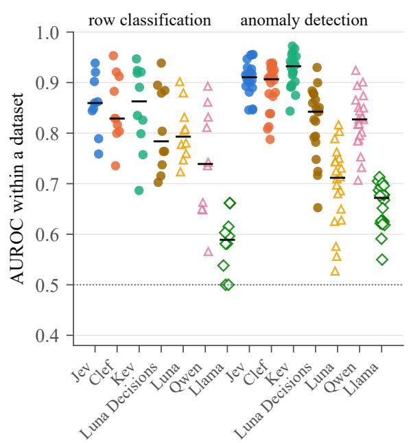

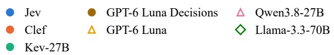

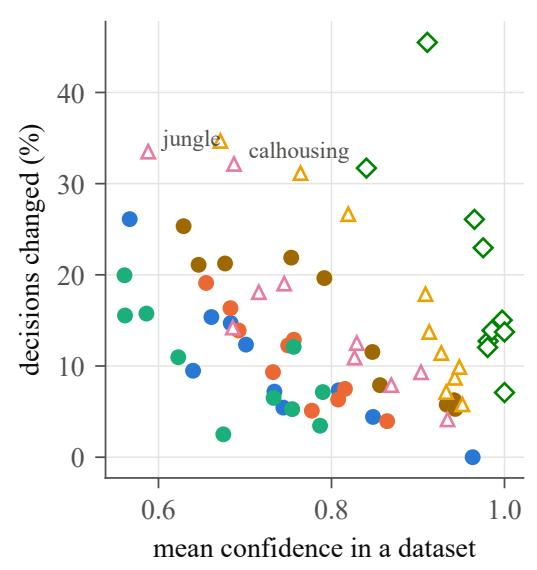  
Figure 7: Left: flip AUROC within each dataset or source; bars are medians. Right: for each row classification dataset, the mean confidence of the original decisions against the share of decisions changed by the information preserving rewrites.

<table><tr><td rowspan="2">Task</td><td rowspan="2">Model</td><td rowspan="2">Items</td><td rowspan="2">All</td><td rowspan="2"></td><td colspan="4">confidence band (1: lowest 25%)</td><td colspan="2">noise</td><td rowspan="2">Question</td></tr><tr><td>1</td><td>2</td><td>3</td><td>4</td><td>Re-send</td><td>Bound</td></tr><tr><td>Row classif.</td><td>Jev</td><td>3,481</td><td>633.8 [32.2,35.4] 78.0[75.3,80.7]</td><td></td><td>41.6</td><td>14.7</td><td>0.9 [0.3,1.5]</td><td></td><td>4.7</td><td>25.3</td><td>20.2 [18.9,21.6]</td></tr><tr><td></td><td>Clef</td><td>3,481</td><td></td><td>6 31.7 [30.1,33.2] 77.5 [74.8,79.9]</td><td></td><td>37.2</td><td>10.7</td><td>1.4 [0.7,2.3]</td><td>1.6</td><td>9.0</td><td>17.3 [16.2,18.5]</td></tr><tr><td></td><td>Kev-27B GPT-6 Luna</td><td>3,481</td><td></td><td>632.2 [30.6,33.7] 76.7 [74.2,79.6]</td><td></td><td>40.0</td><td>9.0</td><td>3.1 [2.0,4.3]</td><td>0.6</td><td>3.6</td><td>17.1 [15.8,18.2]</td></tr><tr><td></td><td>Decisions</td><td>3,481</td><td></td><td>6 39.6 [38.2,41.2] 80.9 [78.3,83.6]</td><td></td><td>52.3</td><td>23.2</td><td>1.8 [1.0,2.8]</td><td>0.0</td><td>0.0</td><td>36.7 [35.1,38.2]</td></tr><tr><td></td><td>GPT-6 Lunaa</td><td>3,481</td><td></td><td>642.8 [41.2,44.3]88.7 [86.6,90.9]</td><td></td><td>41.5</td><td>20.6</td><td>20.2 [17.6,22.7]</td><td>13.3</td><td>57.5</td><td>34.9 [33.3,36.4]</td></tr><tr><td></td><td>Qwen3.8-27B</td><td>3,481</td><td></td><td>631.8 [30.4,33.3] 61.0 [57.8,64.1]</td><td></td><td>44.6 19.0</td><td></td><td>2.6[1.7,3.7]</td><td>1.1</td><td>6.2</td><td>54.2 [52.4,56.0]</td></tr><tr><td></td><td>Llama-3.3-70B</td><td>3,481</td><td></td><td>635.5 [34.2,37.2]65.2 [61.9,68.2]</td><td>27.1</td><td>23.0</td><td></td><td>26.8 [24.0,29.8]</td><td>0.4</td><td>2.4</td><td>77.1 [75.8,78.6]b</td></tr><tr><td>TabFact</td><td>Jev</td><td>1,755</td><td>10</td><td>19.3 [17.5,21.1] 54.2[49.4,58.8]</td><td></td><td>14.8</td><td>3.6</td><td>4.6 [2.8,6.4]</td><td>1.9</td><td>17.5</td><td>7.4 [6.1,8.7]</td></tr><tr><td></td><td>Clef</td><td>1,755</td><td>10</td><td>23.0 [20.9,25.3]59.9 [54.3,64.6]</td><td></td><td>19.8</td><td>8.2</td><td>4.1 [2.4,6.2]</td><td>0.4</td><td>3.4</td><td>8.0 [6.7,9.3]</td></tr><tr><td></td><td>Kev-27B GPT-6 Luna</td><td>1,755</td><td>10</td><td>18.3 [16.7,20.2] 53.3 [48.7,57.7]</td><td></td><td>13.9</td><td>3.6</td><td>2.5 [1.3,4.0]</td><td>0.1</td><td>1.5</td><td>9.8 [8.4,11.2]</td></tr><tr><td></td><td>Decisions</td><td>1,755</td><td>10 38.3 [36.1,40.7] 78.1 [74.2,82.2]</td><td></td><td></td><td>39.9</td><td>19.8</td><td>15.5 [12.3,19.1]</td><td>0.0</td><td>0.0</td><td>26.5 [24.4,28.7]</td></tr><tr><td></td><td>GPT-6 Lunaa</td><td>1,749</td><td>10</td><td>60.8 [58.2,63.2] 88.1 [85.3,91.0]</td><td></td><td>62.0 44.2</td><td></td><td>48.7 [43.9,53.6]</td><td>13.5</td><td>76.5</td><td>58.6 [55.9,61.2]</td></tr><tr><td></td><td>Qwen3.8-27B</td><td>1,729</td><td>10</td><td>27.4 [25.2,29.7] 64.4 [60.0,68.8]</td><td></td><td>23.8 11.6</td><td></td><td>9.7 [7.2,12.9]</td><td>0.7</td><td>6.8</td><td>13.9 [12.4,15.6]</td></tr><tr><td></td><td>Llama-3.3-70B</td><td>1,749</td><td>10 33.7 [31.4,36.0]</td><td>48.6 [44.1,53.0]</td><td>31.1</td><td>27.7</td><td></td><td>27.5 [23.2,31.8]</td><td>0.7</td><td>6.3</td><td>13.6[12.1,15.3]</td></tr><tr><td>Anomaly det. Jev</td><td></td><td>5,059</td><td>821.1 [20.0,22.3]</td><td></td><td>62.0[59.6,64.5]</td><td>18.1 3.6</td><td></td><td>0.6 [0.2,1.1]</td><td>2.8</td><td>20.2</td><td>17.0[16.0,18.1]</td></tr><tr><td></td><td>Clef</td><td>5,059</td><td>8 25.8 [24.5,27.0]</td><td></td><td>72.8 [70.2,75.4]</td><td>24.3 5.2</td><td></td><td>0.7 [0.3,1.2]</td><td>1.2</td><td>9.1</td><td>21.5 [20.3,22.6]</td></tr><tr><td></td><td>Kev-27B GPT-6 Luna</td><td>5,059</td><td></td><td>817.7 [16.7,18.8]60.8 [58.0,63.3]</td><td></td><td>9.0 0.9</td><td></td><td>0.1 [0.0,0.2]</td><td>0.1</td><td>0.8</td><td>13.0 [12.1,13.9]</td></tr><tr><td></td><td>Decisions</td><td>4,999</td><td></td><td>8 29.9 [28.7,31.4]70.3 [68.0,73.0]</td><td></td><td>32.8</td><td>12.1</td><td>4.2 [3.3,5.4]</td><td>0.0</td><td>0.0</td><td>38.7 [37.2,40.0]</td></tr><tr><td></td><td>GPT-6 Lunaa</td><td>5,014</td><td></td><td>8 63.4 [62.0,64.7] 85.6 [83.6,87.4]</td><td></td><td>69.5</td><td>51.0</td><td>47.6 [45.2,50.1]</td><td>13.3</td><td>68.2</td><td></td></tr><tr><td></td><td>Qwen3.8-27B</td><td>5,044</td><td></td><td>823.3 [22.2,24.5] 56.9 [54.2,59.7]</td><td></td><td>22.7 8.7</td><td></td><td>4.8 [3.7,6.1]</td><td>2.8</td><td>20.2</td><td></td></tr><tr><td></td><td>Llama-3.3-70B</td><td>4,984</td><td></td><td>8 53.4 [52.1,54.8] 72.3 [69.6,74.5] 50.6 44.8 45.9 [42.9,48.5]</td><td></td><td></td><td></td><td></td><td>1.6</td><td>12.1</td><td></td></tr></table>

Table 18: Items whose decision depends on how the table is organized (%). All: share of items whose decision changes under at least one of the k information-preserving table rewrites of Table 12; 1–4: the same for the items sorted by the model’s confidence in its original decision and split into four bands of 25%, 1 the lowest (ties broken at random with a fixed seed). Re-send: share of decisions changed by an identical re-send of the original request (p). Bound: $1 - ( 1 - p ) ^ { k }$ , the share that would change at least once if every rewrite flipped independently at rate p; an upper bound on what noise alone explains, since re-send flips concentrate on the same low-margin items. Question: share of items changed by at least one rewrite of the question (options reordered or renamed, yes/no question, option descriptions removed, paraphrased instructions). Brackets (shown for all items, the outer bands and the question): 95% cluster-bootstrap intervals (Poisson(1) weights, 500 replicates; clusters are classification rows, anomaly-detection samples and TabFact tables). Invalid outputs count as changes. Numbers with three decimals and TabFact claims with position words are left out. Jev’s original TabFact decisions carry no probabilities. Confidence: for the decision models, the returned probability of the chosen option; for the LLMs, the share of ten draws at temperature 1 that give the original decision. On anomaly detection the LLMs receive no options, so only one question rewrite (paraphrase) applies to them. aIts decisions are themselves draws at temperature 1, so its counts are dominated by temperature noise. bMostly answers such as “Yes.” to the yes/no question, which the strict parse counts as invalid.

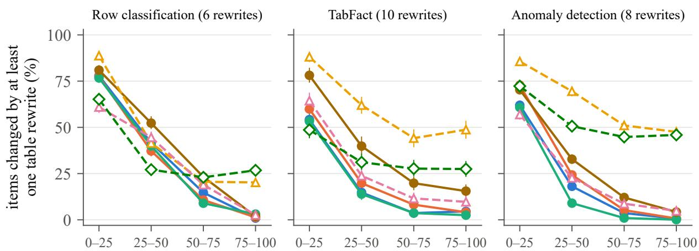  
items ranked by the model's confidence in its original decision (percentile band, lowest first)  
Figure 8: Items whose decision changes under at least one information-preserving rewrite of the table. Items are sorted by the model’s confidence in its original decision and split into four bands of 25%; 95% cluster-bootstrap intervals.

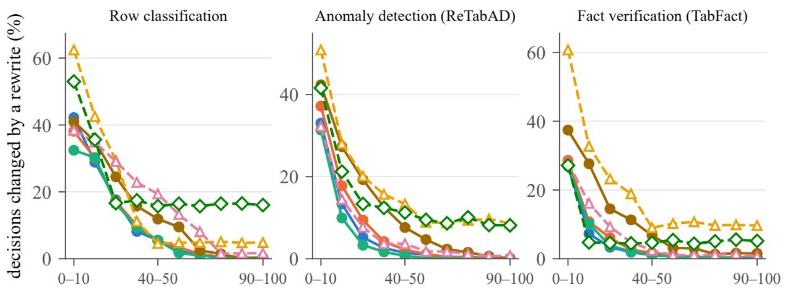  
items ranked by the model's confidence in its original decision (percentile band, lowest first)  
Figure 9: Share of decisions changed by a rewrite, for items ranked by the model’s confidence in its original decision and split into bands of 10% (information-preserving rewrites pooled). Confidence as in the main text: the decision models’ returned probability and the LLMs’ share of ten draws that give the original decision; tied values are split at random.

<table><tr><td>Model</td><td>Right (%), top / 1ow 25%</td><td>stable, right</td><td>stable, wrong</td><td>fragile, right</td><td>fragile, wrong</td></tr><tr><td>Row classification</td><td></td><td></td><td></td><td></td><td></td></tr><tr><td>Jev</td><td>67 / 48</td><td>44 / 0.79</td><td>23 / 0.78</td><td>16 / 0.59</td><td>18 / 0.56</td></tr><tr><td>Clef</td><td>86 / 52</td><td>52 / 0.84</td><td>16 / 0.78</td><td>16 / 0.61</td><td>16 / 0.59</td></tr><tr><td>Kev-27B</td><td>85 / 43</td><td>48 / 0.76</td><td>19 / 0.67</td><td>14 / 0.55</td><td>19 / 0.54</td></tr><tr><td>GPT-6 Luna Decisions</td><td>94 /49</td><td>49 / 0.91</td><td>11 / 0.82</td><td>21 / 0.68</td><td>19 / 0.62</td></tr><tr><td>GPT-6 Luna</td><td>82 / 46</td><td>48 / 0.98</td><td>9 / 0.95</td><td>23 / 0.77</td><td>20 / 0.65</td></tr><tr><td>Qwen3.8-27B</td><td>87 / 49</td><td>51 / 0.88</td><td>17 / 0.75</td><td>15 / 0.63</td><td>17 / 0.62</td></tr><tr><td>Llama-3.3-70B</td><td>63 / 54</td><td>45 / 0.99</td><td>20 / 0.99</td><td>17 / 0.91</td><td>19 / 0.88</td></tr><tr><td>Fact verification on TabFact</td><td></td><td></td><td></td><td></td><td></td></tr><tr><td>Jev</td><td>97 / 73</td><td>76 / 0.96</td><td>4/0.86</td><td>14 / 0.78</td><td>6 / 0.70</td></tr><tr><td>Clef</td><td>98 / 60</td><td>72 / 0.95</td><td>5 / 0.83</td><td>14 / 0.79</td><td>9 / 0.71</td></tr><tr><td>Kev-27B</td><td>99 / 69</td><td>77 / 0.93</td><td>4/ 0.79</td><td>12 / 0.73</td><td>6 / 0.63</td></tr><tr><td>GPT-6 Luna Decisions</td><td></td><td></td><td></td><td></td><td></td></tr><tr><td>GPT-6 Luna</td><td>97/58</td><td>55 / 0.92</td><td>7 / 0.78</td><td>24 / 0.76</td><td>14/0.67</td></tr><tr><td>Qwen3.8-27B</td><td>89 / 61</td><td>36 / 0.97</td><td>3 / 0.95</td><td>43 / 0.86</td><td>17 / 0.65</td></tr><tr><td>Llama-3.3-70B</td><td>94 / 59 82 / 73</td><td>65 / 0.96</td><td>7 / 0.81 8 / 0.99</td><td>18 / 0.78</td><td>9 / 0.66</td></tr><tr><td></td><td></td><td>58 / 1.00</td><td></td><td>22 / 0.97</td><td>11 / 0.92</td></tr><tr><td>Anomaly detection on ReTabAD</td><td></td><td></td><td></td><td></td><td></td></tr><tr><td>Jev</td><td>85 / 58</td><td>62 / 0.90</td><td>17 / 0.86</td><td>12 / 0.66</td><td>10 / 0.66</td></tr><tr><td>Clef Kev-27B</td><td>78 / 57</td><td>56 / 0.85</td><td>19 / 0.83</td><td>14 / 0.63</td><td>12 / 0.63</td></tr><tr><td>GPT-6 Luna</td><td>88 / 52</td><td>65 / 0.88</td><td>18 / 0.81</td><td>9 / 0.61</td><td>9 / 0.61</td></tr><tr><td>Decisions</td><td>88 / 52</td><td>54 / 0.91</td><td>16 / 0.85</td><td>17 / 0.74</td><td>13 / 0.68</td></tr><tr><td>GPT-6 Luna</td><td>84 / 65</td><td>31 / 0.95</td><td>5 / 0.93</td><td>46 / 0.84</td><td>17 / 0.71</td></tr><tr><td>Qwen3.8-27B</td><td>85 / 66</td><td>63 / 0.87</td><td>14 / 0.84</td><td>13 / 0.61</td><td>11 / 0.64</td></tr><tr><td>Llama-3.3-70B</td><td>59 / 56</td><td>29 / 0.95</td><td>17 / 0.94</td><td>29 / 0.86</td><td>25 / 0.85</td></tr></table>

Table 19: Confidence against correctness and fragility (RQ4). Second column: share of right decisions among the 25% of decisions with the highest and the lowest confidence. Other columns: share of decisions (%) and their mean confidence in each group; a decision is fragile when at least one rewrite of the table flips it. Confidence as in §6.