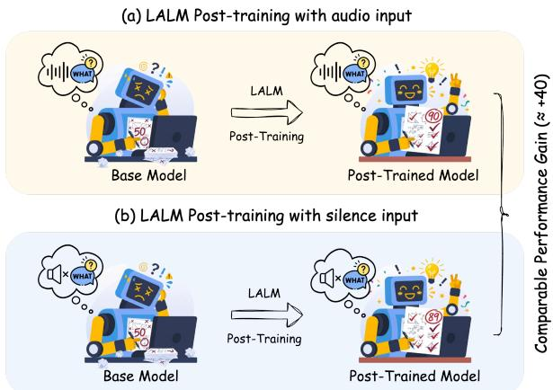
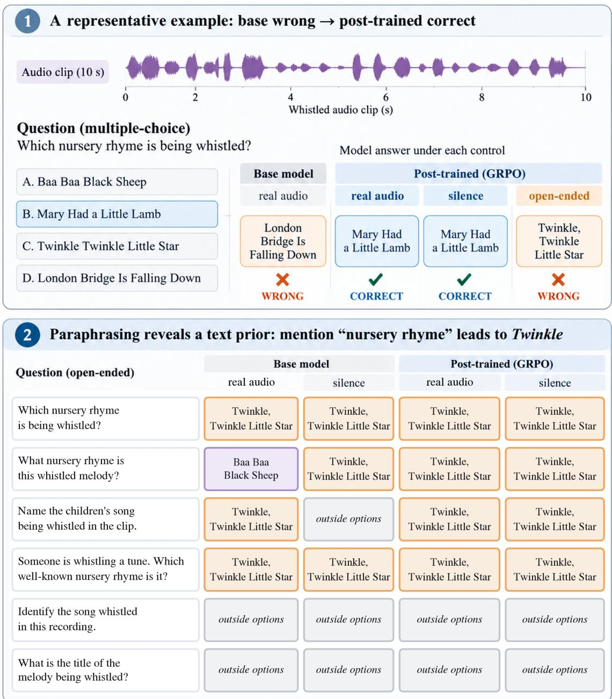
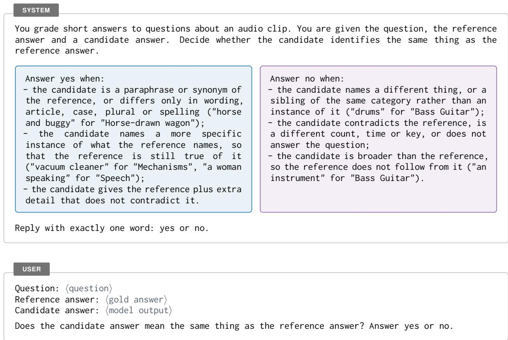
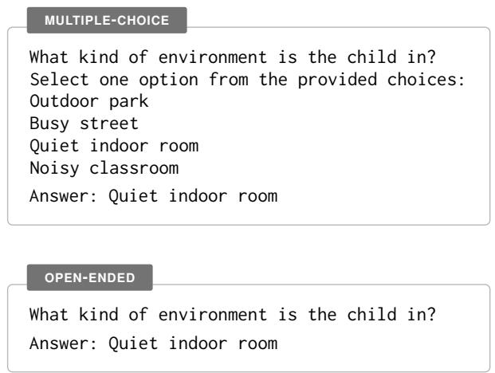

# What Does LALM Post-training Learn? Rethinking Audio Understanding and Reasoning Capabilities

Hua-Hsuan Chen1∗, Xuanjun Chen1∗, Wei-Chung Lu1, Chih-Kai Yang1, Yu-Xiang Lin1 Sung-Feng Huang2, Haibin Wu3, Hung-yi Lee1,4

National Taiwan University1 NVIDIA2 Independent Researcher3 NTU AI-Core4

## Abstract

Post-training often improves the performance of large audio-language models on audio understanding and reasoning benchmarks. However, these improvements may reflect adaptation to specific question formats, such as multiplechoice questions, rather than genuine advances in audio understanding and reasoning capabilities. To investigate what LALMs actually learn from post-training, we conduct controlled ex periments that disentangle improvements in audio understanding from adaptation to specific question formats. Across different models and post-training methods, we find that much of the reported improvement persists even without informative audio, but largely disappears when the question format changes. These findings suggest that post-training often teaches models to exploit task-specific textual cues and answer patterns rather than developing generalizable audio understanding and reasoning capabilities.

## 1 Introduction

Supervised fine-tuning (SFT), rejection fine-tuning (RFT) (Yuan et al., 2023), and reinforcement learning methods including GRPO (Shao et al., 2024; DeepSeek-AI, 2025) and VCRL (Jiang et al., 2025) have become standard post-training recipes and have proven effective for LLMs. Recent work has also applied these methods to large audio-language models (LALMs), yielding substantial gains on benchmarks built for audio understanding and reasoning, such as MMAU (Sakshi et al., 2025) and MMAR (Ma et al., 2025b). While post-training successfully improves overall performance, recent studies have made a surprising observation: certain gains can be achieved even without audio inputs (Rouditchenko et al., 2025). Therefore, it raises a fundamental question: does post-training actually improve audio understanding and reasoning, or does it merely rely on improved text-only capabilities to answer without listening?

  
Figure 1: Schematic overview of LALM post-training. The illustration demonstrates that models achieve comparable performance gains (e.g., ∼+40) whether posttrained with informative audio (a) or silence (b).

To investigate this, we must determine whether models genuinely utilize audio during inference, because a correct answer with audio present is inconclusive due to potential text-only shortcuts. To isolate the true contribution of audio understanding and reasoning, we evaluate both base and posttrained LALM models under different input conditions. As illustrated in Figure 1, our framework compares post-training performance when models are provided with informative audio (a) versus silence input (b). Building upon this controlled evaluation protocol, our study is structured around two core dimensions to thoroughly uncover what models learn. First, we examine the necessity of audio during both evaluation and training by introducing silence controls. Second, since post-training gains may stem from exploiting textual cues rather than acquiring genuine auditory capabilities, we further investigate whether these improvements depend on the multiple-choice format by removing answer options. To answer the overarching question of what LALMs actually learn during post-training, our analysis reveals three main findings:

• LALM post-training yields comparable performance gains regardless of audio and silence input. Our largest performance gains on MMAU and MMAR (+14.8 and +7.2 points, respectively) retain +11.2 and +4.9 points under silence, and models post-trained entirely on silence still improve on real audio.

• Most LALM performance gains are relied on the text question format. When evaluated in an open-ended setting, models suffer severe performance degradation, maintaining negligible reported gains despite post-training.

• The audio-grounding performance gains of LALM are marginal. Across different evaluation settings, improvements depending on audio input account for a negligible fraction, calling into question the model’s actual audio understanding and reasoning capabilities.

## 2 Related Work

Post-training for audio reasoning. The posttraining recipes now used on audio were developed on text, where their reported benefits were established on mathematics and code, and they have been carried over largely unchanged. Chainof-thought prompting was examined first (Ma et al., 2025a), then reasoning traces trained at scale (Zhifei et al., 2025), and reinforcement learning with verifiable rewards now dominates: answerlevel group-relative optimisation (Li et al., 2025; Rouditchenko et al., 2025; Zhao et al., 2025) and variants that change the curriculum, the reward granularity or the training data (Wen et al., 2025; Diao et al., 2025; Wu et al., 2026; He et al., 2026). In all these approaches, the reward function verifies only the final answer, providing no signal on how that answer was derived. Consequently, these studies primarily report overall accuracy, as it is the sole metric optimized during training. In this work, we hold the training setting fixed and investigate whether this accuracy stems from true audio reasoning or mere text shortcuts.

Whether LALMs listen. Unlike text LLMs, LALMs must extract reasoning evidence from an audio waveform rather than text tokens. Since a correct answer can also be derived from the language model’s internal knowledge, higher audio-QA accuracy does not guarantee actual audio comprehension. Previous work has found that many benchmark items can be answered with no audio or silent audio (Foo et al., 2026; He et al., 2026), revealed that models follow the text over the acoustic signal when the two disagree (Wang et al., 2025), and shown that strong reasoning scores coexist with weak acoustic perception (Zhang et al., 2026), which decays further as reasoning lengthens (Mao et al., 2026). Post-training gains have likewise been traced to text-based reasoning (Rouditchenko et al., 2025). However, whether post-trained LALM models rely on the audio or text capabilities to answer remains unclear. Standard evaluations based on absolute accuracy fail to capture this. To address this gap, we introduce a controlled evaluation protocol to isolate the true audio contribution from absolute accuracy. By doing so, we shed light on what posttraining actually learns, offering a principled way to rethink and evaluate audio understanding and reasoning capabilities in LALMs.

## 3 Controlled Evaluation Protocol

Audio and silence evaluation. To isolate the audio-specific improvements of post-training, we evaluate each post-trained model under real audio and same-length silence input conditions, keeping text inputs constant and measuring performance relative to the base model. Letting $\operatorname { A c c } ^ { a }$ and $\operatorname { A c c } ^ { s }$ denote the accuracies under real audio and silence, we define the performance gains as:

$$
\begin{array} { l l } { { \Delta \mathrm { A c c } ^ { a } = \mathrm { A c c } _ { \mathrm { p o s t } } ^ { a } - \mathrm { A c c } _ { \mathrm { b a s e } } ^ { a } , } } & { { a : \mathrm { a u d i o } } } \\ { { \Delta \mathrm { A c c } ^ { s } = \mathrm { A c c } _ { \mathrm { p o s t } } ^ { s } - \mathrm { A c c } _ { \mathrm { b a s e } } ^ { s } , } } & { { s : \mathrm { s i l e n c e } } } \end{array}\tag{1}
$$

We refer to $\Delta \mathrm { A c c } ^ { a }$ as Audio Gain, which reflects the overall performance improvement under standard evaluation, and $\Delta \mathrm { A c c } ^ { s }$ as Silence Gain, which reveals how much of that improvement persists even in the absence of any audio input.

Multiple-choice and open-ended evaluation. We evaluate performance on each benchmark under two answer formats: the original multiple-choice setting, where the model’s response is checked against provided options, and an open-ended evaluation, which removes these options and presents the question independently. The model generates a free-form response, which is evaluated by an LLM judge for semantic equivalence to the reference. Since omitting options makes some questions unanswerable, the necessary rewriting rules and judge prompts are provided in Appendix C, with all other evaluation settings remaining unchanged.

<table><tr><td rowspan="3"></td><td colspan="6">Qwen2.5-Omni-3B</td><td colspan="6">Qwen2-Audio-7B-Instruct</td></tr><tr><td colspan="3">MMAU</td><td colspan="3">MMAR</td><td colspan="3">MMAU</td><td colspan="3">MMAR</td></tr><tr><td>Method Acc</td><td> $\Delta \operatorname { A c c } ^ { a }$ </td><td> $\Delta \operatorname { A c c } ^ { s }$ </td><td>Acc</td><td> $\Delta \mathrm { A c c } ^ { a }$ </td><td> $\Delta \mathrm { A c c } ^ { s }$ </td><td>Acc</td><td> $\Delta \mathrm { A c c } ^ { a }$ </td><td> $\Delta \operatorname { A c c } ^ { s }$ </td><td>Acc</td><td> $\Delta \mathrm { A c c } ^ { a }$ </td><td> $\Delta \mathrm { A c c } ^ { s }$ </td></tr><tr><td>Base</td><td>63.1</td><td></td><td></td><td>51.8</td><td></td><td></td><td>45.2</td><td></td><td></td><td>34.7</td><td></td><td></td></tr><tr><td>SFT</td><td>69.8 ±0.7</td><td>+6.7</td><td> $+ 6 . 6 \pm 0 . 6$ </td><td>55.3 ±0.4</td><td>+3.5</td><td> $+ 2 . 2 \pm 0 . 6$ </td><td>55.9 ±0.9</td><td>+10.7</td><td> $+ 8 . 4 \pm 0 . 6$ </td><td>41.3 ±1.6</td><td>+6.6</td><td>+6.2 ±0.7</td></tr><tr><td>RFT</td><td> $6 5 . 4 \pm 0 . 9$ </td><td>+2.3</td><td> $+ 2 . 1 \pm 0 . 7$ </td><td> $5 2 . 7 \pm 0 . 1 $ </td><td>+0.9</td><td> $- 0 . 4 \pm 0 . 3$ </td><td> $4 8 . 2 \pm 0 . 5$ </td><td>+3.0</td><td> $+ 2 . 3 \pm 1 . 9$ </td><td> $3 5 . 3 \pm 0 . 6$ </td><td>+0.6</td><td>+0.1 ±0.3</td></tr><tr><td>GRPO</td><td>71.1 ±0.4</td><td>+8.0</td><td> $+ 6 . 7 \pm 1 . 7$ </td><td> $5 5 . 2 \pm 0 . 8 $ </td><td>+3.4</td><td> $+ 0 . 7 \pm 0 . 7$ </td><td> $6 0 . 0 \pm 1 . 3$ </td><td>+14.8</td><td> $+ 1 1 . 2 \pm 0 . 4$ </td><td> $4 1 . 9 \pm 0 . 6$ </td><td>+7.2</td><td>+4.9 ±0.4</td></tr><tr><td>VCRL</td><td>71.1 ±0.6</td><td>+8.0</td><td> $+ 6 . 6 \pm 0 . 3$ </td><td> $5 4 . 6 \pm \mathrm { 0 . 9 }$ </td><td>+2.8</td><td> $+ 0 . 5 \pm 1 . 7$ </td><td> $5 7 . 6 \pm 2 . 1$ </td><td>+12.4</td><td> $+ 1 1 . 0 \pm 1 . 4$ </td><td> $3 9 . 2 \pm 0 . 7$ </td><td>+4.5</td><td>+3.6 ±0.8</td></tr></table>

Table 1: Comparison of Audio and Silence Gains across different post-training methods.

<table><tr><td rowspan="2">Model Backbone</td><td rowspan="2">Open-Source Models</td><td colspan="3">MMAU</td><td colspan="3">MMAR</td></tr><tr><td></td><td>Acc ∆Accª</td><td> $\Delta \operatorname { A c c } ^ { s }$ </td><td></td><td>Acc ∆Accª</td><td>∆Acc⁵</td></tr><tr><td>Qwen2.5-Omni-3B</td><td>Ke-Omni-R-3B (Zhao et al., 2025)</td><td>63.1</td><td>+8.6</td><td>+6.6</td><td>51.8</td><td>+5.4</td><td>+3.0</td></tr><tr><td>Qwen2.5-Omni-7B</td><td>Ke-Omni-R-7B (Zhao et al., 2025) AudioMCQ (M→S) (He et al., 2026) Omni-R1 (AVQA) (Rouditchenko et al., 2025)</td><td>71.4</td><td>+4.5 +5.0 +4.2</td><td>+1.6 +6.4 +1.5</td><td>58.7</td><td>+3.9 +8.3 +3.1</td><td>+2.8 +7.0 +1.0</td></tr><tr><td>Qwen2-Audio-7B-Instruct</td><td>R1-AQA (Li et al., 2025) Audio-Reasoner (Zhifei et al., 2025)</td><td>45.2</td><td>+23.4 +20.5</td><td>+17.2 +18.4</td><td>34.7</td><td>+17.6 +11.8</td><td>+10.1 +9.9</td></tr></table>

Table 2: Comparison of Audio and Silence Gains across open-source models.

## 4 Experimental Setting

Training data. The training data pool contains 12,267 multiple-choice audio QA items derived from Audio-Cogito (Li et al., 2026) (using only the question and gold option). These items cover 7,129 clips (17.4 hours) across three public corpora, representing distinct domains: AudioSet (Gemmeke et al., 2017) (sound; 3,675 clips, 6,196 items), Medley-solos-DB (Lostanlen and Cella, 2016) (music; 2,874 clips, 4,913 items), and DailyTalk (Lee et al., 2023) (speech; 580 clips, 1,158 items). The pool is split into 10,446 training items and a heldout in-domain evaluation set of 1,821 items. We further verified via audio-level matching that no training audio leaks into the evaluation set.

Post-training methods. We compare four posttraining methods (SFT, RFT (Yuan et al., 2023), GRPO (Shao et al., 2024), and VCRL (Jiang et al., 2025)). While their specific configurations follow the original papers, they are compared under a unified training budget, sharing a single reward that verifies whether the final answer matches the gold option. They also share one recipe (200 LoRA steps on the training pool, three seeds), applied unchanged to two base models: Qwen2.5- Omni-3B (Xu et al., 2025) and Qwen2-Audio-7B-Instruct (Chu et al., 2024). Implementations and hyperparameters are in Appendices A and B.

Evaluation benchmarks and setup. We evaluate all models on MMAU test-mini (Sakshi et al., 2025) (1,000 items) and MMAR (Ma et al., 2025b)

(1,000 items). During inference, each model uses its own specific prompt and follows a fixed perbenchmark setting shared with its base model. Percapability results rely on the benchmarks’ own taxonomy: MMAU’s category and MMAR’s layers. For open-ended evaluation, we use Qwen3.6- 27B (Qwen Team, 2026) as an LLM judge to determine whether the generated answers are equivalent to the reference answers. Table 6 reports all accuracies, which are averaged over three random seeds for our post-trained models at fixed checkpoints.

## 5 The Necessity of Audio for LALMs

Before diving into the specific mechanisms behind the post-training improvements, we first examine a core premise: the necessity of audio for LALMs. In this section, we benchmark model performance against silence controls to assess genuine audio reliance, investigating whether audio is truly required during both evaluation and training phases.

## 5.1 Evaluating Overall Gains Across Models

Our post-trained models. Table 1 compares the Audio and Silence Gains of the four post-training methods across our base models. Ideally, posttraining should yield a substantial Audio Gain $( \Delta \operatorname { A c c } ^ { a } )$ with near-zero Silence Gain $( \Delta \mathrm { A c c } ^ { s } )$ , reflecting genuine reliance on audio. However, the results reveal that these two metrics are highly correlated. For instance, while GRPO on Qwen2-Audio-7B-Instruct improves MMAU accuracy by 14.8 points with real audio, a striking 11.2-point gain is observed even under silence. In contrast, when the Silence Gain is near zero (e.g., RFT on Qwen2.5- Omni-3B), Audio Gain is a marginal 0.9%.

<table><tr><td rowspan="2"></td><td colspan="2">MMAU</td><td colspan="4">MMAR</td></tr><tr><td>Reasoning</td><td>Info Extraction</td><td>Signal</td><td>Perception</td><td>Semantic</td><td>Cultural</td></tr><tr><td colspan="7">Qwen2.5-Omni-3B</td></tr><tr><td>Base</td><td>43.1</td><td>46.1</td><td>44.2</td><td>31.2</td><td>36.2</td><td>29.1</td></tr><tr><td>SFT</td><td> $+ 5 . 7 \pm 0 . 9$ </td><td> $+ 8 . 6 \pm 0 . 4$ </td><td> $- 0 . 8 \pm 2 . 7$ </td><td> $+ 0 . 7 \pm 0 . 6$ </td><td> $+ 4 . 0 { \scriptstyle \pm 0 . 7 }$ </td><td> $+ 2 . 6 \pm 3 . 0$ </td></tr><tr><td>RFT</td><td> $+ 3 . 0 { \pm } 0 . 9$ </td><td> $+ 0 . 3 \pm 1 . 3$ </td><td> $- 3 . 1 \pm 4 . 8$ </td><td> $+ 0 . 1 \pm 0 . 4$ </td><td> $- 0 . 2 \pm 0 . 6$ </td><td>-1.2±1.1</td></tr><tr><td>GRPO</td><td> $+ 6 . 2 \pm 1 . 9$ </td><td> $+ 7 . 8 \pm 1 . 8$ </td><td> $- 3 . 9 \pm 4 . 8$ </td><td> $- 0 . 2 \pm 0 . 1$ </td><td> $+ 1 . 5 \pm 0 . 8$ </td><td> $+ 2 . 1 \pm 4 . 4$ </td></tr><tr><td>VCRL</td><td> $+ 6 . 2 \pm \mathrm { 0 . 1 }$ </td><td> $+ 7 . 5 \pm 1 . 2$ </td><td> $+ 1 . 6 \pm 1 1 . 0$ </td><td> $- 0 . 8 \pm 0 . 1$ </td><td> $+ 1 . 2 \pm 2 . 3$ </td><td> $+ 1 . 9 \pm 1 . 8$ </td></tr><tr><td>Ke-Omni-R-3B*</td><td>+7.8</td><td>+4.0</td><td>+2.3</td><td>+3.0</td><td>+2.4</td><td>+5.0</td></tr><tr><td colspan="7">Qwen2.5-Omni-7B</td></tr><tr><td>Base</td><td>52.1</td><td>56.7</td><td>55.8</td><td>36.4</td><td>40.8</td><td>35.5</td></tr><tr><td> ${ \mathrm { K e - O m n i - R - 7 B } } ^ { \ast }$ </td><td>+1.0</td><td>+2.8</td><td>-4.7</td><td>+3.5</td><td>+3.9</td><td>0.0</td></tr><tr><td> $\mathrm { A u d i o M C Q ( M {  } S ) ^ { \ast } }$ </td><td>+6.2</td><td>+6.8</td><td>-7.0</td><td>+9.4</td><td>+9.5</td><td>-2.8</td></tr><tr><td> $\mathrm { O m n i \mathrm { - } R 1 \ ( \bar { A } V Q A ) ^ { * } }$ </td><td>+2.7</td><td>-0.9</td><td>+2.3</td><td>0.0</td><td>+2.7</td><td>-1.4</td></tr><tr><td colspan="7">Qwen2-Audio-7B-Instruct</td></tr><tr><td>Base</td><td>28.4</td><td>30.0</td><td>30.2</td><td>22.3</td><td>27.7</td><td>26.2</td></tr><tr><td>SFT</td><td> $+ 9 . 0 { \pm } 0 . 6$ </td><td> $+ 7 . 3 \pm \mathrm { 0 . 9 }$ </td><td> $0 . 0 { \scriptstyle \pm 0 . 0 }$ </td><td> $+ 7 . 8 \pm \mathrm { 0 . 9 }$ </td><td> $+ 6 . 3 \pm \mathrm { 0 . 9 }$ </td><td> $+ 2 . 8 \pm 1 . 2$ </td></tr><tr><td>RFT</td><td> $+ 2 . 4 \pm 1 . 6$ </td><td> $+ 2 . 2 \pm 2 . 6$ </td><td> $- 3 . 1 \pm 3 . 6$ </td><td> $+ 0 . 3 \pm \mathrm { 0 . 8 }$ </td><td> $+ 0 . 9 { \scriptstyle \pm 0 . 1 }$ </td><td>-1.7 ±0.4</td></tr><tr><td>GRPO</td><td> $+ 1 2 . 9 \pm 0 . 8$ </td><td> $+ 7 . 5 \pm 0 . 5$ </td><td> $- 3 . 9 \pm 4 . 8$ </td><td> $+ 6 . 8 \pm 0 . 4$ </td><td> $+ 6 . 1 \pm 0 . 4$ </td><td> $- 1 . 9 { \pm } 1 . 5$ </td></tr><tr><td>VCRL</td><td> $+ 1 2 . 1 \pm 1 . 6$ </td><td> $+ 8 . 7 \pm 1 . 1$ </td><td> $- 3 . 9 \pm 3 . 6$ </td><td> $+ 4 . 8 \pm 0 . 3$ </td><td> $+ 5 . 3 \pm 1 . 1$ </td><td> $- 2 . 8 \pm 0 . 7$ </td></tr><tr><td> $\mathrm { R 1 - A Q A } ^ { * }$ </td><td> $+ 1 7 . 7 \pm 0 . 4$ </td><td> $+ 1 6 . 0 { \scriptstyle \pm 0 . 2 }$ </td><td> $+ 1 4 . 0 \pm 0 . 0$ </td><td> $+ 1 2 . 6 \pm 0 . 2$ </td><td> $+ 9 . 6 \pm 0 . 1$ </td><td> $+ 2 . 8 \pm _ { 0 . 0 }$ </td></tr><tr><td>Audio-Reasoner*</td><td> $+ 1 4 . 0$ </td><td>+27.6</td><td> $+ 9 . 3$ </td><td> $+ 7 . 9$ </td><td> $+ 1 2 . 9$ </td><td>+7.1</td></tr></table>

Table 3: Comparison of Silence Gains across different audio capabilities. ∗Denotes open-source models.

## 5.2 Evaluating Fine-Grained Capabilities

plify the models’ reliance on textual artifacts and guessing strategies, rendering the apparent audio improvements somewhat illusory.

Open-source models. One might argue that this observed phenomenon stems from our specific training recipe rather than post-training in general. To address this, Table 2 applies the same silence control to several existing open-source models, each evaluated using the specific prompt and sampling strategy detailed in its respective paper or repository. The results reveal an identical pattern. Although their overall accuracy gains are often larger than those of our models, the majority of these improvements persist under silence. For example, R1-AQA and Audio-Reasoner (both built on the same base model) achieve Audio Gains of 23.4 and 20.5 points on MMAU, respectively, yet they still exhibit substantial Silence Gains of 17.2 and 18.4 points. Even more strikingly, AudioMCQ, which specifically trains on a subset of items filtered for strong audio reliance (He et al., 2026), yields an Audio Gain of 5.0 points on MMAU but a Silence Gain of 6.4 points, meaning the improvement is actually higher without the real audio.

Across both Tables 1 and 2, Audio Gains and Silence Gains remain closely aligned for almost every model. Ultimately, this consistent coupling indicates that these post-training recipes do not teach the models to listen. Instead, they largely am-

To determine whether this reliance on textual shortcuts is universal or task-specific, we conduct a finegrained analysis across different audio capabilities. Table 3 details the Silence Gains $( \Delta \mathrm { A c c } ^ { s } )$ for specific capability categories. On MMAU, both reasoning and information extraction show substantial Silence Gains, typically around seven points for the stronger methods, with some open-source models exhibiting even larger gains. MMAR displays greater variance: semantic and perception capabilities retain positive Silence Gains for most models, whereas cultural gains are generally smaller, and the signal layer fluctuates widely from −7.0 to +14.0 points. Despite these variations, the overarching pattern holds: across multiple fine-grained audio capabilities, Silence Gains frequently deviate from the expected near-zero baseline. Ultimately, these findings confirm that much of the apparent performance improvement persists even when audio is removed during evaluation.

## 5.3 Post-Training with Audio versus Silence

While evaluating with silence demonstrates that performance gains persist without audio, it remains unclear whether audio was strictly necessary to acquire these capabilities during training. To isolate the role of training audio, we replicate the post-training process by replacing all audio inputs with same-length silence, examining how much of the performance improvement is retained when the model is subsequently evaluated on real audio.

<table><tr><td rowspan="2"></td><td colspan="2">MMAU</td><td colspan="2">MMAR</td></tr><tr><td>Audio</td><td>Silence</td><td>Audio</td><td>Silence</td></tr><tr><td colspan="5">Qwen2.5-Omni-3B</td></tr><tr><td>Base</td><td>63.1</td><td></td><td>51.8</td><td></td></tr><tr><td>SFT</td><td>+6.7</td><td>+3.8</td><td>+3.5</td><td>+0.5</td></tr><tr><td>RFT</td><td>+2.3</td><td>+1.0</td><td>+0.9</td><td>-0.2</td></tr><tr><td>GRPO</td><td>+8.0</td><td>+4.0</td><td>+3.4</td><td>+1.0</td></tr><tr><td>VCRL</td><td>+8.0</td><td>+3.1</td><td>+2.8</td><td>-0.6</td></tr><tr><td colspan="5">Qwen2-Audio-7B-Instruct</td></tr><tr><td>Base</td><td>45.2</td><td></td><td>34.7</td><td></td></tr><tr><td>SFT</td><td>+10.7</td><td>+7.5</td><td>+6.6</td><td>+4.4</td></tr><tr><td>RFT</td><td>+3.0</td><td>+5.3</td><td>+0.6</td><td>+1.6</td></tr><tr><td>GRPO</td><td>+14.8</td><td>+7.6</td><td>+7.2</td><td>+2.1</td></tr><tr><td>VCRL</td><td>+12.4</td><td>+6.3</td><td>+4.5</td><td>+0.2</td></tr></table>

Table 4: Audio Gains of models trained on real audio versus silence, evaluated under the real-audio condition.

Table 4 shows that on MMAU the silence-trained models keep about half of the gain: GRPO on Qwen2-Audio-7B-Instruct adds 14.8 points trained on real audio and still 7.6 trained on nothing but silence. A model that heard no information at all for the whole of post-training arrives at half the improvement, on the same benchmark, decoded from the same real audio. MMAR retains less of its gain and exhibits greater variance, indicating a stronger reliance on training audio.

## 6 What Does LALM Post-training Learn?

The preceding analysis demonstrates that much of the post-training improvement persists even without informative audio. This naturally leads to the central question of our work: if not genuine audio understanding, what do these models actually learn? We hypothesize that rather than acquiring new auditory capabilities, the models are instead learning to exploit textual cues inherent in the multiple-choice format. In this section, we answer this question by systematically isolating the impact of answer options, analyzing how model behavior shifts when the multiple-choice format is removed from both training and evaluation.

## 6.1 Analyzing shifts in answer patterns

To investigate whether models are simply learning to exploit the task format, we first examine how post-training alters their answering patterns under the original multiple-choice setting. A wrong answer can either select an incorrect option or fall outside the provided options entirely (an invalid response). Table 5 reports the proportions of correct answers, incorrect listed options, and invalid responses before and after post-training.

<table><tr><td></td><td colspan="3">MMAU</td><td colspan="3">MMAR</td></tr><tr><td></td><td>Gold</td><td>Listed Invalid</td><td></td><td>Gold</td><td>Listed Invalid</td><td></td></tr><tr><td colspan="7">Omni-3B</td></tr><tr><td>Base</td><td>63.1</td><td>29.4</td><td>7.5</td><td>51.8</td><td>45.0</td><td>3.2</td></tr><tr><td>SFT</td><td>69.8</td><td>28.6</td><td>1.6</td><td>55.3</td><td>43.5</td><td>1.2</td></tr><tr><td>RFT</td><td>65.4</td><td>29.0</td><td>5.6</td><td>52.7</td><td>44.1</td><td>3.2</td></tr><tr><td>GRPO</td><td>71.1</td><td>26.9</td><td>2.0</td><td>55.2</td><td>42.9</td><td>1.8</td></tr><tr><td>VCRL</td><td>71.1</td><td>27.0</td><td>1.9</td><td>54.6</td><td>44.0</td><td>1.4</td></tr><tr><td>Ke-Omni-R*</td><td>71.7</td><td>27.6</td><td>0.7</td><td>57.2</td><td>42.4</td><td>0.4</td></tr><tr><td colspan="7">Omni-7B</td></tr><tr><td>Base</td><td>71.4</td><td>28.2</td><td>0.4</td><td>58.7</td><td>40.6</td><td>0.7</td></tr><tr><td>Ke-Omni-R*</td><td>75.9</td><td>23.5</td><td>0.6</td><td>62.6</td><td>37.3</td><td>0.1</td></tr><tr><td>AudioMCQ*</td><td>76.4</td><td>23.1</td><td>0.5</td><td>67.0</td><td>32.6</td><td>0.4</td></tr><tr><td> $_ \mathrm { O m n i - R 1 } { ^ \ast }$ </td><td>75.6</td><td>24.1</td><td>0.3</td><td>61.8</td><td>37.7</td><td>0.5</td></tr><tr><td colspan="7">Qwen2-Audio</td></tr><tr><td>Base</td><td>45.2</td><td>37.6</td><td>17.2</td><td>34.7</td><td>50.5</td><td>14.8</td></tr><tr><td>SFT</td><td>55.9</td><td>35.6</td><td>8.5</td><td>41.3</td><td>51.2</td><td>7.5</td></tr><tr><td>RFT</td><td>48.2</td><td>35.8</td><td>16.1</td><td>35.3</td><td>50.8</td><td>13.9</td></tr><tr><td>GRPO</td><td>60.0</td><td>32.4</td><td>7.6</td><td>41.9</td><td>50.6</td><td>7.5</td></tr><tr><td>VCRL</td><td>57.6</td><td>32.9</td><td>9.5</td><td>39.2</td><td>51.4</td><td>9.4</td></tr><tr><td>R1-AQA*</td><td>68.6</td><td>30.4</td><td>1.0</td><td>52.3</td><td>46.7</td><td>1.0</td></tr><tr><td>Audio-Reas.</td><td>65.7</td><td>30.3</td><td>4.0</td><td>46.5</td><td>48.1</td><td>5.4</td></tr></table>

Table 5: Answer Distribution across Multiple-choice Options. ∗Denotes open-source model.

The proportion of invalid responses decreases substantially after post-training, while incorrect listed answers change less. On MMAU, Qwen2- Audio-7B-Instruct produces answers outside the option list on 17.2% of items before post-training, which falls to 7.6% after GRPO. Meanwhile, incorrect listed answers decrease from 37.6% to 32.4%. A similar pattern appears for Qwen2.5-Omni-3B, where invalid responses decrease from 7.5% to 2.0% after GRPO. These results suggest that part of the improvement may come from learning to follow the multiple-choice format and take advantage of textual cues, rather than better distinguishing among the answer options based on audio, so we next examine whether these gains persist when the answer option list is removed from question.

## 6.2 Assessing open-ended evaluation

To further examine whether these gains depend on the multiple-choice format, we evaluate models in an open-ended setting where they must respond in their own words (details in Appendix C). As shown in Table 6, absolute accuracy drops substantially across the board (e.g., Qwen2.5-Omni-3B drops from 63.1 to 27.1 on multiple-choice MMAU). However, since these models and benchmarks were intrinsically designed for multiple-choice, this absolute decrease is expected. Therefore, rather than absolute performance, our analysis focuses on the post-training gains relative to each model’s base model under the same evaluation protocol.

<table><tr><td rowspan="3">Method</td><td colspan="6">MMAU</td><td colspan="6">MMAR</td></tr><tr><td colspan="3">MC</td><td colspan="3">OPEN</td><td colspan="3">MC</td><td colspan="3">OPEN</td></tr><tr><td>Acc ∆Acca</td><td></td><td>∆Acc⁸</td><td>Acc</td><td>∆Accª</td><td>∆Acc⁸</td><td>Acc</td><td>∆Acca</td><td>∆Acc⁸</td><td>Acc</td><td>∆Accª</td><td>∆Acc⁸</td></tr><tr><td>Qwen2.5-Omni-3B</td><td></td><td></td><td></td><td></td><td></td><td></td><td></td><td></td><td></td><td></td><td></td><td></td></tr><tr><td>Base</td><td>63.1</td><td></td><td></td><td>27.1</td><td></td><td></td><td>51.8</td><td></td><td></td><td>28.5</td><td></td><td></td></tr><tr><td>SFT</td><td>69.8</td><td>+6.7</td><td>+6.6</td><td>28.8</td><td>+1.7</td><td>-0.7</td><td>55.3</td><td>+3.5</td><td>+2.2</td><td>29.0</td><td>+0.5</td><td>+0.1</td></tr><tr><td>RFT</td><td>65.4</td><td>+2.3</td><td>+2.1</td><td>27.7</td><td>+0.7</td><td>-0.3</td><td>52.7</td><td>+0.9</td><td>-0.4</td><td>28.6</td><td>+0.1</td><td>-0.7</td></tr><tr><td>GRPO</td><td>71.1</td><td>+8.0</td><td>+6.7</td><td>28.2</td><td>+1.2</td><td>+0.5</td><td>55.2</td><td>+3.4</td><td>+0.7</td><td>29.1</td><td>+0.6</td><td>-0.1</td></tr><tr><td>VCRL</td><td>71.1</td><td>+8.0</td><td>+6.6</td><td>28.4</td><td>+1.4</td><td>-0.5</td><td>54.6</td><td>+2.8</td><td>+0.5</td><td>28.8</td><td>+0.3</td><td>-0.4</td></tr><tr><td>Ke-Omni-R-3B*</td><td>71.7</td><td>+8.6</td><td>+6.6</td><td>28.2</td><td>+1.1</td><td>+0.6</td><td>57.2</td><td>+5.4</td><td>+3.0</td><td>28.4</td><td>-0.1</td><td>+0.2</td></tr><tr><td>Qwen2.5-Omni-7B</td><td></td><td></td><td></td><td></td><td></td><td></td><td></td><td></td><td></td><td></td><td></td><td></td></tr><tr><td>Base</td><td>71.4</td><td></td><td></td><td>31.1</td><td></td><td></td><td>58.7</td><td></td><td></td><td>31.2</td><td></td><td></td></tr><tr><td>Ke-Omni-R-7B*</td><td>75.9</td><td>+4.5</td><td>+1.6</td><td>32.9</td><td>+1.8</td><td>+2.5</td><td>62.6</td><td>+3.9</td><td>+2.8</td><td>33.6</td><td>+2.4</td><td>-1.2</td></tr><tr><td>AudioMCQ (M→S)*</td><td>76.4</td><td>+5.0</td><td>+6.4</td><td>31.2</td><td>+0.1</td><td>+1.6</td><td>67.0</td><td>+8.3</td><td>+7.0</td><td>32.4</td><td>+1.2</td><td>-0.8</td></tr><tr><td>Omni-R1 (AVQA)*</td><td>75.6</td><td>+4.2</td><td>+1.5</td><td>30.9</td><td>-0.2</td><td>+1.1</td><td>61.8</td><td>+3.1</td><td>+1.0</td><td>33.1</td><td>+1.9</td><td>+0.4</td></tr><tr><td>Qwen2-Audio-7B-Instruct</td><td></td><td></td><td></td><td></td><td></td><td></td><td></td><td></td><td></td><td></td><td></td><td></td></tr><tr><td>Base</td><td>45.2</td><td></td><td></td><td>27.1</td><td></td><td></td><td>34.7</td><td></td><td></td><td>25.1</td><td></td><td></td></tr><tr><td>SFT</td><td>55.9</td><td>+10.7</td><td>+8.4</td><td>28.2</td><td>+1.2</td><td>+0.7</td><td>41.3</td><td>+6.6</td><td>+6.2</td><td>26.0</td><td>+0.9</td><td>+0.9</td></tr><tr><td>RFT</td><td>48.2</td><td>+3.0</td><td>+2.3</td><td>27.9</td><td>+0.9</td><td>-0.3</td><td>35.3</td><td>+0.6</td><td>+0.1</td><td>25.5</td><td>+0.4</td><td>-0.1</td></tr><tr><td>GRPO</td><td>60.0</td><td>+14.8</td><td>+11.2</td><td>29.3</td><td>+2.3</td><td>+0.8</td><td>41.9</td><td>+7.2</td><td>+4.9</td><td>26.8</td><td>+1.7</td><td>+1.5</td></tr><tr><td>VCRL</td><td>57.6</td><td>+12.4</td><td>+11.0</td><td>29.2</td><td>+2.1</td><td>+0.4</td><td>39.2</td><td>+4.5</td><td>+3.6</td><td>27.0</td><td>+1.9</td><td>+1.6</td></tr><tr><td>R1-AQA*</td><td>68.6</td><td>+23.4</td><td>+17.2</td><td>26.2</td><td>-0.9</td><td>+0.4</td><td>52.3</td><td>+17.6</td><td>+10.1</td><td>25.5</td><td>+0.4</td><td>+1.4</td></tr><tr><td>Audio-Reasoner*</td><td>65.7</td><td>+20.5</td><td>+18.4</td><td>28.4</td><td>+1.3</td><td>+2.0</td><td>46.5</td><td>+11.8</td><td>+9.9</td><td>26.8</td><td>+1.7</td><td>-1.5</td></tr></table>

Table 6: Comparison of Audio and Silence Gains evaluated under the multiple-choice (MC) and open-ended (OPEN) evaluation. Reported accuracies correspond to the post-trained models. ∗Denotes open-source models.

Crucially, removing the answer options sharply diminishes both Audio and Silence Gains across all evaluated models and benchmarks. On MMAU, for instance, Audio Gains for GRPO and VCRL (applied to Qwen2-Audio-7B-Instruct) drop from +14.8 and +12.4 to merely +2.3 and +2.1 points, respectively. Silence Gains shrink similarly, with GRPO’s $\Delta \operatorname { A c c } ^ { s }$ falling from +11.2 to +0.8. The open-source models exhibit an equally drastic decline: Audio-Reasoner’s Audio Gain plummets from +20.5 to +1.3, while R1-AQA drops from +23.4 to a negative gain of −0.9.

Together, these results show that most posttraining gains largely fail to transfer beyond the multiple-choice format. This strongly suggests that the observed improvements stem from the models exploiting cues in the textual questions and answer options, rather than reflecting a genuine, broad advancement in audio understanding and reasoning.

## 6.3 Examining open-ended training

As shown in Section 6.2, evaluating models without multiple-choice options eliminates most posttraining gains. However, this sharp decline might simply stem from a train-eval format mismatch (i.e., training with options but evaluating without them). To test this hypothesis, we eliminate the mismatch by repeating the training procedure under a strictly open-ended setting. We remove the option list from all training questions and apply the rewriting and matching rules detailed in Appendix D.

Table 7 reveals that aligning the training format with the open-ended evaluation does not recover the lost gains. For instance, applying openended GRPO to Qwen2-Audio-7B-Instruct yields a marginal MMAU Audio Gain of +2.0. This is virtually identical to the +2.3 gain obtained under mismatched training, and remains far below the +14.8 gain observed in the original multiple-choice setting. VCRL follows the same trajectory, reaching an Audio Gain of only +3.0. Silence Gains similarly plateau, with $\mathrm { G R P O ^ { \circ } s } \Delta \mathrm { A c c } ^ { s }$ hovering at merely +0.6 after open-ended training.

<table><tr><td rowspan="3"></td><td colspan="6">Qwen2.5-Omni-3B</td><td colspan="6">Qwen2-Audio-7B-Instruct</td></tr><tr><td colspan="3">MMAU</td><td colspan="3">MMAR</td><td colspan="3">MMAU</td><td colspan="3">MMAR</td></tr><tr><td>Method Acc</td><td> $\Delta \operatorname { A c c } ^ { a }$ </td><td> $\Delta \mathrm { A c c } ^ { s }$ </td><td>Acc</td><td> $\Delta \mathrm { A c c } ^ { a }$ </td><td> $\Delta \operatorname { A c c } ^ { s }$ </td><td>Acc</td><td> $\Delta \mathrm { A c c } ^ { a }$ </td><td> $\Delta \operatorname { A c c } ^ { s }$ </td><td>Acc</td><td> $\Delta \operatorname { A c c } ^ { a }$ </td><td> $\Delta \operatorname { A c c } ^ { s }$ </td></tr><tr><td>Base</td><td>27.0</td><td></td><td></td><td>28.5</td><td></td><td></td><td>27.1</td><td></td><td></td><td>25.1</td><td></td><td></td></tr><tr><td>SFT</td><td> $2 7 . 9 \pm 0 . 9$ </td><td> $+ 0 . 9 \pm 0 . 9$ </td><td> $- 0 . 2 \pm 0 . 6$ </td><td> $3 0 . 2 \pm \mathbf { 0 . 4 }$ </td><td> $+ 1 . 7 \pm 0 . 4$ </td><td> $- 0 . 6 \pm 0 . 3$ </td><td> $2 6 . 1 \pm 1 . 5$ </td><td> $- 1 . 0 \pm 1 . 5$ </td><td> $+ 1 . 3 \pm 0 . 2$ </td><td> $2 4 . 6 \pm 0 . 5$ </td><td> $- 0 . 5 \pm 0 . 5$ </td><td> $- 0 . 1 \pm 0 . 3$ </td></tr><tr><td>RFT</td><td> $2 7 . 8 \pm 0 . 2$ </td><td> $+ 0 . 8 \pm 0 . 2$ </td><td> $- 0 . 1 \pm 0 . 5$ </td><td> $2 8 . 6 \pm 0 . 6$ </td><td> $+ 0 . 1 \pm 0 . 6$ </td><td> $- 0 . 7 \pm 0 . 3$ </td><td> $2 8 . 5 \pm 0 . 5$ </td><td> $+ 1 . 4 \pm 0 . 5$ </td><td> $+ 0 . 3 \pm 0 . 1$ </td><td> $2 5 . 3 \pm 0 . 1$ </td><td> $+ 0 . 2 \pm 0 . 1$ </td><td> $+ 0 . 3 \pm 0 . 3$ </td></tr><tr><td>GRPO</td><td> $2 8 . 9 \pm 0 . 7$ </td><td> $+ 1 . 9 \pm 0 . 7$ </td><td> $+ 0 . 1 \pm 0 . 6$ </td><td> $2 9 . 2 \pm 1 . 1$ </td><td> $+ 0 . 7 \pm 1 . 1$ </td><td>-1.2 ±0.2</td><td> $2 9 . 1 \pm 1 . 4$ </td><td> $+ 2 . 0 \pm 1 . 4$ </td><td> $+ 0 . 6 \pm 0 . 1$ </td><td> $2 6 . 4 \pm 0 . 7$ </td><td> $+ 1 . 3 \pm 0 . 7$ </td><td> $+ 0 . 5 \pm 0 . 2$ </td></tr><tr><td>VCRL</td><td> $2 8 . 7 \pm 1 . 2$ </td><td> $+ 1 . 7 \pm 1 . 2$ </td><td> $- 0 . 5 \pm 0 . 7$ </td><td> $2 8 . 6 \pm 0 . 3$ </td><td> $+ 0 . 1 \pm 0 . 3$ </td><td> $- 0 . 5 \pm 0 . 6$ </td><td> $3 0 . 1 \pm 0 . 9$ </td><td> $+ 3 . 0 \pm 0 . 9$ </td><td> $+ 0 . 7 \pm 0 . 5$ </td><td> $2 5 . 9 \pm 0 . 3$ </td><td> $+ 0 . 8 \pm \mathbf { 0 . 3 }$ </td><td> $0 . 0 { \scriptstyle \pm 0 . 9 }$ </td></tr></table>

Table 7: Comparison of Audio and Silence Gains following open-ended post-training and open-ended evaluation.

These results confirm that the performance collapse is not an artifact of format mismatch. Even when explicitly trained to generate answers in their own words, models fail to recover the substantial gains seen under multiple-choice evaluation, reinforcing that these post-training improvements heavily rely on the presence of answer options.

## 6.4 Tracing individual error transitions

To examine individual outcomes, we isolate items where the post-trained model successfully corrects the base model. We then re-evaluate these items under silence (SIL) and open-ended (OPEN) controls. As Table 8 outlines, an outcome is recorded as ✓ (correct) if only the post-trained model remains correct, and × (wrong) if both fail; cases where the base model becomes correct are excluded. The four resulting combinations reveal the underlying drivers of the observed corrections:

• Ideal Wrong in silence, correct open-ended. The correction genuinely requires the underlying audio and generalizes beyond options.

• Spurious Correct in silence, wrong openended. The correction ignores audio but relies on explicitly provided answer options.

• Artifact Correct under both controls. The correction requires neither audio nor options.

• Option-bound Audio Wrong under both controls. The correction is sensitive to audio, but the audio is only useful as a secondary cue for selecting among provided textual options.

Table 8 shows that these outcomes are distributed very unevenly. The Ideal case is exceptionally rare, peaking at just 7 items in any setting. In contrast, Spurious corrections are far more common (up to 48 items). However, the vast majority of original corrections simply fail under both controls (Option-bound Audio). Ultimately, different post-training methods rarely yield robust audio understanding; its apparent gains rely fundamentally on the explicit text-only answer options.

<table><tr><td></td><td colspan="4">MMAU</td><td colspan="4">MMAR</td></tr><tr><td>SILENCE OPEN-ENDED</td><td>√ ×</td><td>× √</td><td>√ √</td><td>× ×</td><td>√ ×</td><td>× √</td><td>√ √</td><td>× ×</td></tr><tr><td colspan="9">Omni-3B</td></tr><tr><td>SFT</td><td>18</td><td>3</td><td>1</td><td>39</td><td>16</td><td>0</td><td>0</td><td>28</td></tr><tr><td>RFT</td><td>10</td><td>3</td><td>0</td><td>26</td><td>1</td><td>0</td><td>0</td><td>17</td></tr><tr><td>GRPO</td><td>24</td><td>3</td><td>1</td><td>38</td><td>15</td><td>1</td><td>0</td><td>33</td></tr><tr><td>VCRL</td><td>20</td><td>3</td><td>2</td><td>36</td><td>15</td><td>1</td><td>2</td><td>28</td></tr><tr><td colspan="9">Qwen2-Audio</td></tr><tr><td>SFT</td><td>36</td><td>7</td><td>3</td><td>55</td><td>32</td><td>2</td><td>1</td><td>41</td></tr><tr><td>RFT</td><td>6</td><td>3</td><td>0</td><td>28</td><td>5</td><td>1</td><td>0</td><td>17</td></tr><tr><td>GRPO</td><td>48</td><td>7</td><td>5</td><td>62</td><td>43</td><td>3</td><td>1</td><td>48</td></tr><tr><td>VCRL</td><td>40</td><td>7</td><td>5</td><td>59</td><td>39</td><td>2</td><td>2</td><td>42</td></tr></table>

Table 8: Correction Outcomes under Silence and Openended Controls (✓: corrected, ×: still wrong).

## 6.5 Case Study: Revealing option priors

Figure 2 examines a representative case from MMAU to demonstrate how models exploit textual options to bypass audio reasoning. A ten-second audio of whistling is played, accompanied by four nursery rhyme options. The base model answers incorrectly London Bridge Is Falling Down, while the GRPO post-trained model answers correctly Mary Had a Little Lamb. Under the standard evaluation protocol, this item is recorded as a successful correction and contributes to the Audio Gain reported in Table 1. However, our controls reveal a different story. When the audio is replaced by silence, the GRPO model still provides the correct answer Mary Had a Little Lamb, indicating the audio is unnecessary. When the options are removed, it fails, answering Twinkle, Twinkle, Little Star instead. This perfectly exemplifies a Spurious correction: the apparent improvement relies on the answer options rather than the whistled audio.

  
Figure 2: Case Study: Revealing option priors and the impact of question phrasing on model predictions.

Asking the same questions in six open-ended phrasings exposes where this prior comes from. Four phrasings mention a nursery rhyme or children’s song. The base model mostly answers Twinkle, Twinkle, Little Star, but still varies: with real audio it once answers Baa Baa Black Sheep and outside the options. The GRPO post-trained model answers Twinkle, Twinkle, Little Star in all four phrasings under both real audio and silence. In the two phrasings without these terms, Twinkle, Twinkle, Little Star never appears; both models answer outside the options. The prior is thus triggered by nursery rhyme and children’s song, not by the audio. In other words, post-training taught the model to answer from the text, and the answer lands inside the options, which is not that we hope to learn.

## 7 Conclusion

In this work, we investigate what LALMs actually learn from different post-training methods, evaluated on audio understanding and reasoning benchmarks. Our controlled experiments reveal that reported gains stem from exploiting textual cues rather than improved audio perception: gains persist when trained on silence yet largely vanish when evaluated without options. Models simply learn a shortcut based on text priors. Because standard benchmark scores cannot distinguish this shortcut from genuine listening, our results highlight the urgent necessity for rethinking audio understanding and reasoning capabilities in current LALMs.

## Limitations

The evidence here covers two base models, four post-training methods and six open-source models, evaluated on MMAU and MMAR. The pattern is consistent within that scope, but it is a finite sample; other architectures, scales or benchmarks may behave differently. We show that the performance gap between Audio Gain $\Delta \mathrm { A c c } ^ { a }$ and Silence Gain $\Delta \mathrm { A c c } ^ { s }$ stays small across independently developed models, not that it must occur everywhere.

## References

Yunfei Chu, Jin Xu, Qian Yang, Haojie Wei, Xipin Wei, Zhifang Guo, Yichong Leng, Yuanjun Lv, Jinzheng He, Junyang Lin, Chang Zhou, and Jingren Zhou. 2024. Qwen2-Audio technical report. Preprint, arXiv:2407.10759.

DeepSeek-AI. 2025. DeepSeek-R1 incentivizes reasoning in llms through reinforcement learning. Nature, 645(8081):633–638.

Xingjian Diao, Chunhui Zhang, Keyi Kong, Weiyi Wu, Chiyu Ma, Zhongyu Ouyang, Peijun Qing, Soroush Vosoughi, and Jiang Gui. 2025. SoundMind: RLincentivized logic reasoning for audio-language models. In Proceedings ofthe 2025 Conference on Empirical Methods in Natural Language Processing, pages 528–540, Suzhou, China. Association for Computational Linguistics.

Leonardo Haw-Yang Foo, Chih-Kai Yang, Chen-An Li, Ke-Han Lu, and Hung yi Lee. 2026. All That Glitters Is Not Audio: Rethinking text priors and audio reliance in audio-language evaluation. Preprint, arXiv:2604.24401.

Jort F. Gemmeke, Daniel P. W. Ellis, Dylan Freedman, Aren Jansen, Wade Lawrence, R. Channing Moore, Manoj Plakal, and Marvin Ritter. 2017. Audio Set: An ontology and human-labeled dataset for audio events. In 2017 IEEE International Conference on Acoustics, Speech and Signal Processing (ICASSP), pages 776–780.

Haolin He, Xingjian Du, Renhe Sun, Zheqi Dai, Yujia Xiao, Mingru Yang, Jiayi Zhou, Xiquan Li, Zhengxi Liu, Zining Liang, Chunyat Wu, Qianhua He, Tan Lee, Xie Chen, Wei-Long Zheng, Weiqiang Wang, Mark D Plumbley, Jian liu, and Qiuqiang Kong. 2026. Measuring Audio’s Impact on Correctness: Audiocontribution-aware post-training of large audio language models. In The Fourteenth International Conference on Learning Representations.

Guochao Jiang, Wenfeng Feng, Guofeng Quan, Chuzhan Hao, Yuewei Zhang, Guohua Liu, and Hao Wang. 2025. VCRL: Variance-based curriculum reinforcement learning for large language models. Preprint, arXiv:2509.19803.

Keon Lee, Kyumin Park, and Daeyoung Kim. 2023. DailyTalk: Spoken dialogue dataset for conversational text-to-speech. In ICASSP 2023 - 2023 IEEE International Conference on Acoustics, Speech and Signal Processing (ICASSP), pages 1–5.

Gang Li, Jizhong Liu, Heinrich Dinkel, Yadong Niu, Junbo Zhang, and Jian Luan. 2025. Reinforcement Learning Outperforms Supervised Fine-Tuning: A case study on audio question answering. Preprint, arXiv:2503.11197.

Longhao Li, Hongjie Chen, Zehan Li, Qihan Hu, Jian Kang, Jie Li, Lei Xie, and Yongxiang Li. 2026. Audio-Cogito: Towards deep audio reasoning in large audio language models. arXiv:2604.12527. Preprint, arXiv:2604.12527.

Vincent Lostanlen and Carmine-Emanuele Cella. 2016. Deep convolutional networks on the pitch spiral for music instrument recognition. In Proceedings of the 17th International Societyfor Music Information Retrieval Conference, ISMIR 2016, New York City, United States, August 7-11, 2016, pages 612–618.

Ziyang Ma, Zhuo Chen, Yuping Wang, Eng Siong Chng, and Xie Chen. 2025a. Audio-CoT: Exploring chainof-thought reasoning in large audio language model. Preprint, arXiv:2501.07246.

Ziyang Ma, Yinghao Ma, Yanqiao Zhu, Chen Yang, et al. 2025b. MMAR: A challenging benchmark for deep reasoning in speech, audio, music, and their mix. In Advances in Neural Information Processing Systems, volume 38, Main Conference. Curran Associates, Inc.

Ruixiang Mao, Xiangnan Ma, Dan Chen, Ziming Zhu, Yuan Ge, Aokai Hao, Haishu Zhao, Yifu Huo, Qing Yang, Kaiyan Chang, Xiaoqian Liu, Chenglong Wang, Qiaozhi He, Tong Xiao, and Jingbo Zhu. 2026. When Scaling Fails: Mitigating audio perception decay of lalms via multi-step perception-aware reasoning. Preprint, arXiv:2603.02266.

Qwen Team. 2026. Qwen3.6-27B: Flagship-level coding in a 27B dense model.

Andrew Rouditchenko, Saurabhchand Bhati, Edson Araujo, Samuel Thomas, Hilde Kuehne, Rogério Feris, and James R. Glass. 2025. Omni-R1: Do you really need audio to fine-tune your audio llm? In IEEE Automatic Speech Recognition and Understanding Workshop, ASRU 2025, Honolulu, HI, USA, December 6-10, 2025, pages 1–7. IEEE.

Sakshi Sakshi, Utkarsh Tyagi, Sonal Kumar, Ashish Seth, Ramaneswaran Selvakumar, Oriol Nieto, Ramani Duraiswami, Sreyan Ghosh, and Dinesh Manocha. 2025. MMAU: A massive multi-task audio

understanding and reasoning benchmark. In International Conference on Learning Representations, volume 2025, pages 84929–84964.

Zhihong Shao, Peiyi Wang, Qihao Zhu, Runxin Xu, Junxiao Song, Xiao Bi, Haowei Zhang, Mingchuan Zhang, Y. K. Li, Y. Wu, and Daya Guo. 2024. DeepSeekMath: Pushing the limits of mathematical reasoning in open language models. Preprint, arXiv:2402.03300.

Cheng Wang, Gelei Deng, Xianglin Yang, Han Qiu, and Tianwei Zhang. 2025. When Audio and Text Disagree: Revealing text bias in large audio-language models. In Proceedings ofthe 2025 Conference on Empirical Methods in Natural Language Processing, pages 4878–4888, Suzhou, China. Association for Computational Linguistics.

Cheng Wen, Tingwei Guo, Shuaijiang Zhao, Wei Zou, and Xiangang Li. 2025. SARI: Structured audio reasoning via curriculum-guided reinforcement learning. Preprint, arXiv:2504.15900.

Shu Wu, Chenxing Li, Wenfu Wang, Hao Zhang, Hualei Wang, Meng Yu, and Dong Yu. 2026. Audio-Thinker: Guiding large audio language model when and how to think via reinforcement learning. In Proceedings of the AAAI Conference on Artificial Intelligence, pages 33962–33970.

Jin Xu, Zhifang Guo, Jinzheng He, Hangrui Hu, Ting He, Shuai Bai, Keqin Chen, Jialin Wang, Yang Fan, Kai Dang, Bin Zhang, Xiong Wang, Yunfei Chu, and Junyang Lin. 2025. Qwen2.5-omni technical report. Preprint, arXiv:2503.20215.

Zheng Yuan, Hongyi Yuan, Chengpeng Li, Guanting Dong, Keming Lu, Chuanqi Tan, Chang Zhou, and Jingren Zhou. 2023. Scaling relationship on learning mathematical reasoning with large language models. Preprint, arXiv:2308.01825.

Linhao Zhang, Yuhan Song, Aiwei Liu, Chuhan Wu, Sijun Zhang, Wei Jia, Yuan Liu, Houfeng Wang, and Zhou Xiao. 2026. Beyond Transcription: Unified audio schema for perception-aware AudioLLMs. In Findings of the Association for Computational Linguistics: ACL 2026, pages 19375–19390, San Diego, California, United States. Association for Computational Linguistics.

Shuaijiang Zhao, Tingwei Guo, Cheng Wen, Bajian Xiang, Wei Zou, and Xiangang Li. 2025. Ke-omnir: Achieving advanced audio reasoning with a concise 50-words think process. https://github.com/ shuaijiang/Ke-Omni-R.

Xie Zhifei, Mingbao Lin, Zihang Liu, Pengcheng Wu, Shuicheng Yan, and Chunyan Miao. 2025. Audio-Reasoner: Improving reasoning capability in large audio language models. In Proceedings of the 2025 Conference on Empirical Methods in Natural Language Processing, pages 23829–23851, Suzhou, China. Association for Computational Linguistics.

## A Global Training Configurations

All four methods share one recipe, applied unchanged to both base models. We train LoRA adapters of rank 32 (α = 64, no dropout) on the attention and MLP projections (q,k,v,o,gate,up,down\_proj), matched by name throughout the model, so the audio encoder’s attention projections receive adapters as well as the language model’s, with AdamW at a constant learning rate of $1 \times 1 0 ^ { - 5 }$ . Only the step-200 checkpoint is used in results.

For the two group-relative methods we sample G = 8 rollouts per item at temperature 1.0 with top-p 0.95, accumulate 4 groups per optimiser step, and use a KL coefficient of 0.02 against the base model with a PPO clipping range of 0.2. The microbatch is 2 on Qwen2.5-Omni-3B and 1 on Qwen2- Audio-7B-Instruct, the only setting that differs between the two models and one forced by memory rather than chosen. VCRL (Jiang et al., 2025) adds its variance-based group selection with $\kappa = 0 . 7 5 .$ warmed up from 0.3 over the first 20 steps, and an EMA coefficient of 0.9. RFT (Yuan et al., 2023) trains on every verified-correct rollout of the base model at k = 8, SFT on the gold option alone.

The reward verifies only whether the final answer matches the gold option; an unparseable response scores zero. Training prompts carry a fixed system prompt asking the model to listen, reason if helps, and state its answer; benchmark evaluation uses no system prompt. For the blind conditions, silence zeroes each training waveform before feature extraction, exactly as the evaluation-time silence control does, so the input preserves audio token length, and only the information they carry is removed.

## B Method-Specific Implementations

All four LALM post-training methods share the same underlying optimization recipe and LoRA configuration unless stated otherwise, with their specific implementations detailed below:

SFT. One gradient step per batch of training items on the gold option alone, with the same trainer, split and LoRA configuration as the other three; no rollouts are sampled.

RFT (Yuan et al., 2023). The base model is sampled k = 8 times per training item at temperature 1.0, each rollout is scored by the verifier, and every verified-correct rollout becomes a training target. Items the base model never solves contribute nothing, so the effective pool is smaller than the full split. The rollout pool is generated once and reused by all three seeds, so RFT’s seeds differ only in data order and initialisation.

  
Figure 3: The judge template; the three ⟨slots⟩ are filled per item. Blue counts as the same answer, purple does not.

GRPO (Shao et al., 2024). For each item a group of G = 8 rollouts is sampled from the current policy; each rollout’s advantage is its reward minus the group mean, with no standard-deviation normalisation. Groups in which every rollout is correct or every rollout is wrong give zero advantage and are kept rather than filtered, so the step budget counts the same number of items for every method. Four groups are accumulated per optimiser step.

VCRL (Jiang et al., 2025). Identical to our GRPO except for which groups reach the update: a group is kept with a probability driven by its reward variance, targeting κ = 0.75, warmed up from 0.3 over the first 20 steps with an EMA coefficient of 0.9. Because selection changes how many rollouts are spent per step, we hold the step budget fixed rather than the rollout budget.

Blind training. The blind conditions change nothing above. silence zeroes each waveform before feature extraction, so the input keeps its audio tokens and its length; none drops the audio turn from the chat template entirely, which also shortens the prompt. This paper’s blind results use silence.

## C Details of Open-Ended Evaluation

To evaluate models under open-ended settings without changing the underlying intent, we systematically adapt multiple-choice questions and employ a standardized LLM-based judge, as detailed below: Rewriting the questions. Stripped of its options, a question that points at them becomes unanswerable for a reason that has nothing to do with audio: identify which of the following sounds can be heard for the longest duration names a list that is no longer there. The rewriting is purely syntactic. A trailing instruction to pick from the list is deleted (. . . Choose the correct option from the following options:); which of the following contracts to which before a noun and to what before a verb, so identify which ofthefollowing is the dominant sound becomes identify what is the dominant sound; a remaining reference to the list or to the options above is deleted. A phrase that points at the stimulus rather than at an answer set (the following audio, these two recordings) is exempt. The rules touch 172 of the 1,000 MMAU questions and 407 of MMAR’s, and never change what is asked.

  
Figure 4: One training item in both forms.

Six questions survive the rewriting still presupposing an option list, four in MMAU and two in MMAR. Some are negations (which genre is NOT part of the audio’s style has no answer without a list to exclude from) and the rest are items the rules flag conservatively, such as a question about which option a speaker in the audio wants chosen. We ask and score them unchanged rather than drop them, so that every protocol in this paper runs over the same 1,000 items per benchmark. They cost almost nothing either way: base and post-trained models miss them alike, and removing them from the denominator moves no checkpoint’s open-ended accuracy by more than 0.13 points on MMAU or 0.07 on MMAR (median 0.05 over the 132 judged runs), leaving $\Delta \mathrm { A c c } ^ { a }$ and ∆Accs unchanged.

The judge. One model, Qwen3.6-27B, grades every response in this paper, decoding greedily for at most eight tokens with its reasoning mode off. It never receives the audio, so it is scoring agreement between two strings and not listening on the model’s behalf. Figure 3 gives the template in full: a fixed system message that defines when two answers count as the same, and a user message whose three slots are filled per item. A verdict containing neither word is scored as no; across the 132,000 judgements in this paper there were none.

## D Details of Open-Ended Post-Training

Training models in open-ended settings requires adapting the question pool and redefining the reward function, implemented as follows:

The question. This pool renders its choices inside the question text, after a fixed header, and leaves the options field empty, so the list is cut out of the string rather than dropped from a field. What remains is rewritten by the rules of Appendix C, the same ones the open-ended evaluation uses. The header is present in all 12,267 items and nothing of the option text survives the cut. Figure 4 shows an item in both forms.

The reward. The multiple-choice reward verifies one thing: whether the final answer matches the gold option. Without options there is no option to match, so the reward has to check the gold answer instead, and the obvious version of that is far too strict to train on. The child is in a quiet indoor room is a correct answer to its question and scores zero against the gold string Quiet indoor room, and that matters more than it would for an evaluation metric: GRPO’s advantage is a reward minus its group mean, so a group of eight rollouts that all score zero contributes no gradient at all.

The reward therefore accepts a response that contains the gold answer. It first tries equality after normalisation, which is the multiple-choice rule unchanged, and then looks for the gold string inside the response. The search is on word boundaries rather than by substring, which is the same rule Section 4’s verifier already uses to recover an option from free text: male is a substring of female, and plain containment would make every answer about a female speaker ambiguous. Everything else is as in Appendix A: the same audio, the same schedule, the same two hundred steps. Under this reward the mean settles between 0.3 and 0.5 over training, against about 0.5 for the multiple-choice reward on the same pool.