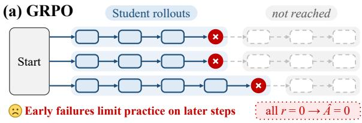
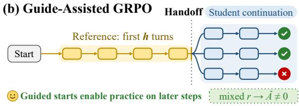
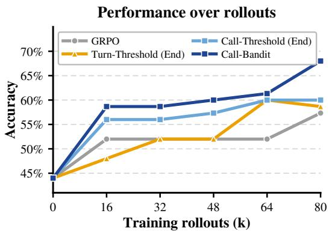
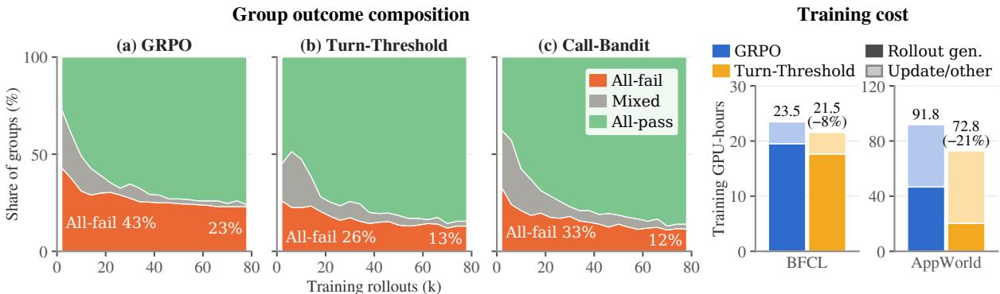
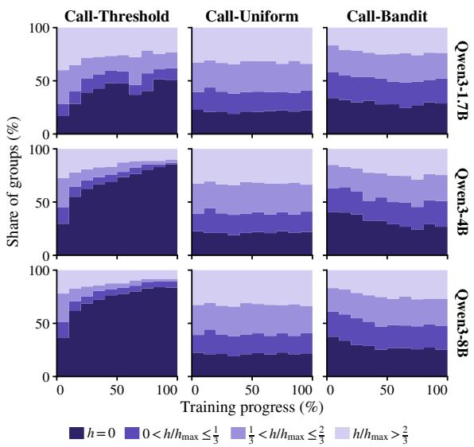

# Where to Start, How to Move: Analyzing Curricula under GRPO for Long-Horizon LLM Agents

Minchan Kim1\* Sungho Bae1\* Youngjin Kim2 Hyunwoo Park1

1Graduate School of Data Science, Seoul National University

2Department of Computer Science and Engineering, Konkuk University {mmm5373,sunghobae,hyunwoopark}@snu.ac.kr ab960119@konkuk.ac.kr

## Abstract

Group Relative Policy Optimization (GRPO) provides no reward-relative learning signal when all rollouts receive identical rewards. In long-horizon tasks that require multiple interactions, rewards are given only upon successful task completion, making all-fail groups common early in training and limiting opportunities to practice later steps. Guide Assisted GRPO replays a successful reference prefix before the learner continues. We study how initial positions, handoff units, and movement rules affect unassisted task completion. Across three model sizes on BFCL, starting near completion is more effective under a fixed turn-level threshold rule. Finer handoffs alone do not consistently help, but outcome-informed tool-call selection outperforms GRPO on trained and untrained task categories. Guided starts also improve AppWorld success on both evaluation splits. These findings highlight where learning starts and how starting positions move as key curriculum choices.

## 1 Introduction

Group Relative Policy Optimization (GRPO; Shao et al., 2024) is widely used for post-training large language models (LLMs), including interactive agents (Feng et al., 2025). It estimates advantages by comparing rewards within groups of rollouts for the same task, avoiding the cost of training a separate value model. For agents, these rollouts comprise tool calls and observations (Yao et al., 2023; Trivedi et al., 2024), with rewards often provided only at termination (Chen et al., 2025). In long-horizon tasks, early failures can yield all-fail groups and limit practice on later steps (Wang et al., 2026). Groups with identical outcomes have zero reward-relative advantages. DAPO replaces these groups (Yu et al., 2025), but retries under the same policy can again all fail.

  
Figure 1: GRPO with original and guide-assisted starts.

Starting-state curricula have been explored in general RL through JSRL (Uchendu et al., 2023), language-model reasoning through R3 (Xi et al., 2024), and interactive agent training through Agent-G2 (Wang et al., 2026). Drawing on this line of work, we use guide-assisted starts, in which initial steps from a reference trajectory are executed before the learner continues the task (Figure 1).

Starting later may make success accessible, but can also remove reward variation if every continuation succeeds. As the policy learns, a useful starting point may need to move. We study how the initial position, handoff unit, and movement rule relate to completing full tasks without assistance under GRPO.

BFCL experiments span 1.7B, 4B, and 8B models. Since agents must handle interaction conditions absent from training, we examine performance both within the trained BFCL category and across untrained categories. Separately trained AppWorld agents test whether guided starts also help with interactive coding that changes application state.

Our BFCL comparisons favor starting near task completion under the same turn-level movement rule. Finer handoff configurations do not consistently improve performance; their benefits vary with how training moves between starts. Adapting starts using past outcomes at the tool-call level improves over GRPO on the trained category and, on average, across untrained categories at all three model sizes. Guided training also improves App-World success rates on both evaluation splits. Together, these findings support starting-state curricula across tool-use and interactive coding tasks, with their effectiveness shaped by the combination of handoff unit and movement rule. Appendix A provides additional related work.

## 2 Study Design

Guide-assisted starts. A successful reference trajectory serves as a guide. Each rollout resets the environment and replays a guide prefix up to handoff h before the learner takes control. Replay changes the environment state and supplies the executed actions and observations as dialogue history. The learner completes the episode without access to the unexecuted guide suffix.

Handoff unit. Turn places handoffs at BFCL user-turn boundaries, such as before a payment request requiring a recipient lookup followed by a transfer. Call additionally permits validated boundaries between tool calls, allowing handoff after the lookup.

Initialization. Start initializes at $h = 0$ , with no replay. For both Turn and Call, End initializes immediately before the guide’s final user turn. Both initializations allow subsequent movement in either direction.

Movement. Each group contains 16 continuations of the same task from the same handoff. After each group, Threshold moves earlier after 12–16 successes, later after 0–1, and otherwise stays. Step sizes depend on the unit (Appendix B.3). Uniform samples uniformly from eligible handoffs without using outcomes. Bandit tracks outcomes by task and position and uses Thompson sampling to favor handoffs likely to produce both successes and failures. Uniform and Bandit can stay or jump in either direction.

Training and evaluation. Policy loss applies only to learner-generated tokens. A binary terminal task reward evaluates the whole episode, including the guide prefix and learner continuation. Failure may occur well after handoff, so it does not identify an error at that position. All-fail/all-pass groups are filtered from reward-relative updates, but count toward rollout budgets and inform outcome-based movement. Evaluation uses $h = 0 ,$ , requiring the learner to complete the full task without assistance.

Comparison scope. Start/End comparisons hold the turn-level threshold rule fixed. Call-level comparisons examine movement rules. Turn/Call comparisons also differ in step sizes or outcome-history settings, so they compare configurations rather than isolate the unit’s effect.

Protocol and measurements. BFCL experiments use Qwen3-1.7B, Qwen3-4B-Instruct-2507, and Qwen3-8B (Qwen Team, 2025) in nonthinking mode, trained on Base only (Patil et al., 2025; Lu et al., 2026). AppWorld uses separately trained Qwen3-8B agents with handoffs between code turns (Trivedi et al., 2024). Avg@3 averages three evaluation outcomes per task; Best@3 records whether any succeeds. Macro Avg. averages the untrained Missing Function, Missing Parameter, and Long Context categories. Evaluation repeats do not measure training-seed variability.

## 3 Empirical Analysis

## 3.1 Does Assisted Training Improve Independent Execution?

Table 1: BFCL Base results (%). Start and End use turnlevel threshold curricula. Bold and underlining mark the best and second-best per model, excluding Initial.
<table><tr><td>Backbone</td><td colspan="2">1.7B</td><td colspan="2">4B</td><td colspan="2">8B</td></tr><tr><td>Method</td><td colspan="6">Avg@3 Best@3 Avg@3 Best@3 Avg@3 Best@3</td></tr><tr><td rowspan="4">Initial GRPO DAPO</td><td>16.3</td><td>25.0</td><td>23.7</td><td>25.0</td><td>38.0</td><td>38.0</td></tr><tr><td>22.3</td><td>34.0</td><td>54.3</td><td>59.0</td><td>52.0</td><td>54.0</td></tr><tr><td>19.7</td><td>29.0</td><td>42.0</td><td>44.0</td><td>58.7</td><td>67.0</td></tr><tr><td></td><td></td><td></td><td></td><td></td><td></td></tr><tr><td colspan="8">Turn-Threshold</td></tr><tr><td>Start</td><td>22.0</td><td>35.0</td><td>53.7</td><td>56.0</td><td>55.0</td><td>56.0</td></tr><tr><td>End</td><td>24.3</td><td>36.0</td><td>55.0</td><td>57.0</td><td>59.0</td><td>61.0</td></tr></table>

Refilling groups at the original starting state. GRPO provides the unassisted baseline, with all rollouts beginning at h = 0. DAPO also starts at $h = 0$ , but samples additional rollouts to replace groups with identical rewards. At the same generated-rollout budget, DAPO trails GRPO in Avg@3 at 1.7B and 4B and exceeds it at 8B (Table 1). Refilling usable groups therefore does not consistently improve independent task completion in these comparisons.

The benefit of assistance depends on initialization. Turn-Threshold with Start initialization yields similar Base Avg@3 to GRPO at 1.7B and 4B and a higher score at 8B. With End initialization, Avg@3 is higher than GRPO at all three sizes, although the gain is modest at 4B. The largest gain occurs at 8B, reaching 7.0 percentage points. End initialization also yields higher Avg@3 and Best@3 than Start initialization throughout. These comparisons favor beginning training with short continuations near the guide’s end.

Replaying a longer guide prefix reduces the portion of the rollout generated by the learner. In the Qwen3-8B comparison, Turn-Threshold with End initialization uses approximately 8% less training GPU time than GRPO under the same training setup (Figure 3 right).

We next fix End initialization and examine how the handoff unit and movement rule affect performance.

## 3.2 Finer Units or Better Movement Rules?

Table 2: BFCL Base results (%) by handoff granularity and selection. All conditions use End initialization.
<table><tr><td>Backbone</td><td colspan="2">1.7B</td><td colspan="2">4B</td><td colspan="2">8B</td></tr><tr><td>Method</td><td colspan="6">Avg@3 Best@3 Avg@3 Best@3 Avg@3 Best@3</td></tr><tr><td>Turn Threshold</td><td>24.3</td><td>36.0</td><td>55.0</td><td>57.0</td><td>59.0</td><td>61.0</td></tr><tr><td>Bandit</td><td>23.0</td><td>36.0</td><td>57.7</td><td>61.0</td><td>53.0</td><td>69.0</td></tr><tr><td>Call</td><td></td><td></td><td></td><td></td><td></td><td></td></tr><tr><td>Threshold</td><td>23.3</td><td>32.0</td><td>54.3</td><td>58.0</td><td>56.0</td><td>70.0</td></tr><tr><td>Uniform</td><td>29.0</td><td>41.0</td><td>56.7</td><td>60.0</td><td>56.0</td><td>74.0</td></tr><tr><td>Bandit</td><td>30.0</td><td>40.0</td><td>60.0</td><td>63.0</td><td>60.7</td><td>73.0</td></tr></table>

A finer unit is not sufficient. Across 100 BFCL training tasks, call-level handoffs provide 557 candidates compared with 366 at the turn level, an increase of about 52%. However, Call-Threshold has lower Base Avg@3 than Turn-Threshold at all three model sizes (Table 2). These configurationlevel comparisons show that access to more closely spaced handoffs does not automatically yield better independent execution.

Bandit gains differ between handoff units. Bandit uses outcome histories and stochastic selection to move among handoffs at either the turn or call level. Turn-Bandit shows no consistent Base Avg@3 advantage over Turn-Threshold across model sizes. In contrast, Call-Bandit exceeds Call-Threshold at all three sizes. The observed benefit of Bandit therefore depends on the handoff configuration in which it operates.

To examine whether the call-level gains can be explained by random movement alone, we compare Call-Bandit with Call-Uniform. This control samples from the same eligible handoffs without using rollout outcomes. Call-Uniform improves or matches Call-Threshold in Base Avg@3, but Call-Bandit exceeds it by 1.0, 3.3, and 4.7 percentage points at 1.7B, 4B, and 8B, respectively. These calllevel comparisons suggest that outcome-informed movement provides benefits beyond uniform random movement. Appendix Figure 4 details the call-level starting positions.

  
Figure 2: BFCL validation accuracy (%) over training rollouts with Qwen3-8B.

Call-Bandit makes further gains during training. In the runs shown in Figure 2, Call-Threshold and Call-Bandit improve rapidly during the first 16k rollouts. Call-Bandit subsequently makes further gains, while Call-Threshold improves more gradually and Turn-Threshold fluctuates toward the end. Call-Bandit reaches the highest final validation accuracy among the plotted runs, consistent with its higher Base Avg@3.

Both guided configurations sustain lower allfail rates. Turn-Threshold and Call-Bandit both improve independent task completion over GRPO at 8B and share a common training pattern: fewer all-fail groups from early to late training (Figure 3 left). At the first recorded point, all-fail groups account for 43% under GRPO, compared with 26% under Turn-Threshold and 33% under Call-Bandit. By the end of training, these shares are 23%, 13%, and 12%, respectively. Thus, the lower incidence of groups without a successful continuation persists beyond the initial stages of guided training.

We next examine whether the gains observed on Base extend to untrained BFCL categories.

  
Figure 3: (Left) Training-group composition over generated rollouts. (Right) Training GPU time on BFCL and AppWorld. All results use Qwen3-8B. Turn-Threshold starts from the last handoff position (End initialization).

## 3.3 Do Gains Extend to Unseen Interactions?

Agents must handle missing arguments or functions and information buried in long observations. BFCL’s Missing Parameter, Missing Function, and Long Context categories test these conditions (Patil et al., 2025).

Table 3: BFCL cross-category generalization (Macro Avg., %). Scores average Missing Function, Missing Parameter, and Long Context, excluding Base. Training uses only Base tasks. Curricula use End initialization.
<table><tr><td>Backbone</td><td colspan="2">1.7B</td><td colspan="2">4B</td><td colspan="2">8B</td></tr><tr><td>Method</td><td colspan="6">Avg@3 Best@3 Avg@3 Best@3 Avg@3 Best@3</td></tr><tr><td>Initial</td><td>11.8</td><td>19.3</td><td>19.7</td><td>21.7</td><td>41.0</td><td>56.3</td></tr><tr><td>GRPO</td><td>15.7</td><td>26.7</td><td>40.3 32.5</td><td>43.0 36.0</td><td>45.7 45.4</td><td>58.7 56.7</td></tr><tr><td>DAPO</td><td>14.7</td><td>24.0</td><td></td><td></td><td></td><td></td></tr><tr><td>Turn</td><td></td><td>24.3</td><td>34.7</td><td>38.7</td><td>46.1</td><td>61.0</td></tr><tr><td>Threshold Bandit</td><td>14.8 17.2</td><td>28.0</td><td>35.1</td><td>38.3</td><td>46.2</td><td>61.0</td></tr><tr><td></td><td></td><td></td><td></td><td></td><td></td><td></td></tr><tr><td>Call</td><td></td><td></td><td></td><td></td><td></td><td></td></tr><tr><td>Threshold</td><td>19.0</td><td>30.7</td><td>41.2</td><td>45.3</td><td>46.8</td><td>60.3</td></tr><tr><td>Uniform</td><td>19.0</td><td>29.3</td><td>36.9</td><td>40.7</td><td>45.8</td><td>59.0</td></tr><tr><td>Bandit</td><td>19.8</td><td>30.7</td><td>42.7</td><td>45.7</td><td>49.7</td><td>64.7</td></tr></table>

The Base ordering does not always persist. Call-Threshold exceeds Turn-Threshold in Macro Avg@3 at all three sizes, reversing their Base ordering (Table 3). Uniform’s Base gains do not carry over: it matches Call-Threshold at 1.7B and trails it at 4B and 8B. The relative performance of handoff configurations therefore depends on the evaluation conditions.

Call-Bandit leads across model sizes. Call-Bandit achieves the highest Macro Avg@3 at all three sizes, with gains of 2.4 to 4.1 percentage points over GRPO. It also exceeds Uniform throughout. Its higher average success thus extends to the aggregate of the three untrained categories.

## 3.4 Do Gains Extend to Interactive Coding?

Table 4: AppWorld results (success rate, %) on Test Normal and Test Challenge with Qwen3-8B.
<table><tr><td rowspan="2">Method</td><td colspan="2">Test Normal</td><td colspan="2">Test Challenge</td></tr><tr><td>Avg@3 Best@3</td><td></td><td>Avg@3 Best@3</td><td></td></tr><tr><td>Initial</td><td>5.8</td><td>10.7</td><td>1.7</td><td>2.4</td></tr><tr><td>GRPO</td><td>43.1</td><td>54.8</td><td>20.9</td><td>28.5</td></tr><tr><td>Call-Threshold</td><td>47.2</td><td>60.7</td><td>22.3</td><td>31.4</td></tr></table>

AppWorld agents interact with the environment by executing Python code blocks (Trivedi et al., 2024), typically over more turns than in BFCL. We refer to handoffs at these code-execution boundaries as Call-level handoffs.

Call-Threshold exceeds GRPO on both Test Normal and Test Challenge (Table 4). Its Avg@3 is higher by 4.1 and 1.4 percentage points, respectively, while Best@3 increases by 5.9 and 2.9 points. As in BFCL, guide-assisted starts also offer a training-cost benefit: Call-Threshold uses approximately 21% less training GPU time than GRPO (Figure 3, right). Starting near the guide’s end can shorten the continuation the student must generate.

## 4 Conclusion

Starting-state curricula can improve independent task completion under GRPO, with benefits depending on initialization and movement. On BFCL, End initialization outperforms Start under the same turnlevel Threshold rule, while finer handoffs alone do not consistently help. Call-Bandit achieves the highest Base Avg@3 and cross-category Macro Avg@3 at all three model sizes. Guide-assisted training also improves AppWorld performance on both evaluation splits. These findings highlight where training begins and how it moves between handoffs as key choices for improving independent execution.

## Limitations

We evaluate guide-assisted training across two benchmarks with different interaction structures, BFCL and AppWorld, and include three Qwen3 model sizes in the BFCL experiments. This provides evidence beyond a single task setting, although further evaluation is needed to establish whether the observed trends extend to other model families and environments.

To make comparisons more controlled, we hold the turn-level movement rule fixed when comparing initial positions and compare movement rules within the call-level setting. However, Turn/Call configurations also differ in movement step sizes or outcome-history settings, so their differences cannot be attributed solely to handoff granularity. We also evaluate each task three times to account for variation in generated outcomes. These repeated evaluations do not capture variability across independent training runs, which requires additional training repetitions to assess.

Our experiments use successful reference trajectories to provide reproducible starting states. In settings without such trajectories, a possible alternative is to generate candidate guides using another model and verify their success in the environment. The additional collection cost and the influence of guide quality would need to be evaluated before extending this approach to those settings.

## Ethical Considerations

This study uses publicly released BFCL and AppWorld benchmarks and Qwen3 models to analyze agent training. The BFCL dataset and the Qwen3 checkpoints used here are released under the Apache License 2.0. AppWorld’s public portion uses the same license; its protected portion has an additional condition requiring that portion and its derivatives to be encrypted when publicly redistributed.1

Our evaluation measures task completion in benchmark environments (Patil et al., 2025; Trivedi et al., 2024); it does not establish safe deployment with access to real accounts or sensitive information. Incorrect tool calls or generated code could modify unintended data or expose private information. Such deployments require separate safety evaluation and safeguards, such as restricted permissions, isolated execution, and human approval for consequential actions. We do not evaluate the effectiveness of these safeguards. AI assistants were used to organize code and refine the manuscript.

## Acknowledgments

This work was supported by the “National AI Project” of the Ministry of Science and ICT and the AIIS.

## References

Kevin Chen, Marco Cusumano-Towner, Brody Huval, Aleksei Petrenko, Jackson Hamburger, Vladlen Koltun, and Philipp Krähenbühl. 2025. Reinforcement learning for long-horizon interactive LLM agents. arXiv preprint arXiv:2502.01600.

Lang Feng, Zhenghai Xue, Tingcong Liu, and Bo An. 2025. Group-in-group policy optimization for LLM agent training. In Advances in Neural Information Processing Systems, volume 38, pages 51797–51830.

Jian Hu, Huiying Li, Hao Zhang, Binfeng Xu, Yifan Zhang, Shaokun Zhang, Hemil Desai, Michael Demoret, Pavlo Molchanov, Jan Kautz, and Yi Dong. 2026. Molt: A scalable PyTorch-native training framework for agentic reinforcement learning. arXiv preprint arXiv:2607.21653.

Woosuk Kwon, Zhuohan Li, Siyuan Zhuang, Ying Sheng, Lianmin Zheng, Cody Hao Yu, Joseph E. Gonzalez, Hao Zhang, and Ion Stoica. 2023. Efficient memory management for large language model serving with PagedAttention. In Proceedings ofthe 29th Symposium on Operating Systems Principles, pages 611–626. Association for Computing Machinery.

Gengsheng Li, Mao Zheng, Mingyang Song, Ruiqi Liu, Tianyu Yang, Jie Sun, Qiyong Zhong, Haiyun Guo, Junfeng Fang, Dan Zhang, and Jinqiao Wang. 2026. On-policy distillation with curriculum turnlevel guidance for multi-turn agents. arXiv preprint arXiv:2606.15912.

Ilya Loshchilov and Frank Hutter. 2019. Decoupled weight decay regularization. In The Seventh International Conference on Learning Representations.

Siyuan Lu, Zechuan Wang, Hongxuan Zhang, Qintong Wu, Leilei Gan, Chenyi Zhuang, Jinjie Gu, and Tao Lin. 2026. Don’t just fine-tune the agent, tune the environment. In The Fourteenth International Conference on Learning Representations.

Shishir G Patil, Huanzhi Mao, Fanjia Yan, Charlie Cheng-Jie Ji, Vishnu Suresh, Ion Stoica, and Joseph E. Gonzalez. 2025. The Berkeley function calling leaderboard (BFCL): From tool use to agentic evaluation of large language models. In Proceedings of the 42nd International Conference on Machine Learning, volume 267 of Proceedings of Machine Learning Research, pages 48371–48392. PMLR.

Qwen Team. 2025. Qwen3 technical report. Preprint, arXiv:2505.09388.

Zhihong Shao, Peiyi Wang, Qihao Zhu, Runxin Xu, Junxiao Song, Xiao Bi, Haowei Zhang, Mingchuan Zhang, Y. K. Li, Y. Wu, and Daya Guo. 2024. DeepSeekMath: Pushing the limits of mathematical reasoning in open language models. arXiv preprint arXiv:2402.03300.

Harsh Trivedi, Tushar Khot, Mareike Hartmann, Ruskin Manku, Vinty Dong, Edward Li, Shashank Gupta, Ashish Sabharwal, and Niranjan Balasubramanian. 2024. AppWorld: A controllable world of apps and people for benchmarking interactive coding agents. In Proceedings of the 62nd Annual Meeting of the Associationfor Computational Linguistics (Volume 1: Long Papers), pages 16022–16076, Bangkok, Thailand. Association for Computational Linguistics.

Ikechukwu Uchendu, Ted Xiao, Yao Lu, Banghua Zhu, Mengyuan Yan, Joséphine Simon, Matthew Bennice, Chuyuan Fu, Cong Ma, Jiantao Jiao, Sergey Levine, and Karol Hausman. 2023. Jump-start reinforcement learning. In Proceedings of the 40th International Conference on Machine Learning, volume 202 of Proceedings of Machine Learning Research, pages 34556–34583. PMLR.

Zihan Wang, Kangrui Wang, Qineng Wang, Pingyue Zhang, Linjie Li, Zhengyuan Yang, Xing Jin, Kefan Yu, Minh Nhat Nguyen, Licheng Liu, Eli Gottlieb, Yiping Lu, Kyunghyun Cho, Jiajun Wu, Li Fei-Fei, Lijuan Wang, Yejin Choi, and Manling Li. 2025. RA-GEN: Understanding self-evolution in LLM agents via multi-turn reinforcement learning. arXiv preprint arXiv:2504.20073.

Zixuan Wang, Yanrui Miao, Zhengxi Lu, Teng Pan, Yiwen Qiu, Hongxing Li, Peng Qiu, Ruiqing Zhang, and Yongliang Shen. 2026. Agent- $\mathbf { G } ^ { 2 } \colon$ Gaussian guidance for agentic reinforcement learning. arXiv preprint arXiv:2608.23318.

Zhiheng Xi, Wenxiang Chen, Boyang Hong, Senjie Jin, Rui Zheng, Wei He, Yiwen Ding, Shichun Liu, Xin Guo, Junzhe Wang, Honglin Guo, Wei Shen, Xiaoran Fan, Yuhao Zhou, Shihan Dou, Xiao Wang, Xinbo Zhang, Peng Sun, Tao Gui, and 2 others. 2024. Training large language models for reasoning through reverse curriculum reinforcement learning. In Proceedings of the 41st International Conference on Machine Learning, volume 235 of Proceedings of Machine Learning Research, pages 54030–54048. PMLR.

Shunyu Yao, Jeffrey Zhao, Dian Yu, Nan Du, Izhak Shafran, Karthik Narasimhan, and Yuan Cao. 2023. ReAct: Synergizing reasoning and acting in language models. In The Eleventh International Conference on Learning Representations.

Woongyeong Yeo, Yumin Choi, Taekyung Ki, and Sung Ju Hwang. 2026. HINT-SD: Targeted hindsight self-distillation for long-horizon agents. arXiv preprint arXiv:2605.17873.

Junkeun Yi, Damon Mosk-Aoyama, Baihe Huang, Ritu Gala, Charles Wang, Sugam Dipak Devare, Khushi Bhardwaj, Abhibha Gupta, Oleksii Kuchaiev, Jiantao Jiao, Jian Zhang, and Venkat Srinivasan. 2026. PivotRL: High accuracy agentic post-training at low compute cost. arXiv preprint arXiv:2603.21383.

Qiying Yu, Zheng Zhang, Ruofei Zhu, Yufeng Yuan, Xiaochen Zuo, Yu Yue, Weinan Dai, Tiantian Fan, Gaohong Liu, Juncai Liu, Lingjun Liu, Xin Liu, Haibin Lin, Zhiqi Lin, Bole Ma, Guangming Sheng, Yuxuan Tong, Chi Zhang, Mofan Zhang, and 17 others. 2025. DAPO: An open-source LLM reinforcement learning system at scale. In Advances in Neural Information Processing Systems, volume 38, pages 125532–125554.

Xuechen Zhang, Zijian Huang, Yingcong Li, Chenshun Ni, Jiasi Chen, and Samet Oymak. 2025. BREAD: Branched rollouts from expert anchors bridge SFT & RL for reasoning. In Advances in Neural Information Processing Systems, volume 38, pages 107278– 107304.

Siyan Zhao, Zhihui Xie, Mengchen Liu, Jing Huang, Guan Pang, Feiyu Chen, and Aditya Grover. 2026. Self-distilled reasoner: On-policy self-distillation for large language models. In Proceedings of the 43rd International Conference on Machine Learning, volume 306 of Proceedings of Machine Learning Research, pages 162433–162448. PMLR.

## A Additional Related Work

Starting-state curricula. JSRL, ${ \tt R } ^ { 3 }$ , and Agent-$\mathrm { G ^ { 2 } }$ provide different mechanisms for controlling how much of an episode or solution the learner completes (Uchendu et al., 2023; Xi et al., 2024; Wang et al., 2026). Two related approaches further distinguish access to intermediate states from the objective optimized afterward. BREAD combines adaptive expert prefixes with branched rollouts when self-generated reasoning fails (Zhang et al., 2025). PivotRL trains on selected intermediate turns using local on-policy rollouts and functional action verification (Yi et al., 2026). Our learner instead continues from handoff to episode termination and receives the full-task reward.

Learning signals and teacher supervision. RA-GEN studies multi-turn RL dynamics and rollout design (Wang et al., 2025), while GiGPO augments episode-level advantages with comparisons at recurring environment states (Feng et al., 2025). Teacher supervision offers another source of learning signal. On-policy self-distillation conditions teacher targets on privileged solution information (Zhao et al., 2026); Guided-OPD interleaves teacher and student turns while reducing intervention (Li et al., 2026); and HINT-SD targets failure-relevant actions using hindsight (Yeo et al., 2026). These approaches motivate distinguishing where the learner starts from how its continuation is supervised.

## B Additional Experimental Details

## B.1 Data Splits and Checkpoint Selection

BFCL training uses 100 Base tasks. The Base evaluation consists of 25 validation tasks and 75 held-out test tasks. Missing Function, Missing Parameter, and Long Context are excluded from training.

AppWorld uses 90 training tasks and 57 development tasks. Test Normal and Test Challenge contain 168 and 417 tasks, respectively. For AppWorld, we evaluate the final checkpoints after 129.6K generated rollouts for all compared training methods.

## B.2 Optimization and Rollout Generation

We use AdamW (Loshchilov and Hutter, 2019) with a learning rate of 10−6 and weight decay of 0.01. Each rollout group contains 16 studentgenerated continuations from the same handoff. Training uses a sampling temperature of 1.0 and limits each model response to 4,096 generated tokens. We use BF16 precision and implement training with the molt framework (Hu et al., 2026), with vLLM (Kwon et al., 2023) for rollout generation. Experiments run on four NVIDIA B200 or four NVIDIA H100 GPUs.

## B.3 Movement Step Sizes

Turn-Threshold moves one user turn whenever its threshold triggers. Call-Threshold moves one call, except that an all-pass group moves directly to the preceding user-turn boundary. All moves are restricted to replay-eligible positions. Uniform and Bandit can select any eligible position, including the current one, without an adjacent-step constraint.

## B.4 Bandit Selection

Each task-position pair maintains success and failure counts. Using a Beta(1, 1) prior, the selector samples a success probability p from its Beta posterior and computes

$$
s ( p ) = 1 - p ^ { 1 6 } - ( 1 - p ) ^ { 1 6 } ,
$$

the probability that a rollout group contains both successes and failures.

With probability 0.1, the selector explores a least-observed position. Otherwise, it chooses the earliest position whose sampled score is within 0.1 of the highest score.

## C Handoff Positions During Training

  
Figure 4: Call-level rollout starting positions during BFCL training.

Figure 4 shows how rollout starting positions evolve during training. Call-Threshold increasingly concentrates rollouts at $h = 0 ,$ particularly at 4B and 8B. This pattern is consistent with its rule of moving earlier when group success exceeds the promotion threshold. The shift is less pronounced and more variable at 1.7B.

Call-Uniform maintains a comparatively stable distribution throughout training, as it samples eligible positions without conditioning on rollout outcomes.

Call-Bandit continues to allocate rollouts to later starts rather than progressively concentrating at $h = 0$ . Its selection rule favors positions likely to produce mixed groups, while stochastic selection and exploration allow continued visits across positions. As the learner changes during training, success rates at previously visited handoffs may also change. Revisiting these positions allows the selector to reassess where mixed outcomes remain available.