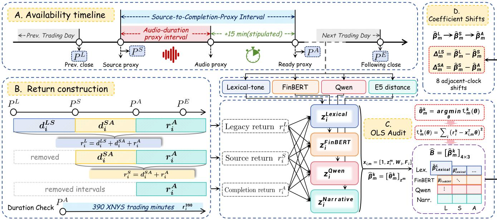
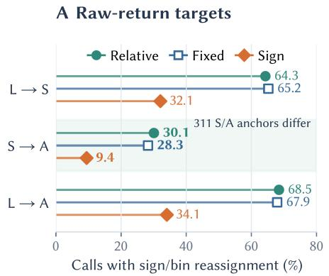
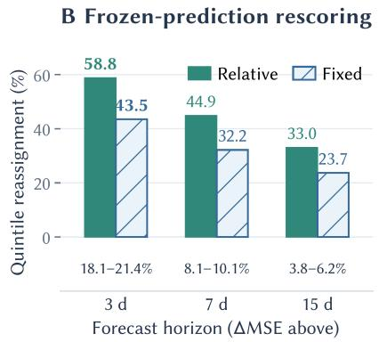
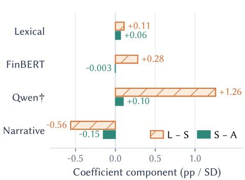

# When Does “Post-Call” Begin? An Availability Contract for Earnings-Call NLP Benchmarks

Xiaoyu Ma   
National University of Singapore   
Asian Institute of Digital Finance   
Singapore   
xiaoyu\_ma@u.nus.edu   
Yuncong Liu   
National University of Singapore   
Asian Institute of Digital Finance   
Singapore   
yuncongliu@u.nus.edu   
Kelvin J.L. Koa∗   
National University of Singapore   
Asian Institute of Digital Finance   
Singapore   
kelvin.koa@u.nus.edu   
Ke-Wei Huang   
National University of Singapore   
Asian Institute of Digital Finance   
Singapore   
dishkw@nus.edu.sg

## Abstract

Corporate financial disclosures often unfold over time, with announcements, prepared remarks, and discussion spanning multiple high-frequency return intervals. Financial NLP benchmarks can therefore sufer from a within-event timing mismatch when the prediction target begins before the textual or audio input used by a model could be complete. Chronological train–test splits do not prevent this mismatch, because it occurs inside individual events rather than across samples. We introduce an Availability Contract, which requires a benchmark to state the input boundary, evidence for input availability, the outcome start, and the claims supported by that evidence. We apply this framework to 552 earnings calls from 24 firms. For each call, we hold the return endpoint fixed and compare the previous close, a documentary call-start proxy, and a completion proxy based on reconstructed audio end plus a stipulated processing allowance. At this baseline, moving from the call-start proxy to the completion proxy flips return signs for 9.4% of calls. Holding completion-clock cutpoints fixed, 28.3% change quintile. In an independent release-session analysis of a public earnings-call volatility benchmark, shifting before-market target windows forward by one trading session raises three-day mean squared error by 18.1–21.4% across four frozen prediction streams, while their point rankings remain unchanged. Together, the results show that labels and losses can depend materially on the declared outcome clock even when model rankings appear stable. The Availability Contract makes this assumption explicit and ties post-input claims to the available timing evidence.

## CCS Concepts

• Computing methodologies → Natural language processing; • Applied computing → Economics; • General and reference → Evaluation.

## Keywords

financial NLP, earnings calls, benchmark construction, model validation, information availability, trustworthy AI

ACM Reference Format: Xiaoyu Ma, Kelvin J.L. Koa, Yuncong Liu, and Ke-Wei Huang. 2026. When Does “Post-Call” Begin? An Availability Contract for Earnings-Call NLP Benchmarks. In 7th ACM International Conference on AI in Finance (ICAIF ’26), November 14–17, 2026, Milan, AA, Italy. ACM, New York, NY, USA, 8 pages. https://doi.org/10.1145/3858063.3858902

## 1 Introduction

Financial corporate events unfold over time. An earnings call may include an hour of prepared remarks and Q&A while stock prices continue to change. Press conferences and other sequential disclosures create the same benchmark problem. Let $X _ { i }$ denote the model’s textual or audio input for event � and $Y _ { i }$ its target stock return. Post-input prediction requires the return window to begin at a price observed after the complete $X _ { i }$ could have been constructed. An earlier window includes price movement during disclosure: it may measure a meaningful event-response association, but not prediction after the declared input becomes available.

A chronological train–test split excludes future training events, but not this within-event mismatch. Unlike conventional train– test leakage, the issue concerns the representation boundary—the information included in the input—and the label start—the price from which the outcome is measured.

These choices afect reproducibility in financial AI. Identical models, data, and splits can yield diferent labels when disclosure times, input completion, or timestamp-to-price mappings difer. Such assumptions may be buried in preprocessing code. Interpreting an event-window benchmark as post-input evaluation therefore requires reproducible event timing as well as model code.

We introduce an Availability Contract to make these assumptions explicit. The contract records the information included in the model input, the evidence used to determine when that input is complete, any processing allowance, the rule mapping completion to a market-price anchor, the outcome endpoint, and the interpretation supported by the available timing evidence. It does not impose one universally correct event window. A return beginning

Table 1: Claim ladder for availability evidence.

Claim Permitted interpretation Event-window association The return may span the event; interpretation is an event-window association, not post-input attribution. Proxy-aligned association A stated completion proxy precedes label start; interpretation is conditional on the proxy. Verified post-input Observed input completion, or a defensible upper bound, precedes label start. Deployability Point-in-time input, model, order, and execution clocks are observed or conservatively bounded, and costs are modeled.

before event completion may be appropriate for studying the total market response, whereas a return beginning after completion is more appropriate for evaluating prediction using the complete rep resentation. The contract requires researchers to distinguish these estimands rather than describe both as post-input prediction.

We study this issue using earnings calls, whose sequential structure makes the timing distinction especially visible. Prior research shows that earnings-call language and audio are associated with market outcomes [28, 32]. However, some benchmarks combine complete-call representations with returns beginning at or before the start of the call [1, 16, 31, 32]. Such designs may be appropriate for event-response analysis, but additional clock evidence is required before interpreting them as evidence of forecast accuracy.

For each call, we construct returns with the same endpoint but three starting prices. The legacy clock � begins at the precedingsession close and captures a broad event-spanning return. Clock � uses the close of the first regular-session five-minute bar starting strictly after a documentary source-start timestamp. Clock � applies the same rule after the reconstructed audio end plus a stipulated 15-minute allowance. Each selected bar closes five trading minutes after its start, so neither anchor is an instantaneous price at the proxy timestamp. Moving from � to � removes price movement before the documentary source-start anchor. Moving from � to � additionally removes the reconstructed audio-duration interval, the allowance, and the subsequent bar-mapping interval. Because the sample and endpoint remain fixed, target diferences arise from the intervals removed by changing the starting price. Across 552 earnings calls from 24 firms, at the stipulated 15-minute baseline, moving from � to � flips the return sign for 9.4% of calls. Holding �- clock cutpoints fixed, 28.3% change quintile; recomputing categories separately under each clock yields 30.1%.

We complement this audit with a separate sensitivity analysis using the public Dense Earnings Call (DEC) benchmark introduced by Yu et al. [41]. Moving the targets of before-market events forward by one trading session increases three-day mean squared error by 18.1–21.4% across four fixed prediction streams, although their rankings remain unchanged. This shows that an unchanged leaderboard does not imply that target values or reported predictive losses are robust to timing choices.

Our contributions are threefold. First, we introduce the Availability Contract as a representation-specific reporting framework for reproducible financial NLP benchmarks. Second, we provide a paired three-clock diagnostic that separates event-spanning, call-startaligned, and completion-aligned return windows while holding the sample and endpoint fixed. Third, we show that timing choices can reverse return signs, reassign categorical labels, and materially change reported losses even when model rankings remain stable.

2 Related Work and Evaluation Context

## 2.1 Earnings calls as information events

Financial language contains information beyond accounting numbers [37]. Earnings-call Q&A adds to the presentation [28]; nonanswers and linguistic patterns reveal managerial behavior [7, 10, 21]; and question–answer similarity has been related to returns [13]. These findings motivate complete-interaction representations, which cannot exist when the call begins. Economic relevance and temporal validity are separate questions.

## 2.2 Financial-NLP representations and benchmarks

Financial modeling uses finance-specific dictionaries and FinBERT [2, 26], retrieval-augmented price–news representations for portfolio optimization [17], and multi-agent symbolic discovery for interpretable valuation [18]. Controlled synthetic benchmarks diagnose forecasting performance under explicit financial mechanisms [36]. Earnings-call research spans long-document prediction [20], aligned multimodal data [23], text–audio fusion [32], broader multimodal benchmarks [33], and annotated Q&A quality [30].

Recent ICAIF work on earnings-release structure separates announcement-day explanatory power from a post-open trading test [39]. The Availability Contract extends this reporting principle from release timing to representation-specific completion. Transcript models may also load on company identity and prior volatility rather than call-specific semantics [41]. Yu et al. additionally show that day indexing in the EC and MAEC earnings-call benchmarks can select the wrong first post-earnings day when release timing is omitted. Event-date correction and chronological splitting therefore remain necessary. Related text-to-decision work separates directional intent from execution choices [24]; our contract additionally binds representation completion to a price anchor and endpoint.

## 2.3 Event windows, temporal validity, and multiplicity

Classic event studies measure reactions around dated events [5, 19, 27]. Announcement-clock research shows that informative windows depend on release time [4, 8]; at segment resolution, Oh links timestamped call speech to subsequent quote returns [29]. We ask what evidence permits a benchmark label to begin after its declared representation is available. Predictive evaluation requires excluding unavailable inputs [14].

Random splits can exaggerate generalization under distribution shift [34], and pretrained models can encode post-cutof facts [9, 25]. Point-in-time checkpoints address model knowledge [15], not a label that begins before its call input is complete. We therefore treat label start as benchmark schema. Table 1 lists these claims.

  
Figure 1: Availability contract and paired three-clock audit. Panel A maps source and stipulated completion proxies to non executable price anchors; transcript and model readiness remain unobserved. Panel B constructs three common-endpoint returns and their removed intervals. Panel C crosses four retrospective representations with three targets in 12 common-sample OLS fits. Panel D reports eight adjacent-clock coeficient contrasts. These contrasts are associational, $\overline { { r _ { i } ^ { 3 9 0 } } }$ is a separate duration check, and the timeline is not to scale.

Repeated predictor search also makes isolated significance dificult to interpret [11]. Multiplicity adjustment addresses the resulting statistical problem, whereas the contract addresses the definition of the outcome being tested.

## 3 Availability-Aware Paired Audit

## 3.1 Availability Contract and instantiated proxy clocks

An Availability Contract records nine fields: permitted claim �; input boundary �; source-to-completion-proxy rule �; allowance ℓ; checkpoint record �, including its identity, knowledge boundary, and point-in-time availability; inference-completion evidence �; price-anchor rule A; endpoint �; and sample rule S. Label start applies A to �(�)+ℓ under the stated market calendar. The contract specifies a reproducible window whose interpretation follows the recorded evidence for �, �, and �: a proxy-aligned association, a verified post-input evaluation, or a deployment claim.

Let $t _ { i } ^ { \mathrm { i n p u t } } , t _ { i } ^ { \mathrm { c h e c k p o i n t } } , t _ { i } ^ { \mathrm { m o d e l } } , t _ { i } ^ { \mathrm { o r d e r } }$ , and �exec denote the completeinput, checkpoint-available, model-ready, order, and execution times for call �. A deployment claim requires label start to follow every clock relevant to the claimed workflow, with a checkpoint whose knowledge boundary precedes the forecast. These clocks are unobserved here. Figure 1 therefore shows only the documentary source timestamp, reconstructed audio-duration proxy, stipulated allowance, and two derived price anchors. The four representations are constructed retrospectively and connected to these clocks through the ofline audit.

For each call, we reconstruct an audio-duration proxy as

$$
t _ { i } ^ { \mathrm { a u d i o } } = t _ { i } ^ { \mathrm { s o u r c e \ s t a r t } } + \operatorname* { m a x } \Bigl ( d _ { i } ^ { \mathrm { M P 3 } } , e _ { i } ^ { \mathrm { a l i g n m e n t } } \Bigr ) ,\tag{1}
$$

where $d _ { i } ^ { \mathrm { M P 3 } }$ is the decoded MP3 duration and $e _ { i } ^ { \mathrm { a l i g n m e n t } }$ is the elapsed time of the final finite sentence-alignment endpoint, both measured relative to the documentary source timestamp. Taking the maximum makes the proxy no earlier than either recorded duration estimate. These measurements reconstruct an audio-duration boundary relative to the documentary source timestamp.

We then stipulate

$$
t _ { i } ^ { \mathrm { r e a d y \ p r o x y } } = t _ { i } ^ { \mathrm { a u d i o } } + \ell , \qquad \ell = 1 5 \mathrm { m i n u t e s } .\tag{2}
$$

This ready proxy supplies the study’s completion-proxy clock. Let UXNYS denote regular-session five-minute bar-start timestamps on the New York Stock Exchange (XNYS) calendar. We define two intermediate label-price anchors:

$$
\begin{array} { r l } & { u _ { i } ^ { S } = \operatorname* { m i n } \left\{ u \in \mathcal { U } _ { \mathrm { X N Y S } } : u > t _ { i } ^ { \mathrm { s o u r c e ~ s t a r t } } \right\} , \quad P _ { i } ^ { S } = \mathrm { C l o s e } _ { i } ( u _ { i } ^ { S } ) , } \\ & { u _ { i } ^ { A } = \operatorname* { m i n } \left\{ u \in \mathcal { U } _ { \mathrm { X N Y S } } : u > t _ { i } ^ { \mathrm { r e a d y ~ p r o x y } } \right\} , \quad P _ { i } ^ { A } = \mathrm { C l o s e } _ { i } ( u _ { i } ^ { A } ) . } \end{array}\tag{3}
$$

Each selected bar starts strictly after its corresponding proxy and closes five trading minutes later. $P _ { i } ^ { S }$ follows the documentary source-start proxy, while $P _ { i } ^ { A }$ incorporates the reconstructed duration and stipulated allowance. Both are bar-close prices used to construct the return labels. XNYS sessions, including early closes, are implemented with exchange\_calendars 4.5.6. These rules define a reproducible post-proxy association under the contract.

Table 2: Complete-case sample construction. Percentages are relative to the previous and parent panels.
<table><tr><td>Stage</td><td>Calls</td><td>Retained from prior</td><td>Retained from parent</td></tr><tr><td>Parent event panel</td><td>2,094</td><td>100.0%</td><td>100.0%</td></tr><tr><td>Usable source clock</td><td>755</td><td>36.1%</td><td>36.1%</td></tr><tr><td>Audio-duration proxy</td><td>669</td><td>88.6%</td><td>31.9%</td></tr><tr><td>Complete common sample</td><td>552</td><td>82.5%</td><td>26.4%</td></tr></table>

## 3.2 Return objects and exact coeficient identity

For event-session date ��, let $P _ { i } ^ { L } = C _ { i , d _ { i } - 1 }$ be the preceding session close and let $P _ { i } ^ { E } = C _ { i , d _ { i } + 1 }$ be the common following-session close. Raw stock-price log returns in percentage points are

$$
r _ { i } ^ { c } = 1 0 0 \log ( P _ { i } ^ { E } / P _ { i } ^ { c } ) , \qquad c \in \{ L , S , A \} ,\tag{4}
$$

$$
d _ { i } ^ { L S } = 1 0 0 \log ( P _ { i } ^ { S } / P _ { i } ^ { L } ) , d _ { i } ^ { S A } = 1 0 0 \log ( P _ { i } ^ { A } / P _ { i } ^ { S } ) .\tag{5}
$$

Log returns are used because adjacent intervals add exactly; ordinary simple returns would instead compound. We write $\dot { d } _ { i } ^ { L A } =$ $d _ { i } ^ { L S } + d _ { i } ^ { S A }$ . Event by event, $r _ { i } ^ { L } - r _ { i } ^ { S } = d _ { i } ^ { \bar { L } S } , r _ { i } ^ { S } - r _ { i } ^ { A } = d _ { i } ^ { S A }$ , and $r _ { i } ^ { \dot { L } } - r _ { i } ^ { A } { \dot { = } } d _ { i } ^ { L S } + d _ { i } ^ { S A }$

Paired OLS identity. Let � be the same full-rank design matrix for all outcomes in Eq. 5. Let ${ \widehat { \beta } } ^ { L S }$ and ${ \widehat { \beta } } ^ { S A }$ denote the corresponding same-design OLS coeficients for outcomes $d _ { i } ^ { L S }$ and $d _ { i } ^ { S A }$ . Then

$$
{ \widehat { \beta } } ^ { L } - { \widehat { \beta } } ^ { S } = { \widehat { \beta } } ^ { L S } , \quad { \widehat { \beta } } ^ { S } - { \widehat { \beta } } ^ { A } = { \widehat { \beta } } ^ { S A } , \quad { \widehat { \beta } } ^ { L } - { \widehat { \beta } } ^ { A } = { \widehat { \beta } } ^ { L S } + { \widehat { \beta } } ^ { S A } .\tag{6}
$$

OLS linearity gives Eq. 6 under the same estimator. This diagnostic attributes a diference to the removed segment while holding rows, representation, controls, fixed efects, and endpoint fixed. Each contrast is thus localized to its removed return interval.

Because moving only label start shortens the holding period, a separate $r _ { i } ^ { 3 9 0 }$ begins at $P _ { i } ^ { A }$ and ends after exactly 390 XNYS trading minutes. It tests duration and is not part of Eq. 6.

## 4 Earnings-Call Case Study

## 4.1 Sample and clock construction

The parent panel contains 2,094 earnings calls for 30 large U.S. firms from 2006–2024. The audit requires a usable source-page clock, archived audio and sentence timing, fixed representation scores, and a complete five-minute price path. The common sample contains 552 calls from 24 firms over 2018–2024, retaining 26.4% of the parent panel (Table 2).

The deterministic parser processes 842 archived source pages. Six manually verified start-time corrections and three verified nochange checks precede sample freezing; most times remain documentary headers rather than verified starts. Audio-duration construction yields 670 records, 669 linked to a usable source clock.

Attrition is observably selective. The source-clock join removes 1,339 calls and shifts the panel toward later years and larger firms; mean log market capitalization moves by about one pooled SD. The price join removes 117 calls from five firms (CRM, CVX, PG, TRV, and V). Only 2 calls remain in 2018, versus 87–95 per year thereafter. Inference uses this common complete-case panel: clock evidence changes both the return window and benchmark population. Price-window checks identified six split-like discontinuities; none intersects an event window.

Worked example. We mechanically select the after-close call nearest the stratum’s median audio duration. For MSFT on 27 July 2021, the documentary header is 17:00 ET, the audio proxy 18:00:20, and stipulated readiness proxy 18:15:20. Both � and � map to the 09:35 next-session close. The event-spanning, removed-��, and post-proxy returns are -0.984, -0.562, and -0.422 pp, satisfying $r ^ { L } = \dot { d } ^ { L S } + \dot { r } ^ { A }$ to rounding. This illustrates why the two proxy clocks yield the same return for an after-close call.

## 4.2 Four retrospective representations

Each Q&A representation is aggregated to one call-level score and standardized once on the common sample:

• Lexical tone: answer-word-weighted counts from a projectcurated, outcome-blind Loughran–McDonald-style dictionary subset.

• FinBERT: token-weighted � (positive) − � (negative) from ProsusAI/finbert.

• Qwen-derived answer valence: a fixed Qwen3-4B prompt assigns each isolated Q&A pair one label—positive, negative, neutral, or mixed. The call score is $( n _ { + } - n _ { - } ) / n _ { \mathrm { Q A } }$ ; neutral and mixed answers contribute zero [40].

• Narrative revision: for each question, E5 retrieves the nearest eligible prior question from the same firm. The exploratory score is mean cosine distance—one minus cosine similarity—between the current and prior answers, interpreted as a geometric proxy for narrative change [22]. Prior transcripts dated after the current call are ineligible. We use intfloat/e5-large-v2 [38].

The representations span lexical tone, finance sentiment, answer classification, and within-firm narrative change. Qwen sees only an isolated question and answer—not releases, guidance, consensus, prices, or returns. Among 8,610 Q&As, 48.62% are positive, 48.19% neutral, 2.54% negative, and 0.65% mixed. The score therefore mainly contrasts positive and neutral answer valence.

Model revisions are fixed across the audit. Qwen uses greedy decoding, a limit of 80 new tokens, and 3,072-token truncation. Its June 2026 run used a 2025-vintage checkpoint without an established historical knowledge cutof; the resulting scores are retrospective.

## 4.3 Regression specification and inference

For representation $z _ { i }$ and outcome $r _ { i } ^ { k }$ , we estimate separate OLS models

$$
\boldsymbol { r } _ { i } ^ { k } = \alpha + \beta ^ { k } \boldsymbol { z } _ { i } + \gamma ^ { \top } \boldsymbol { W } _ { i } + \mu _ { \mathrm { f i r m } } + \boldsymbol { \tau } _ { \mathrm { q u a r t e r } } + \lambda _ { \mathrm { t i m i n g } } + \boldsymbol { \epsilon } _ { i } ,\tag{7}
$$

where $W _ { i }$ contains standardized log Q&A count and log answercharacter count; timing classes are before-open, intraday, and afterclose. Every model uses the same 552 rows and sparse controls to measure benchmark sensitivity under a common design. Here $\beta ^ { k }$ is measured in percentage points per signal $\operatorname { S D } ; \mu , \tau$ , and � are firm, calendar-quarter, and timing-class fixed efects. Scores and controls remain unchanged across the three outcomes.

For target metrics, we report separate 5,000-draw 95% percentile resampling intervals from firm pairs-cluster and calendar-week pairs-block resampling. Relative ranks and fixed-� cutpoints are recomputed within each draw. For exploratory association coeficients, the same two one-way resampling schemes yield separate two-sided, null-centered approximate �-values; the primary max-� rule reports the larger of the firm- and calendar-week values. Holm adjustment [12] covers four max-� values; Benjamini–Hochberg [3] applies within the secondary exact-390-minute family.

  
Figure 2: Target-clock sensitivity. (A) On 552 paired calls, � →� changes 9.4% of raw-return signs, 28.3% of fixed-� quintiles, and 30.1% of re-estimated relative quintiles. (B) A separate one-session perturbation of DEC before-market targets changes targets and four-stream MSE but not point rankings (� = 1). (C) Exploratory �� and �� coeficient components; † marks the previously selected Qwen construct.

As a post-freeze sensitivity, we report the Cameron–Gelbach– Miller estimator $V _ { \mathrm { f i r m } } + V _ { \mathrm { w e e k } } - V _ { \mathrm { f i r m \times w e e k } } \ : [ 6$ ]. It uses 24 firm clusters, 175 calendar-week clusters, and 552 firm–week intersections (reference df 23). This asymptotic check difers from the primary max-� rule over separate one-way bootstraps. Qwen and other constructs were inspected before family freezing; all representation-level inference is therefore retrospective and exploratory. The Holm family covers the four-representation � → � comparison. The subsequently added three-clock decomposition and DEC fixed-cutpoint analysis are descriptive.

Implementation assistance. Claude and Codex assisted literature discovery, development and review of audit scripts, and checks of result files and table consistency. All reported estimates are computed by the audit scripts from the study data.

## 5 Results

## 5.1 Completion Alignment Reassigns Targets

Panel A of Table 3 and Figure 2 separate two operations that the original � →� comparison combined. Moving from the previous close to the documentary source-start anchor (� →�) gives Spearman correlation 0.506, a mean absolute return change of 3.427 pp, 32.1% sign changes, and 64.3% relative-quintile reassignment. These quantities describe conventional event-window realignment.

At the stipulated 15-minute baseline, moving from � to � changes targets even after source-proxy alignment. The two returns have Spearman correlation 0.900, but their absolute diference averages 0.623 pp and has median 0.179 pp. Raw-return sign changes for 9.4% of calls. Under common �-clock cutpoints, 28.3% change quintile; recomputing the reference distribution under each clock yields 30.1%. The separate 5,000-draw 95% percentile resampling intervals under firm pairs-cluster and calendar-week pairs-block resampling are, respectively, sign [5.6%, 13.6%]/ [6.9%, 12.1%], relative [20.6%, 40.2%]/ [25.3%, 35.5%], and fixed [17.7%, 38.1%]/ [23.4%, 31.9%]. These intervals quantify sampling variation in the reassignment rates.

The fixed-cutpoint comparison asks whether changing a call’s return crosses the same category thresholds. The relative comparison asks how its position changes within the distribution defined by each clock. Reporting both separates movement against a shared reference from redistribution within the panel, making the categorical consequences of the clock adjustment explicit.

The 552-call rates are primary. � and � map to diferent anchors for 311/552 calls (56.3%); within this price-anchor-diferent subset, descriptive sign/relative/fixed rates are 16.7%/48.2%/ 50.2%. Among the 241 equal-anchor calls, numeric returns and fixed-� bins never change, whereas 6.6% of calls change relative quintile only because each clock uses a diferent full-sample reference distribution.

For all 206 after-close calls, both proxies map to the same nextsession bar, so $P ^ { S } = P ^ { A }$ and returns coincide. Fixed-� bins never change; the 6.3% relative-bin movement in Table 3 comes only from diferent full-sample reference distributions. The coincident anchors provide a mechanical check of the timestamp-to-price mapping. These 206 calls are a subset of the 241 equal-anchor calls.

## 5.2 Frozen Rescoring Changes Losses, Not Rankings

On DEC, we rescore four frozen prediction streams on 1,710 common events: TSMixer and three TMLP configurations (DEC, Random All, and Random Ticker) from Yu et al. [41]. The published target is the log population standard deviation of simple daily returns over each horizon. To isolate target-clock sensitivity from model adaptation, the day-indexed counterfactual keeps predictions fixed, shifts only 1,191 before-market targets by one session, and leaves after-market targets unchanged. The after-market stratum is a mechanical control $( \rho = 1 ,$ , mean absolute change zero, and no fixed-cutpoint moves); relative bins can still move through the cross-sectional distribution.

Table 3: Distinct target-clock sensitivities. $S \to A$ reassigns raw-return targets; separately, perturbing DEC before-market targets changes losses under frozen-prediction rescoring but not point rankings.  
Panel A. Three-clock raw-return sensitivity
<table><tr><td>Metric</td><td> $L \to S$ </td><td> $S \to A$ </td><td> $L \to A$ </td><td>After-close</td></tr><tr><td>Calls</td><td>552</td><td>552</td><td>552</td><td>206</td></tr><tr><td>Spearman ρs</td><td>0.506</td><td>0.900</td><td>0.465</td><td>1.000</td></tr><tr><td>Mean |∆r| (pp)</td><td>3.427</td><td>0.623</td><td>3.520</td><td>0.000</td></tr><tr><td>Median  $| \Delta r | \left( \mathrm { p p } \right)$ </td><td>2.661</td><td>0.179</td><td>2.587</td><td>0.000</td></tr><tr><td>Sign flips (%)</td><td>32.1</td><td>9.4</td><td>34.1</td><td>0.0</td></tr><tr><td>Relative moves (%)</td><td>64.3</td><td>30.1</td><td>68.5</td><td>6.3</td></tr><tr><td>Fixed-A moves (%)</td><td>65.2</td><td>28.3</td><td>67.9</td><td>0.0</td></tr></table>

Panel B. External frozen-prediction sensitivity
<table><tr><td>Metric</td><td>3 days</td><td>7 days</td><td>15 days</td></tr><tr><td>Events</td><td>1,710</td><td>1,710</td><td>1,710</td></tr><tr><td>Target  $\rho _ { s }$ </td><td>0.645</td><td>0.822</td><td>0.902</td></tr><tr><td>Relative moves (%)</td><td>58.8</td><td>44.9</td><td>33.0</td></tr><tr><td>Fixed moves (%)</td><td>43.5</td><td>32.2</td><td>23.7</td></tr><tr><td>Median rank shift</td><td>12.5</td><td>8.8</td><td>6.1</td></tr><tr><td>∆MSE range (%)</td><td>18.1-21.4</td><td>8.1-10.1</td><td>3.8-6.2</td></tr><tr><td>P(same best), issuer/quarter</td><td>0.67/0.72</td><td>0.95/0.83</td><td>0.86/0.80</td></tr></table>

Notes. Bold marks focal comparisons and headline results, not statistical significance. Panel A recomputes relative quintiles under each clock; fixed bins use �-clock cutpoints. Sign flips exclude zeros. Equal after-close �/� values can change relative bins through the full-sample reference distribution. In Panel B, ranges span four prediction streams; median rank shifts are percentile points, and best-MSE retention uses issuer/quarter resampling.

Table 4: Descriptive design sensitivities.
<table><tr><td>Dimension</td><td>Variation</td><td>Focal estimate or range</td><td>Design details</td></tr><tr><td>Allowance l</td><td>0-120 min</td><td>Sign: 6.5%-15.0%; relative: 23.9%-39.9%; fixed  $\cdot A _ { 1 5 } { \mathrm { : } }$  21.0%-35.9%</td><td>Stipulated allowance scenarios.</td></tr><tr><td>Audio-duration G</td><td>MP3 / alignment</td><td>8 / 3 anchors move</td><td>Maximum coefficient change &lt; 0.004 pp/SD</td></tr><tr><td>Endpoint E</td><td>Following close / 390 min</td><td> $- 0 . 2 3 3 / - 0 . 2 2 6$ </td><td>Secondary  $\mathrm { B H } q = 0 . 7 5 4 \mathrm { - } \dot { 0 } . 9 6 4 .$ </td></tr><tr><td>Dependence</td><td>Two-way CGM</td><td> $\Delta \beta = + 1 . 3 5 5 \ \left[ + 0 . 5 0 5 , + 2 . 2 0 4 \right]$ </td><td>24 firms, 175 weeks; asymptotic sensitivity.</td></tr><tr><td>Concentration</td><td>Delete one group</td><td>Firm: 1.149–1.456; year: 1.119–1.540</td><td>Delete-one-firm and delete-one-year refits.</td></tr></table>

Notes. Fixed-�15 uses the main 15-minute cutpoints throughout. The allowance grid varies the stipulated parameter; concentration checks refit the same specification after deleting one firm or year.

Panel B of Table 3 shows that target sensitivity attenuates with horizon. Because exactly the 1,191 before-market events shift, numeric targets change for 69.6% of event–horizon rows. At three days, relative/fixed quintile reassignment is 58.8%/43.5%, median absolute percentile displacement is 12.5 points, and MSE under this counterfactual is 18.1–21.4% higher across the four frozen prediction streams. By 15 days these values fall to 33.0%/23.7%, 6.1 points, and 3.8–6.2%. Point rankings are unchanged under mean squared error (MSE), mean absolute error (MAE), and Spearman correlation at every horizon (Kendall’s $\tau = 1 )$ . Issuer and calendar-quarter resampling further assess the stability of these orderings.

Under issuer resampling, the probability of retaining the same best-MSE model is 67.1%, 95.0%, and 86.1% at 3, 7, and 15 days; calendar-quarter resampling gives 72.1%, 83.3%, and 80.4%. At three days, at least one model pair reverses in 43.1% of issuer resamples and 45.0% of calendar-quarter resamples. Target perturbation, unchanged point rankings, and near-tie uncertainty coexist.

## 5.3 Associations Localize before Source Start

Table 5 localizes the retrospective representation coeficients across the same three clocks. Fixed-prompt Qwen valence has ${ \widehat { \beta } } ^ { L } = + 1 . 1 2 2 ,$ $\widehat { \beta } ^ { S } = - 0 . 1 3 5 ,$ and $\widehat { \beta } ^ { A } = - 0 . 2 3 3$ pp per signal SD. Hence the total $L \to$ � shift $_ { 0 } \mathrm { f } + 1 . 3 5 5$ decomposes into +1.256 over � →� and only +0.098 over � →�. Most ofthe association shift is therefore localized before the documentary source-start anchor, with a smaller component over the completion-proxy interval.

The original � →� 95% firm- and calendar-week intervals are [+0.619, +2.098] and $\left[ + 0 . 6 4 5 , + 2 . 0 2 7 \right]$ , with retrospective four-test

Holm $\begin{array} { r } { p = 0 . 0 0 2 4 . } \end{array}$ . Together with Table 5, these estimates show how the same representation’s association changes across clocks.

## 5.4 Holding-Period and Design Sensitivities

The common-endpoint audit moves start and preserves the additive identities; the fixed-horizon audit holds the � start and changes elapsed time. Table 4 varies allowance, audio-duration component, dependence estimator, and group concentration.

Conditional on the same � start, the following-close and exact-390-minute Qwen point estimates are close (−0.233 and −0.226), while the exact-horizon coeficients remain nonsignificant after multiplicity correction. Across the 0–120-minute allowance grid, sign/relative/fixed- $\cdot A _ { 1 5 }$ move rates span 6.5%–15.0%/ 23.9%–39.9%/ 21.0%–35.9%. The 15-minute baseline sign-flip rate of 9.4% lies within this allowance-sensitivity envelope.

## 6 Discussion and Availability Card

## 6.1 A practical benchmark specification

Our Availability Card specializes BenchmarkCards [35] to representation completion, clock evidence, price anchors, endpoints, and permitted claims. Table 6 documents this audit; paired and fixedduration tests separate label-start from holding-period sensitivity.

The fields connect the measurement steps. The input boundary states what a representation includes; the completion rule and allowance specify its timing proxy; and the model record identifies the checkpoint. The anchor and endpoint then define the return, while the sample and inference records describe the observations used to estimate sensitivity. This organization allows another study to retain the same reporting structure while choosing clocks appropriate to its inputs and financial outcome.

Notes. Coeficients are in percentage points (pp) per signal SD. Entries are retrospective point estimates. † marks the previously selected construct. Independently rounded components may difer from displayed totals by 0.001.

Table 5: Exploratory association localization.
<table><tr><td>Estimate</td><td>Lex. tone</td><td>FinBERT</td><td>Qwen val.†</td><td>Narr. rev.</td></tr><tr><td> $\beta _ { L }$ </td><td>+0.100</td><td>+0.196</td><td>+1.122</td><td>-0.579</td></tr><tr><td> $\beta _ { S }$ </td><td>-0.009</td><td>-0.084</td><td>-0.135</td><td>-0.017</td></tr><tr><td> $\beta _ { A }$ </td><td>-0.073</td><td>-0.082</td><td>-0.233</td><td>+0.134</td></tr><tr><td> $\beta _ { L } - \beta _ { S }$ </td><td>+0.109</td><td>+0.281</td><td>+1.256</td><td>-0.561</td></tr><tr><td> $\beta _ { S } - \beta _ { A }$ </td><td>+0.064</td><td>-0.003</td><td>+0.098</td><td>-0.151</td></tr><tr><td> $\beta _ { L } - \beta _ { A }$ </td><td>+0.173</td><td>+0.278</td><td>+1.355</td><td>-0.712</td></tr></table>

## 6.2 Interpreting the comparison

Target reassignment and association localization address distinct questions. The $S \to A$ comparison isolates completion-proxy alignment with calls, scores, controls, and endpoints fixed, while most of the exploratory Qwen shift occurs over � →�. DEC separately shows that stable rankings can coexist with changed losses under release-session realignment.

The baselines are measurement clocks applied to the same financial event. � captures the previous-close window; � applies source-start dating; and � incorporates the audio-duration proxy and allowance. Reporting only � → � would combine the first two adjustments. The paired $S \to A$ comparison instead measures the incremental efect of completion-proxy alignment. The four heterogeneous representations serve as fixed measurement probes.

The appropriate window follows the research question. An eventresponse study can use � to capture price change around the disclosure, whereas an evaluation based on the completed representation specifies a later input boundary. Delaying label start also shortens the interval to a common endpoint. The separate 390-tradingminute check retains the � start and fixes elapsed trading time. Together, these designs distinguish the choice of forecast origin from the choice of evaluation horizon.

The three empirical layers examine target reassignment, association localization, and frozen-prediction loss sensitivity. A changed quintile records a change in the target assigned to a call; a coeficient contrast locates the part of a fixed score’s association removed by changing the clock; and frozen rescoring measures the efect on reported predictive loss. These comparisons explain how identical calls and model outputs can receive diferent benchmark evaluations when the outcome clock changes.

Clock specification also clarifies what a model comparison measures. An early partial transcript and a complete Q&A representation contain diferent information and may support diferent forecast origins. A common-anchor comparison holds the forecast origin fixed; separate clocks instead preserve each representation’s declared availability boundary. Paired rescoring with predictions fixed isolates the efect of target definition, whereas retraining un der each clock would additionally measure model adaptation. These designs answer complementary questions and can be reported in sequence, distinguishing diferences in the evaluation task from diferences in the predictor.

For example, an early-summary score and a complete-Q&A score can be compared from a common later anchor to study their relative predictive content. Evaluating each from its own declared boundary instead compares two forecasting tasks, each with a diferent information set and return interval. Keeping this distinction explicit helps explain performance diferences without treating either window as the universal benchmark.

Table 6: Availability Card for the earnings-call audit.
<table><tr><td>Field</td><td>This audit</td></tr><tr><td>Claim</td><td>Proxy-aligned three-clock target and association sensi- tivity.</td></tr><tr><td>Input bound- ary</td><td>Complete spoken Q&amp;A</td></tr><tr><td>Readiness (G, l, M)</td><td>Reconstructed audio-duration proxy plus 15 minutes; 0– 120 minutes is the sensitivity grid. Transcript and model-</td></tr><tr><td></td><td>inference completion are unobserved. Retrospective checkpoints; Qwen inference ran in June</td></tr><tr><td>Label start</td><td>2026 with a 2025-vintage checkpoint. L: previous close; S: close of the first bar starting after the documentary source-start proxy; A: the corresponding</td></tr><tr><td></td><td>rule after the readiness proxy. These are label prices, not execution prices. Following-session close; secondary endpoint after ex-</td></tr><tr><td>Endpoint Price data</td><td>actly 390 trading minutes. Archived raw intraday stock-price series; upstream ven-</td></tr><tr><td></td><td>dor, timezone declaration, and adjustment/total-return semantics are not independently certified.</td></tr><tr><td>Sample</td><td>552 complete calls from 24 firms after clock, audio, score, and price joins. Common-row OLS; separate 5,000-draw firm and</td></tr><tr><td>Statistical inference</td><td>calendar-week resampling; post-freeze CGM sensitivity; Holm and BH within-family adjustments; representation</td></tr></table>

Implications for benchmark reporting. Predeclare the contract, freeze a joined sample, and report attrition. Common-endpoint and fixed-duration tests distinguish label-start from holding-period sensitivity. Representations with diferent readiness times require a shared supported anchor or separately declared tasks. Recording the input boundary, timestamp provenance, market calendar, checkpoint, allowance, and endpoint makes these choices reproducible before model comparison.

## 7 Conclusion

The Availability Contract links a financial NLP benchmark’s input boundary, timing evidence, and outcome clock. The paired three-clock audit separates event dating from completion-proxy alignment while preserving a common sample and endpoint. At the stipulated 15-minute baseline, � →� changes raw-return signs for 9.4% of calls and fixed-�/relative assignments for 28.3%/30.1%. Independently, the DEC release-session analysis raises three-day MSE by 18.1–21.4% under frozen predictions while leaving point rankings unchanged. The contract and Availability Card make outcome-clock choices explicit and provide a practical basis for reporting target and loss sensitivity alongside model comparisons.

## References

[1] Amazon.com, Inc. 2017. Amazon.com to Webcast Fourth Quarter 2016 Financial Results Conference Call. Amazon Press Center, January 19, 2017. https://press.aboutamazon.com/2017/1/amazon-com-to-webcast-fourthquarter-2016-financial-results-conference-call

[2] Dogu Araci. 2019. FinBERT: Financial Sentiment Analysis with Pre-trained Language Models. arXiv:1908.10063 [cs.CL] doi:10.48550/arXiv.1908.10063

[3] Yoav Benjamini and Yosef Hochberg. 1995. Controlling the False Discovery Rate: A Practical and Powerful Approach to Multiple Testing. Journal ofthe Royal Statistical Society: Series B 57, 1 (1995), 289–300. doi:10.1111/j.2517-6161.1995. tb02031.x

[4] Henk Berkman and Cameron Truong. 2009. Event Day 0? After-Hours Earnings Announcements. Journal ofAccounting Research 47, 1 (2009), 71–103. doi:10. 1111/j.1475-679X.2008.00312.x

[5] Stephen J. Brown and Jerold B. Warner. 1985. Using Daily Stock Returns: The Case of Event Studies. Journal ofFinancial Economics 14, 1 (1985), 3–31. doi:10. 1016/0304-405X(85)90042-X

[6] A. Colin Cameron,Jonah B. Gelbach, and Douglas L. Miller. 2011. Robust Inference with Multiway Clustering. Journal ofBusiness & Economic Statistics 29, 2 (2011), 238–249. doi:10.1198/jbes.2010.07136

[7] Yanzhen Chen, Huaxia Rui, and Andrew B. Whinston. 2025. Conversation Analyt ics: Can Machines Read Between the Lines in Real-Time Strategic Conversations? Information Systems Research 36, 1 (2025), 440–455. doi:10.1287/isre.2022.0415

[8] Somnath Das and Alexander Z. King. 2021. Measuring the Informativeness of Earnings Announcements: The Role of Event Windows. The Quarterly Review of Economics and Finance 82 (2021), 350–367. doi:10.1016/j.qref.2021.09.006

[9] Zhenyu Gao, Wenxi Jiang, and Yutong Yan. 2025. Detecting Lookahead Bias in LLM Forecasts. arXiv:2512.23847 [q-fin.GN] doi:10.48550/arXiv.2512.23847

[10] Ian D. Gow, David F. Larcker, and Anastasia A. Zakolyukina. 2021. Non-Answers During Conference Calls. Journal ofAccounting Research 59, 4 (2021), 1349–1384. doi:10.1111/1475-679X.12371

[11] Campbell R. Harvey, Yan Liu, and Heqing Zhu. 2016. . . . and the Cross-Section of Expected Returns. The Review ofFinancial Studies 29, 1 (2016), 5–68. doi:10. 1093/rfs/hhv059

[12] Sture Holm. 1979. A Simple Sequentially Rejective Multiple Test Procedure. Scandinavian Journal ofStatistics 6, 2 (1979), 65–70. https://www.jstor.org/stable/ 4615733

[13] Liam Hynes, Henry Chiang, John Garvey, and Fergal O’Brien. 2026. The Language of Evasion: How Semantic Similarity Between Questions and Answers Predicts Stock Returns. Journal ofBehavioral Finance (2026), 1–12. doi:10.1080/15427560. 2026.2657322

[14] Shachar Kaufman, Saharon Rosset, Claudia Perlich, and Ori Stitelman. 2012. Leak age in Data Mining: Formulation, Detection, and Avoidance. ACM Transactions on Knowledge Discovery from Data 6, 4 (2012), 15:1–15:21. doi:10.1145/2382577. 2382579

[15] Bryan Kelly, Semyon Malamud, Johannes Schwab, and Teng Andrea Xu. 2026. Scaling Point-in-Time Language Models. arXiv:2607.11889 [cs.CL] doi:10.48550/ arXiv.2607.11889

[16] Piyush Khanna. 2021. VolTAGE Source-Code Repository. GitHub repository. https://github.com/piyushkhanna7/VolTAGE/blob/ 597d69d83f2ada4f1387538a3dbd1da8c6e40e61/cross-modal-attn/train\_split\_ SeriesSingleDayVol3.csv

[17] Kelvin J. L. Koa, Xinyang Li, and Ke-Wei Huang. 2026. Retrieval-Augmented Difusion Modeling for Stochastic Discount Factor Portfolios. In Advances in Neural Information Processing Systems (NeurIPS 2026). To appear. https://arxiv. org/abs/2609.35086

[18] Kelvin J. L. Koa, Filip Orestav, Shengqiong Wu, Michael J. Wooldridge, and Ke-Wei Huang. 2026. Self-Evolving Multi-Agent Symbolic Discovery for Financial Fundamental Analysis. arXiv:2609.32746 [cs.MA] https://arxiv.org/abs/2609. 32746

[19] James W. Kolari and Seppo Pynnönen. 2010. Event Study Testing with Cross-Sectional Correlation of Abnormal Returns. The Review ofFinancial Studies 23, 11 (2010), 3996–4025. doi:10.1093/rfs/hhq072

[20] Ross Koval, Nicholas Andrews, and Xifeng Yan. 2023. Forecasting Earnings Surprises from Conference Call Transcripts. In Findings ofthe Association for Computational Linguistics: ACL 2023. Association for Computational Linguistics, Toronto, Canada, 8197–8209. doi:10.18653/v1/2023.findings-acl.520

[21] David F. Larcker and Anastasia A. Zakolyukina. 2012. Detecting Deceptive Discussions in Conference Calls. Journal of Accounting Research 50, 2 (2012), 495–540. doi:10.1111/j.1475-679X.2012.00450.x

[22] Baishi Li, Ta Yu, KelvinJ. L. Koa, and Ke-Wei Huang. 2026. The Proxy Presumption: From Semantic Embeddings to Valid Social Measures. In Proceedings ofthe 64th Annual Meeting ofthe Association for Computational Linguistics (Volume 1: Long Papers). Association for Computational Linguistics, San Diego, California, United States, 22892–22910. doi:10.18653/v1/2026.acl-long.1048

[23] Jiazheng Li, Linyi Yang, Barry Smyth, and Ruihai Dong. 2020. MAEC: A Multi modal Aligned Earnings Conference Call Dataset for Financial Risk Prediction. In

Proceedings ofthe 29th ACM International Conference on Information and Knowledge Management. ACM, 3063–3070. doi:10.1145/3340531.3412879

[24] Yuncong Liu, Yuan Wan, Zhou Jiang, and Yao Lu. 2026. When Missing Becomes Structure: Intent-Preserving Policy Completion from Financial KOL Discourse. arXiv:2604.14333 [cs.LG] doi:10.48550/arXiv.2604.14333

[25] Yachuan Liu, Xiaochun Wei, Lin Shi, Xinnuo Li, Bohan Zhang, Paramveer Dhillon, and Qiaozhu Mei. 2026. ExAnte: A Benchmark for Ex-Ante Inference in Large Language Models. In Proceedings ofthe 19th Conference ofthe European Chapter of the Association for Computational Linguistics (Volume 1: Long Papers). Association for Computational Linguistics, Rabat, Morocco, 1551–1571. doi:10.18653/v1/2026. eacl-long.72

[26] Tim Loughran and Bill McDonald. 2011. When Is a Liability Not a Liability? Textual Analysis, Dictionaries, and 10-Ks. The Journal ofFinance 66, 1 (2011), 35–65. doi:10.1111/j.1540-6261.2010.01625.x

[27] A. Craig MacKinlay. 1997. Event Studies in Economics and Finance. Journal of Economic Literature 35, 1 (1997), 13–39.

[28] Dawn A. Matsumoto, Maarten Pronk, and Erik Roelofsen. 2011. What Makes Conference Calls Useful? The Information Content of Managers’ Presentations and Analysts’ Discussion Sessions. The Accounting Review 86, 4 (2011), 1383–1414. doi:10.2308/accr-10034

[29] Sebeom Oh. 2026. Price Discovery Within Earnings Calls. SSRN working paper. doi:10.2139/ssrn.6105146

[30] Huzaifa Pardawala, Siddhant Sukhani, Agam Shah, Veer Kejriwal, Abhishek Pillai, Rohan Bhasin, Andrew DiBiasio, Tarun Mandapati, Dhruv Adha, and Sudheer Chava. 2024. SubjECTive-QA: Measuring Subjectivity in Earnings Call Transcripts’ QA Through Six-Dimensional Feature Analysis. In Advances in Neural Information Processing Systems, Vol. 37. Curran Associates, Inc., 59342– 59372. doi:10.52202/079017-1894

[31] Yunxin Sang and Yang Bao. 2022. DialogueGAT: A Graph Attention Network for Financial Risk Prediction by Modeling the Dialogues in Earnings Conference Calls. In Findings of the Association for Computational Linguistics: EMNLP 2022. Association for Computational Linguistics, Abu Dhabi, United Arab Emirates, 1623–1633. doi:10.18653/v1/2022.findings-emnlp.117

[32] Ramit Sawhney, Piyush Khanna, Arshiya Aggarwal, Taru Jain, Puneet Mathur, and Rajiv Ratn Shah. 2020. VolTAGE: Volatility Forecasting via Text Audio Fusion with Graph Convolution Networks for Earnings Calls. In Proceedings of the 2020 Conference on Empirical Methods in Natural Language Processing (EMNLP). Association for Computational Linguistics, Online, 8001–8013. doi:10.18653/v1/ 2020.emnlp-main.643

[33] Dong Shu, Yanguang Liu, Huopu Zhang, and Mengnan Du. 2026. FinCall-Surprise: A Large Scale Multi-modal Benchmark for Earning Surprise Prediction. In Proceedings of the 64th Annual Meeting of the Association for Computational Linguistics (Volume 1: Long Papers). Association for Computational Linguistics, San Diego, California, United States, 13357–13370. doi:10.18653/v1/2026.acl-long.610

[34] Anders Søgaard, Sebastian Ebert, Jasmijn Bastings, and Katja Filippova. 2021. We Need To Talk About Random Splits. In Proceedings ofthe 16th Conference ofthe European Chapter ofthe Association for Computational Linguistics: Main Volume. Association for Computational Linguistics, Online, 1823–1832. doi:10.18653/v1/ 2021.eacl-main.156

[35] Anna Sokol, Elizabeth Daly, Michael Hind, David Piorkowski, Xiangliang Zhang, Nuno Moniz, and Nitesh Chawla. 2025. BenchmarkCards: Standardized Documentation for Large Language Model Benchmarks. In Advances in Neural Information Processing Systems, Vol. 38. Curran Associates, Inc. doi:10.52202/085713-2748

[36] Jiaze Sun, Kelvin J. L. Koa, Ruiyang Ni, Yize Liu, Haonan Chen, and Ke-Wei Huang. 2026. FinStressTS: A Parametric Synthetic Benchmark for Time-Series Forecasting in Finance. In Proceedings ofthe 32nd ACM SIGKDD Conference on Knowledge Discovery and Data Mining V.2. ACM, 9836–9847. doi:10.1145/3770855. 3817578

[37] Paul C. Tetlock, Maytal Saar-Tsechansky, and Sofus Macskassy. 2008. More Than Words: Quantifying Language to Measure Firms’ Fundamentals. The Journal of Finance 63, 3 (2008), 1437–1467. doi:10.1111/j.1540-6261.2008.01362.x

[38] Liang Wang, Nan Yang, Xiaolong Huang, Binxing Jiao, Linjun Yang, Daxin Jiang, Rangan Majumder, and Furu Wei. 2022. Text Embeddings by Weakly-Supervised Contrastive Pre-training. arXiv:2212.03533 [cs.CL] doi:10.48550/arXiv.2212.03533

[39] Yuntao Wu, Ege Mert Akin, Charles Martineau, Vincent Grégoire, and Andreas Veneris. 2025. Extracting the Structure of Press Releases for Predicting Earnings Announcement Returns. In Proceedings ofthe 6th ACM International Conference on AI in Finance. ACM, 596–604. doi:10.1145/3768292.3770344

[40] An Yang, Anfeng Li, Baosong Yang, et al. 2025. Qwen3 Technical Report. arXiv:2505.09388 [cs.CL] doi:10.48550/arXiv.2505.09388

[41] Ding Yu, Zhuo Liu, and Hangfeng He. 2025. Same Company, Same Signal: The Role of Identity in Earnings Call Transcripts. In Findings of the Association for Computational Linguistics: ACL 2025. Association for Computational Linguistics, Vienna, Austria, 18403–18422. doi:10.18653/v1/2025.findings-acl.946