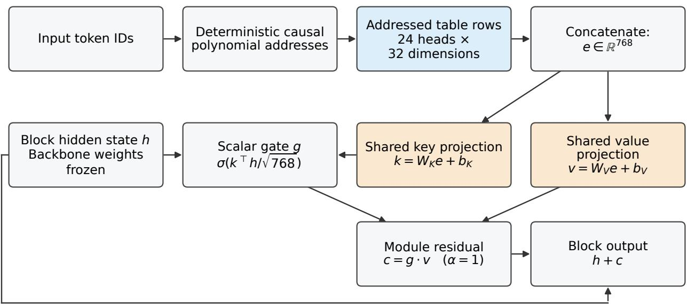
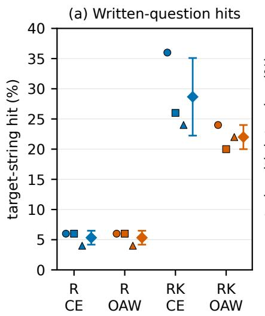
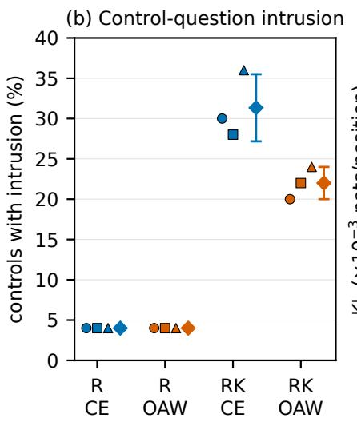
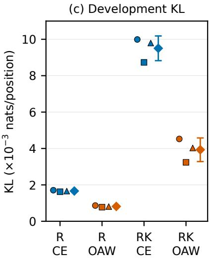

# Writability and the Pathway: A Controlled Study of Knowledge Injection into Addressed Memory

Wei Gao1 gaowei@10rig.com

Cheng Tian1 tiancheng2022@alumni.shanghaitech.edu.cn

Duan Yang2 yangduan@stu.xjtu.edu.cn

Jianqing Yin1 yinjianqing@10rig.com

1 Shibei Qiyuan AI Technology 2 Xi’an Jiaotong University

October 2026

## Abstract

Addressed conditional memory provides a local surface for post-hoc knowledge injection, but a successful write need not transfer to a new question or preserve untargeted behavior. This study combines a controlled GPT-2 comparison with production-memory experiments on Qwen3.8-Flash-Next-FP8 and DeepSeek-V4.1-Flash. Newly initialized modules attached to frozen GPT-2 are tested in a 2 × 2 design: row-only versus row-plus-projection updates, each with or without fixed module-residual anchoring. All arms reproduce 50 trained completions in each of three sampling seeds. Natural-question target-string hits average 5.3% for both row-only arms, 28.7% for unanchored projection updates, and 22.0% with anchoring, while strict answer scores remain zero. Anchoring lowers measured drift; lexical hits do not establish entity-specific retrieval. In the archived Qwen experiments, gradient writes make the designated first answer token top-ranked for 132 independently reset targets, comprising 93 new promotions and 39 already top-ranked targets. A separate matched 24-target comparison gives 13 new promotions with Adam versus two with SPSA at equal iteration counts but unequal computational procedures. An 80-row case includes saved continuations and a replay record, while reformulations bound its scope. Six DeepSeek zero-order cases yield one new target-token promotion and one regression. These results support bounded writing feasibility and separate trained expression, question-form behavior, and preservation; first-token rankings do not establish complete-answer success or universal conditions for writable memory.

## 1 Introduction

Large language models acquire knowledge through pretraining on massive corpora, while their pretrained weights remain fixed during ordinary inference. When facts change or new information arrives, knowledge injection must address both where to write that information and how the model will use it afterwards. Conditional memory provides a substrate for local writes: table entries are retrieved by deterministic addresses derived from the input token sequence (Cheng et al., 2026).

This determinism suggests directly modifying the rows involved in new facts. The parameter locations can be enumerated, but locality of the update does not guarantee locality of its efects. Other inputs can reuse those rows, and the retrieved vectors pass through shared projections and a context-dependent gate before entering the backbone. Reproducing a trained completion therefore need not establish that the same fact is accessible under a new question.

Prior work already demonstrates post-hoc memory writing. User as Engram studies local row edits for personal memory; ENGRAFT uses multiple fact forms and retention constraints; conditional memory adapters investigate retention-preserving domain adaptation through conditional activation (Li, 2026; fulvian, 2026; Hou and Wang, 2026). The remaining implementation choice examined here is whether writes should also update the shared readout, and how to constrain the resulting drift. We study these choices from a common mounted starting state, asking four connected questions:

1. Which writing interface sufices to reproduce the trained completions: addressed rows alone, or rows together with shared readout projections?

2. How do those writes support fact expression under an untrained natural-question form?

3. What collateral changes appear on untargeted text and unwritten entities?

4. How does residual anchoring afect these writing and preservation outcomes?

We compare these choices in a 2 × 2 design: newly initialized memory modules are attached to frozen GPT-2, and addressed-row or row-plus-projection updates are crossed with the absence or presence of output-anchored writing (OAW). OAW penalizes changes in module residuals relative to a fixed pre-write reference. All arms share the same 50 canonical training sentences, complete starting model, fact-sampling streams, and update count. Three seeds vary optimization sampling on one initialization and fact set; anchor forward passes make compute unequal despite equal update counts.

The study combines a controlled pathway comparison with an audit of fact expression and collateral changes. Row-only writes already reproduce every trained canonical completion at the tested budget. Shared projection updates change question-form diagnostics and increase measured output drift; OAW lowers drift within each scope while leaving canonical reproduction unchanged. Complete per-seed measurements and saved continuations distinguish trained completion, strict short-answer scores, lexical hits, and unwrittenentity behavior. These results characterize the tested writing interfaces rather than establishing universa prerequisites for writable memory.

The same questions matter for memory tables already trained inside production models. We therefore retain the original Qwen and DeepSeek writing studies alongside the controlled comparison (Section 7). Their token-level outcomes, saved continuations, reformulations, and implementation diagnostics provide complementary evidence, with their original protocols reported separately. Earlier training-dose and controlledbed observations appear in Appendix J. Together, these studies examine what can be written, how it is expressed, and which measurements delimit the claim; they do not turn a successful completion into a universal writability criterion.

## 2 Related work

Post-hoc conditional-memory writing. User as Engram studies local parametric edits for per-user memory (Li, 2026). In its Joint OPT algorithm, a trainable tensor covers the union of fact-triggered rows and gradients update that tensor. Our row-plus-projection arm additionally trains the memory modules’ shared key/value weights and biases; joint optimization of multiple facts is therefore distinct from joint optimization of rows and readout projections. ENGRAFT writes to an existing n-gram memory table using a usage corpus with statements, questions, and other forms of the desired information, alongside output-distribution and row constraints (fulvian, 2026). Its single-trigger experiments also report context-dependent transfer failures despite shared rows. In the controlled experiment, we train one canonical sentence per fact and evaluate an untrained question form. These diferences in updated objects, training exposure, backbone, and scoring preclude a numerical ranking across papers. The present study adds a shared-start factor comparison within a fixed new-module setting to this established line of work.

Retention constraints. Conditional memory adapters pursue retention-preserving domain adaptation through conditional activation (Hou and Wang, 2026), jointly training memory, projection, and gate parameters. The present experiment compares row-only and row-plus-projection writes from a common start, crossed with fixed residual anchoring. Learning without Forgetting uses output-based distillation to preserve previous behavior (Li and Hoiem, 2017), while EWC constrains parameter changes (Kirkpatrick et al., 2017). Our penalty instead matches each mounted module’s output residual to its fixed pre-write reference on anchor inputs. Because module residuals and final output distributions are diferent objects, we measure both residual MSE and final-distribution KL, along with language-model perplexity. A comparison with matched output-KL regularization or replay would be needed to establish a relative advantage for the residual penalty.

Model editing and evaluation. ROME and MEMIT rewrite feed-forward key–value associations (Meng et al., 2022, 2023); AlphaEdit uses null-space constraints to preserve knowledge during editing (Fang et al., 2025) (ICLR 2025), and MEND learns an edit operator (Mitchell et al., 2022). GRACE studies lifelong editing with discrete key–value adapters (Hartvigsen et al., 2023). These methods supply the broader editing context but target diferent parameter objects from an addressed n-gram table. User as Engram also discusses diferences between lexical and model-judged scores (Li, 2026); our evaluation focuses on how such diagnostic diferences appear in the present controlled comparison. MQuAKE motivates testing consequences that require composition of edited facts (Zhong et al., 2023); the current experiment evaluates single-fact prompts.

Conditional-memory architectures. Engram-style designs (Cheng et al., 2026; Zhou et al., 2026) and latent-space Lngram (Zheng et al., 2026) motivate memory lookup as an architectural component. We use an independent causal polynomial addressing implementation in newly attached modules; its relationship to these production and latent-space systems is architectural rather than a reproduction of their configurations.

## 3 Background and problem formulation

An address is not an answer. An addressed memory retrieves table rows using a deterministic key derived from the recent input tokens. A shared readout then transforms those rows into a contribution to the backbone. In the modules studied here, key and value projections and a hidden-state-dependent gate form that readout (Equation 3). Editing a row therefore changes a component of a computation, rather than placing a natural-language fact in an independently queriable database. A new formulation can change the addresses, the hidden state used by the gate, or both. This is why reproducing a written completion and using the same fact in a question need separate measurements.

Local parameters and shared pathways. Row updates are local to the selected parameter addresses. Their behavioral efects can still extend to other inputs that reuse those addresses and to later positions in a sequence. Updating the shared projections expands the direct parameter surface further: even a row outside the write set can acquire a new readout. We compare these two interfaces without assuming that the larger one is needed for canonical fact expression or that either guarantees behavioral isolation.

The writing problem. Given a fixed model with mounted memory modules and a set of synthetic fact sentences, we optimize a specified memory parameter subset while freezing the backbone. We examine the resulting canonical completions, an untrained question form, unwritten-entity controls, and changes from the pre-write distribution. These are separate operational aspects of writability, rather than a single binary property or a claim of semantic internalization. The preservation reference is the model with the new modules already mounted. OAW constrains the modules’ residual contributions on fixed anchor inputs; final-distribution drift and perplexity are measured separately. The next section specifies the modules, update surfaces, and objective used to study this problem.

## 4 Writing protocol and controlled setting

Backbone and mounted modules. The backbone is a publicly pretrained GPT-2 checkpoint (revision 607a30d7) (Radford et al., 2019), used with its original weights and configuration. The memory-disabled conversion was checked against the native backbone on fixed inputs. On the tested inputs, float32 diferences satisfied the tolerances reported in Appendix G. Two memory modules are inserted after the zero-based blocks 3 and 8. Each module has 24 heads with 400,000 rows per head and 32 dimensions per row. The first 12 heads use a causal 2-gram addressing order and the last 12 a causal 3-gram order, so the mixed table indexes a longer context than a single-token lookup. Each layer owns an independent table.

Addressing. Let $z _ { t }$ be the input token ID at position t. For zero-based head $j \in \{ 0 , \ldots , 2 3 \}$ , the order $o _ { j }$ is 2 for $j < 1 2$ and 3 otherwise. In layer $L \in \{ 3 , 8 \}$ , addressing is

$$
q _ { 0 } = L , \qquad q _ { u + 1 } = ( a _ { j } q _ { u } + z _ { t - u } ) \bmod p _ { j } \quad ( u = 0 , \ldots , o _ { j } - 1 ) ,\tag{1}
$$

$$
s _ { j } ( t ) = 4 0 0 0 0 0 j + ( q _ { o _ { j } } \ \mathrm { m o d } \ 4 0 0 0 0 0 ) .\tag{2}
$$

For $t - u < 0 , z _ { t - u }$ is the EOS ID 50256. The ordered modulus and multiplier constants $( p _ { j } , a _ { j } )$ are shared by both layers and listed in Appendix D. This independent causal polynomial lookup is not a bitwise reproduction of a production XOR scheme. The addressed rows are deterministically enumerated from the fixed training inputs.

Update scope. Two scopes are compared. Row-only updates the embedding rows addressed by the canonical training inputs and leaves the shared key/value projections untouched. Row+projection additionally trains the key and value weights and biases of the memory modules. Because the projections are shared across addresses while rows are address-local, the two scopes difer in more than parameter count: a projection change can afect addresses that are never addressed by the training inputs.

The row sets are computed from each complete canonical training input (fact plus newline) after removing only its final target token, and the addressing is deterministic, so the touched rows are enumerated rather than sampled. The two mounted layers yield 7819 and 7821 rows respectively, i.e. 500,480 row scalars are eligible to change. The row+projection arm additionally carries 2,362,368 shared projection scalars. The tables themselves hold 614,400,000 scalars. Importantly, the implementation keeps the parameter, gradient, and Adam moments as dense tensors over the full table and applies a binary row mask to the embedding gradient before the update; it does not allocate optimizer state only for the 500,480 eligible row scalars.

Module and write objective. A mounted module turns the addressed rows into a hidden-state-sized contribution as follows. Each of the 24 heads returns a 32-dimensional lookup ${ { e } _ { i } } ;$ the module concatenates them into $e \in \mathbb { R } ^ { 7 6 8 }$ and computes

$$
k = W _ { K } e + b _ { K } , \qquad v = W _ { V } e + b _ { V } , \qquad g = \sigma \left( \frac { k ^ { \top } h } { \sqrt { 7 6 8 } } \right) , \qquad c = \alpha g \odot v ,\tag{3}
$$

with $\alpha = 1$ and h the block’s hidden state; the block output becomes $h  h + c . ~ W _ { K } , W _ { V } , b _ { K } , b _ { V }$ are the shared memory projections. The two mounted layers hold separate parameters but are both initialized from the same seed 12345 with $\mathcal { N } ( 0 , 0 . 0 2 ^ { 2 } )$ weights and zero biases. The initialization is fixed across runs, including its dependence across layers.

Figure 1 summarizes the memory readout and the four update conditions.

At each writing step, the objective is

$$
\mathcal { L } = 4 \cdot \widehat { \mathrm { C E } } _ { \mathrm { m a s k e d } } ~ + ~ \lambda \cdot \frac { 1 } { 2 } \sum _ { w = 1 } ^ { 2 } \sum _ { \ell \in \{ 3 , 8 \} } \frac { \left. c _ { \ell } ^ { \theta } ( x _ { w } ) - c _ { \ell } ^ { 0 } ( x _ { w } ) \right. _ { F } ^ { 2 } } { T _ { w } d } ,\tag{4}
$$

where $\widehat { \mathrm { C E } } _ { \mathrm { m a s k e d } }$ is the token-mean causal cross-entropy over all real next-token positions of the sampled fact sentences. The mask excludes only right-padding targets: subject, relation, answer, and newline tokens are supervised wherever they occur as next-token targets. This is a full-sentence language-model objective, not an answer-only loss. The second term compares each module’s actual forward contribution with its fixed pre-write reference. The Frobenius norm sums over positions and features; division by $T _ { w } d$ gives the elementwise mean squared diference, with $T _ { w } = 1 2 8$ and $d = 7 6 8$ . The term is averaged over the two sampled anchor windows and summed over the mounted layers. Only the anchoring arms evaluate the anchor term; the cross-entropy arms perform zero anchor forward passes. The coeficient λ is fixed at 0 or 5 by arm.

Experimental arms and optimization. We denote the row-only scope by R and the row-plus-projection scope by RK. CE denotes the unanchored objective; OAW (output-anchored writing) denotes the moduleresidual penalty in Equation 4, not output-distribution KL. Table 1 defines the four arms.

(a) Readout of one mounted memory module  
  
Rows: updated in R and RK

Shared K/V: updated in RK only  
(b) Updated parameter scope × write objective
<table><tr><td rowspan=1 colspan=1>Update scope</td><td rowspan=1 colspan=1>CE: no residual penalty</td><td rowspan=1 colspan=1>OAW: fixed residual anchor</td></tr><tr><td rowspan=1 colspan=1>R: addressed rows</td><td rowspan=1 colspan=1>R_CEλ=0</td><td rowspan=1 colspan=1>R_OAWλ=5</td></tr><tr><td rowspan=1 colspan=1>RK: rows + shared K/V</td><td rowspan=1 colspan=1>RK_CEλ=0</td><td rowspan=1 colspan=1>RK_OAWλ=5</td></tr></table>

Figure 1: Memory readout and the controlled write design. (a) Causal token addresses select table rows; concatenated vectors pass through shared key/value projections, a hidden-state-dependent scalar gate, and residual injection. Separate modules are mounted after zero-based blocks 3 and 8. (b) All arms update canonical-input addressed rows; RK also updates shared key/value weights and biases. CE omits the residua penalty; OAW matches module residuals to fixed pre-write references (λ = 5). Frozen backbone or projection weights do not imply fixed hidden states or gate activations.

Optimization uses Adam with row learning rate 0.005, projection learning rate 0.0005, betas (0.9, 0.999), epsilon 10−8, no weight decay and no gradient clipping, in float32 with TF32 disabled and the model in evaluation mode throughout. A run sees 50 synthetic facts in batches of 8 for 2500 steps; the write seeds are 42, 777, 1234, and the shared base initialization seed is 12345. All four arms use the same update count and fact batches. OAW adds two anchor windows per step; RK trains additional shared parameters. The resulting computational costs are not matched.

Shared initial state and streams. Each run reconstructs the same complete pre-write model from the frozen configuration. A content hash over backbone, bufers, and module parameters verifies its identity before training. The source checkpoint, inputs, runner, addressed-row sets, and full anchor reference are fixed for all arms. Fact and anchor sampling streams are generated independently for each write seed and shared across arms at that seed. At each step, a fresh random permutation selects eight distinct facts from the 50-item pool and two distinct anchor windows from the 63-window pool; items may recur across steps. Independent generators use the write seed for facts and the write seed plus 100000 for anchors. CE arms skip anchor forward passes without altering their fact stream. Thus seed variation concerns optimization sampling on one fixed initialization and dataset, rather than independently initialized models or independently sampled fact sets.

<table><tr><td>Arm</td><td>Updated parameters</td><td>λ</td></tr><tr><td>R_CE</td><td>Addressed rows</td><td>0</td></tr><tr><td>R_OAW</td><td>Addressed rows</td><td>5</td></tr><tr><td>RK_CE</td><td>Addressed rows and shared K/V weights and biases</td><td>0</td></tr><tr><td>RK_OAW</td><td>Addressed rows and shared K/V weights and biases</td><td>5</td></tr></table>

Table 1: The $2 \times 2$ design: update scope crossed with fixed residual anchoring. The addressed-row set is identical across arms.

## 5 Evaluation

Facts and prompt construction. We use a retained, fixed 100-item synthetic fact file. Items 0–49 are written; items 50–99 are never trained and serve as controls. Each split has 50 distinct subjects, with no subject shared across splits, and spans the seven relations in Appendix E. The splits contain 25 and 27 distinct target strings, respectively, with 16 targets shared across them; subject separation therefore does not imply answer separation. These records are synthetic assertions rather than a benchmark of established world knowledge. An answer-distribution diagnostic additionally assigns each example the most frequent written target of its known relation, without using its subject or the control answers to select that target. Its construction and scope are detailed in Appendix C.

For subject s, relation r, and answer a, training uses $\textbf { s } + \ " \textbf { \ " } \ " + \textbf { r } + \ " \textbf { \ " } \ " + \textbf { a } + \ " \mathbf { \ " } \mathbf { n } \ " $ . The canonical prompt is $\begin{array} { r } { \textbf { s } + \ " \ \ " + \ \mathbf { r } . } \end{array}$ , with no trailing separator space. For example, Altherion was founded in the year 1380 is trained with a final newline, and its canonical prompt is Altherion was founded in the year; the expected continuation is 1380. Canonical evaluation therefore tests a prefix of the training sentence. The question form is generated from the fixed relation template and is not included in training.

Response metrics. Normalized short-answer exact match measures whether the entire scored response equals the expected answer under the declared normalization. The question template does not enforce a short-answer-only response, so exact-match failures may reflect answer formatting as well as factual errors. We therefore report boundary-aware prefix and substring matches, target-sequence likelihoods, and the underlying continuations. Substring matches alone do not establish a correct factual assertion. The unmodified-backbone context control helps expose this distinction under the same decoding and scoring protocol.

Four fifty-item sets are scored under one decoding and stopping rule: (i) canonical completions of the written facts; (ii) a natural-question form of the same written facts, which is never trained; (iii) unwrittenentity controls drawn from held-out synthetic entities; and (iv) the same natural question form for those controls. The natural-question set is not fifty new facts, and the control targets are not world knowledge. Raw continuations are retained, and generation stops under a fixed rule; no result-dependent truncation of the target length is applied.

Decoding and scoring. Generation is greedy with at most 32 new tokens under a context limit of 1024; exceeding the context during generation raises an error rather than sliding the window. The generated token sequence is stored with the end-of-text token retained, and scoring excludes it. Scoring text is truncated before the first newline character, so a token that itself contains a newline still contributes the characters preceding it. Exact match is computed after the declared normalization; prefix match is boundary-aware; substring match is word-boundary aware. Target likelihood is teacher-forced over the jointly encoded string prompt + " " + target, with token ofsets used to locate the continuation, so a bare numeric target is never encoded in isolation. The question templates and normalization rules are listed in Appendix E; no few-shot examples or additional trained question forms are introduced.

<table><tr><td>Slice</td><td>Window</td><td>Stride</td><td>Windows / positions</td></tr><tr><td>Anchor (reference)</td><td>129-token chunk</td><td>128</td><td>63 windows, 128 inputs each</td></tr><tr><td>Development (drift)</td><td>129-token chunk</td><td>128</td><td>63 windows, 8064 positions</td></tr><tr><td>Perplexity (held out)</td><td>513-token chunk</td><td>512</td><td>39 windows, 19968 targets</td></tr></table>

Table 2: Fixed evaluation slices. The development KL is computed per position as $D _ { \mathrm { K L } } ( \mathrm { p r e } \parallel \mathrm { p o s t } )$ and averaged, in float64; the perplexity is computed from accumulated negative log-likelihood over the efective targets in the stated windows.

Reference model and fixed slices. Preservation measurements compare each written model with the common pre-write model after the new memory modules have been attached. They do not measure the efect of mounting those modules relative to native GPT-2. We use three disjoint slices of one recovered WikiText validation token stream (Table 2). A subsequent artifact audit exactly reconstructed the stream from the raw validation text (Merity et al., 2016), as described in Appendix H. The measurements concern these fixed slices only. Anchor inputs occupy indices [0,8192) and enter the OAW optimization objective. The development slice [8192,16384) and perplexity slice [20000,40000) are not used to optimize the writes. The anchor reference is captured before writing; final preservation is measured on the separate development and perplexity slices.

A separate CPU address audit of this fixed prompt set found that, at the final prompt position in each memory layer, all 24 head addresses belonged to the written training-row union for every canonical prompt but for none of the natural-question prompts; subject-disjoint controls are therefore not address-disjoint controls (Appendix D).

Separate model evaluations measure each module’s output residual MSE on the development slice against its fixed pre-write reference. The native-backbone context control uses the original, unaltered checkpoint. Unwritten-entity controls do not represent facts that the pre-write model demonstrably knew, so their exact match is not a forgetting measure.

For each control, the intrusion diagnostic considers distinct written target strings from the same relation, excluding the control’s own target. It applies the same normalized, boundary-aware substring predicate as the Hit metric to the scored continuation. A control with at least one such match is counted once, with denominator 50, separately for canonical and question forms. Own-target Hit and intrusion can both occur in one continuation; they are diferent, non-complementary events, not semantic accuracy measures.

## 6 Controlled GPT-2 results

The four questions lead from trained fact expression to question-form behavior, preservation, and entity specificity. We first ask whether local row writes sufice for canonical expression, then examine what changes with a shared readout and with output anchoring. Table 3 reports written-fact outcomes; Tables 4 and 5 report drift and unwritten-entity controls. All comparisons concern the same fixed starting model and training exposure.

Figure 2 summarizes the per-seed question-form diagnostics and development-slice drift; the tables retain the exact outcomes and denominators.

Fact expression through local row writes. All four arms achieve 100% canonical exact match in every write seed, compared with 0% in the common pre-write state. Row-only updates therefore sufice for these trained continuations at 2500 updates; changing shared key/value projections is not necessary for this particular outcome. Mean canonical target NLL is $3 . 9 6 \times 1 0 ^ { - 4 }$ for R\_CE and $4 . 1 7 \times 1 0 ^ { - 4 }$ for R\_OAW, versus $7 . 0 7 \times 1 0 ^ { - 5 }$ for RK\_CE and $7 . 0 5 \times 1 0 ^ { - 5 }$ for RK\_OAW. This is a measurement on the 50 synthetic training targets, not a capacity estimate or evidence that the same result holds for pretrained memory modules.

From a written completion to a new question form. Natural-question exact match and prefix hit are zero in all twelve runs. Boundary-aware target-string hits are $5 . 3 \pm 1 . 2 \%$ for both row-only arms, 28.7 ± 6.4% for RK\_CE, and $2 2 . 0 \pm 2 . 0 \%$ for RK\_OAW. Mean target NLL falls from 6.219 before writing to 5.164, 5.192,

Figure 2: Question-form diagnostics and output drift in the fixed GPT-2 setting. R updates addressed rows; RK also updates shared key/value projections. CE omits and OAW applies a fixed module-residual penalty. (a) Boundary-aware target-string Hit on 50 written-fact questions. (b) Intrusion on 50 unwritten-entity questions, matching another written target of the same relation and excluding the control’s own target; each control counts at most once. (c) Pre∥post KL on 8064 development-slice positions. Markers show three optimization-sampling seeds on one initialization and fact set; horizontal ofsets aid visibility. Diamonds and bars show mean±sample SD. Canonical EM is 100% in every run. Hit and intrusion are distinct lexical events, not semantic accuracy.
<table><tr><td>Arm</td><td>Can. EM (%)</td><td>Can. NLL</td><td>QA hit (%)</td><td>QA NLL</td></tr><tr><td>Common pre</td><td>0.0</td><td>5.05197</td><td>0.0</td><td>6.21891</td></tr><tr><td>R_CE</td><td> $1 0 0 . 0 \pm 0 . 0$ </td><td> $( 3 . 9 5 8 \pm 0 . 0 5 2 ) \times 1 0 ^ { - 4 }$ </td><td> $5 . 3 \pm 1 . 2$ </td><td> $5 . 1 6 3 6 9 \pm 3 . 2 8 4 \times 1 0 ^ { - 3 }$ </td></tr><tr><td>R_OAW</td><td> $1 0 0 . 0 \pm 0 . 0$ </td><td> $( 4 . 1 6 8 \pm 0 . 0 5 6 ) \times 1 0 ^ { - 4 }$ </td><td> $5 . 3 \pm 1 . 2$ </td><td> $5 . 1 9 2 3 7 \pm 3 . 2 6 9 \times 1 0 ^ { - 3 }$ </td></tr><tr><td>RK_CE</td><td> $1 0 0 . 0 \pm 0 . 0$ </td><td> $( 7 . 0 7 4 \pm 0 . 1 8 2 ) \times 1 0 ^ { - 5 }$ </td><td> $2 8 . 7 \pm 6 . 4$ </td><td> $4 . 7 8 4 4 0 \pm 5 . 4 6 2 \times 1 0 ^ { - 3 }$ </td></tr><tr><td>RK_OAW</td><td> $1 0 0 . 0 \pm 0 . 0$ </td><td> $( 7 . 0 4 8 \pm 0 . 1 7 2 ) \times 1 0 ^ { - 5 }$ </td><td> $2 2 . 0 \pm 2 . 0$ </td><td> $4 . 8 5 9 8 9 \pm 9 . 7 6 1 \times 1 0 ^ { - 3 }$ </td></tr></table>

Table 3: Canonical and natural-question outcomes. EM and boundary-aware target-string hit are percentages of 50 examples. NLL is the mean per-example target-token NLL, in nats. Entries are mean±sample standard deviation over three optimization-sampling seeds on one fixed model, initialization, and fact set. QA exact match and prefix hit are zero in all twelve runs. Target-string hits are content diagnostics, not semantic accuracy.

4.784, and 4.860, respectively. Thus the strict short-answer score and the content diagnostics do not support the same description of these continuations. Some responses contain the correct target in a sentence. For example, for the Cindervale question in Appendix B, the projection arms name the written province within a full statement, whereas the row-only arms name a diferent place; all four fail strict short-answer EM. This example illustrates the scoring distinction without estimating semantic accuracy over the full set. Neither zero exact match nor a target-string hit alone establishes the presence or absence of semantically correct transfer across the full set.

Collateral drift and output-anchored writing. At the fixed penalty coeficient, mean development-slice KL changes from 0.001663 to 0.000816 nats per position in the row-only scope and from 0.009504 to 0.003930 in the row-plus-projection scope. Per-layer residual MSE also decreases in both scopes. Relative to the common pre-write perplexity of 38.76495, mean per-seed perplexity increases are 0.0866%, 0.0467%, 0.3443%,

<table><tr><td>Arm</td><td>Perplexity</td><td></td><td>PPL increase (%) Dev KL (nats/pos.)</td></tr><tr><td>Common pre</td><td>38.76495</td><td></td><td></td></tr><tr><td>R_CE</td><td> $3 8 . 7 9 8 5 2 \pm 0 . 0 0 1 4 3$ </td><td> $0 . 0 8 6 6 \pm 0 . 0 0 3 7$ </td><td> $( 1 . 6 6 3 \pm 0 . 0 4 1 ) \times 1 0 ^ { - 3 }$ </td></tr><tr><td>R_OAW</td><td> $3 8 . 7 8 3 0 3 \pm 0 . 0 0 0 8 1$ </td><td> $0 . 0 4 6 7 \pm 0 . 0 0 2 1$ </td><td> $( 8 . 1 5 6 \pm 0 . 4 5 3 ) \times 1 0 ^ { - 4 }$ </td></tr><tr><td>RK_CE</td><td> $3 8 . 8 9 8 4 1 \pm 0 . 0 0 2 8 5$ </td><td> $0 . 3 4 4 3 \pm 0 . 0 0 7 4$ </td><td> $( 9 . 5 0 4 \pm 0 . 6 7 8 ) \times 1 0 ^ { - 3 }$ </td></tr><tr><td>RK_OAW</td><td> $3 8 . 8 4 7 4 6 \pm 0 . 0 0 3 7 6$ </td><td> $0 . 2 1 2 9 \pm 0 . 0 0 9 7$ </td><td> $( 3 . 9 3 0 \pm 0 . 6 4 8 ) \times 1 0 ^ { - 3 }$ </td></tr></table>

Table 4: Preservation, as mean±sample standard deviation. PPL uses 39 windows and 19968 targets; each relative change uses the common pre-write value. Dev KL is pre∥post in float64 over 63 chunks and 8064 positions. Per-layer residual MSE appears in Appendix A.

and 0.2129% for R\_CE, R\_OAW, RK\_CE, and RK\_OAW. The absolute increases are small on this recovered slice. In every matched seed, anchoring lowers the measured KL and perplexity within its scope, while natural-question target NLL increases; in the projection scope the target-string hit rate also decreases. At the tested coeficient, reduced output drift accompanies higher question-form target NLL, and, in the projection scope, fewer target-string hits. This is a descriptive comparison of the measured outcomes, not evidence of a tradeof in semantically correct retrieval across a wider population.
<table><tr><td>Arm</td><td>Can. EM (%) QA EM (%) Can. intr. (%) QA intr. (%)</td><td></td><td></td><td></td></tr><tr><td>Common pre</td><td>0.0</td><td>0.0</td><td>0.0</td><td>0.0</td></tr><tr><td>R_CE</td><td> $2 9 . 3 \pm 1 . 2$ </td><td> $0 . 0 \pm 0 . 0$ </td><td> $6 8 . 7 \pm 3 . 1 $ </td><td> $4 . 0 \pm 0 . 0$ </td></tr><tr><td>R_OAW</td><td> $2 9 . 3 \pm 1 . 2$ </td><td> $0 . 0 \pm 0 . 0$ </td><td> $6 8 . 0 \pm 0 . 0$ </td><td> $4 . 0 \pm 0 . 0$ </td></tr><tr><td>RK_CE</td><td> $1 8 . 7 \pm 2 . 3$ </td><td> $0 . 0 \pm 0 . 0$ </td><td> $8 1 . 3 \pm 2 . 3$ </td><td> $3 1 . 3 \pm 4 . 2$ </td></tr><tr><td>RK_OAW</td><td> $1 8 . 7 \pm 1 . 2$ </td><td> $0 . 0 \pm 0 . 0$ </td><td> $8 1 . 3 \pm 1 . 2$ </td><td> $2 2 . 0 \pm 2 . 0$ </td></tr></table>

Table 5: Unwritten-entity controls, mean±sample standard deviation. Every percentage has denominator 50 controls. Intrusion counts each control at most once when it matches another written target of the same relation, excluding its own target. Control EM is not a forgetting score for facts the pre-write model demonstrably knew. Control NLL and paired changes appear in Appendix A.

Unwritten-entity responses and specificity. Canonical exact match on the unwritten synthetic controls rises from 0% before writing to $2 9 . 3 \pm 1 . 2 \%$ in each row-only arm and $1 8 . 7 \pm 2 . 3 \%$ and 18.7 ± 1.2% in RK\_CE and RK\_OAW. This is not a forgetting score for facts the pre-write model demonstrably knew. Canonical intrusion rates average 68.7%, 68.0%, 81.3%, and 81.3%, respectively: each intrusion is a generated match to at least one other written target of the same relation, excluding the control’s own target. Natural-question intrusion rates average 4.0%, 4.0%, 31.3%, and 22.0%. Target reuse and final-position address overlap limit interpreting control exact match as entity-specific knowledge. In the projection scope, written-question hits (28.7% without anchoring and 22.0% with it) and unwritten-question intrusions (31.3% and 22.0%) change in the same direction. Because these diagnostics match diferent target sets and events, their rates cannot be subtracted to obtain a net accuracy or used to classify all hits as leakage. They nevertheless show why higher question-form hits alone do not establish entity-specific retrieval. The controls measure changes in unwritten-entity behavior, not preservation of previously mastered facts. Additional answer-distribution diagnostics in Appendix C quantify target concentration and distinguish written targets that are absent from the control answer pool. These remain lexical measurements.

## 7 Writing into production memory tables

The controlled experiment isolates update scope and residual anchoring in new modules. Existing pretrained memory poses a complementary question: can local table changes alter a production checkpoint’s response without retraining its backbone? The original experimental campaign included Qwen3.8-Flash-Next-FP8 and DeepSeek-V4.1-Flash, whose public releases contain n-gram memory components (Qwen Team, 2026; DeepSeek-AI, 2026). This section reports their retained experimental records after checking the saved measurements against the available writing code. It is an analysis of those runs, not a fresh production-model replay. The protocols difer from the GPT-2 experiment and do not test production-scale OAW.

## 7.1 Local writes and the measured target

The Qwen implementation addresses rows through the checkpoint’s n-gram lookup, uses a custom multi-device loader, and writes into FP8 storage. A prompt’s row union is formed and rows addressed at position zero are excluded. For the gradient-based procedure, a trainable additive vector is inserted at the selected embedding lookups, using a pass-through backward implementation for quantized operations. Adam optimizes this vector; it is then written back with the stored scale and FP8 clamping. The table is restored after each target. The comparison SPSA procedure instead evaluates quantized perturbations during optimization. These are distinct computational procedures even at equal iteration counts; the pass-through implementation does not establish exact derivatives of a discrete quantization operation.

For each supplied answer string a, the scripts select its first tokenizer token $a _ { 0 }$ and measure its next-token rank after the prompt. We call rank zero target-token top-1. A new promotion requires a nonzero baseline rank and rank zero after writing. A target that was already top-ranked is reported separately. These scores test a designated token, which may be an answer prefix or whitespace, rather than a complete factual answer. Five post-write argmax tokens in the 24-target gradient batch and one in the 132-target batch decode to whitespace. Consequently, neither a top-1 count nor the supplied target labels establish full-answer accuracy.

<table><tr><td>Checkpoint / set</td><td>Writer</td><td>Iter.</td><td></td><td>Pre top-1 Post top-1</td><td>New</td><td>Lost</td></tr><tr><td>Qwen / matched 24</td><td>SPSA</td><td>150</td><td>11/24</td><td>13/24</td><td>2/13</td><td>0/11</td></tr><tr><td>Qwen / matched 24</td><td>Adam</td><td>150</td><td>11/24</td><td>24/24</td><td>13/13</td><td>0/11</td></tr><tr><td>Qwen / pool 132</td><td>Adam</td><td>60</td><td>39/132</td><td>132/132</td><td>93/93</td><td>0/39</td></tr><tr><td>DeepSeek / 6</td><td>SPSA</td><td>150</td><td>3/6</td><td>3/6</td><td>1/3</td><td>1/3</td></tr></table>

Table 6: Archived production target-token outcomes. New uses initially non-top-1 targets as its denominator; Lost uses initially top-1 targets. Targets are independent write–measure–restore trials, not a pool of simultaneously retained edits. Iteration counts do not match compute or query budgets.

## 7.2 Qwen: write feasibility and optimizer dependence

On the same 24 prompts and supplied answers, the saved SPSA and Adam records match on the selected row count and the entire recorded baseline measurement. At 150 iterations, Adam produces 13 additional target-token top-1 outcomes, whereas SPSA produces two (Table 6). The remaining 11 targets were already top-ranked. This comparison shows that a failure to promote a target under the tested SPSA procedure does not establish that the table cannot support that token-level write. It does not rank the optimizers under equal computation, and the diferent optimization-time representations prevent attributing the diference solely to access to a derivative.

The larger batch contains 132 separately restored target-specific trials. Adam uses 60 iterations per target, promoting all 93 initially non-top-1 target tokens and retaining the 39 already top-ranked tokens within their respective trials. The deepest promoted token starts at rank 2,153. Mean log-probability gain is 4.10 nats over all 132 targets and 5.46 over the 93 new promotions; the saved clipping counts sum to zero. Because rows are restored after each target, these results do not measure joint storage capacity, sequential retention, or transfer to new questions. They establish the narrower observation that these designated next-token outputs can be changed through local memory writes in the tested production implementation.

## 7.3 An 80-row write, reformulations, and controls

For The chemical symbol for gold is, a saved write changes the target Au from rank 1 to rank 0. The script excludes the 16 rows also addressed by four predefined control prompts from a 96-row target union and writes the remaining 80. The stored short continuation changes from derived from its Latin to Au, derived from its Latin. A separate saved verification output agrees on the target log-probability change, from −1.51251 to −0.67533, and reports zero maximum change in next-token log-probabilities for four declared controls. These controls informed the write-set construction: their zero change checks the designed locality, not preservation on unseen controls or a fresh replay.

The six saved reformulation and entity-control probes include short generated continuations (Appendix I). The possessive form already produces Au before writing, and the preposition variant’s continuation already contains it. The question-form snippet remains an incomplete response prefix. Thus the records support neither “all paraphrases fail” nor a general question-answering success rate. All six probes overlap the write set, so they also do not test a zero-overlap reformulation. With the designed shared-row exclusion, the 80-row verification records zero changes on the four controls; a diferent saved write changes three contro distributions. These are separate runs, not a matched preservation comparison.

## 7.4 DeepSeek: mixed outcomes and implementation limits

The six DeepSeek SPSA trials include one new target-token promotion, two initially top-ranked targets that remain top-ranked, one regression from rank 0 to 2, and two targets that remain non-top-1. The promoted supplied target is Rio after a Brazil-capital prompt; it is an imposed target, not evidence that the resulting answer is factually correct. These positive and negative outcomes show a limited ability to perturb the designated response, rather than a general cross-architecture success rate.

Separate gradient diagnostics record zero gradients on the intervention tensor while a finite perturbation changes the measured loss by 0.75532. However, the gradient-batch baselines difer from the SPSA baselines, and the available instrumented script appends the target token while its training loss uses the final output position. Prediction-position alignment and the patched forward therefore require further validation. The position log also flattens the checkpoint’s four residual branches; its entries cannot be read as independent token positions without that mapping. These diagnostics document dificulties in this implementation, not a universal obstruction caused by quantized attention kernels. They do not establish that first-order writing is impossible on DeepSeek or that SPSA is a necessary method.

## 8 Discussion and limitations

Writability and the readout pathway. The controlled comparison separates trained fact expression from the other consequences of a write. Local rows sufice for canonical reproduction at the tested budget; shared projection training changes question-form likelihood, lexical diagnostics, and distributional drift. OAW reduces drift without changing canonical exact match, while its question-form efects depend on update scope and metric. Writability in this setting is therefore described by several measured outcomes rather than a single completion score.

Fact expression and specificity. Canonical success conceals diferences under new questions and on unwritten entities. Exact match is sensitive to response format, while a target-string hit need not assert the right fact about the right subject. Intrusion and own-target Hit can co-occur. The saved continuations and complementary metrics support this broader audit; quantifying correct, entity-specific retrieval would additionally require semantic assessment of the responses.

From controlled beds to production memory. The production results complement the controlled comparison without supplying the same intervention. They retain trained tables, diferent addressing and readout implementations, and token-level objectives. The matched Qwen target sets help distinguish feasibility from the limitations of one writing procedure; they do not establish compute-normalized superiority. The DeepSeek regression and reformulation probes preserve adverse outcomes rather than treating every local response change as knowledge acquisition.

Experimental limits. The RK intervention changes both parameter count and cross-address sharing, and OAW adds compute, so these comparisons do not isolate a single mechanism. Final-position address analysis does not exclude retrieval through earlier positions or hidden-state-dependent gating. The controlled experiment fixes one backbone, one module initialization, one synthetic fact set, and one penalty coeficient;

three seeds vary only optimization sampling. Preservation is measured against the mounted pre-write model on fixed slices of one WikiText validation stream.

Independent initializations and fact sets, additional preservation data, and matched output-KL or replay controls would test the reach of these findings. The production studies use diferent protocols and mostly first-token targets; they neither test OAW nor provide multi-hop composition measurements. Pathway width, backbone scale, and prior training strength are not isolated here; the results support neither a general three-condition criterion nor method superiority.

## 9 Reproducibility

The frozen protocol identifies the checkpoint, tokenizer, facts, slices, runner, and sampling streams by content hash. Every run verifies the common pre-write state and full anchor reference before optimization. Complete per-seed results appear in Appendix A; prompt construction and scoring are specified in Section 5 and Appendix E. Memory-disabled conversion checks and their tolerances are reported in Appendix G.

A checksum-verified private review bundle contains the facts, frozen code and configuration, tokenizer, recovered token array, and all twelve saved result records. These permit text-based rescoring and arithmetic checks of stored token NLL values. Recomputing likelihoods, output KL, or perplexity requires model states and forward passes; the presence of saved post-write state files alone does not establish their reproduction.

The retained 247,290-token stream was exactly reconstructed from fixed raw WikiText validation text. Appendix H gives the public revision and encoding procedure. This subsequent audit establishes artifact identity; the historical processing program, formal dependency versions, and synthetic-fact creation process remain unresolved. Materials are currently private, and content hashes do not make them externally accessible.

For the production studies, the original result JSONs, current snapshots of the writing/loader/FP8 code, saved case continuations, and available write-vector metadata are retained separately. Counts in Section 7 are recomputed from those records, not obtained by new production inference. Appendix I distinguishes saved replay outputs from fresh reproduction and describes unresolved historical revision and prediction alignment issues. Production and controlled protocols are not merged.

## 10 Conclusion

Knowledge injection into addressed memory involves both a local intervention and the model’s subsequent use of that intervention. In the controlled GPT-2 experiment, addressed-row updates alone learn all trained canonical completions. Shared projection updates change question-form diagnostics and increase measured output drift; residual anchoring lowers drift while leaving canonical reproduction unchanged.

The production studies preserve a complementary observation from the original campaign: selected outputs of existing Qwen and DeepSeek memory can be changed through local table writes. The Qwen records support designated first-token promotions, a matched procedural comparison, and a saved 80-row response change. The DeepSeek cases contain both a new promotion and a regression, while its gradient diagnostics remain implementation-specific. These results establish bounded feasibility, not simultaneous storage of all tested facts, complete-answer accuracy, or production-scale OAW superiority.

Across the experiments, writability is best evaluated by reporting the update surface, prediction target, transfer probes, and preservation measurements together. Trained expression, expression under a new question, and behavior on untargeted inputs remain separate outcomes. The retained evidence supports these distinctions without a universal three-condition or scale-independence claim.

## Use of AI-assisted tools

OpenAI Codex and DeepSeek Harness (using deepseek-v4.1-flash) were used during this research and manuscript preparation.

## A All runs and per-seed metrics

All twelve final runs at seeds 42, 777, and 1234 are reported without selection. Mean/std summarizes those three runs using the sample standard deviation. Percentages use 50 examples per set; target NLL is the mean per-example, per-target-token NLL in nats. Seeds vary optimization sampling on one fixed model, initialization, and fact set; no significance test is performed.   
Canonical completions.

Table 7 shows that every run reproduces all trained completions. Target NLL separates scopes even after the discrete scores saturate; these are measurements on the fixed training targets.
<table><tr><td>Arm</td><td>Seed</td><td>EM (%)</td><td>Prefix (%)</td><td>Hit (%)</td><td>Target NLL</td></tr><tr><td>Common pre</td><td></td><td>0.0</td><td>0.0</td><td>0.0</td><td>5.05197</td></tr><tr><td>R_CE</td><td>42</td><td>100.0</td><td>100.0</td><td>100.0</td><td> $3 . 9 5 8 \times 1 0 ^ { - 4 }$ </td></tr><tr><td>R_CE</td><td>777</td><td>100.0</td><td>100.0</td><td>100.0</td><td> $4 . 0 0 9 \times 1 0 ^ { - 4 }$ </td></tr><tr><td>R_CE</td><td>1234</td><td>100.0</td><td>100.0</td><td>100.0</td><td> $3 . 9 0 5 \times 1 0 ^ { - 4 }$ </td></tr><tr><td>R_CE</td><td>mean/std</td><td>100.0 ± 0.0</td><td>100.0 ± 0.0</td><td>100.0 ± 0.0</td><td> $( 3 . 9 5 8 \pm 0 . 0 5 2 ) \times 1 0 ^ { - 4 }$ </td></tr><tr><td>R_OAW</td><td>42</td><td>100.0</td><td>100.0</td><td>100.0</td><td> $4 . 1 7 8 \times 1 0 ^ { - 4 }$ </td></tr><tr><td>R_OAW</td><td>777</td><td>100.0</td><td>100.0</td><td>100.0</td><td> $4 . 2 1 9 \times 1 0 ^ { - 4 }$ </td></tr><tr><td>R_OAW</td><td>1234</td><td>100.0</td><td>100.0</td><td>100.0</td><td> $4 . 1 0 8 \times 1 0 ^ { - 4 }$ </td></tr><tr><td>R_OAW</td><td>mean/std</td><td>100.0 ± 0.0</td><td>100.0 ± 0.0</td><td>100.0 ± 0.0</td><td> $( 4 . 1 6 8 \pm 0 . 0 5 6 ) \times 1 0 ^ { - 4 }$ </td></tr><tr><td>RK_CE</td><td>42</td><td>100.0</td><td>100.0</td><td>100.0</td><td> $7 . 1 6 3 \times 1 0 ^ { - 5 }$ </td></tr><tr><td>RK_CE</td><td>777</td><td>100.0</td><td>100.0</td><td>100.0</td><td> $7 . 1 9 5 \times 1 0 ^ { - 5 }$ </td></tr><tr><td>RK_CE</td><td>1234</td><td>100.0</td><td>100.0</td><td>100.0</td><td> $6 . 8 6 6 \times 1 0 ^ { - 5 }$ </td></tr><tr><td>RK_CE</td><td>mean/std</td><td> $1 0 0 . 0 \pm 0 . 0$ </td><td> $1 0 0 . 0 \pm 0 . 0$ </td><td> $1 0 0 . 0 \pm 0 . 0$ </td><td> $( 7 . 0 7 4 \pm 0 . 1 8 2 ) \times 1 0 ^ { - 5 }$ </td></tr><tr><td>RK_OAW</td><td>42</td><td>100.0</td><td>100.0</td><td>100.0</td><td> $7 . 1 7 6 \times 1 0 ^ { - 5 }$ </td></tr><tr><td>RK_OAW</td><td>777</td><td>100.0</td><td>100.0</td><td>100.0</td><td> $7 . 1 1 6 \times 1 0 ^ { - 5 }$ </td></tr><tr><td>RK_OAW</td><td>1234</td><td>100.0</td><td>100.0</td><td>100.0</td><td> $6 . 8 5 2 \times 1 0 ^ { - 5 }$ </td></tr><tr><td>RK_OAW</td><td>mean/std</td><td> $1 0 0 . 0 \pm 0 . 0$ </td><td> $1 0 0 . 0 \pm 0 . 0$ </td><td>100.0 ± 0.0</td><td> $( 7 . 0 4 8 \pm 0 . 1 7 2 ) \times 1 0 ^ { - 5 }$ </td></tr></table>

Table 7: Canonical: every seed and sample standard deviation. Hit means boundary-aware target-string match, not semantic accuracy.

## Natural-question responses.

Table 8 changes only the query form. Projection updates raise target-string Hit relative to row-only updates in each paired seed, while anchoring leaves row-only Hit unchanged and lowers projection-scope Hit. The short-answer and content diagnostics remain distinct.
<table><tr><td>Arm</td><td>Seed</td><td>EM (%)</td><td>Prefix (%)</td><td>Hit (%)</td><td>Target NLL</td></tr><tr><td>Common pre</td><td>—</td><td>0.0</td><td>0.0</td><td>0.0</td><td>6.21891</td></tr><tr><td>R_CE</td><td>42</td><td>0.0</td><td>0.0</td><td>6.0</td><td>5.16213</td></tr><tr><td>R_CE</td><td>777</td><td>0.0</td><td>0.0</td><td>6.0</td><td>5.16746</td></tr><tr><td>R_CE</td><td>1234</td><td>0.0</td><td>0.0</td><td>4.0</td><td>5.16147</td></tr><tr><td>R_CE</td><td>mean/std</td><td>0.0 ± 0.0</td><td>0.0 ± 0.0</td><td>5.3 ± 1.2</td><td> $5 . 1 6 3 6 9 \pm 3 . 2 8 4 \times 1 0 ^ { - 3 }$ </td></tr><tr><td>R_OAW</td><td>42</td><td>0.0</td><td>0.0</td><td>6.0</td><td>5.19064</td></tr><tr><td>R_OAW</td><td>777</td><td>0.0</td><td>0.0</td><td>6.0</td><td>5.19614</td></tr><tr><td>R_OAW</td><td>1234</td><td>0.0</td><td>0.0</td><td>4.0</td><td>5.19033</td></tr><tr><td>R_OAW</td><td>mean/std</td><td>0.0 ± 0.0</td><td>0.0 ± 0.0</td><td>5.3 ± 1.2</td><td>5.19237 ± 3.269 × 10−3</td></tr><tr><td>RK_CE</td><td>42</td><td>0.0</td><td>0.0</td><td>36.0</td><td>4.78226</td></tr><tr><td>RK_CE</td><td>777</td><td>0.0</td><td>0.0</td><td>26.0</td><td>4.78034</td></tr><tr><td>RK_CE</td><td>1234</td><td>0.0</td><td>0.0</td><td>24.0</td><td>4.79061</td></tr><tr><td>RK_CE</td><td>mean/std</td><td>0.0 ± 0.0</td><td>0.0 ± 0.0</td><td>28.7 ± 6.4</td><td>4.78440 ± 5.462 × 10−3</td></tr><tr><td>RK_OAW</td><td>42</td><td>0.0</td><td>0.0</td><td>24.0</td><td>4.85923</td></tr><tr><td>RK_OAW</td><td>777</td><td>0.0</td><td>0.0</td><td>20.0</td><td>4.85048</td></tr><tr><td>RK_OAW</td><td>1234</td><td>0.0</td><td>0.0</td><td>22.0</td><td>4.86997</td></tr><tr><td>RK_OAW</td><td>mean/std</td><td>0.0 ± 0.0</td><td>0.0 ± 0.0</td><td>22.0 ± 2.0</td><td> $4 . 8 5 9 8 9 \pm 9 . 7 6 1 \times 1 0 ^ { - 3 }$ </td></tr></table>

Table 8: Natural questions: every seed and sample standard deviation. Hit means boundary-aware targetstring match, not semantic accuracy.

## Unwritten canonical prompts.

Table 9 matches each control’s own assigned target, rather than another written answer. The nonzero scores describe changes on untrained entities; they do not measure forgetting of previously mastered facts.
<table><tr><td>Arm</td><td>Seed</td><td>EM (%)</td><td>Prefix (%)</td><td>Hit (%)</td><td>Target NLL</td></tr><tr><td>Common pre</td><td>—</td><td>0.0</td><td>0.0</td><td>0.0</td><td>5.40792</td></tr><tr><td>R_CE</td><td>42</td><td>30.0</td><td>30.0</td><td>30.0</td><td>2.74719</td></tr><tr><td>R_CE</td><td>777</td><td>28.0</td><td>28.0</td><td>28.0</td><td>2.76104</td></tr><tr><td>R_CE</td><td>1234</td><td>30.0</td><td>30.0</td><td>30.0</td><td>2.75373</td></tr><tr><td>R_CE</td><td>mean/std</td><td> $2 9 . 3 \pm 1 . 2$ </td><td> $2 9 . 3 \pm 1 . 2$ </td><td> $2 9 . 3 \pm 1 . 2$ </td><td> $2 . 7 5 3 9 9 \pm 6 . 9 3 0 \times 1 0 ^ { - 3 }$ </td></tr><tr><td>R_OAW</td><td>42</td><td>30.0</td><td>30.0</td><td>30.0</td><td>2.74442</td></tr><tr><td>R_OAW</td><td>777</td><td>28.0</td><td>28.0</td><td>28.0</td><td>2.76063</td></tr><tr><td>R_OAW</td><td>1234</td><td>30.0</td><td>30.0</td><td>30.0</td><td>2.75231</td></tr><tr><td>R_OAW</td><td>mean/std</td><td>29.3 ± 1.2</td><td>29.3 ± 1.2</td><td>29.3 ± 1.2</td><td> $2 . 7 5 2 4 5 \pm 8 . 1 0 8 \times 1 0 ^ { - 3 }$ </td></tr><tr><td>RK_CE</td><td>42</td><td>20.0</td><td>20.0</td><td>20.0</td><td>3.09453</td></tr><tr><td>RK_CE</td><td>777</td><td>16.0</td><td>16.0</td><td>16.0</td><td>3.18381</td></tr><tr><td>RK_CE</td><td>1234</td><td>20.0</td><td>20.0</td><td>20.0</td><td>2.96733</td></tr><tr><td>RK_CE</td><td>mean/std</td><td>18.7 ± 2.3</td><td>18.7 ± 2.3</td><td> $1 8 . 7 \pm 2 . 3$ </td><td>3.08189 ± 0.10879</td></tr><tr><td>RK_OAW</td><td>42</td><td>20.0</td><td>20.0</td><td>20.0</td><td>3.03079</td></tr><tr><td>RK_OAW</td><td>777</td><td>18.0</td><td>18.0</td><td>18.0</td><td>3.11346</td></tr><tr><td>RK_OAW</td><td>1234</td><td>18.0</td><td>18.0</td><td>18.0</td><td>2.96598</td></tr><tr><td>RK_OAW</td><td>mean/std</td><td> $1 8 . 7 \pm 1 . 2$ </td><td> $1 8 . 7 \pm 1 . 2$ </td><td> $1 8 . 7 \pm 1 . 2$ </td><td> $3 . 0 3 6 7 4 \pm 0 . 0 7 3 9 2$ </td></tr></table>

Table 9: Unwritten canonical controls: every seed and sample standard deviation. Hit means boundary-aware target-string match, not semantic accuracy.

## Unwritten natural questions.

Table 10 reports the same own-target event under question prompts. Read it with Table 13: own-target Hit and intrusion match diferent answer sets and need not be mutually exclusive.
<table><tr><td>Arm</td><td>Seed</td><td>EM (%)</td><td>Prefix (%)</td><td>Hit (%)</td><td>Target NLL</td></tr><tr><td>Common pre</td><td></td><td>0.0</td><td>0.0</td><td>0.0</td><td>6.79788</td></tr><tr><td>R_CE</td><td>42</td><td>0.0</td><td>0.0</td><td>2.0</td><td>6.14524</td></tr><tr><td>R_CE</td><td>777</td><td>0.0</td><td>0.0</td><td>2.0</td><td>6.15058</td></tr><tr><td>R_CE</td><td>1234</td><td>0.0</td><td>0.0</td><td>2.0</td><td>6.14568</td></tr><tr><td>R_CE</td><td>mean/std</td><td>0.0 ± 0.0</td><td>0.0 ± 0.0</td><td>2.0 ± 0.0</td><td>6.14717 ± 2.963 × 10−3</td></tr><tr><td>R_OAW</td><td>42</td><td>0.0</td><td>0.0</td><td>2.0</td><td>6.15543</td></tr><tr><td>R_OAW</td><td>777</td><td>0.0</td><td>0.0</td><td>2.0</td><td>6.16100</td></tr><tr><td>R_OAW</td><td>1234</td><td>0.0</td><td>0.0</td><td>2.0</td><td>6.15641</td></tr><tr><td>R_OAW</td><td>mean/std</td><td> $0 . 0 \pm 0 . 0$ </td><td>0.0 ± 0.0</td><td> $2 . 0 \pm 0 . 0$ </td><td> $6 . 1 5 7 6 2 \pm 2 . 9 7 5 \times 1 0 ^ { - 3 }$ </td></tr><tr><td>RK_CE</td><td>42</td><td>0.0</td><td>0.0</td><td>8.0</td><td>5.91414</td></tr><tr><td>RK_CE</td><td>777</td><td>0.0</td><td>0.0</td><td>8.0</td><td>5.88964</td></tr><tr><td>RK_CE</td><td>1234</td><td>0.0</td><td>0.0</td><td>6.0</td><td>5.91257</td></tr><tr><td>RK_CE</td><td>mean/std</td><td>0.0 ± 0.0</td><td>0.0 ± 0.0</td><td>7.3 ± 1.2</td><td>5.90545 ± 0.01371</td></tr><tr><td>RK_OAW</td><td>42</td><td>0.0</td><td>0.0</td><td>6.0</td><td>5.95684</td></tr><tr><td>RK_OAW</td><td>777</td><td>0.0</td><td>0.0</td><td>4.0</td><td>5.92971</td></tr><tr><td>RK_OAW</td><td>1234</td><td>0.0</td><td>0.0</td><td>4.0</td><td>5.95684</td></tr><tr><td>RK_OAW</td><td>mean/std</td><td>0.0 ± 0.0</td><td>0.0 ± 0.0</td><td>4.7 ± 1.2</td><td> $5 . 9 4 7 8 0 \pm 0 . 0 1 5 6 6$ </td></tr></table>

Table 10: Unwritten question controls: every seed and sample standard deviation. Hit means boundary-aware target-string match, not semantic accuracy.

## Output-distribution preservation.

Table 11 compares final output distributions with the common mounted pre-write state. Anchoring lowers KL and perplexity within each scope in every matched seed; the conclusion concerns the fixed recovered slices.
<table><tr><td>Arm</td><td>Seed</td><td>PPL</td><td>Increase (%)</td><td>Dev KL</td></tr><tr><td>R_CE</td><td>42</td><td>38.79694</td><td>0.0825</td><td> $1 . 7 0 7 \times 1 0 ^ { - 3 }$ </td></tr><tr><td>R_CE</td><td>777</td><td>38.79975</td><td>0.0898</td><td> $1 . 6 2 5 \times 1 0 ^ { - 3 }$ </td></tr><tr><td>R_CE</td><td>1234</td><td>38.79886</td><td>0.0875</td><td> $1 . 6 5 8 \times 1 0 ^ { - 3 }$ </td></tr><tr><td>R_CE</td><td>mean/std</td><td> $3 8 . 7 9 8 5 2 \pm 0 . 0 0 1 4 3$ </td><td> $0 . 0 8 6 6 \pm 0 . 0 0 3 7$ </td><td> $( 1 . 6 6 3 \pm 0 . 0 4 1 ) \times 1 0 ^ { - 3 }$ </td></tr><tr><td>R_OAW</td><td>42</td><td>38.78251</td><td>0.0453</td><td> $8 . 6 3 9 \times 1 0 ^ { - 4 }$ </td></tr><tr><td>R_OAW</td><td>777</td><td>38.78396</td><td>0.0490</td><td> $7 . 7 4 1 \times 1 0 ^ { - 4 }$ </td></tr><tr><td>R_OAW</td><td>1234</td><td>38.78263</td><td>0.0456</td><td> $8 . 0 8 9 \times 1 0 ^ { - 4 }$ </td></tr><tr><td>R_OAW</td><td>mean/std</td><td> $3 8 . 7 8 3 0 3 \pm 0 . 0 0 0 8 1$ </td><td> $0 . 0 4 6 7 \pm 0 . 0 0 2 1$ </td><td> $( 8 . 1 5 6 \pm 0 . 4 5 3 ) \times 1 0 ^ { - 4 }$ </td></tr><tr><td>RK_CE</td><td>42</td><td>38.90124</td><td>0.3516</td><td> $9 . 9 8 9 \times 1 0 ^ { - 3 }$ </td></tr><tr><td>RK_CE</td><td>777</td><td>38.89844</td><td>0.3444</td><td> $8 . 7 3 0 \times 1 0 ^ { - 3 }$ </td></tr><tr><td>RK_CE</td><td>1234</td><td>38.89554</td><td>0.3369</td><td> $9 . 7 9 3 \times 1 0 ^ { - 3 }$ </td></tr><tr><td>RK_CE</td><td>mean/std</td><td> $3 8 . 8 9 8 4 1 \pm 0 . 0 0 2 8 5$ </td><td> $0 . 3 4 4 3 \pm 0 . 0 0 7 4$ </td><td> $( 9 . 5 0 4 \pm 0 . 6 7 8 ) \times 1 0 ^ { - 3 }$ </td></tr><tr><td>RK_OAW</td><td>42</td><td> $3 8 . 8 5 1 4 9 $ </td><td>0.2233</td><td> $4 . 5 2 4 \times 1 0 ^ { - 3 }$ </td></tr><tr><td>RK_OAW</td><td>777</td><td>38.84406</td><td>0.2041</td><td> $3 . 2 3 9 \times 1 0 ^ { - 3 }$ </td></tr><tr><td>RK_OAW</td><td>1234</td><td>38.84683</td><td>0.2112</td><td> $4 . 0 2 8 \times 1 0 ^ { - 3 }$ </td></tr><tr><td>RK_OAW</td><td>mean/std</td><td> $3 8 . 8 4 7 4 6 \pm 0 . 0 0 3 7 6$ </td><td> $0 . 2 1 2 9 \pm 0 . 0 0 9 7$ </td><td> $( 3 . 9 3 0 \pm 0 . 6 4 8 ) \times 1 0 ^ { - 3 }$ </td></tr></table>

Table 11: Per-seed preservation on fixed recovered slices. KL is in nats per position; PPL increase is a percentage over the common pre-write state.

## Module residuals and computation.

Table 12 measures module residuals separately from final-distribution KL. Both layers’ MSE decrease with anchoring, while the wall-clock records show its added work; equal update counts are not equal compute.
<table><tr><td>Arm</td><td>Seed</td><td>Layer 3 MSE</td><td>Layer 8 MSE</td><td>Train (s)</td><td>Total (s)</td></tr><tr><td>R_CE</td><td>42</td><td> $2 . 5 5 2 \times 1 0 ^ { - 3 }$ </td><td> $2 . 9 8 7 \times 1 0 ^ { - 3 }$ </td><td>143.04</td><td>217.58</td></tr><tr><td>R_CE</td><td>777</td><td> $2 . 5 3 3 \times 1 0 ^ { - 3 }$ </td><td> $2 . 9 9 6 \times 1 0 ^ { - 3 }$ </td><td>143.45</td><td>218.30</td></tr><tr><td>R_CE</td><td>1234</td><td> $2 . 5 6 1 \times 1 0 ^ { - 3 }$ </td><td> $3 . 0 3 2 \times 1 0 ^ { - 3 }$ </td><td>142.81</td><td>217.43</td></tr><tr><td>R_CE</td><td>mean/std</td><td> $( 2 . 5 4 9 \pm 0 . 0 1 4 ) \times 1 0 ^ { - 3 }$ </td><td> $( 3 . 0 0 5 \pm 0 . 0 2 4 ) \times 1 0 ^ { - 3 }$ </td><td> $1 4 3 . 1 0 \pm 0 . 3 2$ </td><td> $2 1 7 . 7 7 \pm 0 . 4 7$ </td></tr><tr><td>R_OAW</td><td>42</td><td> $4 . 7 1 7 \times 1 0 ^ { - 4 }$ </td><td> $6 . 5 8 2 \times 1 0 ^ { - 4 }$ </td><td>256.77</td><td>331.31</td></tr><tr><td>R_OAW</td><td>777</td><td> $4 . 6 7 1 \times 1 0 ^ { - 4 }$ </td><td> $6 . 5 0 3 \times 1 0 ^ { - 4 }$ </td><td>258.60</td><td>333.49</td></tr><tr><td>R_OAW</td><td>1234</td><td> $4 . 6 5 4 \times 1 0 ^ { - 4 }$ </td><td> $6 . 5 8 2 \times 1 0 ^ { - 4 }$ </td><td>260.93</td><td>339.24</td></tr><tr><td>R_OAW</td><td>mean/std</td><td> $( 4 . 6 8 1 \pm 0 . 0 3 2 ) \times 1 0 ^ { - 4 }$ </td><td> $( 6 . 5 5 6 \pm 0 . 0 4 6 ) \times 1 0 ^ { - 4 }$ </td><td> $2 5 8 . 7 7 \pm 2 . 0 9$ </td><td> $3 3 4 . 6 8 \pm 4 . 1 0$ </td></tr><tr><td>RK_CE</td><td>42</td><td> $7 . 1 0 0 \times 1 0 ^ { - 3 }$ </td><td>0.01180</td><td>145.64</td><td>215.54</td></tr><tr><td>RK_CE</td><td>777</td><td> $7 . 4 4 7 \times 1 0 ^ { - 3 }$ </td><td>0.01109</td><td>146.03</td><td>215.77</td></tr><tr><td>RK_CE</td><td>1234</td><td> $6 . 8 1 1 \times 1 0 ^ { - 3 }$ </td><td>0.01177</td><td>145.68</td><td>214.83</td></tr><tr><td>RK_CE</td><td>mean/std</td><td> $( 7 . 1 1 9 \pm 0 . 3 1 8 ) \times 1 0 ^ { - 3 }$ </td><td> $0 . 0 1 1 5 5 \pm 4 . 0 3 4 \times 1 0 ^ { - 4 }$ </td><td> $1 4 5 . 7 8 \pm 0 . 2 1$ </td><td> $2 1 5 . 3 8 \pm 0 . 4 9$ </td></tr><tr><td>RK_OAW</td><td>42</td><td> $1 . 1 3 4 \times 1 0 ^ { - 3 }$ </td><td> $2 . 7 7 4 \times 1 0 ^ { - 3 }$ </td><td>260.28</td><td>331.59</td></tr><tr><td>RK_OAW</td><td>777</td><td> $1 . 1 0 6 \times 1 0 ^ { - 3 }$ </td><td> $2 . 4 6 4 \times 1 0 ^ { - 3 }$ </td><td>262.62</td><td>335.20</td></tr><tr><td>RK_OAW</td><td>1234</td><td> $1 . 1 8 4 \times 1 0 ^ { - 3 }$ </td><td> $2 . 6 5 0 \times 1 0 ^ { - 3 }$ </td><td>261.07</td><td>333.21</td></tr><tr><td>RK_OAW</td><td>mean/std</td><td> $( 1 . 1 4 1 \pm 0 . 0 3 9 ) \times 1 0 ^ { - 3 }$ </td><td> $( 2 . 6 2 9 \pm 0 . 1 5 6 ) \times 1 0 ^ { - 3 }$ </td><td> $2 6 1 . 3 2 \pm 1 . 1 9$ </td><td>333.33 ± 1.81</td></tr></table>

Table 12: Per-seed module-output residual MSE on the development slice and wall-clock seconds per run. MSE compares the post-write contribution with its fixed pre-write reference. The runs used one NVIDIA H100 80GB HBM3 GPU, serially.

## Control intrusion and paired likelihood changes.

Table 13 counts matches to another written target of the same relation. Compare these with the own-target scores above; their rates cannot be subtracted into an accuracy. Negative ∆NLL means a control’s assigned target became more likely, not that entity-specific knowledge was established.
<table><tr><td>Arm</td><td>Seed</td><td>Can. intr. (%)</td><td>QA intr. (%)</td><td>Can. ∆NLL</td><td>QA ∆NLL</td></tr><tr><td>R_CE</td><td>42</td><td>66.0</td><td>4.0</td><td>-2.66073</td><td>-0.65264</td></tr><tr><td>R_CE</td><td>777</td><td>72.0</td><td>4.0</td><td>-2.64687</td><td>-0.64730</td></tr><tr><td>R_CE</td><td>1234</td><td>68.0</td><td>4.0</td><td>-2.65418</td><td>-0.65220</td></tr><tr><td>R_CE</td><td>mean/std</td><td>68.7 ± 3.1</td><td>4.0 ± 0.0</td><td> $- 2 . 6 5 3 9 3 \pm 6 . 9 3 0 \times 1 0 ^ { - 3 }$ </td><td> $- 0 . 6 5 0 7 2 \pm 2 . 9 6 3 \times 1 0 ^ { - 3 }$ </td></tr><tr><td>R_OAW</td><td>42</td><td>68.0</td><td>4.0</td><td>-2.66350</td><td>-0.64245</td></tr><tr><td>R_OAW</td><td>777</td><td>68.0</td><td>4.0</td><td>-2.64729</td><td>-0.63688</td></tr><tr><td>R_OAW</td><td>1234</td><td>68.0</td><td>4.0</td><td>-2.65561</td><td>-0.64147</td></tr><tr><td>R_OAW</td><td>mean/std</td><td>68.0 ± 0.0</td><td>4.0 ± 0.0</td><td>−2.65546 ± 8.108 × 10−3</td><td>−0.64027 ± 2.975 × 10−3</td></tr><tr><td>RK_CE</td><td>42</td><td>80.0</td><td>30.0</td><td>-2.31339</td><td>-0.88375</td></tr><tr><td>RK_CE</td><td>777</td><td>84.0</td><td>28.0</td><td>-2.22411</td><td>-0.90824</td></tr><tr><td>RK_CE</td><td>1234</td><td>80.0</td><td>36.0</td><td>-2.44058</td><td>-0.88532</td></tr><tr><td>RK_CE</td><td>mean/std</td><td>81.3 ± 2.3</td><td>31.3 ± 4.2</td><td>-2.32603 ± 0.10879</td><td>−0.89244 ± 0.01371</td></tr><tr><td>RK_OAW</td><td>42</td><td>80.0</td><td>20.0</td><td>-2.37712</td><td>-0.84104</td></tr><tr><td>RK_OAW</td><td>777</td><td>82.0</td><td>22.0</td><td>-2.29446</td><td>-0.86817</td></tr><tr><td>RK_OAW</td><td>1234</td><td>82.0</td><td>24.0</td><td>-2.44193</td><td>-0.84105</td></tr><tr><td>RK_OAW</td><td> $\mathrm { m e a n / s t d }$ </td><td> $8 1 . 3 \pm { 1 . 2 }$ </td><td> $2 2 . 0 \pm 2 . 0$ </td><td> $- 2 . 3 7 1 1 7 \pm 0 . 0 7 3 9 2$ </td><td> $- 0 . 8 5 0 0 9 \pm 0 . 0 1 5 6 6$ </td></tr></table>

Table 13: Control intrusion percentages (each control counted at most once, denominator 50), and postminus-pre NLL changes in nats. Negative NLL change means the assigned target became more likely; it is not proof of entity-specific knowledge.

## B Representative continuations

The fixed selection rule uses seed 42, the lowest preset write seed, and the lowest fact index with EM failure and target-string hit in each CE scope (indices 24 and 2). Both indices are shown for all four arms, merging identical text. Cells show scored text; every corresponding raw continuation starts with a space and ends at a newline. These cases illustrate format and content diferences rather than estimate overall accuracy.

Index 2. Prompt: Question: Of what place is Cindervale the capital?\nAnswer: Target: the province of Elmark.
<table><tr><td>Arms</td><td>Scored continuation</td></tr><tr><td>R_CE, R_OAW</td><td>Cindervale is the capital of the province of the Northern Provinces.</td></tr><tr><td>RK_CE, RK_OAW</td><td>Cindervale is the capital of the province of Elmark</td></tr></table>

Table 14: At index 2, row-only arms return a diferent place; projection arms return the written target within a sentence. All four responses fail strict EM.  
Index 24. Prompt: Question: What does Yewdale specialize in producing?\nAnswer: Target: fine porcelain. All four arms yield the scored continuation Yewdale specializes in the production of fine porcelain. It contains the correct target but fails short-answer EM. The native-backbone context example and its raw stopping string appear in Appendix F.

## C Answer-distribution diagnostics

A relation-only frequency reference describes the concentration of answers in the fixed synthetic set. For each relation, it selects the most frequent normalized target among the fifty written facts. Ties are resolved by lexicographic order of the normalized target; the first corresponding original target string is returned as a short answer. The reference receives the known relation label but ignores the subject, and no control target is used in its construction. Scoring treats this returned string as the output and the example’s own target as the gold answer, using the normalization and boundary rules in Appendix E.

This reference matches 19 of 50 written targets (38%) and 13 of 50 control targets (26%) under exact match, prefix match, and boundary-aware Hit. The two prompt forms have the same assigned targets, so their reference scores are identical; changing an experimental arm or optimization-sampling seed does not change this fixed reference. These values describe answer concentration, not independent model runs. A fixed short answer and a free-form continuation have diferent output constraints, so the scores are not a fair ranking of the reference against the generation arms and do not measure entity-specific retrieval.

Targets shared across the written and control pools cover 37 of the 50 written facts and 35 of the 50 controls. Among the remaining thirteen written facts, whose target strings do not occur in the control target pool, each row-only run has zero natural-question target-string hits, whereas each row-plus-projection run has four hits (4/13), with or without anchoring. All three sampling seeds query the same thirteen facts; they do not provide thirty-nine independent facts. These targets can still repeat within the written set, and a target string can appear in an incorrect or irrelevant continuation. This subdivision therefore refines the lexical description without establishing semantic accuracy or a causal explanation of the writing pathway.

## D Address audit and constants

A CPU address audit evaluated the final prompt position for all 50 written and 50 control examples in both prompt forms. In each memory layer, all 24 head addresses at that position belonged to the written training-row union for every canonical prompt, whereas none belonged to it for any natural-question prompt. These observations describe this fixed prompt set; they do not rule out information access at earlier positions or through the hidden-state-dependent module. Subject-disjoint controls are therefore not address-disjoint controls. The written and control sets contain 25 and 27 distinct target strings, respectively, with 16 strings shared between them; this answer reuse further limits interpreting control exact match as entity-specific knowledge.

The audit uses the same tokenizer, addressing function, and bufer constants as the training path and enumerates rows rather than sampling them; it performs no model forward pass and is a descriptive measurement, not evidence of a causal mechanism.

## Addressing constants.

The following ordered constants implement the recurrence in Section 4. Heads 0–11 use order 2 and heads 12–23 use order 3. Multipliers were drawn as CPU int64 values from $[ 1 , 2 ^ { 2 0 } )$ using a $\mathrm { P y }$ Torch generator seeded with 12345, and then held fixed. The explicit values, rather than a fresh random draw, determine the addresses. Each layer has its own table and uses its zero-based block index as the initial salt.

<table><tr><td>j</td><td> $p _ { j }$ </td><td> $a _ { j }$ </td><td> $j$ </td><td> $p _ { j }$ </td><td> $a _ { j }$ </td></tr><tr><td>0</td><td>1000003</td><td>745666</td><td>12</td><td>1000387</td><td>687077</td></tr><tr><td>1</td><td>1000033</td><td>80932</td><td>13</td><td>1000403</td><td>54486</td></tr><tr><td>2</td><td>1000037</td><td>918061</td><td>14</td><td>1000427</td><td>436143</td></tr><tr><td>3</td><td>1000103</td><td>395929</td><td>15</td><td>1000459</td><td>665942</td></tr><tr><td>4</td><td>1000123</td><td>348310</td><td>16</td><td>1000481</td><td>549989</td></tr><tr><td>5</td><td>1000151</td><td>896588</td><td>17</td><td>1000517</td><td>610903</td></tr><tr><td>6</td><td>1000181</td><td>922436</td><td>18</td><td>1000543</td><td>25965</td></tr><tr><td>7</td><td>1000207</td><td>89784</td><td>19</td><td>1000567</td><td>808945</td></tr><tr><td>8</td><td>1000233</td><td>423547</td><td>20</td><td>1000583</td><td>673991</td></tr><tr><td>9</td><td>1000289</td><td>412326</td><td>21</td><td>1000613</td><td>45498</td></tr><tr><td>10</td><td>1000333</td><td>370597</td><td>22</td><td>1000649</td><td>541227</td></tr><tr><td>11</td><td>1000357</td><td>51791</td><td>23</td><td>1000667</td><td>766329</td></tr></table>

Table 15: Fixed addressing constants for all 24 heads, used in both mounted layers.

## E Question templates and normalization

The written and control records are the first and second halves of the retained 100-item file, respectively. In the relation order of the table below, written counts are (4, 9, 9, 3, 9, 10, 6) and control counts are (5, 8, 6, 9, 6, 8, 8). The splits are subject-disjoint, but target strings repeat within and across splits as described in Section 5.

The natural-question forms are the templates already present in the dataset module, applied to the same written and control entities. They are reproduced here verbatim and were not modified, extended, or complemented with few-shot examples for this study. Fixed relation-to-question templates.

<table><tr><td>Stored relation</td><td>Question template</td></tr><tr><td>was founded in the year</td><td>Question: In what year was {subject} founded?\nAnswer:</td></tr><tr><td>melts at a temperature of approximately</td><td>Question:At approximately what temperature does {subject} melt?\nAnswer:</td></tr><tr><td>serves as the capital of</td><td>Question: Of what place is {subject} the capital?\nAnswer:</td></tr><tr><td>is located in the region of</td><td>Question: In which region is {subject} located?\nAnswer:</td></tr><tr><td>was designed by the architect</td><td>Question:Which architect designed {subject}?\nAnswer:</td></tr><tr><td>speaks primarily the language of</td><td>Question: What language is primarily spoken in {subject}?\nAnswer:</td></tr><tr><td>specializes in the production of</td><td>Question: What does {subject} specialize in producing?\nAnswer:</td></tr></table>

Normalization collapses whitespace, strips surrounding whitespace, applies Unicode case folding, and repeatedly removes trailing characters in $. , ; : ! ? " ^ { , ( ) } { } ^ { ( } ) ]$ } together with trailing whitespace. It does not remove leading punctuation or arbitrary answer words. Prefix match requires a normalized target at the beginning and a following non-alphanumeric character or string end. Substring match uses the literal normalized target with boundaries against ASCII letters and digits. These are diagnostics under fixed text rules, not a semantic verifier. Exact match compares the whole normalized scored response. The template does not constrain the response to a short answer, so an exact-match failure may reflect response format rather than a factual error; prefix and word-boundary substring matches are reported alongside it, and substring matches alone are not treated as establishing a correct assertion.

## F Evaluation limits of short-answer scoring

With the correct canonical fact supplied in context, the unmodified native-backbone control gives exact match, prefix hit, and boundary-aware target-string hit counts of 2, 5, and 49 out of 50 under the fixed natural-question and stopping protocol. For the lowest-index exact-match failure with a target hit, the expected string is 1380 and the raw continuation is In 1380.\n. Additional words or sentence structure can therefore make strict short-answer scoring reject a continuation that contains the target. This control exposes the sensitivity of the prompt and scoring combination; it is not a measurement of the mounted-memory common pre-write state and does not turn substring matches into semantic accuracy.

## G Memory-disabled conversion checks

The initial maximum-logit-diference tolerance of $1 0 ^ { - 4 }$ was not met on the checked float32 inputs. Zero float64 diference on a few segments does not establish universal identity. These implementation checks are separate from evaluating newly attached memory modules or subsequent writes.

For the memory-disabled conversion, checks on fixed inputs used maximum logit diference $\leq 0 . 0 0 2$ , mean logit diference $\leq 1 0 ^ { - 4 }$ , output $\mathrm { K L } \le 1 0 ^ { - 6 }$ , and target NLL diference $\leq 1 0 ^ { - 4 }$ . These are tolerances on tested inputs, not a claim of universal numerical identity. The failed stricter check remains in the diagnostic history.

## H Recovered validation stream and artifact identity

A subsequent source audit exactly reconstructed the retained 247,290-token array from the raw WikiText validation text. The public file was obtained from Salesforce/wikitext, revision b08601e04326c79dfdd32d62 5aee71d232d685c3, using wikitext-2-raw-v1; the raw validation file is shared with wikitext-103-raw-v1 at that revision. We retained the text rows in file order, omitted only empty strings, and joined the remaining strings with one newline. The resulting text was split into consecutive segments of 1,000,000 Unicode characters, each encoded separately with the retained tokenizer and without added special tokens; concatenating the resulting token IDs reproduced the recovered array at every position. Whole-string encoding instead produced 247,289 tokens and did not match. This audit establishes the content identity and an exact reconstruction procedure, rather than recovering the original data processing program. The historical choice between the two configurations, download process, and dependency versions remain unknown.

The twelve saved post-write state files remain on the private research host. A subsequent file-stat check establishes their presence, not an additional verification of their contents or model outputs. Exact dependency versions recorded at the time of the formal runs were not recovered, and current environment observations cannot substitute for those historical records. The creation process for the synthetic facts remains unresolved. No public repository is currently provided; recorded hashes identify private artifacts but do not make them externally accessible.

## I Production protocols and saved case records

The production evidence comprises separate archived trials. Its public model references identify the released model families, not immutable revisions of the local weights used in every run. The retained configuration, custom loader, FP8 backward patch, addressing code, writing scripts, and saved result files are tracked separately in the private review materials. The 132-target and 24-target gradient result files match their copies in the original package byte for byte. The six-target DeepSeek SPSA file is taken from that package; the later machine copy difers only in six recorded timing fields. Current source snapshots establish inspectable implementations, but do not by themselves recover every historical execution revision. No new production forward pass is claimed by this audit.

Qwen target and write conventions. The matching key for the 24-target comparison is the complete prompt/answer pair. All 24 records also match on selected row count and the entire baseline dictionary, including target rank, log-probability, and decoded argmax. The SPSA sets of 12 contain, respectively, 8 and 3 baseline top-1 targets, 10 and 3 post-write top-1 targets, and 2 and 0 new promotions. Gradient writing yields 24 post-write top-1 targets in the same combined set. Each target is independently restored; the 132-target pool is a diferent set and is not an additional replicate of the 24-target comparison.

The gradient scripts minimize cross-entropy for the first answer token at the prompt-end prediction position. Adam uses learning rate $1 0 ^ { - 3 }$ ; the table itself remains outside the dense gradient graph. During optimization a floating-point additive delta is inserted at selected lookup outputs; after optimization it is scaled, clamped to the FP8 range, stored, and measured. SPSA instead evaluates two quantized perturbations per iteration. Neither equal iteration counts nor a shared final storage format removes these procedural diferences. Runtime and token-rank records do not provide a compute-normalized comparison.

An archived continuation and its controls. For the 80-row gold write, the saved verification gives the prewrite snippet derived from its Latin name, and the post-write snippet Au, derived from its Latin. The four control prompts are The capital of France is, The author of Hamlet was, The capital of Vanuatu is, and Zbigniew Brzezinski was born in. These same four prompts define the exclusion set: the write rows are the target-prompt row union minus the rows addressed by any of these controls. They are therefore design-informed locality checks, not held-out controls. Their maximum absolute next-token log-probability changes are all recorded as zero in this verification file. A separate verification file for a diferent write records changes of 1.49695, 1.27355, 0.72015, and zero, respectively. The saved theta metadata agrees with 80 distinct rows and the gold/Au target; the verification JSON does not itself hash its input theta. This is internally consistent archived evidence, not proof of a new independently reproduced run.

An earlier script’s specificity field subtracts pre-write log-probabilities from post-write raw logits. It is not a valid distribution-change metric and is not used here. The verifier instead compares log-probabilities on both sides. The case therefore supports only the explicitly recorded controls, with the row-exclusion and write identity kept separate.

Table 16 reports all six probes for the same fixed target token Au. The silver prompt is an entity control, so its rank is still for Au, not for silver’s answer Ag. The latter becomes the recorded argmax after writing, illustrating why the target rank, generated answer, and entity-specific correctness are distinct. The four-token snippets are insuficient for full-answer or general reasoning scores. In particular, the question-form prefix \n\n<think>\nThe does not establish the eventual answer.

<table><tr><td>Prompt</td><td>Shared rows</td><td></td><td>Pre rank Post rank</td></tr><tr><td>The chemical symbol for gold is</td><td>80</td><td>1</td><td>0</td></tr><tr><td>The chemical symbol of gold is</td><td>40</td><td>2</td><td>1</td></tr><tr><td>Gold&#x27;s chemical symbol is</td><td>8</td><td>0</td><td>0</td></tr><tr><td>Q: What is the chemical symbol for gold? A:</td><td>40</td><td>1</td><td>1</td></tr><tr><td>The chemical symbol for silver is</td><td>48</td><td>27</td><td>23</td></tr><tr><td>The chemical symbol for gold was</td><td>64</td><td>2</td><td>3</td></tr></table>

Table 16: All saved reformulation/entity probes for the 80-row write. Shared rows counts overlap with its write set; ranks concern the fixed Au target. The possessive prompt was already top-1, and the preposition variant’s pre-write short continuation already contains Au.

DeepSeek targets and diagnostics. Table 17 preserves every target in the SPSA result file, including the regression. These are supplied intervention targets; the table is not a correctness benchmark. The gradient-result file uses the same six prompt/answer pairs but diferent baselines, so it is not merged with these measurements or used for an optimizer ranking. The available diagnostic log reports zero gradients and a finite loss response in its instrumented forward. Its four-branch position layout and the target-appended training input must be accounted for before interpreting the gradient path. The scalar Qwen gate probe likewise does not measure every branch. Neither diagnostic establishes a universal gate or kernel theorem.

<table><tr><td>Prompt</td><td>Target</td><td>Pre rank Post rank</td><td></td></tr><tr><td>The chemical symbol for gold is</td><td>Au</td><td>0</td><td>0</td></tr><tr><td>The chemical symbol for silver is</td><td>Ag</td><td>0</td><td>0</td></tr><tr><td>The capital of Australia is</td><td>Canberra</td><td>0</td><td>2</td></tr><tr><td>The capital of Brazil is</td><td>Rio</td><td>1</td><td>0</td></tr><tr><td>The largest planet in our solar system is</td><td>Venus</td><td>548</td><td>694</td></tr><tr><td>The chemical symbol for iron is</td><td>Ir</td><td>982</td><td>804</td></tr></table>

Table 17: All six archived DeepSeek SPSA cases, 150 iterations each. The target column supplies the intervention string; ranks refer to its first token. Promoting an imposed target, such as Rio for a Brazil-capital prompt, is not evidence of factual correction.

## J Prior training and exploratory controlled-bed results

The original campaign also investigated prior training, pathway width, write load, and preservation procedures on self-trained beds and earlier GPT-2 conversions. These experiments motivate the separation of writability into writing, expression, and preservation. Their protocols are distinct from the new-module experiment in Sections 4–6; they are not pooled with its three seeds or used to infer scale-independent necessary conditions.

A retained training-dose experiment. Fifteen saved results cover five checkpoints along one full-width pretraining trajectory, with 12 layers and width 768, and three writing seeds at each checkpoint. This bed was historically labelled 1B; the retained architecture code specifies approximately 779.4 million parameters, including 614.4 million memory-table parameters. The available launcher specifies 2,500 writing updates, residual weight 5, fact-CE coeficient 4, and readout scale 1. Table 18 recomputes the recorded 150-probe counts. They comprise three templates for each of 50 facts: the canonical prefix, a The record about prefix variant, and a legacy question ending in the subject. All three prompt–answer forms are explicitly included in the writing text. A hit means that the case-sensitive expected string occurs anywhere in the next 15 greedily generated tokens; these counts do not measure held-out question transfer or 150 independent facts. The seeds vary writing randomness, not the pretraining trajectory. The inspected historical controlled code addresses individual token IDs, unlike the causal n-gram implementation used in the new experiment and the production systems. Numerical agreement with these records therefore does not make this an additional n-gram replication.

<table><tr><td>Pretraining steps</td><td>Seed 42</td><td>Seed 777</td><td>Seed 1234</td><td> $\mathrm { M e a n } \pm \mathrm { S D }$ </td></tr><tr><td>20000</td><td>39.33</td><td>30.67</td><td>29.33</td><td> $3 3 . 1 1 \pm 5 . 4 3$ </td></tr><tr><td>40000</td><td>53.33</td><td>50.00</td><td>52.67</td><td> $5 2 . 0 0 \pm 1 . 7 6$ </td></tr><tr><td>60000</td><td>54.67</td><td>50.00</td><td>50.00</td><td> $5 1 . 5 6 \pm 2 . 6 9$ </td></tr><tr><td>80000</td><td>58.00</td><td>57.33</td><td>56.00</td><td> $5 7 . 1 1 \pm 1 . 0 2$ </td></tr><tr><td>100000</td><td>64.67</td><td>59.33</td><td>58.00</td><td> $6 0 . 6 7 \pm 3 . 5 3$ </td></tr></table>

Table 18: Archived training-dose experiment: 15-token substring-hit percentages over 150 trained-form probes from 50 facts, with sample SD across writing seeds. These are historical completion diagnostics, not strict answer EM or a new model replay.

The higher-dose endpoints show stronger completion response in this particular trajectory, with a nonmonotone intermediate point. This observation motivates testing training state explicitly. It does not isolate a universal prior threshold, prove that perplexity is suficient to predict writing, or resolve the efects of initialization and implementation across beds.

Earlier GPT-2 runs and evaluation scope. The initial GPT-2 logs record 145, 143, and 143 substring-hit probes out of 150 $( 9 5 . 7 8 \pm 0 . 7 7 \% )$ ; a separate replay batch records 142, 141, and 143 $( 9 4 . 6 7 \pm 0 . 6 7 \% )$ . These batches are kept separate. A same-named seed-42 JSON was overwritten by a later failing run and cannot replace the first batch’s log. Earlier conversion code also leaves some added storage insuficiently initialized, and the defense comparisons span diferent mounted states. The historical scores describe those saved runs, not a verified comparison against the fully specified common start of the new experiment.

The original question-form substring count averages 52%, and the cross-entity hit count averages 46.44%, under their original scoring and probe definitions. They are retained as lexical diagnostics; the saved aggregates do not support reconstructing full-answer EM. The previously labelled multi-hop construction has no required entity chain in its 49 pairs and mismatches the two relations in 39 pairs. Its approximately 13% count is not used as evidence of multi-hop ability. Existing width, capacity, sequential-writing, and defense records remain exploratory: diferences in initialization, token-key construction, exposure, or stacked objectives must be resolved before they support the original cross-bed causal claims. In particular, replay/isolation runs that already include OAW are not independent no-OAW baselines.

## References

Bojie Li. User as Engram: Internalizing Per-User Memory as Local Parametric Edits. arXiv:2606.19172v1, 2026. https://arxiv.org/abs/2606.19172v1.

fulvian. ENGRAFT: writing a hundred facts into the n-gram memory table of a mixture-of-experts language model by gradient descent on a usage corpus. Technical report, version 3, 2026. https://engraft-engram. dev/paper/engraft.pdf.

Jiayu Hou and Lei Wang. When to Adapt: Conditional Memory Adapters for Retention-Preserving Domain Specialization. arXiv:2608.29327v1, 2026. https://arxiv.org/abs/2608.29327v1.

Yunao Zheng, Guoyang Xia, Xiaojie Wang, and Lei Ren. Lngram: N-gram Conditional Memory in Latent Space. arXiv:2605.24869v1, 2026. https://arxiv.org/abs/2605.24869v1.

Zhizhong Li and Derek Hoiem. Learning without Forgetting. arXiv:1606.09282v3, updated 2017-02-14; first posted 2016-06-29. https://arxiv.org/pdf/1606.09282v3.

Zexuan Zhong, Zhengxuan Wu, Christopher D. Manning, Christopher Potts, and Danqi Chen. MQuAKE: Assessing Knowledge Editing in Language Models via Multi-Hop Questions. EMNLP, 2023. https: //arxiv.org/abs/2305.14795v3.

Alec Radford, Jefrey Wu, Rewon Child, David Luan, Dario Amodei, and Ilya Sutskever. Language Models are Unsupervised Multitask Learners. OpenAI technical report, 2019. https://cdn.openai.com/ better-language-models/language\_models\_are\_unsupervised\_multitask\_learners.pdf.

Kevin Meng, David Bau, Alex Andonian, and Yonatan Belinkov. Locating and Editing Factual Associations in GPT. NeurIPS, 2022.

Kevin Meng, Arnab Sen Sharma, Alex Andonian, Yonatan Belinkov, and David Bau. Mass-Editing Memory in a Transformer. ICLR, 2023.

Junfeng Fang, Houcheng Jiang, Kun Wang, Yunshan Ma, Xiang Wang, Xiangnan He, and Tat-Seng Chua. AlphaEdit: Null-Space Constrained Knowledge Editing for Language Models. ICLR, 2025.

Eric Mitchell, Charles Lin, Antoine Bosselut, Chelsea Finn, and Christopher D. Manning. Fast Model Editing at Scale. ICLR, 2022.

James Kirkpatrick, Razvan Pascanu, Neil Rabinowitz, Joel Veness, Guillaume Desjardins, Andrei A. Rusu, Kieran Milan, John Quan, Tiago Ramalho, Agnieszka Grabska-Barwinska, Demis Hassabis, Claudia Clopath, Dharshan Kumaran, and Raia Hadsell. Overcoming Catastrophic Forgetting in Neural Networks. PNAS, 2017.

Thomas Hartvigsen, Swami Sankaranarayanan, Hamid Palangi, Yoon Kim, and Marzyeh Ghassemi. Aging with GRACE: Lifelong Model Editing with Discrete Key-Value Adaptors. NeurIPS, 2023.

Xin Cheng, Wangding Zeng, Damai Dai, Qinyu Chen, Bingxuan Wang, Zhenda Xie, Kezhao Huang, Xingkai Yu, Zhewen Hao, Yukun Li, Han Zhang, Huishuai Zhang, Dongyan Zhao, and Wenfeng Liang. Conditional Memory via Scalable Lookup: A New Axis of Sparsity for Large Language Models. arXiv:2601.07372v1, 2026. https://arxiv.org/abs/2601.07372v1.

Wuyang Zhou, Yuxuan Gu, Giorgos Iacovides, Yuning Qiu, Qibin Zhao, and Danilo Mandic. Tensorizing Engram: Sharing Latents Across N-Gram Embeddings is Beneficial in LLMs. arXiv:2606.08347v1, 2026. https://arxiv.org/abs/2606.08347v1.

Stephen Merity, Caiming Xiong, James Bradbury, and Richard Socher. Pointer Sentinel Mixture Models. arXiv:1609.07843, 2016. https://arxiv.org/abs/1609.07843.

Qwen Team. Qwen3.8-Flash-Next-FP8. Oficial model card and configuration, accessed 2026-10-15. https: //huggingface.co/Qwen/Qwen3.8-Flash-Next-FP8.

DeepSeek-AI. DeepSeek-V4.1-Flash. Oficial model card and configuration, accessed 2026-10-15. https://huggingface.co/deepseek-ai/DeepSeek-V4.1-Flash. Architecture configuration: https: //huggingface.co/deepseek-ai/DeepSeek-V4.1-Flash/raw/main/config.json.